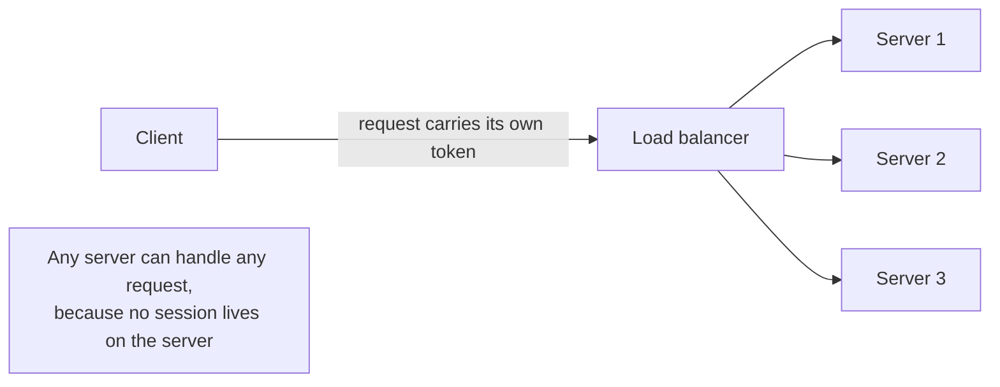
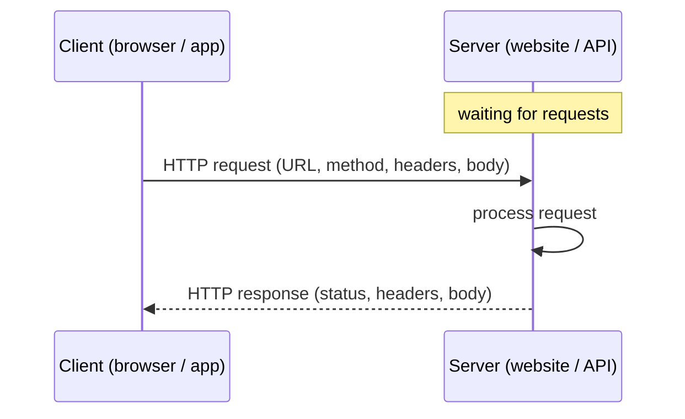
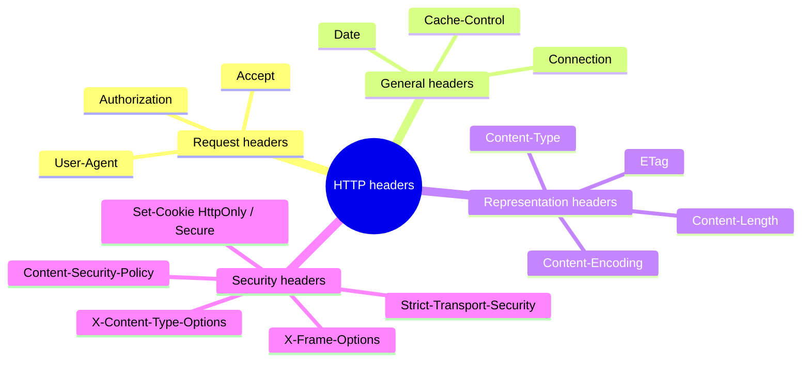
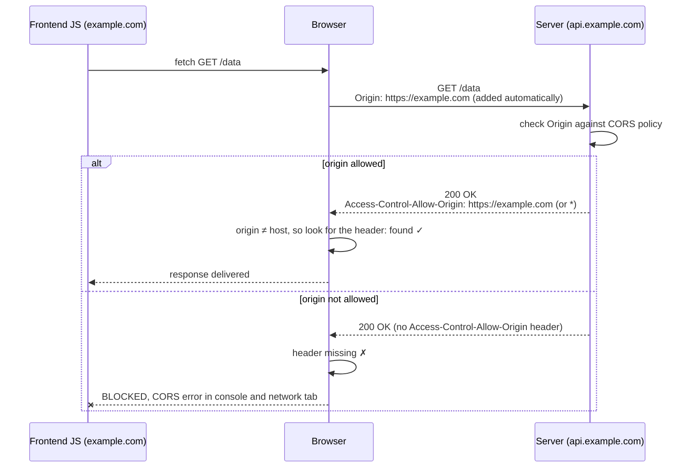
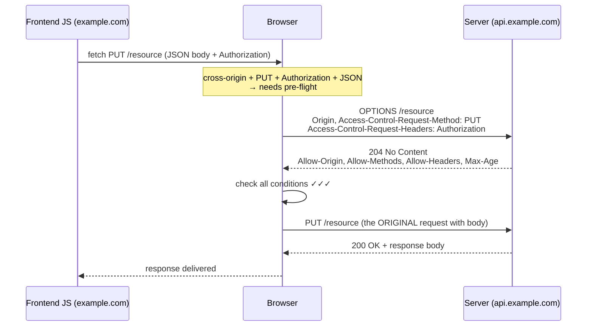
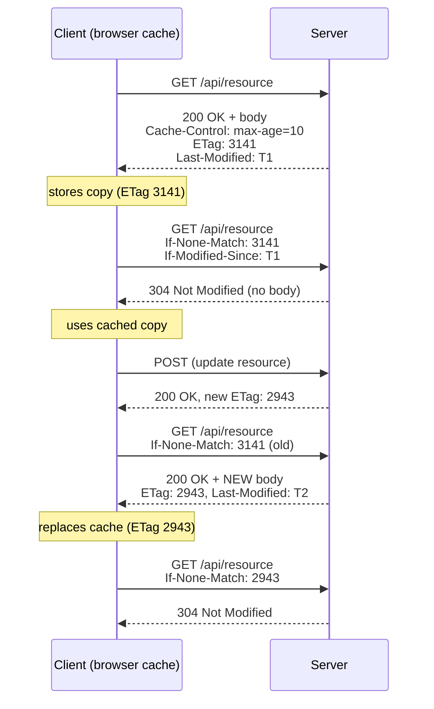
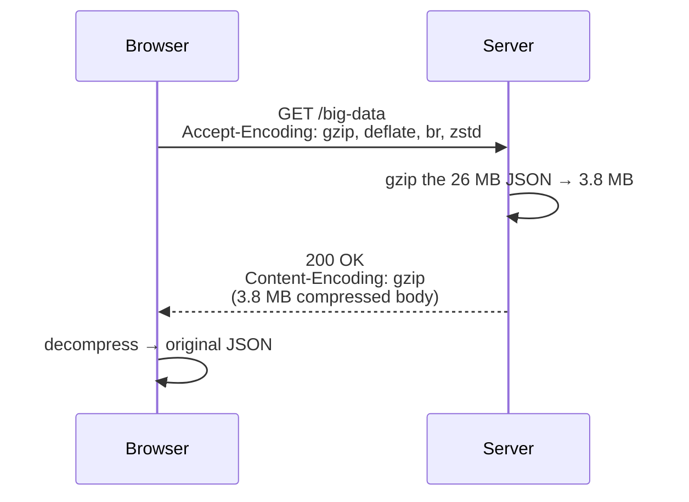
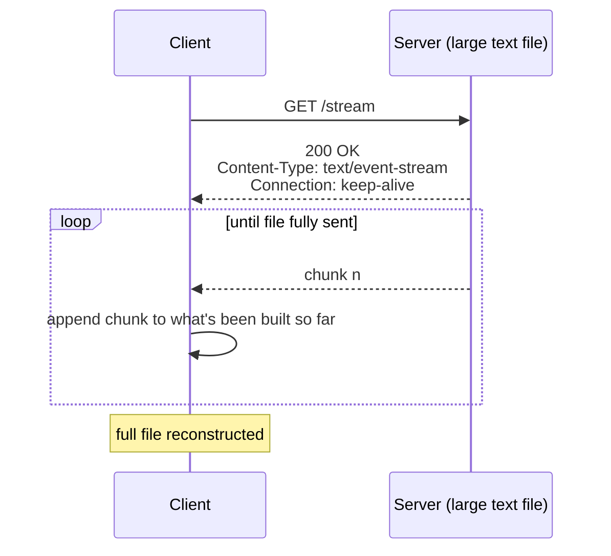
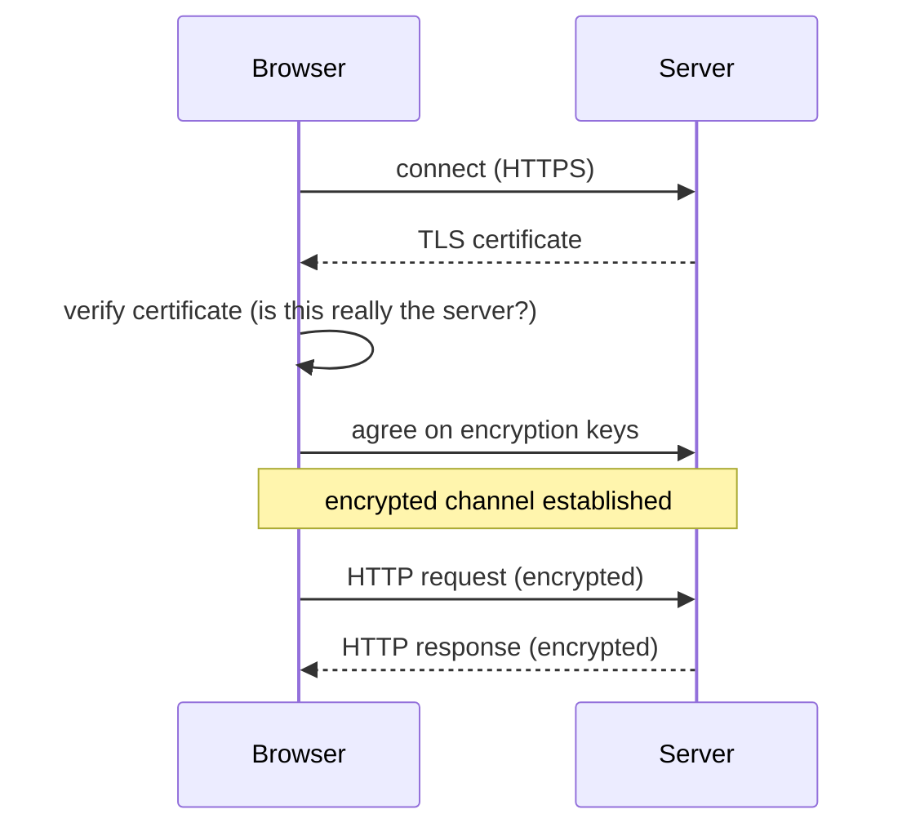

# My Notes: Understanding HTTP for Backend Engineers

> **Source:** "5. Understanding HTTP for backend engineers, where it all starts" by Sriniously (YouTube, Sep 27, 2024, 1:18:13)
> **Link:** https://www.youtube.com/watch?v=a3C1DMswClQ
>
> I wrote these from the video's full caption track. The diagrams are my own versions of what he shows and describes on screen (messages, OSI model, CORS flows, caching, etc.). They aren't copies of his slides.

---

## 1. Why I'm starting with HTTP

- Backend is huge. If I tried to study every possible component, I'd be stuck for years.
- So the plan is to focus on topics used in most codebases (roughly 90% of them).
- HTTP is the medium my browser uses to talk to servers, both to send data and to receive it.
- Clients and servers communicate in plenty of other ways and protocols too, but HTTP is one of the most used, so it comes first.

---

## 2. The two core ideas

### 2.1 Statelessness

**What it means:** HTTP has **no memory of past interactions**.

- Every request I send has to carry **everything** the server needs to process it: URL, method, headers.
- Once the server responds, it **forgets** the request.
- If I send another request, the server treats it as a **new and unrelated event**.

**Self-contained requests:** since the server doesn't remember anything, each request must include its own auth tokens or session info.
- Example: to fetch my user profile, I have to send my credentials (cookies or a token) **on every request** so the server knows who's asking.

```
Request 1:  GET /profile   + Cookie/Token  ──►  Server processes, responds, forgets
Request 2:  GET /profile   + Cookie/Token  ──►  Server treats it as brand new
            (I must send the token AGAIN, because the server has no memory of request 1)
```

**Why stateless is good:**

| Benefit | Why |
|---|---|
| **Simplicity** | The server doesn't store session info, which would cost extra resources and complexity |
| **Scalability** | Requests can go to any of several servers, since no single server has to track a session |
| **Resilience** | If a server crashes, no client session state needs restoring, because none was kept |



**The catch:** because HTTP is stateless, I add state on top of it where I need continuity (logins, shopping carts) using **cookies, sessions, or tokens**. A later video in the series covers these.

### 2.2 Client–server model

In every HTTP flow there's always a **client** and a **server**.

- **Client:** usually a web browser or an app.
  - It **starts** the communication by sending a request.
  - It provides everything the server needs: resource URL, headers, etc.
- **Server:** hosts resources (websites, APIs, other content).
  - It **waits** for incoming requests.
  - It processes each one and sends back a response: a web page, data, an error message, a JSON file, a text file, or any other content.



**Rule to remember:** in HTTP, **communication is always initiated by the client**. The server only responds.

**HTTP vs HTTPS:** for this whole topic I can treat them as interchangeable. Oversimplified, HTTPS is HTTP with more security (encryption, security certificates, TLS). The underlying principles are the same, and the security details lean into network engineering.

---

## 3. Transport layer and the OSI model

Before any request or response can happen, client and server need a **connection**, a medium to communicate over.

- HTTP uses **TCP** for this.
- Strictly, HTTP doesn't need the transport to be *connection-based*. It only needs it to be **reliable**: it shouldn't lose messages, or at minimum it should report an error when it does.
- Of the two most common internet transport protocols, **TCP and UDP**, TCP is the more reliable one.
- So HTTP relies on TCP, which **is** connection-based.
- TCP sets up connections with a **3-way handshake**. That's something to look up separately if I'm curious.

```
TCP 3-way handshake (for my own reference)

Client                    Server
  │ ──── SYN ───────────────► │
  │ ◄─── SYN-ACK ──────────── │
  │ ──── ACK ───────────────► │
  │   connection established  │
  │ ════ HTTP messages ══════ │
```

### The OSI model
This model comes up whenever people talk about sending and receiving data over a network.

```
┌─────────────────────────────┐
│ 7. Application  ← HTTP lives here; this is MY layer as a backend engineer
├─────────────────────────────┤
│ 6. Presentation             │  (TLS encryption discussions border here)
├─────────────────────────────┤
│ 5. Session                  │
├─────────────────────────────┤
│ 4. Transport    ← TCP / UDP (handshakes, connections)
├─────────────────────────────┤
│ 3. Network      ← IP        │
├─────────────────────────────┤
│ 2. Data Link                │
├─────────────────────────────┤
│ 1. Physical                 │
└─────────────────────────────┘
```

- As a backend engineer I mostly deal with **Layer 7, the application layer**.
- Topics like the TCP handshake, establishing connections, and TLS encryption (which came up in the previous video) border on the lower layers. Those are mostly **network engineering** concepts.
- They're good to know, but going deep is a rabbit hole. So I focus on the application layer and only skim the network side: HTTP uses TCP, and TCP uses a 3-way handshake.

---

## 4. How HTTP evolved

Over the years, each HTTP version changed how clients and servers send and receive data.

| Version | Key changes |
|---|---|
| **HTTP/1.0** | Each request opened a **new connection**, which had to be set up and torn down for every request/response. Inefficient and slow. |
| **HTTP/1.1** | **Persistent connections**: multiple requests and responses over the **same TCP connection** that was already open. Big performance boost. Also added **chunked transfer encoding** and **better caching**. |
| **HTTP/2.0** | **Multiplexing**: multiple requests/responses at once over one connection. **Binary framing** instead of text. **Header compression (HPACK)**. **Server push**, where the server sends resources before the client asks. |
| **HTTP/3.0** | Built on **QUIC**, a transport protocol over **UDP** instead of TCP. Faster connection setup, lower latency, better packet-loss handling. Keeps multiplexing **without head-of-line blocking**, which is still a problem in HTTP/2. |

```
HTTP/1.0   [open]─req─res─[close]  [open]─req─res─[close]  [open]─req─res─[close]

HTTP/1.1   [open]─req─res─req─res─req─res─────────────────────────────[close]
                    (one persistent TCP connection, requests one after another)

HTTP/2     [open]═╦═ stream 1: req/res ═══
                  ╠═ stream 2: req/res ═══   (multiplexed, binary frames, over TCP)
                  ╚═ stream 3: req/res ═══

HTTP/3     [QUIC over UDP] multiplexed streams, no head-of-line blocking
```

**What I need to remember:** this is another rabbit hole. For now, it's enough to know that client and server establish some kind of network connection, and messages are sent and received over it.

---

## 5. HTTP messages

- **Request message:** sent **by the client** to the server.
- **Response message:** received **by the client** from the server.

He deliberately uses fairly complex sample messages so every component can be covered. Here's my own equivalent:

### Request message

```http
POST /api/users HTTP/1.1                 ← method · resource URL · HTTP version
Host: api.example.com                    ← host (the domain)
User-Agent: Mozilla/5.0                  ┐
Accept: application/json                 │
Content-Type: application/json           │  headers (key: value)
Authorization: Bearer eyJhbGciOi...      │
Content-Length: 48                       ┘
                                         ← BLANK LINE = headers are over, body starts
{"name": "Dilip", "email": "d@example.com"}   ← request body
```

| Part | Meaning |
|---|---|
| `POST` | **Request method** |
| `/api/users` | **Resource URL**, what I'm requesting from the server |
| `HTTP/1.1` | **HTTP version**; 1.1 is currently the most used |
| `Host` | The domain |
| Remaining `key: value` lines | **Headers** |
| Blank line | Marks the end of the headers and the start of the body |
| Body | **Request body**, the info the client wants to send |

### Response message

```http
HTTP/1.1 200 OK                          ← HTTP version · status code · status text
Content-Type: application/json           ┐
Content-Length: 61                       │  response headers
Cache-Control: no-cache                  ┘
                                         ← BLANK LINE
{"id": 1, "name": "Dilip", "email": "d@example.com"}   ← response body
```

- HTTP version, then the **status code** and its value (`200` = OK)
- Response headers
- Blank line
- **Response body**

---

## 6. Why headers exist

**Definition:** headers are **key–value pairs** of parameters sent with a request or received with a response. They're **metadata** about the message.

**My question:** why not put all of this in the URL or the body? Why add a separate section?

**The parcel analogy:**
- When I send a courier parcel, the recipient's address, phone number, state, PIN code, etc. go **on top of the package**, not inside it.
- The people moving it from sender to receiver need that info at each stage of transport.
- If it were inside, every handler would have to **open the parcel** to check the address, over and over. That makes no sense.
- Writing the metadata on the outside lets anyone check it quickly.

```
        ┌──────────────────────────────┐
        │ TO: Dilip, Hyderabad 5000xx  │  ← HEADERS (metadata, readable without opening)
        │ PH: +91-XXXXXXXXXX           │
        │ FRAGILE                      │
        ├──────────────────────────────┤
        │                              │
        │       (contents)             │  ← BODY (the actual payload)
        │                              │
        └──────────────────────────────┘
```

HTTP headers work much the same way, and they have even more uses (covered below).

---

## 7. Types of headers

There are lots of headers, so I group them into categories.



### 7.1 Request headers
Sent by the client to tell the server about the request.
- **`User-Agent`**: identifies the client (a browser, Postman, another server, a mobile app).
- **`Authorization`**: carries credentials such as a **Bearer token** so the server can identify the user.
- **`Accept`**: what content I expect back (JSON, text, an HTML file).

→ Request headers help the server understand the **client's environment, preferences, and capabilities**.

### 7.2 General headers
Used in **both** requests and responses. Metadata about the message itself.
- **`Date`**: when the message was sent.
- **Caching directives**: `no-cache`, `max-age`.
- **`Connection`**: keep it alive or close it.

### 7.3 Representation headers
Describe **the resource being sent**, whether it's a request body or a response body.
- **`Content-Type`**: the media type (JSON, HTML…).
- **`Content-Length`**: size of the resource in **bytes**.
- **`Content-Encoding`**: any encoding applied, e.g. **gzip** or **deflate**.
- **`ETag`**: a unique identifier, mostly used for **caching**.

→ These make sure client and server know **how to interpret and process the body**.

### 7.4 Security headers
Make requests and responses safer by controlling browser behaviour such as content loading, cookies, and encryption.

| Header | What it does | Attack it prevents |
|---|---|---|
| **`Strict-Transport-Security` (HSTS)** | Client only talks to the server over HTTPS | Protocol downgrade |
| **`Content-Security-Policy`** | Restricts where JS, CSS, images, etc. may load from | Cross-site scripting (XSS) |
| **`X-Frame-Options`** | Stops the page being embedded in an iframe | Clickjacking |
| **`X-Content-Type-Options`** | Browser won't guess the content's MIME type | MIME-type sniffing |
| **`Set-Cookie` with `HttpOnly` / `Secure`** | Cookie is unreadable from JavaScript (`HttpOnly`) and only sent over HTTPS (`Secure`) | Cookie theft |

→ Security headers protect both sides by controlling how the browser handles resources and by enforcing security policies.

### 7.5 Two big ideas behind headers

**1. Extensibility**
- HTTP is highly extensible because headers can be **added or customised without changing the protocol**.
- Adding a bit of metadata can change the whole flow of an interaction, which keeps HTTP adaptable to new technologies and use cases. For example:
  - **Security enhancements:** headers like Strict-Transport-Security enforce secure connections.
  - **Custom headers:** I can create my own, like `X-Custom-Header`, for my app.
  - **Content negotiation:** `Accept`, `Accept-Language`, `Accept-Encoding` let the server serve different versions of content to match the client's preference.

**2. Headers as a remote control**
- Headers let the client send **instructions or preferences** to the server, which change how the server responds or processes a request.
  - **Content-type negotiation:** I ask for HTML and get HTML; I ask for JSON and get JSON.
  - **Caching and expiration:** the server uses `Cache-Control` or `Expires` to say how long I should cache a resource.
  - **Authentication:** I authenticate with the `Authorization` header, which affects access-control decisions.

```
Client (remote control)                      Server
  Accept: application/json        ───►   "OK, I'll send JSON"
  Accept-Language: es             ───►   "OK, Spanish"
  Authorization: Bearer ...       ───►   "OK, you're user #42"
```

The video goes deeper into headers in the demos later on.

---

## 8. HTTP methods

**Why methods exist:** to represent the different **actions** a client (a browser or an API consumer) can ask the server to perform. Rather than every request doing the same thing, a method defines the **intent** of the interaction.

Keyword: **intent**. Methods give each action a clear meaning, and they're fairly intuitive.

| Method | Intent | Has body? | Notes |
|---|---|---|---|
| **GET** | Fetch data | No | Must **not** modify anything on the server |
| **POST** | Create data | Yes | The body is how the data reaches the server |
| **PATCH** | Update data **partially or selectively** | Yes | E.g. a profile page where the user changes just their name |
| **PUT** | Update by **completely replacing** the resource | Yes | Whatever is in the body replaces the old instance entirely |
| **DELETE** | Delete a resource | Usually no | Exactly what it sounds like |

### PATCH vs PUT

```
Existing resource:  { name: "Dilip", city: "Hyderabad", role: "dev" }

PATCH { name: "D. Kumar" }   →  { name: "D. Kumar", city: "Hyderabad", role: "dev" }   (only name changed)
PUT   { name: "D. Kumar" }   →  { name: "D. Kumar" }                                    (whole thing replaced)
```

- PATCH is like an **append or selective replacement**. PUT is a **complete replacement**.
- Many developers use PUT when they should use PATCH, which goes against the semantics.
- **My rule of thumb: always use PATCH unless I have a specific reason to use PUT.**

---

## 9. Idempotent vs non-idempotent

**Idempotent:** I can call the method **multiple times and get the same result**.

| Method | Idempotent? | Why |
|---|---|---|
| **GET** | Yes | However many times I fetch, the data is the same; GET must not modify server data |
| **PUT** | Yes | It completely replaces the resource, so replacing old with new repeatedly gives the same end state |
| **DELETE** | Yes | I can only delete a resource once; after that it's already gone, so repeating gives the same result |
| **POST** | **No** | Each call creates something new |

**POST example (a notes app):**
```
1st POST /notes {"text":"hi"}  → 201, note #1 created
2nd POST /notes {"text":"hi"}  → 201, note #2 created    ← same request, different result
```
The same request produces different results, so POST is **non-idempotent**.

---

## 10. OPTIONS method and the CORS flow

### 10.1 The OPTIONS method
- It's another HTTP method, with an interesting use in the **CORS flow** (part of the browser's same-origin policy, touched on earlier in the series).
- I probably won't use it directly as a developer, but I'll see it now and then in the browser **network tab** as a **pre-flight request**.
- It's used to **fetch the server's capabilities** for a **cross-origin request (CORS)**.

### 10.2 Same-Origin Policy and CORS
- By default, browsers follow the **Same-Origin Policy**: a web page can't make requests to a domain other than the one that served it.
- **CORS (Cross-Origin Resource Sharing)** is a security mechanism, **enforced by browsers**, that controls how web apps interact with resources on other (cross-origin) domains.
- Without CORS, the browser **blocks** requests from an app on one origin (e.g. `example.com`) to a different origin (e.g. `api.another-example.com`) for security reasons.
- CORS lets **servers specify who can access their resources and how**.

There are two kinds of cross-origin flow:
1. **Simple request flow**
2. **Pre-flighted request flow**

---

### 10.3 Simple request flow

Setup: my **frontend** is at `example.com`, my **server** at `api.example.com`, and I make a **GET** request.



Steps:
1. The client sends the request. **The browser automatically adds the `Origin` header** to show where the request came from.
2. It uses a **simple method**: GET, POST, or HEAD.
3. The request reaches the server, which **checks the `Origin` header against its CORS policy**.
4. If the origin is allowed, the server includes **`Access-Control-Allow-Origin`** in the response, along with the resource.
5. While parsing the response, the browser notices my domain (`example.com`) differs from the host (`api.another-domain.com`), so it checks for that header:
   - Its value is my domain, **or**
   - Its value is **`*`**, meaning all origins are allowed.
   - If either holds, the browser passes the response through to my JavaScript.

**If the server doesn't allow my origin** (or has no CORS handling), it leaves that header out. The browser sees it's missing and **blocks the response**: I get an error in the console and a **CORS error** in the network tab.

```http
# Request
GET /data HTTP/1.1
Host: api.example.com
Origin: https://example.com

# Allowed response
HTTP/1.1 200 OK
Access-Control-Allow-Origin: https://example.com
Content-Type: application/json

# Blocked response (header missing)
HTTP/1.1 200 OK
Content-Type: application/json
```

---

### 10.4 Pre-flighted request flow

A **pre-flight** is a request the browser sends **before the original request**, to ask about the server's capabilities and tell the server what's coming.

**When is a request pre-flighted?**

```
Is it a CROSS-ORIGIN request?  (my domain ≠ server domain)
        │
        ├── No  ──► normal request, no CORS involved
        │
        └── Yes ──► Does ANY ONE of these hold?
                     │
                     ├── (1) Method is NOT GET / POST / HEAD  (e.g. PUT, DELETE)
                     ├── (2) Has non-simple headers            (e.g. Authorization, custom headers)
                     └── (3) Content-Type is NOT one of:
                              • application/x-www-form-urlencoded
                              • multipart/form-data
                              • text/plain                    (e.g. application/json)
                     │
                     ├── None ──► SIMPLE request flow
                     └── Any  ──► PRE-FLIGHTED request flow (OPTIONS first)
```

- It's an **either/or** situation. Any single condition is enough.
- "Non-simple headers" means anything beyond the general or simple request headers, e.g. `Authorization` or custom headers.
- The three content types above are the "simple" ones. **If my request uses JSON, it's pre-flighted.**
- As a frontend or backend engineer I mostly deal with **JSON**, so **most of my requests get pre-flighted**.

**The pre-flight request** is where the **OPTIONS** method finally shows up:

```http
OPTIONS /resource HTTP/1.1
Host: api.example.com                          ← the API's host
Origin: https://example.com                    ← my frontend's domain
Access-Control-Request-Method: PUT             ← "do you support PUT on this route?"
Access-Control-Request-Headers: Authorization  ← "do you allow this header?"
```

- It has **no actual data**: no request body. It's a **general enquiry** about the server's capabilities.
- It's basically saying: "I'm making a cross-origin request. Do you support PUT for this route? Do you allow this header?"

**If the server handles CORS properly**, it responds:

```http
HTTP/1.1 204 No Content
Access-Control-Allow-Origin: https://example.com     ← (or *) my origin is allowed      ✓
Access-Control-Allow-Methods: PUT, DELETE            ← methods allowed on this route    ✓
Access-Control-Allow-Headers: Authorization          ← the header I asked about is OK   ✓
Access-Control-Max-Age: 86400                        ← cache this answer for 24 hours   ✓
```

- **`204 No Content`**: just information, no body. 204 is what we use when there's no content.
- **`Access-Control-Allow-Origin`**: my domain counts as a valid cross-origin requester (or `*` = any client). The browser ticks this off.
- **`Access-Control-Allow-Methods`**: I asked about PUT; the server says it allows PUT and DELETE here. Ticked.
- **`Access-Control-Allow-Headers`**: I asked about `Authorization`; it's allowed. Ticked.
- **`Access-Control-Max-Age`**: "don't send me more pre-flights; this config holds for at least the next 24 hours." That saves bandwidth on both sides, since the browser doesn't pre-flight every request on every route.

**If the server doesn't handle CORS**, it won't send these headers, and the browser **blocks** the request automatically.

**Full pre-flight flow:**



**Simple flow + pre-flight flow together make up the whole CORS flow.**

---

## 11. CORS demo with Burp Suite

**Ground rules for every demo in this series:**
- **No code is shown.** We're learning from first principles: first understand **what** the underlying mechanism is, then later **how** to code it.
- The server's language or framework doesn't matter. He just explains what he changed on the server, and it could be implemented in any language.

**Tool: Burp Suite**
- Used by ethical hackers and packed with features.
- Here it's only used to **intercept and visualise HTTP traffic**, which it's very good at.

**Setup:**
```
┌────────────────────────┐   cross-origin    ┌────────────────────────┐
│ Frontend app           │ ────────────────► │ API server             │
│ http://localhost:5173  │                   │ http://localhost:3000  │
│ (Origin)               │                   │ (Host; later 3001)     │
└────────────────────────┘                   └────────────────────────┘
   Same host (localhost), DIFFERENT PORTS → the browser treats it as cross-origin
```

### Demo 1: simple request, CORS enabled
- I fire the simple request and the response renders on the page.
- In the request and response I can see everything covered earlier: method, URL, headers, status code, response headers, response body.
- **What makes it cross-origin:**
  - Request **`Origin`** = `localhost:5173` (frontend)
  - Request **`Host`** = `localhost:3000` (API)
  - Different ports, so cross-origin. Under the same-origin policy, 5173 could only call 5173.
- **Key request headers:** `Origin` (frontend origin) and `Host` (the API I'm connecting to).
- **Key response header:** **`Access-Control-Allow-Origin`** containing the frontend's port, 5173 (it could also be `*`).
- The browser sees the header, so by CORS rules the response is expected and allowed. It's not blocked, and I can render it.

### Demo 2: simple request, header removed on the server
- He changes the server so it **no longer returns `Access-Control-Allow-Origin`**.
- He refreshes, clears the history, and **disables caching** in dev tools so a fresh request goes out.
- Firing the same request, **the browser blocks the response with a CORS error.**
- Inspecting it: still cross-origin (origin 5173, host 3001), and the server didn't return the header, so the browser blocked it.

```
Origin: localhost:5173  →  Host: localhost:3001
Response: (no Access-Control-Allow-Origin)
Browser:  ✗ CORS error, response blocked
```

### Demo 3: pre-flighted request
- CORS is re-enabled on the server.
- In the network tab, **two requests** show up:
  1. **OPTIONS** (the pre-flight)
  2. The original request

**Pre-flight (OPTIONS) analysis:**
- Method is OPTIONS; cross-origin because referrer/origin and host ports differ.
- Server responded **`204 No Content`**. Pre-flights are general enquiries with no request or response body.
- `Access-Control-Allow-Origin` = frontend origin/port, so the browser lets it through (condition 1).

**Why was it pre-flighted? I check the original request:**
- ✓ Method is **PUT**, not a simple method (GET/POST/HEAD)
- ✓ It has an **`Authorization`** header, which rules out a simple request
- ✓ `Content-Type` is **`application/json`** with a JSON body
- All three hold, but **any one** would have triggered the pre-flight.

**Rest of the OPTIONS response:**
| Pre-flight request asked | Server answered |
|---|---|
| `Access-Control-Request-Method: PUT` | `Access-Control-Allow-Methods: GET, POST, PUT, DELETE` |
| `Access-Control-Request-Headers: authorization, content-type` | `Access-Control-Allow-Headers: Content-Type, Authorization` |
| — | `Access-Control-Max-Age: 0` (set to 0 **for testing**; if it were cached for e.g. 5 minutes, I wouldn't see new pre-flights) |
| — | `Content-Length: 0` (no content) |

- The pre-flight succeeded with 204, a success code.
- The browser then sends the **original PUT**: resource URL, origin, `Authorization`, host, and request body. The server returns a response body.

**Takeaway:** that's how CORS works under the hood, why these headers matter, and how browsers react to them.

---

## 12. Response status codes

The `200 OK` part of a response.

### Why they exist
- They report the **result of a request in a standard way**.
- I can look at the code and know whether it worked, or what state the server is in, **without** reading the body or guessing from its shape. Otherwise I'd be reasoning like: "if it worked I'd expect this structure; if it failed, that structure; if the server crashed, a null object…"
- They tell the client quickly whether the request **succeeded, errored, or needs further action**.
- **They help with error handling**, because specific codes identify the problem:
  - **401 unauthorized** → the client can log the user out and ask them to log in again.
  - **400 bad request** (e.g. an invalid form value) → the client can ask the user to fix the form and resubmit.
- **Standardisation:** they're the same across all web services, so servers communicate consistently with any client, whatever the platform or language. Python, Go, Rust, JavaScript, Ruby: I must follow the standard. Success means 200; creating something means 201.
- **Before status codes**, clients had to **guess** the outcome from the response content, which was inconsistent and inefficient. Status codes give everyone a **universal language** and make interactions and error handling simpler.

### Structure
They're **three-digit numbers**, and the first digit gives the category:

```
1xx ── Informational
2xx ── Success
3xx ── Redirection
4xx ── Client errors
5xx ── Server errors
```

### 1xx: Informational
| Code | Meaning | When |
|---|---|---|
| **100 Continue** | Server received the headers; the client can go ahead and send the body | Large uploads: the client sends headers first, and if the server is OK with them it replies 100 so the client sends the rest |
| **101 Switching Protocols** | Server is switching protocols as the client asked | E.g. upgrading **HTTP → WebSocket** |

These aren't the codes I'll see day to day. I'll mostly deal with 2xx, 4xx and 5xx, plus 3xx.

### 2xx: Success
| Code | Meaning | Example |
|---|---|---|
| **200 OK** | Most common. The request succeeded and the server is returning the resource or doing the action | A successful GET that retrieves a resource |
| **201 Created** | The request was fulfilled and **created a new resource** | POST requests, new form submissions |
| **204 No Content** | Success, but **no body** to return | The server's reply to an OPTIONS pre-flight (info lives in headers); also often used for **DELETE** ("deleted it, nothing to return, assume success") |

### 3xx: Redirection
| Code | Meaning | Example |
|---|---|---|
| **301 Moved Permanently** | The resource has **permanently** moved to a new URL; future requests should use it | I had `/user`, then moved it to `/person`. For backward compatibility, so old users and apps don't break, `/user` returns 301 and redirects to `/person` |
| **302 Found (temporary)** | The resource is **temporarily** at another URL; the client should **keep using the original** URL in future | A campaign running for a couple of hours: I temporarily redirect a route to catch new traffic or show a different UI, then revert |
| **304 Not Modified** | The resource hasn't changed since the client last fetched it | Used with **conditional GETs and ETags** for efficient caching: "use your cached copy instead of downloading again" (see the caching demo) |

```
GET /user    →  301 Location: /person   →  client updates bookmarks; always uses /person
GET /sale    →  302 Location: /promo    →  client follows now, but keeps using /sale later
GET /data (If-None-Match: "abc") → 304  →  client uses its cached copy
```

### 4xx: Client errors
As a backend engineer, these are the ones I'll deal with most, since they come from something the client did.

| Code | Meaning | When I should return it |
|---|---|---|
| **400 Bad Request** | Something's wrong with the request data | Invalid or illogical data: I expect a number and get an array or string; I expect an email and get a phone number. Tells the client to fix its request format and retry |
| **401 Unauthorized** | Authentication is required but missing or invalid | I expect a JWT and either it's **expired** or the client **never sent it** |
| **403 Forbidden** | The server understood but **refuses to authorise**, even if the user **is** authenticated | User A tries to delete user B's resource: no permission for that action |
| **404 Not Found** | The resource isn't available | Wrong URL, or the resource was deleted. The most famous status code |
| **405 Method Not Allowed** | Wrong HTTP method for this resource | E.g. PUT on a resource that only accepts GET/POST. Often a frontend **typo**: PATCH instead of PUT, PUT instead of POST |
| **409 Conflict** | The request conflicts with the current state | Users create folders and **names must be unique**. On POST I check whether one exists; if it does, return 409 so the client knows to pick another name |
| **429 Too Many Requests** | **Rate limiting** | My server allows at most **60 requests per client per second**; when a client exceeds that, return 429 |

**401 vs 403 in one line:** 401 = "I don't know who you are." 403 = "I know who you are, and you can't do this."

### 5xx: Server errors
| Code | Meaning | When |
|---|---|---|
| **500 Internal Server Error** | Something unexpected broke on the server | A process failed or an unhandled exception was raised. Instead of returning nothing, crashing, or hanging the request, I return 500 so the client knows the server had a problem |
| **501 Not Implemented** | The server doesn't support the method or feature **yet** | Not supported now, may be later. I'm signalling that intent |
| **502 Bad Gateway** | A proxy got an **invalid response** from upstream | Common with proxies like **Nginx**, load balancers, reverse proxies. I don't usually return this myself; proxies and load balancers do |
| **503 Service Unavailable** | The service **temporarily** can't handle requests | High traffic or maintenance. "Unavailable now, try again later" |
| **504 Gateway Timeout** | Like 502, but upstream **didn't respond in time** | Nginx didn't hear back from my app server behind it within the timeout |

```
Client ──► Nginx (proxy / load balancer) ──► My app server
                 │
                 ├─ app returns garbage/invalid  → Nginx returns 502 Bad Gateway
                 └─ app doesn't reply in time    → Nginx returns 504 Gateway Timeout
```

**That covers the status codes I need for about 95% of use cases.**

---

## 13. Status code demo

**Setup:** a frontend app with buttons that each trigger a request, and a server that returns a different status code for each. The requests are **mocks**.

- He fires all the requests at once.
- Every original request has an **OPTIONS pre-flight before it**, because they're all cross-origin and the browser needs to check first.

Going through the original requests one by one:

| Code | What the server returned (mock) |
|---|---|
| **200 OK** | Successful response |
| **201 Created** | A **POST**: "resource created successfully". Even as a mock, this is what a real one usually looks like |
| **400 Bad Request** | "Bad request: missing required data" (he says "401" once by mistake here; the code is 400) |
| **401 Unauthorized** | I haven't included the JWT, cookie or whatever auth mechanism I use, or it's **expired or invalid** |
| **403 Forbidden** | I'm trying an action I'm not authorised for: "you do not have access" |
| **404 Not Found** | "Not found: the requested resource could not be found" |
| **409 Conflict** | "Resource already exists", like the duplicate-folder example |
| **500 Internal Server Error** | Just "internal server error". It deliberately **doesn't give the client much detail, for security** |
| **503 Service Unavailable** | "Service unavailable, please try again later" |

These cover most of the codes discussed above.

---

## 14. HTTP caching

**Definition:** HTTP caching **stores copies of responses for reuse**, cutting down repeated requests to the server.

**Benefits:**
- Faster load times
- Less bandwidth
- Less server load

The client doesn't download lots of data and the server doesn't send it. **If the data hasn't changed, the client reuses the old copy.** That's what caching means.

### The three key caching headers (from the server's first response)
| Header | Meaning |
|---|---|
| **`Cache-Control: max-age=10`** | Keep this resource cached for **at most 10 seconds** |
| **`ETag`** | Usually a **hash computed from the response**; the server hashes the body and sends it as the ETag. (The demo uses a random number instead.) |
| **`Last-Modified`** | When the resource last changed; helps decide between the cached copy and a fresh one |

### The conditional request headers (sent by the client on the next request)
| Request header | Paired with | Meaning |
|---|---|---|
| **`If-None-Match`** | `ETag` | "If the resource's current ETag doesn't match the one I have, send the new version" |
| **`If-Modified-Since`** | `Last-Modified` | "If it was modified after this time, I have an outdated copy, so send the new one" |

Otherwise, I'll use my cached version from the browser cache.

### Demo, step by step (following the network trail)

**Step 1: first load (fetch).**
- Lots of requests fire (JS, CSS, etc.). The one that matters is the last: `GET /api/resource`.
- Nothing special in the request headers yet.
- Response: **`200`** with the resource body, plus `Cache-Control: max-age=10`, `ETag: 3141`, `Last-Modified: <date>`.

**Step 2: fetch the same resource again.**
- Request: `GET /api/resource` with **`If-None-Match: 3141`** and **`If-Modified-Since: <date>`**.
- The server checks `If-None-Match` (the ETag) and the last-modified time. They match, so nothing changed.
- Response: **`304 Not Modified`** → "go ahead and use your cached copy."

**Step 3: update the resource.**
- Ideally this would be PATCH or PUT; the demo uses **POST** for simplicity.
- Response: **`200 OK`** plus a **new ETag: 2943**.
- Right after, the client does a new GET, but it still sends the **old ETag 3141** (its cached version) and the old last-modified value.
- The server sees the resource changed after that, so it returns **`200`** (not 304) with the fresh data, **ETag 2943**, and a new Last-Modified.

**Step 4: fetch again.**
- The client now sends the **new ETag 2943** and the new last-modified value.
- The server sees this is the latest version and returns **`304 Not Modified`** again.



### His opinion on HTTP caching
- In production it gets **much more complicated**: the server has to implement and manage all the ETags itself.
- If the server **forgets to update an ETag**, clients keep using the **stale** cached version, which is bad.
- Better options exist now, e.g. **React Query**, which is **fully client-side caching**. The client controls when to use the cache, when to refetch, at what interval, and more. He considers this much better than traditional HTTP caching.
- Still good to know HTTP caching exists. **For a simple enough use case, HTTP-based caching is fine.**

---

## 15. Content negotiation

I've already seen some of these headers: `Accept`, `Content-Type: application/json`, etc.

**What it is:** the mechanism client and server use to **agree on the best format for exchanging data**: types, encodings, and representations of content.
- The client states its preferred format (JSON, XML, HTML…).
- The server responds in a compatible format, or a **fallback** if that's not available.

### Three types of content negotiation
| Type | Request header | Example values |
|---|---|---|
| **Media type** | `Accept` | `application/json`, `application/xml` |
| **Language** | `Accept-Language` | `en` (English), `es` (Spanish) |
| **Encoding** | `Accept-Encoding` | `gzip`, `deflate` (the server replies in that compression format) |

HTTP compression is part of this topic too, and appears in the demo.

### Demo
A server that supports different negotiations, and a frontend client to talk to it.

**Run 1: defaults (English, JSON, gzip)**
```http
GET /resource HTTP/1.1
Accept-Language: en
Accept: application/json
Accept-Encoding: gzip, deflate, br, zstd     ← encodings my browser supports
```
→ The server responds with **JSON in English**.

**Run 2: switch language to Spanish**
- Only one header changes: `Accept-Language: es`.
- → The server responds in **Spanish** instead of English.

**Run 3: switch format to XML (still Spanish)**
- `Accept: application/xml`, `Accept-Language: es`.
- → The response is **XML, in Spanish**.

```
Client prefs ─────────────────────────►  Server picks a representation
Accept: application/json                 →  JSON
Accept: application/xml                  →  XML
Accept-Language: en / es                 →  English / Spanish
Accept-Encoding: gzip                    →  gzip-compressed body
```

**Benefit:** the client tells the server its preferences (data format, language), and the server sticks to them, which makes the client's life easier. Format and language are the two main kinds shown.

---

## 16. HTTP compression

This falls under content negotiation. Formats include **gzip, deflate**, and others.

### Demo
- He replaces the JSON response with a **very large file of 11,000 entries**.

**With compression (gzip):**
- The server compresses with gzip and sends **`Content-Encoding: gzip`**, because the client said it accepts gzip.
- Transferred size: **≈ 3.8 MB**.
- The raw response looks like gibberish because it's compressed.

**Compression disabled on the server, same request:**
- Same file, same 11,000 entries.
- Transferred size: **≈ 26 MB**.

```
                     same 11,000-entry JSON file
With gzip      ███▊                                  ≈ 3.8 MB
Without gzip   ██████████████████████████            ≈ 26 MB
```

**Why it matters:** imagine every client downloading 26 MB. That wastes a lot of bandwidth. So when a response is large, I compress it on the server, and the **browser decompresses** it on the client, getting exactly the same response.



---

## 17. Persistent connections and keep-alive

Good to know it exists behind the scenes, though I won't really work with it directly.

- **HTTP/1.0:** every request/response cycle needed its **own connection**. Opening and closing TCP connections is **resource-intensive and slow**, so this was inefficient.
- **HTTP/1.1** introduced **persistent connections**: a single TCP connection is **reused** for multiple requests and responses, avoiding the open/close overhead each time.
- To enable this they introduced the **`Keep-Alive`** mechanism and header: client and server reuse the same connection for multiple requests/responses **until one of them closes it**.

### Key points
1. **In HTTP/1.1, connections are persistent by default.** I don't have to do anything. They stay open for more requests unless explicitly closed. Many requests and responses go over one connection, which **cuts latency and saves resources** since fewer connections are opened.
2. **The `Connection: keep-alive` header** is still sometimes sent to **explicitly** ask the server to keep the connection open. It can carry options:
   - **`timeout`**: how long the connection should stay open
   - **`max`**: how many requests can be sent before it's closed
3. **`Connection: close`**: the connection closes after the response is sent. That was the **default in HTTP/1.0**, and I can still **force** it in HTTP/1.1.

```http
Connection: keep-alive
Keep-Alive: timeout=5, max=100
```

```
HTTP/1.0 (Connection: close default)
  [TCP open]─req1─res1─[close]   [TCP open]─req2─res2─[close]

HTTP/1.1 (persistent by default)
  [TCP open]─req1─res1─req2─res2─req3─res3─ ... ─[close when one side decides]
```

**In practice:** I just need to understand it. I usually won't touch it, because the defaults work fine.

---

## 18. Large requests and responses

How a server takes in large requests (video, image, audio files, anything much bigger than typical JSON), and how a client receives large responses.

Two demos:
1. **Client → server:** sending large requests (multipart)
2. **Server → client:** sending large responses (streaming in chunks)

### 18.1 Multipart requests (uploading files)
- **Multipart** is the usual way to send files, large or not, from client to server.
- **Difference from a JSON body:** the file's **binary data is sent in parts**, hence "multipart".

**Demo:** he selects a picture and clicks "upload file".

```http
POST /upload HTTP/1.1
Content-Length: 245812
Content-Type: multipart/form-data; boundary=----WebKitFormBoundaryAbC123

------WebKitFormBoundaryAbC123                       ← boundary (start)
Content-Disposition: form-data; name="file"; filename="photo.jpg"
Content-Type: image/jpeg

<binary data of the image ...>
------WebKitFormBoundaryAbC123--                     ← boundary (end)
```

- It's a **POST** with a **`Content-Length`**.
- **`Content-Type: multipart/form-data`** plus the important part, the **`boundary`**.
- **Why the boundary:** the binary data travels in parts, so I need a **delimiter**, some code that **separates the parts**. The boundary declares what that delimiter is.
- Searching the request body for it, it appears at the **start** of the binary data and again at the **end**, where the binary data finishes.
- The server reads the file and responds with some file details to confirm the upload worked.

**Rule: whenever I need to send large files to the server, I use multipart requests.**

```
┌─────────────── request body ───────────────┐
│ --boundary                                  │
│   headers for part 1 (field / file name)    │
│   <part 1 data>                             │
│ --boundary                                  │
│   headers for part 2                        │
│   <part 2 binary data>                      │
│ --boundary--   ← closing delimiter          │
└─────────────────────────────────────────────┘
```

### 18.2 Receiving large responses: streaming in chunks
- Demo: a **large text file** on the server, **streamed to the client in chunks**.
- He clicks "stream data": the first chunk arrives, and then chunks keep arriving continuously from the server.
- The **request** is just a normal **GET**.
- The **response** has three things to note:
  1. **`Content-Type: text/event-stream`**: not plain text content; the data is streamed to the client as a series of **events**.
  2. **`Connection: keep-alive`**: keep the connection open **until all the data is sent**.
  3. (Plus the continuous chunked delivery itself.)
- Scrolling down, chunks are still arriving, and the server keeps sending until the whole file is through.
- **How it works:** because of these headers, the **client keeps appending** each chunk it receives and builds up the full text file.

```http
HTTP/1.1 200 OK
Content-Type: text/event-stream
Connection: keep-alive

data: chunk 1 ...

data: chunk 2 ...

data: chunk 3 ...
...
```



**That's how I send a large file from server to client: chunked transfer, or a text event stream.**

---

## 19. SSL, TLS, and HTTPS

I don't work with these directly, but I should know what the terms mean.

### SSL (Secure Sockets Layer)
- The **original** protocol for securing communication between a client (like a browser) and a server.
- It **encrypts data** so sensitive info like **passwords or credit card numbers** can't be intercepted by attackers.
- It was the original client–server encryption mechanism.
- It's now **outdated** because of **security vulnerabilities**, and has been **replaced by TLS**.

### TLS (Transport Layer Security)
- The **modern, more secure version of SSL**, and what clients and servers use for encryption today.
- It **encrypts data in transit**, so anything sent between client and server is protected from **interception and tampering**.
- **How it works:** TLS uses **certificates to authenticate the server** and set up an **encrypted connection**, preventing **eavesdropping** and **data breaches**.
- It's **continuously updated** with newer, more secure versions.
- The recommended version: *the audio cuts off at "TLS 1." The current recommended version is generally **TLS 1.3**.*

### HTTPS
- **HTTP plus the security features provided by SSL/TLS.** Originally SSL; now TLS.
- TLS is the underlying mechanism, and HTTPS is HTTP running over it.
- **How it works:** when I visit a site over HTTPS, TLS encrypts the communication between my browser and the server, protecting things like **login credentials** from attackers.

```
           HTTP  (plain text: anyone on the path can read/modify)
             │
             ▼
   ┌───────────────────┐
   │  TLS (was SSL)    │  ← certificates authenticate server + encrypt
   └───────────────────┘
             │
             ▼
           HTTPS  (encrypted, tamper-proof in transit)
```



That's all I need to know about TLS and HTTPS for application-level work.

---

## 20. Wrap-up

- That was a lot of material. I should **rewatch sections** until it's internalised.
- Overall, this is the HTTP I need. There's always more to read (HTTP internals, TLS, TCP, other components), but for backend work it's enough if I:
  - **understand and internalise** these concepts, and
  - can **visualise the whole flow** of every component covered here.
- Then I'll understand what I need to and be able to **debug most issues**, because I know how the system works behind the scenes and which components come into play in each flow.

---

## 21. My cheat sheet

```
CORE IDEAS
  Stateless ............ every request carries its own auth/context; server forgets
  Client–server ........ client ALWAYS initiates
  Transport ............ HTTP over TCP (reliable); HTTP/3 over QUIC/UDP

VERSIONS
  1.0 new conn per request · 1.1 persistent + chunked + caching
  2.0 multiplexing, binary, HPACK, server push · 3.0 QUIC/UDP, no HOL blocking

MESSAGE = start line · headers · blank line · body

HEADER TYPES
  Request (User-Agent, Authorization, Accept) · General (Date, Cache-Control, Connection)
  Representation (Content-Type/Length/Encoding, ETag) · Security (HSTS, CSP, X-Frame-Options,
  X-Content-Type-Options, HttpOnly/Secure cookies)
  Ideas: extensibility + remote control

METHODS
  GET read · POST create · PATCH partial update · PUT full replace · DELETE remove
  Default to PATCH over PUT
  Idempotent: GET, PUT, DELETE · Non-idempotent: POST

CORS
  Simple: Origin → Access-Control-Allow-Origin (origin or *) or the browser blocks it
  Pre-flight if cross-origin AND any of: non-GET/POST/HEAD · non-simple header · non-simple
  Content-Type (JSON!)
  OPTIONS → 204 + Allow-Origin / Allow-Methods / Allow-Headers / Max-Age → then original request

STATUS CODES
  1xx 100 Continue, 101 Switching Protocols
  2xx 200 OK, 201 Created, 204 No Content
  3xx 301 permanent, 302 temporary, 304 not modified
  4xx 400 bad data, 401 not authenticated, 403 not permitted, 404 not found,
      405 wrong method, 409 conflict, 429 rate limited
  5xx 500 unhandled, 501 not implemented, 502 bad gateway, 503 unavailable, 504 gateway timeout

CACHING
  Server: Cache-Control: max-age · ETag · Last-Modified
  Client: If-None-Match · If-Modified-Since → 304 (use cache) or 200 (new data)
  Prefer client-side caching (React Query) for complex cases

CONTENT NEGOTIATION
  Accept (format) · Accept-Language · Accept-Encoding (compression)
  Compression demo: 11k entries → 3.8 MB gzip vs 26 MB raw

CONNECTIONS
  HTTP/1.1 persistent by default · Connection: keep-alive (timeout, max) · Connection: close

LARGE DATA
  Upload: multipart/form-data + boundary delimiter
  Download/stream: text/event-stream + Connection: keep-alive, client appends chunks

SECURITY
  SSL (outdated) → TLS (certificates + encryption) → HTTPS = HTTP over TLS
```