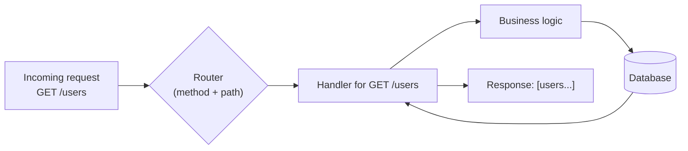
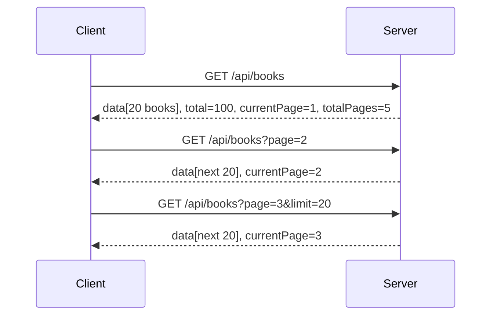
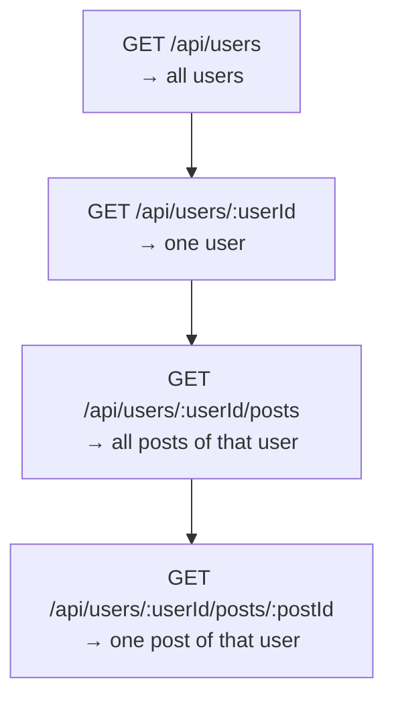
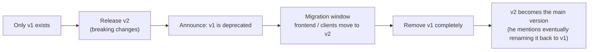
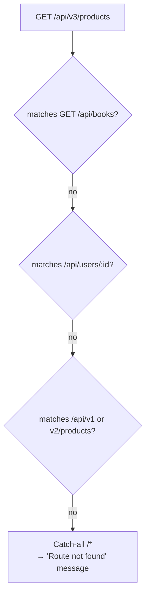

# My Notes: What is Routing in Backend? How Requests Find Their Way Home

> **Source:** "6. What is Routing in Backend? How Requests Find Their Way Home" by Sriniously (YouTube, 24:03)
> **Link:** https://www.youtube.com/watch?v=SubuU1iOC2s
>
> I wrote these from the video's full caption track. The diagrams and sample requests are my own versions of what he demos in Burp Suite with a React app, not copies of his screen.

---

## 1. Methods = WHAT, routing = WHERE

- In the previous video I learned that HTTP methods express my **intent**: fetch, add, update, or delete data.
- So a method tells the server **what** I want to do.
- **Routing** tells the server **where**: which resource I want to perform that action on.

```
   GET          /users
   ───          ──────
   WHAT         WHERE
 (intent /    (route / URL path /
  action)      address of the resource)
```

**Example:** method `GET` + route `/users` → the server sends back an array of users.
- My action is *fetching*.
- The route says *what kind of data / from where*.

The server takes **both together** (method + route) and **maps them to a handler**: a set of instructions that runs the business logic, database operations, and whatever else is needed, then returns the data.



**My one-line definition:** routing = **mapping URL paths (and the method) to server-side logic.**

---

## 2. Demo setup

- **Burp Suite** again, to inspect HTTP traffic.
- A **React app** that fires different API calls to demonstrate each routing concept.
- As before, no server code is shown, only the requests and responses.

---

## 3. How the server matches a request (method + route)

### Request 1: GET
```http
GET /api/books HTTP/1.1
```
- `GET` = my intent / action (fetching).
- `/api/books` = **the route**, the address inside the server I want to reach.
- `books` is called a **resource**. (More on resources when the series gets to REST API concepts. For now I treat it as a route.)
- The server responds with data. In the demo it's just filler, but normally the server would authenticate (if required), then return the data.

### Request 2: POST
```http
POST /api/books HTTP/1.1
Content-Type: application/json

{ "title": "..." }
```
- Method is `POST`, **route is the same**: `/api/books`.
- It creates another book (resource) and returns the resources in the response.

### Key insight
The route is the **same** in both requests. Only the method differs. So on the server:
- **Method + route together form a key** that maps to one specific handler.
- The server checks the method, then the route, combines them, and gets a **unique routing path**.
- `GET /api/books` and `POST /api/books` are two **different** paths that **never clash**. The method is what tells them apart.

```
┌──────────────────────────────┬─────────────────────────┐
│ Routing key (method + path)  │ Handler                 │
├──────────────────────────────┼─────────────────────────┤
│ GET    /api/books            │ listBooks()             │
│ POST   /api/books            │ createBook()            │
└──────────────────────────────┴─────────────────────────┘
        same path, different method → different handler
```

---

## 4. Static routes

- `GET /api/books` and `POST /api/books` above are **static routes**.
- **Why "static":** they contain **no variable parameters**. The string `/api/books` stays constant. I always send exactly that string, and it always returns the same kind of response.

```
/api/books      ← constant string, nothing in it ever changes
```

---

## 5. Dynamic routes and path parameters

### Demo request
```http
GET /api/users/123 HTTP/1.1
```
- `123` represents the **user's ID**.
- Purpose of the endpoint: fetch the details of **one particular user**, using the ID inside the route.
- The server **extracts the ID from the path** and does whatever it needs, like fetching that user from the database and returning their details. (In the demo it just echoes the ID back to prove it received it.)

### What the server-side route definition looks like
He briefly shows the matching part (concept only, not real code):

```js
r.get("/api/users/:id", handler)
//  │        │          └── the handler waiting for this kind of request
//  │        └── route pattern; ":id" = a dynamic slot
//  └── matches the HTTP method
```

- Read it as: "any **GET** request whose path is `/api/users/` followed by **any string** goes to this handler."
- **The `:param` convention** shows up everywhere across the industry, whether it's Java, Python, Node.js, Go, or Rust.
- The colon means: **a dynamic value the client sends in place of `id`.**

### How matching works step by step

```
Incoming:  GET   /api   /users   /123
Pattern:   GET   /api   /users   /:id
            ✓      ✓       ✓       └──► id = "123"   (slot filled)
```

- The method matches GET, then `/api`, then `/users`, then the last segment drops into the `:id` slot.
- **Everything in a route path is a string.** `123` looks like a number, but numbers, special characters, everything in the path arrive as strings.

### Why it's nice
It **reads like a sentence**: "**fetch** data (GET) **from** `/api/users` **for** the user with ID **123**." This human-readable structure is a big part of the idea behind REST APIs.

### Terminology
- A route with a variable part = a **dynamic route**.
- That variable part (`:id` → `123`) = a **path parameter** (also called a **route parameter**), because it sits right after a `/` as part of the path.
- Don't confuse it with the other kind, **query parameters**, below.

---

## 6. Query parameters

### Demo request
He types a value into a search box and hits the search API:

```http
GET /api/search?query=some+value HTTP/1.1
```

| Part | What it is |
|---|---|
| `GET` | method |
| `/api/search` | the route the server uses (with the method) to pick a handler |
| `?` | starts the query string |
| `query=some+value` | a **query parameter**, a key–value pair |

### Why query parameters exist
- **POST / PUT** requests have a **body**, a container for sending user-defined values to the server.
- **GET** requests in REST **don't have a body**. So how do I send values with a GET?
- **Could I use path parameters?** Technically yes:

```
/api/search/some-value        ← technically possible, but...
```

- But path parameters have a specific job: **semantic expression**. `/api/users/123` *means* "the user whose ID is 123."
- Stuffing a search term into the path is **hard to maintain** and **defeats the purpose of REST**, which is giving endpoints meaningful, readable structure.
- So query parameters let me send a **set of key–value pairs** with a request, typically a GET, as **metadata** about the request.

```
Path param:   /api/users/123            → identifies WHICH resource  (semantic)
Query param:  /api/search?query=shoes   → modifies/filters HOW I get it (metadata)
```

### Main use case: pagination
Fetching a list of books in pages (pagination gets its own topic later in the series).

**First request (no query params; server uses defaults):**
```http
GET /api/books HTTP/1.1
```
```json
{
  "data": [ { "...": "book 1" }, "... 20 books ..." ],
  "total": 100,
  "currentPage": 1,
  "totalPages": 5,
  "limit": 20
}
```
- The server **paginates** and returns a chunk, using a default **limit**, say 20 books from the start.
- It also sends **metadata**: total books (100), current page (1), total pages (100 ÷ 20 = 5). The exact shape depends on the implementation.
- The client uses this metadata to make its next requests.

**Next page:**
```http
GET /api/books?page=2 HTTP/1.1
```
- The first time, I didn't send `page` or `limit`, and the server defaulted to page 1.
- To get page 2, I tell the server with a **query parameter**, since a GET has no body.



### Other common uses (all as key–value pairs in the query)
- **Filtering** by user-defined fields
- **Sorting**: which field, and **ascending vs descending**
- Any other metadata about how I want the data

```
/api/books?page=2&limit=20&sort=price&order=desc&genre=fiction
           └─pagination──┘ └──────sorting──────┘ └─filter─┘
```

---

## 7. Nested routes

- Not really a separate *type* of routing. It's a **practice** I'll see everywhere.
- REST APIs often **nest resources** to express meaning, and nested routes are the result.

### Demo request
```http
GET /api/users/123/posts/456 HTTP/1.1
```
```
/api/users   /123        /posts   /456
└─static─┘   └─path param┘ └static┘ └─path param┘
```

- One static part, then a dynamic path parameter, then another static part, then a second dynamic path parameter.
- **Meaning:** "Get the data related to user 123 → specifically their posts → specifically the post with ID 456."

### Each level is its own unique route
I can stop at any level, and each one hits a **different handler** with a **different meaning**:

| Route (all GET) | Handler returns |
|---|---|
| `/api/users` | List of **all users** |
| `/api/users/123` | Details of **user 123** |
| `/api/users/123/posts` | **All posts** of user 123 |
| `/api/users/123/posts/456` | The **one post 456** of user 123 |

```
/api/users
   └── /123                      ← one user
         └── /posts              ← that user's posts
               └── /456          ← one specific post of that user
```



- It's called a **nested route** because I nest different kinds of information at different levels, each expressing a different meaning and giving a different response.
- It's convenient, and I'll see it in pretty much **any API of even medium complexity**.

---

## 8. Route versioning and deprecation

### Demo requests
```http
GET /api/v1/products HTTP/1.1
GET /api/v2/products HTTP/1.1
```
- They look like the earlier requests, except for the **`v1` / `v2`** segment. That's **route versioning**.
- Very common in servers with a REST API interface.

### The responses differ in shape
```json
// GET /api/v1/products
{ "data": [ { "id": 1, "name":  "Phone", "price": 499 } ] }

// GET /api/v2/products
{ "data": [ { "id": 1, "title": "Phone", "price": 499 } ] }
```
- v1: `id, name, price`
- v2: `id, title, price`
- A trivial example, but it shows the point: **the same resource with a different response structure.**

### Why version?
**Scenario:** my endpoint returns data in one format. Later, new requirements arrive. For example, I used to serve only a web app and now also serve a **React Native / Android / Flutter** app, which needs a different response format.

**Option A, the bad way:** create a whole new route.
```
/api/products       (old)
/api/new-products   (new)   ← messy, unclear
```

**Option B, the good way:** version the route.
```
/api/v1/products   (old format)
/api/v2/products   (new format)
```

**Benefits:**
1. It **expresses intent clearly**: this is the v1 response, that is the v2 response.
2. I **don't have to change the whole route** (no `/api/new-products`).
3. It gives me a clean **deprecation path**.

### Deprecation workflow



- After v2 is released, I send a notice to the frontend engineers that **v1 is deprecated**.
- They get a **window** to migrate their request endpoints to the v2 format by the next release.
- Eventually I **remove v1 completely**. He also mentions possibly making v2 "the new v1."
- **Result:** a stable, complete workflow for adding new structure and **breaking changes** to my endpoints, while giving clients time to migrate.

---

## 9. Catch-all route

### Demo request
```http
GET /api/v3/products HTTP/1.1
```
- The server **doesn't serve this route**: there's no handler for `/api/v3/products`.

### What the server does
- **After** all the real routes and their methods are defined, the server adds a final **wildcard route** (`/*`) at the end.
- Any request that falls through every previous match lands here and goes to a handler that sends a **user-friendly message**: "this route doesn't exist / not found."
- Without a catch-all, the **default behaviour** would be something like a null or empty response. The catch-all tells the client clearly that this endpoint isn't served.

```
Route matching order (top to bottom):

  GET    /api/books                    → listBooks
  POST   /api/books                    → createBook
  GET    /api/users/:id                → getUser
  GET    /api/users/:id/posts/:postId  → getUserPost
  GET    /api/v1/products              → productsV1
  GET    /api/v2/products              → productsV2
  ─────────────────────────────────────────────────
  *      /*            (catch-all)     → "Route not found" (friendly message)
         ▲
         └── GET /api/v3/products falls through everything above and lands here
```



---

## 10. Wrap-up

That covers the core concepts to know before going deeper into routing:
- Static routes
- Dynamic routes with **path (route) parameters**
- **Query parameters**
- **Nested** routes with multiple dynamic parameters
- **Versioning and deprecation**
- **Catch-all** routes

With this, I should be able to open a backend codebase, **understand its routing**, change it, and add new routes.

---

## 11. My cheat sheet

```
METHOD = WHAT (intent)        ROUTE = WHERE (resource address)
Routing = mapping (method + URL path) → server-side handler

ROUTING KEY
  method + path together is unique
  GET /api/books  ≠  POST /api/books   (never clash)

STATIC ROUTE
  /api/books                     no variables, constant string

DYNAMIC ROUTE / PATH (ROUTE) PARAMETER
  pattern:  /api/users/:id       ":" = dynamic slot (industry-wide convention)
  request:  /api/users/123       → id = "123"  (always a STRING)
  purpose:  identifies WHICH resource (semantic, human-readable)

QUERY PARAMETERS
  /api/search?query=some+value   key=value pairs after "?", joined with "&"
  why: GET has no body, so metadata goes here
  uses: pagination (page, limit), filtering, sorting (field, asc/desc)
  don't put search values in the path; that breaks REST semantics

NESTED ROUTES
  /api/users                  → all users
  /api/users/123              → one user
  /api/users/123/posts        → that user's posts
  /api/users/123/posts/456    → one specific post
  each level = its own handler + meaning

VERSIONING & DEPRECATION
  /api/v1/products  vs  /api/v2/products   (different response shapes)
  release v2 → announce v1 deprecated → migration window → remove v1

CATCH-ALL
  /*  defined LAST → friendly "route not found" instead of a null/empty response
```
