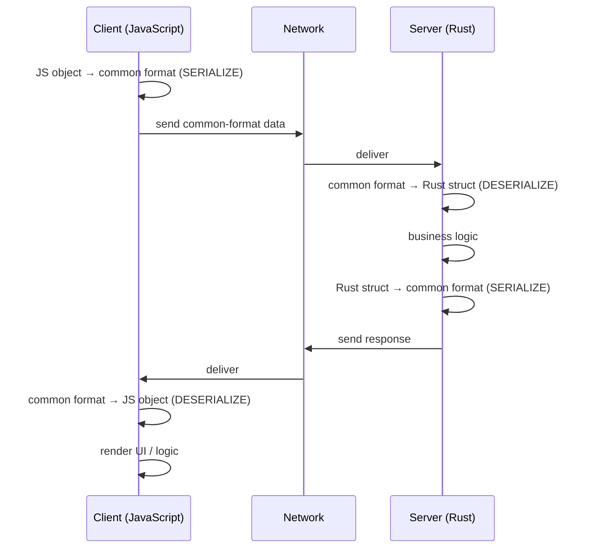
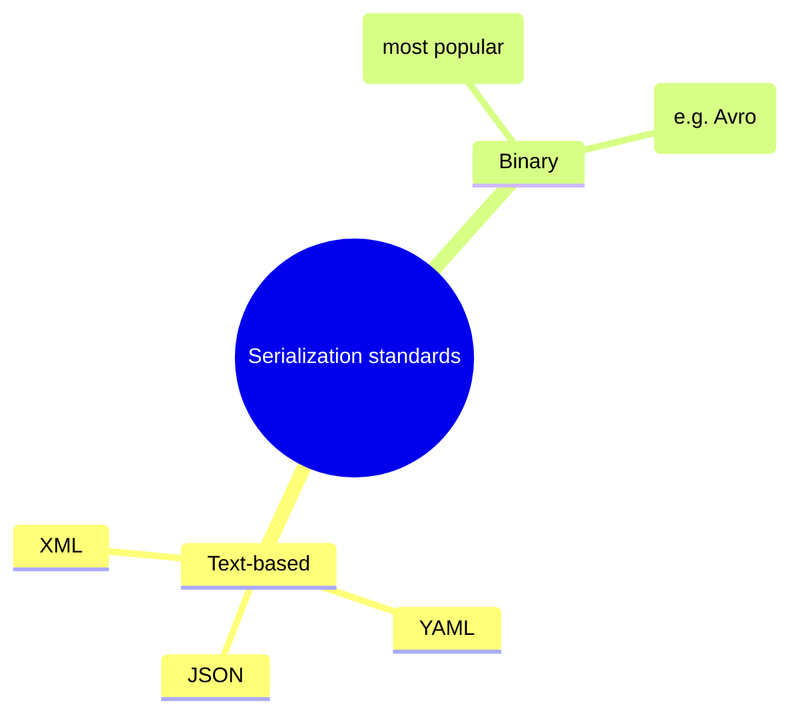

# My Notes: Serialization and Deserialization for Backend Engineers

> **Source:** "7. Serialization and Deserialization for backend engineers" by Sriniously, *Backend from first principles* playlist (YouTube, 21:48)
> **Link:** https://www.youtube.com/watch?v=vzg90tY3uM0
>
> I wrote these from the video's full caption track. The diagrams and examples are my own versions of what's shown and described in the video.

---

## 1. The problem: two languages, one conversation

The setup I already know:
- A **client**, e.g. a browser like Chrome (the frontend).
- A **server**, on localhost or in the cloud (AWS, GCP, Azure…).
- They talk over some kind of network communication: **HTTP / REST**, **gRPC**, **WebSockets**, etc. This series focuses on HTTP/REST.

For this example:
- The client is a **JavaScript app** (React, Angular, Vue…). Most client-side apps are JS.
- The client sends an HTTP request: method + URL, then **headers**, then the **request body**.
- The server responds, and the client has to parse and make sense of the response.

**The real question in this video:** how do client and server **make sense of the data** they send to each other?

Say the client is JavaScript and the server is **Rust**:

```js
// JavaScript (client) sends:
{ name: "some string" }
```

```
JavaScript                                Rust
─────────────                             ─────────────
dynamic types                             strict static types
not compiled (interpreted)                compiled
JS object  { name: ... }      ──?──►      struct User { name: String }
```

- Their data types are **completely different**.
- So how does data from one language, sent over a network to a machine somewhere else, end up as something the other side understands, can run business logic on, and can respond to? And how does the client then understand that response well enough to show UI or run its own logic?

---

## 2. A quick look at the OSI model

- To understand data moving over the internet, it helps to have a **high-level** idea of the OSI model.
- I don't need to master it (IP packets, data frames, etc.). An overview is enough, and plenty of other resources explain it well. Going deep is out of scope here.

```
     CLIENT                                   SERVER
┌──────────────────┐                    ┌──────────────────┐
│ Application      │  ◄── top           │ Application      │
│ ...              │                    │ ...              │
│ (layers between) │                    │ (layers between) │
│ ...              │                    │ ...              │
│ Physical         │  ◄── bottom        │ Physical         │
└────────┬─────────┘                    └────────┬─────────┘
         └────────────── network / internet ─────┘
```

- The **application layer** is at one end and the **physical layer** at the other (whether I call them top or bottom doesn't matter).
- The server has the same stack.

---

## 3. The solution: a common standard

**If I had to design this myself:** two machines in different places, connected over the internet. I need a way (a protocol) for one to send data the other can parse and understand, and it has to be **language-agnostic**.

**The obvious answer:** agree on a **common standard**, which is just a set of rules both sides accept for the format of what they send and receive.



- **Sending:** the client converts its data from JavaScript into the standard format and sends it.
- **Receiving:** the server converts from the standard into its own types (e.g. a Rust **struct**), understands it, and does its work.
- **Responding:** the server converts its Rust data back into the standard and sends it.
- **Client again:** it parses the standard into JavaScript and carries on.

That agreed format is a **serialization standard**.

### Definition
**Serialization and deserialization = converting data to and from a common format**, so that during **transmission** (or **storage**, mentioned in passing) it's **domain-agnostic / language-agnostic**. Machines, clients, and servers from different languages and environments can all make sense of it and respond to it.

```
Serialization:     native data (JS object / Rust struct)  ──►  common format (e.g. JSON)
Deserialization:   common format (e.g. JSON)              ──►  native data
```

---

## 4. Which technologies this series picks

Backend has hundreds of technologies, and it's impossible to learn the concepts behind all of them. So the series sticks to the **most used** ones:

| Area | Many options exist | What the series uses |
|---|---|---|
| Data transmission | HTTP, WebSockets, gRPC… | **HTTP / REST**. Still the most common client–server communication. If I'm solid on HTTP, I can pick up the rest along the way in my career. |
| Databases | Relational: Postgres, MySQL, SQLite · Non-relational: MongoDB, DynamoDB… | **PostgreSQL**. One of the most popular relational DBs, often the first choice for startups and enterprises. |
| Serialization | JSON, YAML, XML, Protobuf… | **JSON**. He estimates it's used around 80% of the time in client–server communication. |

---

## 5. Types of serialization formats



- **Text-based:** JSON, YAML, XML. YAML and XML are serialization formats too, though not as commonly used for HTTP communication.
- **Binary:** the most popular is **Protobuf**, and there are others.
- For now the focus is **JSON**, the most popular choice for HTTP client–server communication.

---

## 6. JSON

### What it is
- **JSON = JavaScript Object Notation.** (Its history and evolution are covered better elsewhere.)
- It **looks and behaves very like a JavaScript object**, hence the name, but it **isn't limited to JavaScript**. It's used everywhere:
  - **HTTP / REST** data between clients and servers (the focus here)
  - **Configuration files**
  - **Log files**: a very popular format for logging application or server data at runtime
- **Big strength:** it's **human-readable**. It was designed that way.
- Its data types are basic and familiar to anyone who knows a little programming.

### The rules

```json
{
  "id": 1,
  "name": "Dilip",
  "isActive": true,
  "skills": ["Python", "FastAPI", "React"],
  "address": {
    "country": "India",
    "phone": 3456
  }
}
```

| Rule | Detail |
|---|---|
| Braces | Starts with `{` and ends with `}` |
| Keys | **Must be in double quotes** and **must be strings**. No other type can be a key |
| Values | **string**, **number**, **boolean**, **array**, or **another object** (nested) |
| Nesting | A nested object follows the **same rules**: braces, quoted string keys, valid values |

```
{                         ← opening brace
  "key":  value           ← key = "double-quoted string"
          │
          ├── "string"
          ├── 123          (number)
          ├── true/false   (boolean)
          ├── [ ... ]      (array)
          └── { ... }      (nested object, same rules again)
}                         ← closing brace
```

That's all I need to know about JSON's structure.

---

## 7. Demo: JSON over the wire

- Same **Burp Suite** setup and the books app from the routing video. This time the focus is the **data format** of the request and response.
- He fires the **POST books** API and opens it in **HTTP history**.

### Request (client → server)
```http
POST /api/books HTTP/1.1
Content-Type: application/json

{
  "id": 3,
  "title": "Some Book",
  "author": "Some Author"
}
```
- JSON as discussed: braces, double-quoted string keys, one **number** value and two **string** values (`id`, `title`, `author`).
- This is what travels over the network.

### Response (server → client)
```json
{
  "books": [
    { "id": 1, "title": "Book One",  "author": "Author A" },
    { "id": 2, "title": "Book Two",  "author": "Author B" },
    { "id": 3, "title": "Some Book", "author": "Some Author" }
  ]
}
```
- The server understood the request, took the ID and other fields, added the book, and responded with **another JSON**.
- That JSON has opening and closing braces, one key holding an **array**, and objects inside the array, all following the JSON rules (quoted keys, number and string values).
- The client receives it, **parses** it, and **renders** it in the UI. Here the client is JavaScript, but it could be PHP or anything else.

---

## 8. The mental model I should keep

If I go deep into the OSI model, data from the application layer gets converted into **data frames**, **IP packets**, goes through the transport layer, and finally becomes **bits (0s and 1s)** carried as voltage signals over optical fibre, etc.

**As a backend engineer, my mental model is simpler:**

```
 CLIENT                                                        SERVER
┌────────────┐                                              ┌────────────┐
│   JSON     │  ← my responsibility ends here    ...and starts again here →  │   JSON     │
└─────┬──────┘                                              └─────▲──────┘
      │  frames → packets → transport → 0101 bits over the wire   │
      └──────────────── NOT MY CONCERN ───────────────────────────┘
```

- The client sticks to a standard (JSON). The server understands JSON and replies in JSON.
- At the **application layer**, data becomes JSON. **That's my responsibility.**
- Whatever formats it passes through below that (frames, packets, bits) **don't concern me**.
- On the receiving end, it's back to **JSON** before the server reads it. The server only ever sees JSON.
- So I don't have to worry about the intermediate steps.

---

## 9. Summary

- Serialization and deserialization isn't a big set of concepts. It's a **phenomenon** in the backend world I need to know exists.
- The whole flow, where the client sends JSON, the server parses and understands it and responds with JSON, and the client parses and understands that, **is** serialization and deserialization.
- **Serialization and deserialization are the techniques for converting data into a common, standard format**, so clients and servers can send it, receive it, make sense of it, and run their logic, **across domains and languages**.

---

## 10. My cheat sheet

```
PROBLEM
  Client (JS: dynamic, interpreted) ↔ Server (Rust: strict, compiled)
  Different data types → how do they understand each other?

SOLUTION
  Agree on a COMMON STANDARD format (language-agnostic)
  Serialize   = native data → common format   (before sending / storing)
  Deserialize = common format → native data   (after receiving / reading)

FORMATS
  Text-based: JSON (≈80% of HTTP usage), YAML, XML
  Binary:     Protobuf (most popular), others

JSON RULES
  { ... }                       braces open/close
  "key"                         keys: double-quoted STRINGS only
  values                        string | number | boolean | array | object (nested)
  used in                       REST APIs, config files, logs
  strength                      human-readable

MENTAL MODEL
  App layer = JSON (my job)
  Frames / packets / bits in between = not my concern
  Server receives JSON again

SERIES TECH CHOICES
  Transport: HTTP/REST · Database: PostgreSQL · Serialization: JSON
```
