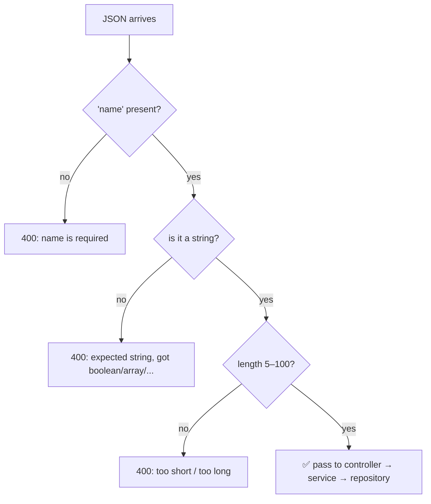
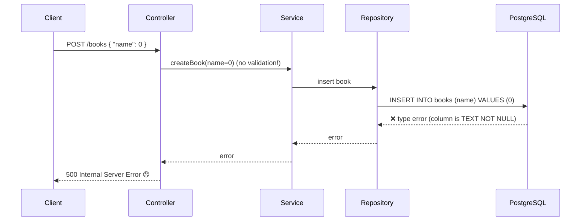
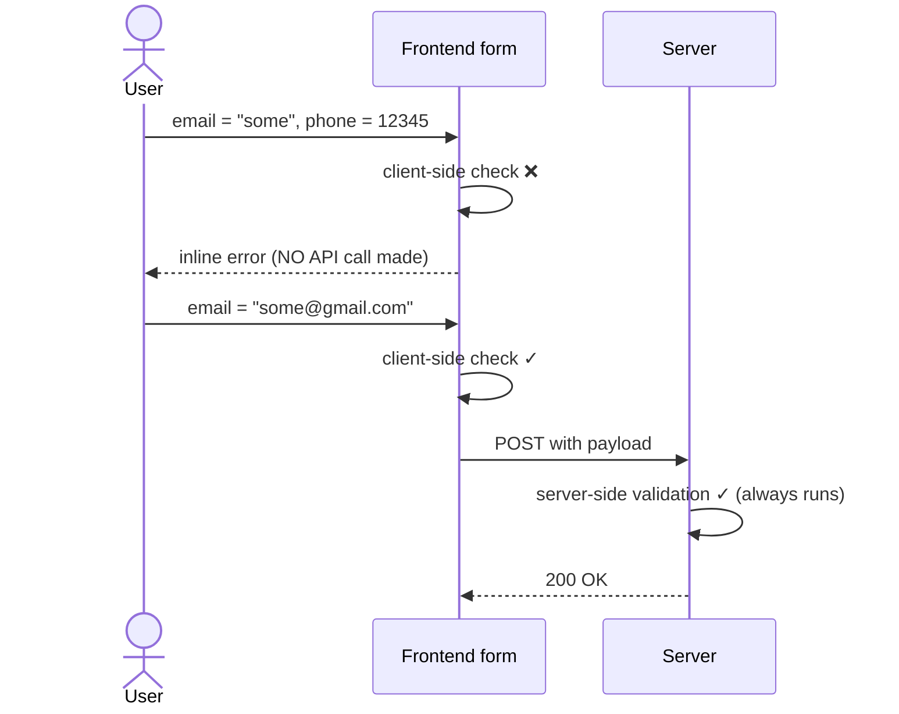

# My Notes: Validations and Transformations for Backend Engineers

> **Source:** "9. Validations and transformations for backend engineers" by Sriniously, *Backend from first principles* playlist (YouTube, 42:48)
> **Link:** https://www.youtube.com/watch?v=qedj_JjjL-U
>
> I wrote these from the video's full caption track, in my own words. The diagrams and request/response samples are my own illustrations of the demos (he uses Insomnia plus a small frontend).

---

## 1. What this topic is really about

- Not a big or complex topic. It's a **set of rules and guidelines** to keep in mind while designing APIs.
- Mostly about **data integrity** and **security**.

---

## 2. Where validation sits in the backend layers

A typical backend has layers of execution:

```
            Client (JSON body, query params, path params, headers)
                │
                ▼
        ┌─────────────────┐
        │ Route matching  │  → picks the controller method for this route
        └────────┬────────┘
                 ▼
   ╔══════════════════════════════════╗
   ║ VALIDATION + TRANSFORMATION      ║  ← HERE: before ANY significant logic
   ║ pipeline (middleware / utility)  ║
   ╚════════════════╤═════════════════╝
                    ▼
        ┌─────────────────┐
        │ Controller      │  HTTP concerns: status codes, response format,
        │ layer           │  incoming/outgoing data
        └────────┬────────┘
                 ▼
        ┌─────────────────┐
        │ Service layer   │  business logic: call repo methods, send emails,
        │                 │  notifications, webhooks...
        └────────┬────────┘
                 ▼
        ┌─────────────────┐
        │ Repository      │  DB connections + queries (Postgres, Redis,
        │ layer           │  any persistent storage)
        └─────────────────┘
```

| Layer | Responsibility |
|---|---|
| **Repository** (bottom) | Database connections and queries: inserts, deletes, everything data-related. Could be a relational DB, Redis, any persistent store |
| **Service** | **Business logic**: everything an API call is meant to do. Calls one or more repository methods, sends notifications and emails, stores data, makes webhook calls… |
| **Controller** | Calls the service method for that API and returns its result over the HTTP connection |

**Why controller and service are separate:** to keep **HTTP-related concerns** in their own layer: which error or success code to return, what format the response takes, **which validations to run**. The controller handles everything coming in from and going out to the client. The service may or may not call the repository, depending on requirements.

**Where validation and transformation happen:** right after route matching calls the controller method, and **before** the controller does anything significant, such as calling services or running business logic.

---

## 3. Why validate at the entry point

My server gets requests from clients all over the world. Before **any** incoming data (JSON payloads, query parameters, path parameters, headers) gets into my logic, I want to be sure it's in **exactly the format this API expects**.

**Example requirement:** the API expects a JSON body with a field `name` that's a **string** of **5–100 characters**. I can be as specific as I like.

**The pipeline** is a middleware or reusable utility function. I give it a **schema**, and it walks the payload field by field:



The point: the data is at least in the **expected shape** before the business logic touches it, so the system never ends up in an **unexpected state** or breaks in **unexpected circumstances**.

---

## 4. What happens without validation

The client sends `{ "name": 0 }` (a number instead of a string), and there's no validation:



```sql
CREATE TABLE books (
  name TEXT NOT NULL   -- database-level type constraint
);
```

- Postgres checks data types before running the operation, so the **insert fails**.
- Depending on error handling, the client gets a **500 Internal Server Error** ("something unexpected went wrong") for a simple form. **That's a poor user experience.**
- **With validation at the entry point**, I'd reject it immediately with **400 Bad Request**: "your data doesn't meet our constraints, retry with the right format."

---

## 5. Types of validation

These aren't the *only* types, but they're the three I'll hit most.

### 5.1 Syntactic validation: does it have the right **structure**?

| Data | Structure checked |
|---|---|
| **Email** | something + `@` + domain + top-level domain (`.com`, `.org`, `.co.in`… thousands exist) |
| **Phone** | country code + the right number of digits for that country (e.g. a 10-digit number) |
| **Date** | the format the API expects, e.g. `YYYY-MM-DD` |

### 5.2 Semantic validation: does the value **make sense**?

| Field | Rejected because |
|---|---|
| **Date of birth** in the future | A DOB can't be after today |
| **Age = 365** | Not a meaningful age, at least not yet |

### 5.3 Type validation: is it the right **data type**?
- string, number, boolean, array, nested JSON object (whose fields have their own types)

```
Syntactic  → "is this shaped like an email?"
Semantic   → "is this birth date in the past? is this age realistic?"
Type       → "is this a number, not a string?"
```

These are things to **keep in mind** while designing APIs: how **strict** and how **specific** I want my validation pipeline to be.

---

## 6. Transformations

**Transformation = running operations on incoming data to put it in the format I need.** It can happen **before** validation (so validation can succeed) or **after** it (to reshape data for the service layer).

### The classic case: query parameters are always strings

```http
GET /bookmarks?page=2&limit=20
```

My validation rules:
```
page:  number, > 0, < 500
limit: number, > 0, < 10,000
```

What actually arrives:
```js
{ page: "2", limit: "20" }   // ALWAYS strings: query params have no other type
```

- Validation fails on the very first check ("page must be a number, got string"), but **the client did nothing wrong**. Query parameter values always reach the server as strings, even when they look like numbers.
- **It's my server's job** to **transform**, or **cast** (force one type into another), the string into a number **first**, then run the validation rules.

```
"2"  ──cast──►  2  ──validate──►  > 0 ✓  < 500 ✓
```

### One pipeline for both
- I usually put **validation and transformation in a single pipeline**, so all input-layer logic (requirements and operations on incoming data) lives in **one place** instead of being scattered around.

---

## 7. Demos

He uses **Insomnia** (an API client) against a local server.

### 7.1 Syntactic validation
`POST /api/valid/syntactic`

```http
POST /api/valid/syntactic
{}
```
```json
[
  { "path": "email", "message": "Required" },
  { "path": "phone", "message": "Required" },
  { "path": "date",  "message": "Required" }
]
```
Then sending random values:
```json
{ "email": "randomstring", "phone": 12345, "date": "2025-11-05" }
```
```json
[
  { "path": "email", "message": "Invalid email format" },
  { "path": "phone", "message": "Expected string, received number" }
]
```
Fix the email to `test@test.com` and make the phone a string → **200 OK**.

### 7.2 Semantic validation
- An empty body returns errors listing `dateOfBirth` (required) and `age` (expected number).
- **Bonus I noticed:** validation errors double as **documentation**. Even without API docs, hitting the endpoint with nothing tells me which fields it expects.
- `dateOfBirth: "1995-06-12"`, `age: 43` → success, values echoed back.
- `dateOfBirth: "2026-..."` → **"Date of birth cannot be in the future."**
- `age: 430` → **"Number must be less than or equal to 120."** (Realistic ages are 1–120. A one-year-old won't be calling the API, but that's the accepted range.)

### 7.3 Complex / cross-field validation
Fields: `password`, `passwordConfirmation`, `married`.

```json
{ "password": "random", "passwordConfirmation": "another", "married": false }
```
- `password` → **"String must contain at least 8 characters."**
- `passwordConfirmation` → **"Passwords don't match."** (The confirmation must equal the password, a common integrity check.)
- Fix both → success.

Then set `married: true`:
- → **"Partner name is required when married is true."**
- Add `"partner": "..."` → success.

```
Rule 1: passwordConfirmation === password
Rule 2: if married === true → partner is required (optional otherwise)
```
That's the "complex" category: constraints **between fields**, defined by what the service layer needs.

### 7.4 Transformation
Send messy input:
```json
{ "email": "TeSt@TeSt.CoM", "phone": "9876543210", "date": "2025-11-05" }
```
The response shows what the server transformed **before** using it:
```json
{ "email": "test@test.com", "phone": "+9876543210", "date": "<reformatted date>" }
```
- Email **lower-cased**
- **`+`** added in front of the phone number
- Date converted to a different format

The server reshapes data for the **service layer's convenience or requirements**.

### 7.5 Type validation
Fields: `stringField`, `numberField`, `arrayField`, `booleanField`.

Sending all of them as strings:
```
numberField  → Expected number, received string
arrayField   → Expected array, received string
booleanField → Expected boolean, received string
```
Fix to `10`, `[1, 2]`, `false`:
```
arrayField[0] → Expected string, received number
```
→ **I can validate each array element's type too.** Change it to `["1", "2"]` → success.

---

## 8. Frontend vs backend validation

**A common mistake:** treating frontend validation as a **replacement** for backend validation.

```
┌─────────────────────────┐            ┌─────────────────────────┐
│ FRONTEND validation     │            │ BACKEND validation      │
│ purpose: UX             │            │ purpose: SECURITY +     │
│ instant feedback in     │            │ DATA INTEGRITY          │
│ the form                │            │ MANDATORY, always       │
│ OPTIONAL for safety     │            │                         │
└─────────────────────────┘            └─────────────────────────┘
```

- **Frontend validation is for user experience**: immediate feedback that something's wrong. It's **not** about security or data integrity.
- **Backend validation is for security and data integrity**, and it **doesn't matter** what the frontend does.
- **Why:** my server can have many clients. A polished web app might validate everything, but someone using **Postman or Insomnia** talks to the API directly with **no frontend at all**. If the backend relies on frontend validation, it **breaks the moment the client changes**.
- **Rule:** be as **strict and specific** as possible on the server, **without assuming anything** about client-side validation.

### Demo: both working together
The same endpoints have a matching frontend.

1. Bad email → the form shows an error and **no API call is made** (client-side validation).
2. Fix it → submit → real API call → the server validates again → **200**.

Client-side gives quick feedback. Server-side is the **mandatory** gate for security and integrity.

---

## 9. My cheat sheet

```
WHERE
  route match → [VALIDATION + TRANSFORMATION] → controller → service → repository
  validate everything from the client: body, query params, path params, headers

WHY
  catch bad data early → 400 Bad Request (clear)
  instead of a DB type error deep inside → 500 Internal Server Error (bad UX)

PIPELINE
  middleware/utility + schema; checks presence → type → constraints (length, range...)
  keep validation + transformation in ONE place

TYPES
  Syntactic  structure: email, phone (country code + digits), date format
  Semantic   makes sense: DOB not in future, age 1–120
  Type       string / number / boolean / array (element types) / object
  Complex    cross-field: passwordConfirmation == password;
             married=true → partner required

TRANSFORMATION
  query params ALWAYS arrive as strings → cast "2" → 2, THEN validate
  normalise: lower-case email, add "+" to phone, reformat dates

BONUS
  validation errors work as API documentation

FRONTEND vs BACKEND
  frontend = UX (instant feedback, optional for safety)
  backend  = security + data integrity (MANDATORY)
  never rely on frontend validation; clients like Postman skip it entirely
```
