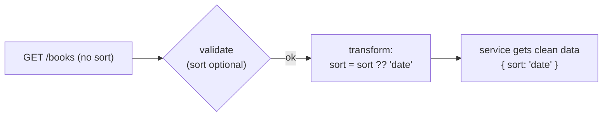
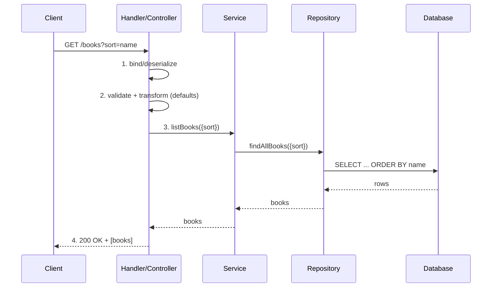
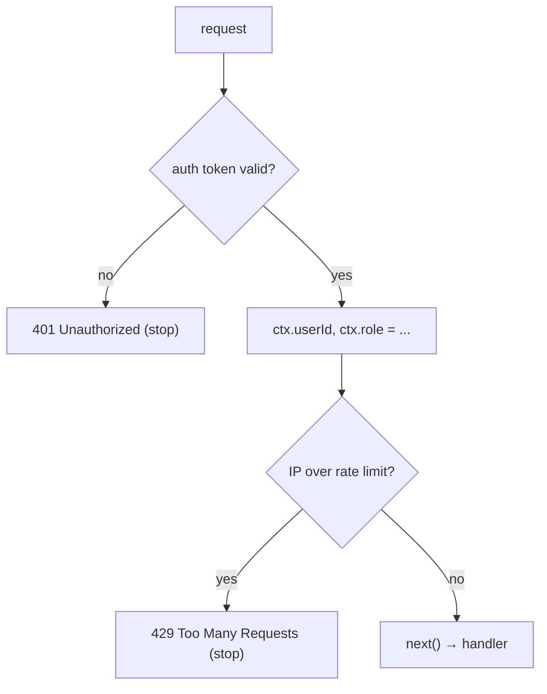
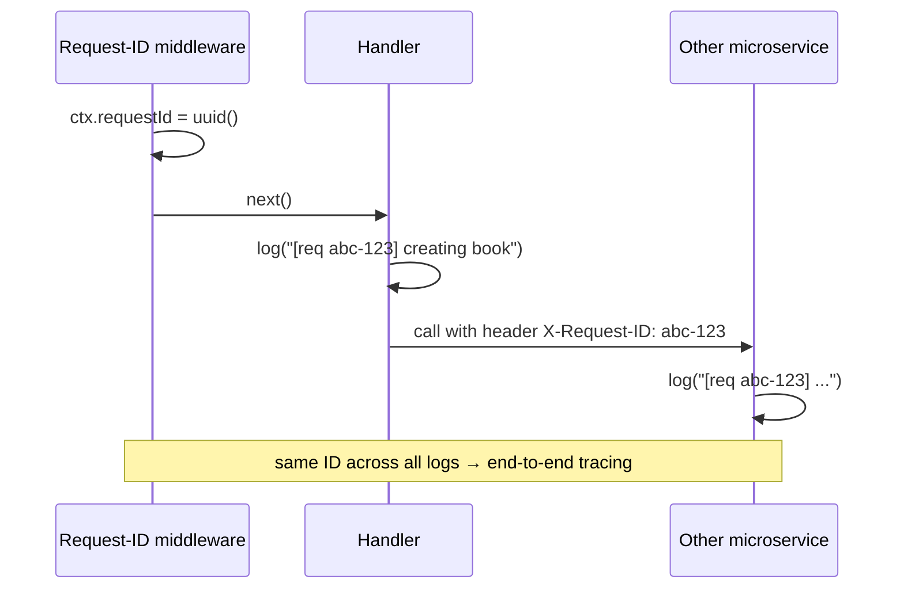

# My Notes: Controllers, Services, Repositories, Middlewares and Request Context

> **Source:** "10. What are controllers, services, repositories, middlewares and request context?" by Sriniously, *Backend from first principles* playlist (YouTube, 59:57)
> **Link:** https://www.youtube.com/watch?v=hyc-7w3pee8
>
> I wrote these from the video's full caption track, in my own words. The diagrams and code sketches are my own illustrations of what he explains.

---

## 1. Why three topics in one video

- The plan was three separate videos: **(1) handlers, services, repositories**, **(2) middlewares**, **(3) request context**.
- They're so tightly connected that explaining them together avoids repeating the same setup three times.
- He's touched on handlers/services/repositories in earlier videos, but this is the proper explanation.

---

## 2. The request life cycle inside the server

Earlier videos covered what happens **outside** the server (sending the request, getting the response). This one is about what happens **inside**, from the moment a request arrives until the response leaves.

```
Client ──HTTP──► OS forwards to port (3000 / 4000 / ...) ──► SERVER ENTRY POINT (listening)
                                                                    │
                                                                    ▼
                                                               ROUTING
                                                     (/users, /users/:id, ...)
                                                                    │
                                                                    ▼
                                                     HANDLER / CONTROLLER
                                                                    │
                                                                    ▼
                                                               SERVICE
                                                                    │
                                                                    ▼
                                                             REPOSITORY ──► DB
```

1. **Entry point:** the OS forwards the HTTP request to whatever port my server is **listening** on.
2. **Routing:** the routing algorithm matches the path (static, dynamic, etc.) and maps the request to a **handler**, a function I've predefined for that API.

### Why split into handler, service, repository?
- Could one handler do everything? **Yes.** Nothing requires the split.
- It's a **design pattern** that makes the codebase **scalable**, more **maintainable**, easier to **add features** to, and easier to **debug**.

---

## 3. Handlers / controllers

### What a handler receives
In every server framework (he's used **Go, Node.js, and Python**, and believes it's an established pattern elsewhere too), a handler gets at least **two objects** from the runtime/framework automatically:

| Object | Used for |
|---|---|
| **Request** | Reading values from the HTTP request |
| **Response** | Sending the response, setting headers, status codes |

```js
// Express-style sketch
app.post("/books", (req, res) => { /* ... */ });
```
```go
// Go net/http-style sketch
func CreateBook(w http.ResponseWriter, r *http.Request) { /* ... */ }
```

By the time a request reaches the handler, routing has already told me **which API** the client is calling. Now I need the **data** so I can process it: DB operations, external API calls, emails, notifications, and so on. Then I send a response, or not, depending on the request. (For example, REST convention for DELETE is **204 No Content** with an empty body.)

### Handler step 1: extract the data and deserialize (binding)

| Method | Where the data is |
|---|---|
| GET | **Query params** |
| POST / PUT / PATCH (and sometimes DELETE) | **Request body** |

- The series has followed the request **top to bottom**: HTTP life cycle → routing → serialization → validation… and now we're at the handler.
- The client sent **JSON** (serialized to cross the network). The handler must **deserialize it into the language's native format**:

| Language | Native target |
|---|---|
| Go | **struct** |
| Python | **dictionary / class** |
| Rust | **struct** |
| Node.js | JS object, usually handled earlier by a body-parser / `express.json()` **middleware** before routing, so I don't do it in the handler |

- Many frameworks call this step **binding** (binding the request body to a native type).
- **If deserialization fails → respond 400 Bad Request and stop.** The request goes no further.

```go
var body CreateBookRequest
if err := json.NewDecoder(r.Body).Decode(&body); err != nil {
    http.Error(w, "invalid payload", http.StatusBadRequest) // 400, stop here
    return
}
```

JavaScript has first-class JSON support (JSON was inspired by JS objects). Other languages need more manual work.

### Handler step 2: validate and transform
(Covered fully in video 9.)
- **Validate everything** coming from an external client: path params, body, query params, as specifically as possible. Required values present, expected formats, nothing malicious, nothing missing.
- Then **optionally transform** the data to make it convenient for the downstream layers.

**Transformation example: defaults for sorting**
```
GET /books                → no query params
GET /books?sort=name      → sort by book name
GET /books?sort=date      → sort by created date
```
- **Good API pattern:** make **all query parameters optional**. (More in the next video on API design and REST.)
- No `sort` passed → validation passes (it's optional) → the **transformation step sets a default**, e.g. `sort = "date"`.
- Without this, the service layer would need `if sort passed… else…` branches. Setting defaults early keeps the code **readable** and the processing path **predictable**.



### Handler step 3: call the service
- The controller calls the service layer with **validated, transformed data**, plus anything else the service needs, such as **auth info** (user ID, permissions).

---

## 4. Services

- The service layer should **not deal with anything HTTP-related**. All HTTP concerns stay in the controller.
- **A service method is just a function.** Looking at it, I shouldn't be able to tell it's used by an API. It takes data, processes it, returns data, without worrying about status codes, validation, or where the data came from. **That's the line between controller and service responsibilities.**

**What a service does:**
- **All the actual processing** of the API happens here.
- It calls **repository** methods when DB access is needed (persist or fetch).
- It may **not** need the DB at all. Example: a "send email" service takes an email address, sends the email, and returns `{ success: true }` to the handler.
- **Orchestration:** it can call **multiple repository methods**, **merge** their results, pick the needed fields, call external APIs, send notifications or emails, and so on.

```js
// service: pure logic, no req/res, no status codes
async function listBooks({ sort }) {
  const books = await bookRepo.findAll({ sort });
  return books;
}

async function sendWelcomeEmail({ email }) {
  await mailer.send(email, "Welcome!");
  return { success: true };     // no repository needed
}
```

---

## 5. Repositories

- Also called the **database layer**.
- **Single responsibility:** take the data to insert, or the filtering/sorting info needed to fetch, **build the database query**, run it, and **return the result**.
- Using the example: the `sort` value travels **handler → service → repository**, and the repository builds the query from it.

**Rule: one repository method returns one kind of data.**

```js
// ❌ don't: one method, optional param, two kinds of result
findBooks(id?)   // returns ALL books if no id, ONE book if id

// ✅ do: separate, single-purpose methods
findAllBooks({ sort })   // → Book[]
findBookById(id)         // → Book
```

```
┌──────────────────────────────────────────────────────────────┐
│ CONTROLLER  → input/output formats, validation, status codes │
│ SERVICE     → actual processing, orchestration, side effects │
│ REPOSITORY  → database queries only, one job per method      │
└──────────────────────────────────────────────────────────────┘
```

---

## 6. Back in the controller: sending the response

The service returns the data (e.g. all books), and execution is back in the controller.

**What the controller did in total:**
1. **Bound** the request data (deserialized it)
2. **Validated and transformed** it
3. **Called the service**, which did the real processing
4. **Got the result** and now **sends the response**

The controller literally **controls the data flow** both ways: client → server and server → client.

**Picking the status code is the controller's job:**
| Outcome | Codes |
|---|---|
| Success | **200**, **201**, **204** (whichever 2xx fits) |
| Client failure | **400**-series |
| Server failure | **500**-series |

Plus an appropriate error message, or the success data. Here: an **array of books with 200**.



---

## 7. Middlewares

### Where they sit
From the entry point to the response, I can put **functions at the boundaries** between stages: before routing, after routing, around the handler, before the response is sent.

```
ENTRY ─► [MW] ─► [MW] ─► ROUTING ─► [MW] ─► [MW] ─► HANDLER→SERVICE→REPO ─► [MW] ─► RESPONSE
          ▲       ▲                  ▲       ▲                               ▲
          └───────┴──── middlewares: functions executed "in the middle" ─────┘
```

They're called **middlewares** because they run **in the middle** of these execution contexts.

### What a middleware receives
Like a handler, plus **one extra thing**:

| Param | Purpose |
|---|---|
| **request** | read or modify request values |
| **response** | modify the response, or **send a response early** |
| **next** | a function that **passes execution to the next context** |

```js
function myMiddleware(req, res, next) {
  // do something with req/res...
  next();            // hand over to the next middleware / routing / handler
}
```

- `next()` passes control to **whatever comes next**: another middleware, the router, or the handler. That's why it's "next context," not "next middleware."
- **All middlewares are optional.** I add them only as needed, and the flow can go straight from routing to the handler.
- Because a middleware has the **response** object, it can **end the request early**, before routing or the handler ever run.

### Why use middlewares
- **Same reason we use functions:** avoid writing the same lines in many places.
- A real app gets thousands, millions, even billions of requests, and has **hundreds or thousands of endpoints**. Common work (**security, logging, authentication, data parsing, compression…**) has to happen on **every** request.
- Without middleware, I'd duplicate that code in every handler. Even a shared helper function still means **calling it in every handler**, which is still duplication.
- So I **delegate common operations to middleware** that runs before the handler. It can also reject bad requests early, **saving server resources**.

---

## 8. Common middleware examples

### 8.1 Security middlewares

**CORS**
- The browser blocks cross-origin access unless the server sends the right headers. (Full flow in the HTTP video.)
- Middleware logic: read **`Origin`** from the request → if it's my allowed frontend origin, **add the CORS headers** to the response → `next()`. If not, add nothing, and the browser blocks the response.
- **Why middleware:** it runs for **every** API call **and** needs both the request and response objects. A perfect fit, so CORS is usually done in middleware, not handlers.

```js
function cors(req, res, next) {
  if (ALLOWED.includes(req.headers.origin)) {
    res.setHeader("Access-Control-Allow-Origin", req.headers.origin);
  }
  next();
}
```

**Security headers**
- Set headers like **Content-Security-Policy** on every response, then `next()`.

**Authentication**
- Extract the token (JWT, session ID…) from headers, payload, wherever my implementation puts it, and verify it. (See video 8.)
- **Fails →** send **401 Unauthorized** immediately and **terminate**. No handler, no `next()`.
- **Succeeds →** get the **user ID, role, permissions** (admin or not…), **store them in the request context**, then `next()`.

**Rate limiting**
- Stops one client from making too many requests too quickly.
- Usually tracked by **IP address**, e.g. "more than 30 calls in 2 seconds?" I choose both the time window and the request threshold (30, 500, …).
- Over the limit → **429 Too Many Requests**. Otherwise → `next()`.



### 8.2 Logging and monitoring
- For every request, log details like **path** (`/users`), **method** (`GET`), **query params**, **body**, etc., to the terminal or a log file.
- Helps with **debugging**, **reports**, and **auditing**.

### 8.3 Global error handling (every backend should have one)
- Errors can happen **anywhere**: handler, service, any middleware in between.
- A global error-handling middleware **catches** that unstructured error and works out:
  - **Client error → 4xx**, or **server error → 5xx** (I can add fields to my errors to mark which kind).
- It sends a **properly structured error** back, usually with a **message**, a **code/ID** (so the frontend can show friendly messages by code), and the **status**.
- **It must be the LAST middleware.** The request flows **one way**. If the error middleware runs in the middle, an error thrown later in the handler never reaches it.

```js
app.use(cors);
app.use(logger);
app.use(auth);
app.use("/books", bookRoutes);
app.use(globalErrorHandler);   // LAST, so it can catch everything above
```

```json
{ "status": 400, "code": "BOOK_TITLE_REQUIRED", "message": "Title is required" }
```

### 8.4 Compression
- Large responses (JSON with thousands of fields) get compressed (e.g. **gzip**). Modern browsers decompress them, so the data is small in transit and back to normal on the client.

### 8.5 Data parsing
- **Serialization/deserialization** (binding) can be handled in middleware instead of each handler.
- So can **validation/transformation**, depending on the codebase's standards and style.

---

## 9. Middleware order

**Order matters**, because each middleware hands off to the next with `next()`, in sequence, until a response goes out.

A typical order:
```
1. CORS             ← earliest: reject disallowed origins before wasting any work
2. Logging
3. Authentication
4. ... (rate limit, permissions, parsing, etc.)
5. Routing → Handler
6. Global error handler   ← LAST: catches errors from everything before it
```

I should spend some time thinking about the **order** that gives the right behaviour for my app and the clients calling it.

---

## 10. Request context

### What it is
- Every framework and language (Node.js, Go, Python…) offers some version of it. The implementation differs, but the concept is the same.
- **A storage / state scoped to ONE request.** Every incoming request gets its **own** context.
- Usually **key–value pairs**.
- It's **readable and writable** by every middleware and handler that request passes through, **without passing values explicitly** and without **tightly coupling** the components.

```
Request #1 ─► [CORS] ─► [Logger] ─► [Auth] ─► [Perms] ─► [Handler] ─► [ErrorMW]
                  ▲          ▲          ▲         ▲           ▲            ▲
                  └──────────┴────── ctx #1 (shared, per-request) ─────────┘
                                   { requestId, userId, role, ... }

Request #2 gets its own ctx #2 (completely separate)
```

### Use 1: passing auth info downstream (and why it matters)
1. The **auth middleware** verifies the credentials/token and finds the **user ID** and **role** (user / admin / sales…, plus permissions like read/write, per RBAC from video 8).
2. It **saves them into the context**.
3. Later, the **handler** for `POST /books` reads the **user ID from the context** and uses it when inserting the book (the `books` table has a `user_id` column).

**Why not take the user ID from the request body?** A **malicious client** could send **another user's ID** and do things on their behalf. So **user identity always comes from the authenticated context, never from client input.** Permission and RBAC checks downstream also read from the context.

```js
// auth middleware
req.ctx = { userId: decoded.sub, role: decoded.role };
next();

// handler
const book = await bookService.create({ ...body, userId: req.ctx.userId }); // NOT body.userId
```

### Use 2: request ID for tracing
- An early middleware generates a unique ID (e.g. a **UUID**) and stores it in the context.
- I use it throughout the life cycle: in **logs**, and when calling **other services** in a microservice setup, passed in a header like **`X-Request-ID`**.
- When auditing or debugging, I can **trace** a request: where it started, and every service it touched.



### Use 3: cancellation, abort signals, deadlines
- The context can carry **cancellation / abort signals** and **deadlines** to downstream or external services, so my service never **hangs forever** waiting on something.

---

## 11. My cheat sheet

```
LIFE CYCLE (inside server)
  OS → port → entry point → [middlewares] → routing → [middlewares]
     → handler → service → repository → DB → back up → [middlewares] → response

HANDLER / CONTROLLER  (gets req, res)
  1. extract data: GET → query params; POST/PUT/PATCH → body
  2. bind/deserialize JSON → native type (Go struct, Python dict/class)
     fail → 400 and STOP   (Node: often done by body-parser middleware)
  3. validate + transform (set defaults, e.g. sort = "date"); keep query params optional
  4. call service with clean data + auth info
  5. pick status code (2xx / 4xx / 5xx) + send response

SERVICE
  pure business logic, NO HTTP knowledge; looks like any normal function
  orchestrates: multiple repo calls, merge results, emails, notifications, external APIs
  may not touch the DB at all

REPOSITORY
  build + run DB query, return result
  ONE method = ONE kind of data (findAll vs findById; no optional-param switching)

MIDDLEWARE  (gets req, res, next)
  runs between stages; optional; next() → next context; can respond early
  why: avoid duplicating common logic across hundreds of handlers
  examples: CORS · security headers · auth (401) · rate limit (429, by IP)
            logging · compression · body parsing · validation · GLOBAL ERROR HANDLER
  ORDER MATTERS: CORS first ... error handler LAST

REQUEST CONTEXT
  per-request key-value state shared by all middlewares + handlers (loose coupling)
  uses: userId/role from auth (NEVER trust userId from the client body)
        request ID (UUID) → logs + X-Request-ID across microservices
        cancellation / abort signals / deadlines
```
