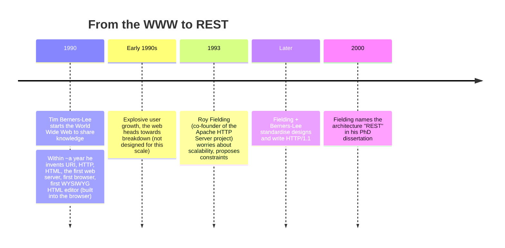
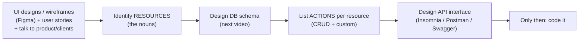

# My Notes: Complete REST API Design

> **Source:** "11. Complete REST API Design" by Sriniously, *Backend from first principles* playlist (YouTube, 2:03:34)
> **Link:** https://www.youtube.com/watch?v=RG6q57DwV8Y
>
> I wrote these from the video's full caption track, in my own words. The diagrams, URLs and JSON samples are my own illustrations of what he designs live in Insomnia.

---

## 1. Why this video matters

- As a backend engineer I'll spend a **lot** of time designing and thinking about APIs. He calls this one of the most important videos in the playlist.
- Focus: **REST APIs** (other styles exist: RPC, GraphQL…).

**The questions that still confuse people:**
- Should a URI path segment be **plural or singular**?
- For updates: **PATCH or PUT**?
- For a **non-CRUD custom action**: which method? It sounds like an update, so PATCH/PUT? It creates something, so POST?
- **Which status code** for which scenario?

**Why the confusion exists:** the standards were written when the web was mostly **MPAs (multi-page applications)**. Today we mostly build **SPAs (single-page applications)**: the first request downloads all the JS, and routing happens on the client. The web looks very different now.

**Goal of the video:** not new standards, but **extracting clear rules and guidelines from the existing ones**, so I can stick to one consistent style for routes, payloads, and docs, stop second-guessing, and **focus on business logic**.

---

## 2. History: how REST came about



- **Tim Berners-Lee (1990):** started the World Wide Web to share knowledge globally. In about a year he created:
  1. **URI**: Uniform Resource Identifier
  2. **HTTP**: the protocol clients and servers still use
  3. **HTML**: the markup language, the skeleton of pages
  4. The **first web server**
  5. The **first web browser**
  6. The first **WYSIWYG HTML editor**, built into the browser
- We still use evolved versions of all of these: URIs, HTTP 1.1 → 2 → 3, HTML, many servers and browsers, in-browser editors.
- **The problem:** users grew **exponentially**, faster than he'd planned for. The web was heading for **breakdown**, and new techniques and standards were needed.
- **Roy Fielding (1993)** proposed constraints to make the web scale. Later he and Berners-Lee wrote the spec for **HTTP/1.1**, the first major standard version.
- **2000:** once the scalability crisis was over, Fielding described the web's architectural style in his **PhD dissertation** and called it **REST (Representational State Transfer)**.
- 📖 **Worth reading as a backend engineer:** search "Roy Fielding REST dissertation" for the original context.

---

## 3. Roy Fielding's six constraints

| # | Constraint | What it means |
|---|---|---|
| 1 | **Client–server** | **Separation of concerns**: the client handles UI/UX, the server handles data storage and business logic (frontend vs backend). Each can **evolve independently**, which helps scalability. Still followed today. |
| 2 | **Uniform interface** | A **standardised way** for the web's components to communicate. Four sub-constraints: **resource identification**, **manipulation of resources through representations**, **self-descriptive messages**, **HATEOAS** (hypermedia as the engine of application state). Gives a consistent interface across services. |
| 3 | **Layered system** | Hierarchical layers, each seeing only the layer directly below. Lets me add **load balancers, proxies**, etc. for scale and security **without** changing core functionality. |
| 4 | **Cache** | Responses must be **explicitly labelled cacheable or not**. Clients cache when allowed → less server load, better network efficiency, faster UX. |
| 5 | **Stateless** | Each request carries **all** the info needed to process it; the server keeps **no client context** between requests. Improves reliability, scalability, visibility, because **any server** behind a load balancer (e.g. round-robin) can handle any request. |
| 6 | **Code on demand** *(optional)* | The server can send **executable code** (e.g. JavaScript) to extend the client. Optional, and not used heavily. |

```
              ┌────────────┐
 Client ─────►│ Load       │──► Server A ┐
              │ balancer   │──► Server B ├─ any server can answer (stateless)
              │ (layer)    │──► Server C ┘
              └────────────┘
```

---

## 4. What "REST" actually means

**RE**presentational **S**tate **T**ransfer:

### Representational
- Resources (data/objects) are **represented** in specific formats: **JSON** (most popular), **XML**, **HTML**…
- **The same resource can have different representations** for different clients:

```
                 user resource { id, name, createdAt }
                         │
          ┌──────────────┴──────────────┐
          ▼                             ▼
   JSON (for an API client /      HTML (for a web browser /
   server-to-server)              UI rendering)
```

### State
- The **current condition / attributes** of a resource.
- Example: an **Amazon shopping cart's** state = the items, their quantities, the total price. That state moves between client and server with each API call.

### Transfer
- The **movement of resource representations** between client and server, over **HTTP** with its methods (GET, POST, PUT, PATCH, DELETE, OPTIONS, HEAD…).
- E.g. a GET for a web page **transfers a representation** from server to client.

**Put together, REST is an architectural style where:**
1. resources have **various representations** (JSON / HTML / XML),
2. their **state is transferred** between client and server,
3. client and server **communicate by sharing these representations**,
4. all under the **constraints** above, for scalability.

He notes that none of this theory needs memorising. It's context for where things come from.

---

## 5. Anatomy of a URL

```
https://sriniously.xyz/books/harry-potter?lang=en#chapter-3
└─┬─┘   └─────┬──────┘└─────────┬───────┘└──┬──┘└────┬───┘
scheme    authority/         path /       query   fragment
          domain             resource     params
```

| Part | Role |
|---|---|
| **Scheme** | `http` or `https` (secure, encrypted) |
| **Authority / domain** | The domain, optionally with a subdomain |
| **Path / resource** | What I'm accessing. **`/` expresses a hierarchical relationship** |
| **Query params** | Key–value pairs, mostly in GET, for filters and other parameters |
| **Fragment** | Scrolls the browser to a section of the page on first load |

---

## 6. Designing API URLs

These are **industry standards / best practices**, not hard rules.

```
https://api.example.com/v1/books
└─┬─┘   └──────┬──────┘└┬┘└─┬─┘
scheme   api. subdomain  │  resource (PLURAL)
                    version
```

1. **Subdomain:** usually **`api.`** + main domain.
2. **Versioning in the route:** `/v1`, `/v2`…
3. **Resource name in plural:** e.g. a Goodreads-like app: `/books`, not `/book`.

### Rule: always plural, even for a single item
```
✅ GET /v1/books          → list all books
✅ GET /v1/books/123      → one book
❌ GET /v1/book/123       → common mistake: singular because it's "one book"
```
Even when fetching **one** book, the resource itself is the **books collection**, so it stays plural.

### Hierarchy
```
/books        → level 1: the collection of books
/books/123    → level 2: one particular book inside that collection
```

### Readable URLs: slugs
- **No spaces or underscores** in URLs (slugs, IDs, any route part).
- To put a phrase in a URL, make a **slug**:
  1. **lower-case everything**, since URLs travel across servers, clients, and OSes and I don't want case-mismatch issues
  2. **replace spaces with hyphens**

```
"Harry Potter"  →  "harry potter"  →  "harry-potter"
GET /v1/books/harry-potter
```

---

## 7. Idempotency and HTTP methods

**Idempotency:** doing the same action **many times has the same effect as doing it once**. For APIs: however many times a client sends the request, the **outcome on the server** is the same.

**The five main data methods:** GET, POST, PUT, PATCH, DELETE. (Also **HEAD** for fetching headers, and **OPTIONS** for CORS pre-flight.)

| Method | Purpose | Idempotent? | Why |
|---|---|---|---|
| **GET** | Fetch data | ✅ Yes | It causes **no side effect**. If someone else adds a book between my calls, the response changes, but **my** calls didn't change anything. Idempotency is about the side effects **I** cause |
| **PATCH** | Update **part** of a resource (1–3 fields) | ✅ Yes | Setting name A→B, then B→B again, then again… the state stays `B` |
| **PUT** | **Replace** the whole representation (send ALL fields: id, name, createdAt…) | ✅ Yes | Same payload → same final state |
| **DELETE** | Delete a resource | ✅ Yes | 1st call deletes. 2nd call → **404** (doesn't exist) but **no new side effect**. A million calls = a million 404s, one actual deletion |
| **POST** | Create a resource | ❌ **No** | Each call creates a **new** entity. Names can repeat, and the **DB generates new IDs** (UUID / serial), so 1,000 calls = 1,000 books. The side effect differs every time |

```
PATCH name=B:   A ──► B ──► B ──► B        (same end state: idempotent)
DELETE /users/1:  exists ──► deleted ──► 404 ──► 404   (no new side effects)
POST /books:      1 book ──► 2 books ──► 3 books       (new effect each time: NOT idempotent)
```

### PATCH vs PUT
- They're **often used interchangeably**. That's tolerable for **internal** APIs.
- For **public** APIs, **follow the standard**: integrators assume I do, and mismatched semantics cause confusion.
- **Partial update → PATCH. Full replacement → PUT.**
- His experience: he rarely uses PUT. In JSON-heavy SPAs, we usually send **some fields** to update, not the whole entity. Full replacement was more of an **MPA-era** habit. **PATCH conveys partial updates more clearly.**

---

## 8. Custom actions use POST

- Some operations aren't fetch, create, update, or delete. They're **actions** I want the server to **perform**.
- The REST spec leaves **POST open-ended**: **anything that doesn't fit the CRUD methods goes under POST.**

```http
POST /send-email
{ "target": "someone@example.com" }
```
Not a fetch, create, update, or delete. It's a **custom action**, so **POST**.

---

## 9. The design workflow: start from the UI

**Design the interface before writing any code.** It should be **intuitive, delightful, unambiguous**, and follow REST standards.

### Why follow standards?
If I ignore them (PUT where POST belongs, DELETE used to fetch…), integrators have only two options:
1. **Read my code** (if they have access), or
2. **Trial and error** with different methods and payloads.

That means lots of room for errors, confusion, and assumptions. With standards (followed ~80%+), integration is **faster**, there are **fewer bugs and fewer sync-up calls**, plus docs and an interactive playground. **No guesswork.**

### Step-by-step


1. **Start from the UI designs / wireframes** (Figma or whatever the design/product team uses). They show how **end users** interact with data:
```
End users ──► Platform (built by frontend engineers) ──► MY APIs ──► Database
```
   Seeing how users relate to the data (top level) and the database (bottom level) is the best starting point.
2. **Find the resources = the nouns** in the requirements (a simplified but useful rule of thumb).
   - Example: a **project management SaaS** (like Jira / Linear) → **projects, users, organizations, tasks, tags**…
3. **Design the DB schema** (covered in the next video; skipped here).
4. **List the actions** clients need on each resource, starting from the **CRUD** template (create, read [list + get one], update, delete).
5. **Design the API interface** in a tool like **Insomnia** (a lighter alternative to Postman).

### Demo schema
```
organizations: id, name, status, description, createdAt, updatedAt
projects:      id, name, organizationId, status, description, createdAt, updatedAt
tasks:         id, ... (belongs to a project)
```

---

## 10. Demo: designing the Organizations API

Server on `http://localhost:3000` (production would use `https`, a real domain, and usually `/v1`; versioning is skipped in the demo).

**Planned actions for organizations:** create, list all, get one, update, delete, plus a custom action.

### List organizations
```http
GET /organizations
```
- **Lower-case, plural** resource name.
- Empty at first.

### Create organization
```http
POST /organizations
Content-Type: application/json

{ "name": "Org 1", "status": "active", "description": "some description" }
```
- **Same URL** as list. The **method** tells the server which controller to use (POST → create, GET → list).
- **Exclude server-managed fields** from the payload: `id`, `createdAt`, `updatedAt` are set by the server/DB.
- In JSON, keys go in double quotes.

```http
HTTP/1.1 201 Created
{ "id": "a1b2...", "name": "Org 1", "status": "active", "description": "some description",
  "createdAt": "...", "updatedAt": "..." }
```
- **201 Created** whenever a new resource is created.
- **Return the newly created entity** in the response.

Listing again now returns the new org with **200 OK** (plain success, nothing created).

---

## 11. List APIs: pagination, sorting, filtering

### The paginated response shape
```json
{
  "data":       [ { "id": "...", "name": "Org 5" }, { "id": "...", "name": "Org 4" } ],
  "total":      5,
  "page":       1,
  "totalPages": 3
}
```

### Why pagination?
Don't return **every** row at once:
1. **Serializing** thousands of records to JSON is **resource-heavy**, causing delay and performance impact.
2. A slow server means a **perceived delay** in the frontend (3–4 seconds), and users notice, even though they only see 10–20 items at first and **scroll** for more.

So return **a portion** (e.g. latest 10 by `createdAt`). On page 2 or infinite scroll, ask for the next portion. Neither the user nor the network gets overwhelmed.

```
All rows:  [ 5 | 4 | 3 | 2 | 1 ]   (sorted latest first)
limit=2:
  page=1 → [ 5 | 4 ]
  page=2 → [ 3 | 2 ]
  page=3 → [ 1 ]        ← totalPages = ceil(5/2) = 3
```

| Field | Meaning / use |
|---|---|
| `data` | The current portion |
| `total` | Total count in the DB, independent of the page. For UI like "showing 10 of 50" |
| `page` | Which portion this response is |
| `totalPages` | Total pages. Infinite scroll can **stop** when `page === totalPages` |

### Query params for pagination
```http
GET /organizations?limit=2&page=2
```
- GET has no body, so the client controls pagination via **query params**: `limit` (items per page) and `page` (which portion).
- **Server defaults (designing the interface means deciding these):** `page = 1`, `limit = 10 or 20` if not sent.

### Sorting
```http
GET /organizations?sortBy=name&sortOrder=asc
```
- `sortBy`: the field (name, status, id… depends on the resource)
- `sortOrder`: `asc` / `desc`
- **Defaults:** `sortBy = createdAt`, `sortOrder = desc` (latest first, the natural expectation).
- **Why always sort by default?** The **database doesn't store rows in any guaranteed order**. Without an explicit sort, results can come back **in random order** between calls.
- If `sortBy` is sent without `sortOrder`, still default to **desc**.

### Filtering
```http
GET /organizations?status=archived
GET /organizations?status=active&name=Org 4
```
- Use the **field name as the query param**, with the value to filter by.
- Multiple filters can combine.

### Sane defaults principle
The list API with **no params at all** should still work: no validation errors for "missing page." **Don't make clients send obvious fields.**

---

## 12. Get, update and delete a single resource

These three share the **same route**. Only the **method** differs:

```
GET    /organizations/:id     → get one         → 200 + entity
PATCH  /organizations/:id     → partial update  → 200 + UPDATED entity
DELETE /organizations/:id     → delete          → 204 No Content (empty body)
```

```http
PATCH /organizations/a1b2...
{ "status": "active" }

HTTP/1.1 200 OK
{ "id": "a1b2...", "name": "Org 6", "status": "active", ... }
```
- Update: **200** (nothing created) and **return the updated entity**.

```http
DELETE /organizations/a1b2...

HTTP/1.1 204 No Content
```
- Delete: **204 No Content**. It succeeded (2xx), and there's nothing to return about a deleted thing.

Similarly, **create and list share a route** (`/organizations`), differing only by method.

---

## 13. 404 vs empty list

After deleting org 6:
```http
GET /organizations/<deleted-id>
→ 404 Not Found   { "message": "Organization not found" }
```
- **404 = a specific resource (by ID) was requested and doesn't exist.**

```http
GET /organizations?status=some-random-value
→ 200 OK
{ "data": [], "total": 0, "page": 1, "totalPages": 0 }
```
- **Rule: a list API with no results returns 200 with an empty array, never 404.** I'm asking for a list, not a particular resource.

---

## 14. Custom action demo: archive an organization

**Why not just `PATCH { status: "archived" }`?** Archiving is **more than flipping a field**. The server may need to:
- remove or delete all **projects** under the org, and their **tasks**,
- send **notifications / emails** to users in that org,
- and so on.

So it's a **custom action**, not a plain update.

```http
POST /organizations/:id/archive

HTTP/1.1 200 OK
{ "id": "...", "name": "Org 5", "status": "archived", ... }
```

**Route structure for custom actions:**
```
/organizations   /:id          /archive
└─ collection ─┘ └─ one item ─┘ └─ action ─┘     (clean hierarchy)
```

- It's **POST**, but the response is **200**, not 201: **nothing was created**.
- ⚠️ Don't assume **POST always means 201**. Custom actions return whatever fits what actually happened.

---

## 15. Demo: Projects API

He groups requests into folders in Insomnia (`org`, `project`) and moves faster, applying the same patterns.

```http
POST /projects
{ "name": "Project 1", "organizationId": "<org-id>", "status": "planned", "description": "..." }
→ 201 Created + new project
```
- Exclude `id`, `createdAt`, `updatedAt`.
- **JSON keys in camelCase** (`organizationId`), for both request payloads and responses. It's the common JSON convention, so clients don't have to guess.

```http
GET /projects?limit=1&page=2        → 200, paginated (plus sorting/filtering as before)
GET /projects/:id                   → 200
PATCH /projects/:id  { "description": "new description" }  → 200 + updated entity
DELETE /projects/:id                → 204
```

### Custom action: clone a project
```http
POST /projects/:id/clone
→ 201 Created + the new cloned project (e.g. "Project 2 clone")
```
- **Why not have the frontend call `POST /projects` with the same values?** Because cloning may mean more on the server: **also clone all its tasks**, **email the project owner**, etc. A plain create can't express that, so it needs an explicit action endpoint.
- It might take an optional payload, e.g. fields to override in the clone.
- Here it **returns 201** because a **new resource was created**, unlike `archive`, which returned 200.
- Cloning an already-deleted project → **404 Project not found**.

**The same patterns work for tasks and any other resource:** list, get one, create, update, delete, plus custom actions. The foundation doesn't change.

---

## 16. Consistency rules

**Be consistent across ALL resources in a project.**

```
✅ POST /organizations { "name": "...", "description": "..." }
✅ POST /projects      { "name": "...", "description": "..." }

❌ POST /projects      { "name": "...", "desc": "..." }        ← renamed field, same meaning
❌ POST /project                                              ← singular, inconsistent with /organizations
```

- Once a frontend engineer integrates **one** API, they **assume** the others follow the same patterns. Breaking the pattern means they hit validation errors and have to dig into docs, wasting their time and effort.
- **Consistency of style is one of the most important traits of a good backend engineer.** Routes, payloads, responses, naming: pick a style and **stick to it**.

---

## 17. Final best practices

1. **Interactive documentation:** plan for **OpenAPI / Swagger** from day one. It's a playground for **testing** and for **documentation**. Keeping it created, maintained, and updated **sets a backend engineer apart**.
2. **Intuitive and consistent:** routes, dynamic params, custom actions, JSON payloads all follow **one pattern**. Ideally the global REST standard, but even if not, **some** pattern, applied everywhere.
3. **Sane defaults:**
   - Lists: `page=1`, `limit=10/20`, `sortBy=createdAt`, `sortOrder=desc`.
   - Creates: **require only what's absolutely needed**, and default the rest. E.g. a new organization defaults to **`status: "active"`**, so `{ "name": "Org" }` alone works (description is optional).
4. **No abbreviations** (`dsc` for description…). Integrators don't have the context I had, so keep payload fields and query params **readable and intuitive**.
5. **Design before code:** a REST API is first **designed**, not programmed. Set aside a **separate session** to design the interface in **Swagger / Insomnia / Postman**, without thinking about language or framework. That's why the whole video stayed language-agnostic.

---

## 18. My cheat sheet

```
REST = REpresentational State Transfer (Fielding, PhD dissertation, 2000)
  constraints: client-server · uniform interface · layered · cacheable · stateless · code-on-demand (opt.)
  representation: same resource as JSON / XML / HTML
  state: current attributes (e.g. cart items + qty + total)
  transfer: moving representations via HTTP methods

URL  scheme://authority/path?query#fragment
API  https://api.example.com/v1/<plural-resource>
     plural ALWAYS (/books/123, not /book/123)
     lower-case slugs with hyphens (harry-potter), no spaces/underscores
     "/" = hierarchy

METHODS + IDEMPOTENCY
  GET (✓)  PUT (✓ full replace)  PATCH (✓ partial, preferred)  DELETE (✓)  POST (✗)
  custom actions → POST  (POST is open-ended)

WORKFLOW
  Figma/wireframes → nouns = resources → DB schema → actions (CRUD + custom)
  → design interface (Insomnia/Postman/Swagger) → THEN code

ROUTES (per resource)
  GET    /orgs            list      200  (paginated)
  POST   /orgs            create    201  + created entity (no id/createdAt/updatedAt in payload)
  GET    /orgs/:id        get one   200  | 404 if missing
  PATCH  /orgs/:id        update    200  + updated entity
  DELETE /orgs/:id        delete    204  (empty body)
  POST   /orgs/:id/archive  action  200 (nothing created)
  POST   /projects/:id/clone action 201 (something created)
  → POST does NOT always mean 201

LIST API
  response: { data, total, page, totalPages }
  params: page, limit, sortBy, sortOrder, <field>=<value> filters
  defaults: page=1, limit=10/20, sortBy=createdAt, sortOrder=desc
  always sort (DB order isn't guaranteed)
  no results → 200 + []   (404 ONLY for a specific missing resource)

CONSISTENCY
  camelCase JSON keys · same field names across resources · same route style
  no abbreviations · sane defaults (e.g. status="active") · OpenAPI/Swagger docs
```
