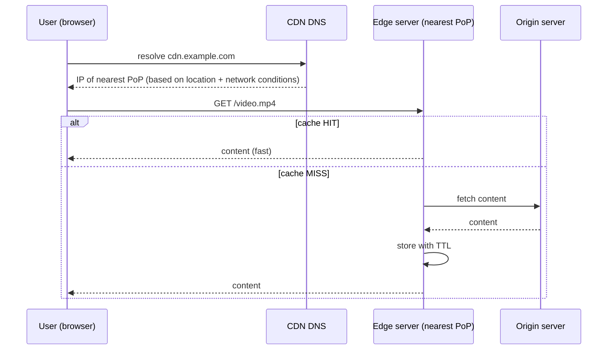
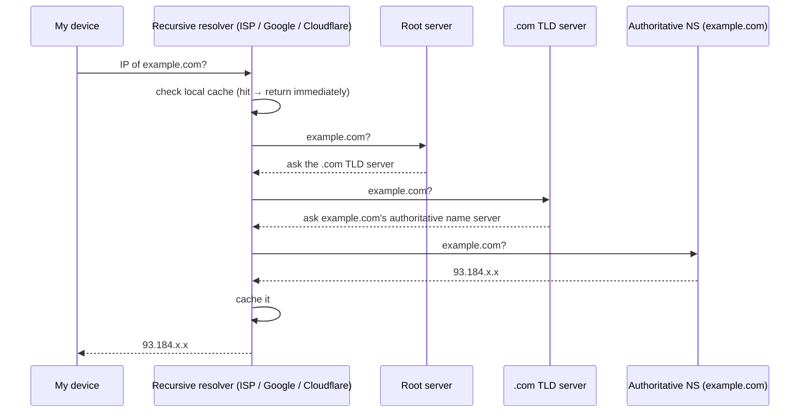
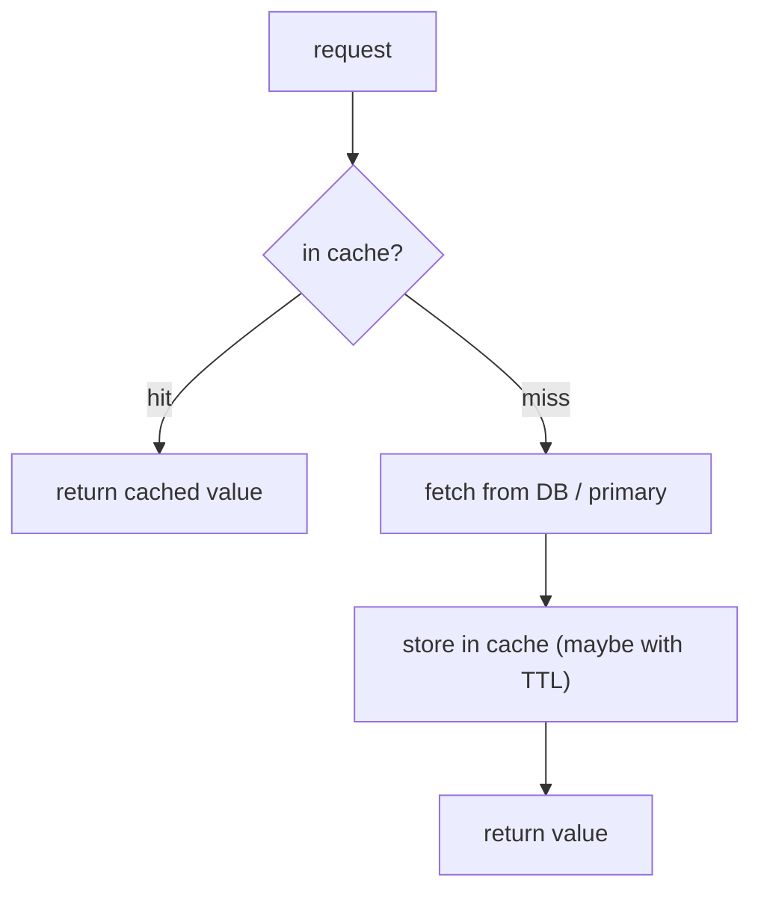
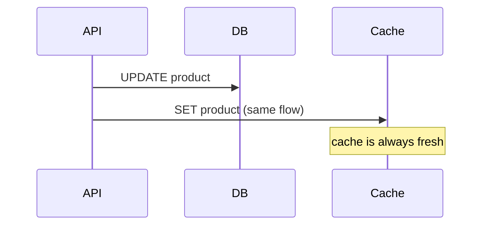
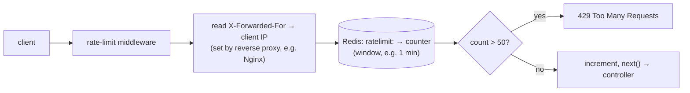

# My Notes: Caching, the Secret Behind It All

> **Source:** "13. Caching, the secret behind it all" by Sriniously, *Backend from first principles* playlist (YouTube, 1:04:23)
> **Link:** https://www.youtube.com/watch?v=estH64OkwxU
>
> I wrote these from the video's full caption track, summarised in my own words. The diagrams and code sketches are my own illustrations.

---

## 1. What caching is

- **One line:** a way to **reduce the time and effort** needed to do some work.
- **More precisely:** keep a **subset** of the primary data (chosen by how often it's used, how likely it is to be needed next, etc.) in a place that's **faster and cheaper to access**.
- It's a huge factor in high-performance apps, especially ones that track latency in tens of micro- or milliseconds.

```
            ┌───────────────────────────┐
 request ──►│  CACHE (fast, small)       │── hit ──► fast response
            │  subset of the data        │
            └────────────┬──────────────┘
                         │ miss
                         ▼
            ┌───────────────────────────┐
            │  PRIMARY source (slow,     │──► compute / fetch ──► store in cache ──► respond
            │  big): DB, origin, algos   │
            └───────────────────────────┘
```

- **Cache hit:** the data was in the cache.
- **Cache miss:** it wasn't, so go to the primary source, then (usually) store the result in the cache for next time.

---

## 2. Real-world examples

### Google Search
- Each query goes through very **expensive** work (crawling, indexing, ranking billions of pages), heavy on CPU and memory.
- Queries like "what is the weather today" are searched **millions of times a day**. Recomputing every time would mean high latency and huge server load.
- Google uses a **distributed in-memory cache** (cache servers spread around the world) to store results:
  - **Hit:** return instantly.
  - **Miss:** run the full pipeline, then cache the result for the next person.

### Netflix
- Each title is **encoded** into several resolutions (1080p, 720p, 480p…) and served based on device and network speed, which saves bandwidth and server load.
- To deliver terabytes to millions of people worldwide with little buffering, Netflix uses a **CDN**:
  - **Origin servers** (say, in US data centres) hold the real content.
  - **Edge locations** worldwide are placed strategically so users get **low latency**. Without them, US users would be fine and users in India would suffer.
- It caches only a **subset** at each edge, chosen with ML / trend analysis of what people in that region watch. Caching everything everywhere would cost too much, and cache storage is pricier than disk.
- CDNs are common everywhere: video, images, static web assets (HTML/CSS/JS). **Vercel's edge network** serves frontends from the region closest to the user.

### X / Twitter trending topics
- Trends come from analysing **millions of tweets in real time**: ML, GPUs, terabytes of data. Very expensive.
- Running that for every user who opens Trending would **crash the servers within seconds**.
- Trends change over **hours or days** (e.g. elections), not seconds, so they're **safe to cache**.
- Every few minutes, compute trends per region and store them in an in-memory store like **Redis**. User requests read from the cache, which is why the section loads instantly.
- The same pattern applies to Facebook, LinkedIn, YouTube…

### The pattern
**Cache whenever I want to avoid (1) repeating heavy computation, or (2) repeatedly sending or fetching heavy data.**

---

## 3. Three levels of caching a backend engineer sees

Caching exists everywhere (hardware, software, browsers). The three I'll run into most:

| Level | Examples |
|---|---|
| **Network** | CDN, DNS |
| **Hardware** | CPU L1/L2/L3 caches, RAM |
| **Software** | Redis, Memcached (they rely on hardware/RAM underneath, but I use them through software libraries) |

---

## 4. Network caching: CDN

**Idea:** cache content on servers **geographically close** to users ("edge" servers / nodes / computing), to cut latency and offload the origin.



1. The user requests a resource (image, video, page) via a URL.
2. The browser sends a **DNS query** to resolve the domain to an IP.
3. The **CDN's DNS** routes the request to the nearest **PoP (Point of Presence)**, a regional cluster of edge servers. Routing considers:
   - the user's **geographic location** (a New York user goes to a New York PoP),
   - **network conditions** (a weak connection may go to a PoP serving lower-quality versions to avoid buffering).
4. The **edge server checks its cache**:
   - **Hit:** serve it.
   - **Miss:** fetch from the **origin** (e.g. US), cache it, serve it.
5. **TTL (time to live):** how long content stays cached (e.g. a few hours). After expiry, the next request fetches fresh content from the origin and caches it with a new TTL.

---

## 5. Network caching: DNS

**DNS** turns domain names into IP addresses, and it relies **heavily** on caching because a full lookup is a lot of work.

### Full resolution, when nothing is cached


- **Recursive resolver:** provided by my **ISP** (in India: Jio, ACT, Airtel…) or a **public DNS** (Google, Cloudflare). It's "recursive" because it keeps asking deeper servers until it finds the IP.
- **Root servers** (a small fixed set worldwide, ~13) don't know the IP, but they know the **TLD servers** (`.com`, `.in`…).
- The **TLD server** points to the domain's **authoritative name server**, which has the actual IP.

### Where DNS caching happens (checked in this order)
```
1. Operating system DNS cache   (Windows / macOS / Linux)
2. Browser DNS cache            (Chrome, Firefox...)
3. Recursive resolver cache     (ISP / Google / Cloudflare)
4. Some authoritative servers
   └── only on a miss everywhere → full root → TLD → authoritative walk
```
Each layer that hits **skips the expensive recursive walk**.

---

## 6. Hardware caching and why RAM is fast

```
┌─────────┐   ┌─────────┐
│ CPU core│   │ CPU core│
│  L1     │   │  L1     │     fastest, tiny
│  L2     │   │  L2     │
└────┬────┘   └────┬────┘
     └──── L3 (shared) ─┘     shared between cores
             │
        RAM (main memory)     fast, limited, VOLATILE  ← Redis / Memcached live here
             │
     Disk (HDD/SSD) / network slower, big, PERSISTENT   ← Postgres / MySQL live here
```

- The CPU keeps frequently used or soon-needed data in **L1/L2/L3**.
- **Example:** when I iterate an array sequentially, **predictive algorithms** load nearby memory into cache ahead of time. That's part of why sequential array access is so fast.

### Why RAM is fast (and its trade-offs)
- An **HDD** reads data **mechanically**: a head moves over a spinning disk to find it.
- **RAM** is capacitor-based. Any address is reached directly with an electrical signal, so access time is roughly **constant from any position**. Hence "random access memory."
- **Trade-offs:**
  - **Limited capacity** compared with disk.
  - **Volatile:** data disappears on power-off.
- So RAM can't replace disk. **Disk = persistence; RAM = speed.**

### How in-memory DBs get both
- Redis / Memcached **serve reads and writes from RAM**.
- For **persistence**, they also write to **disk** behind the scenes and **reload into RAM** on startup. That's the tool's job, not mine.

---

## 7. Software caching: in-memory key-value stores

**Technologies:** **Redis**, **Memcached**, cloud-managed ones like **AWS ElastiCache**, and **Valkey** (an open-source Redis alternative).

**What "in-memory key-value NoSQL database" means:**
| Word | Meaning |
|---|---|
| **In-memory** | Data lives in **RAM**, not on disk like Postgres/MySQL, so it's **very fast** |
| **Key-value** | Simple structure: a **key** maps to a **value** (string, number, list, JSON… types vary by tool) |
| **NoSQL** | No strict schema, tables, or rows like relational DBs |

```
KEY                          VALUE
"user:42:profile"     →      {"name":"Dilip","bio":"..."}
"trending:IN"         →      ["#topic1","#topic2",...]
"ratelimit:10.0.0.12" →      37
```

---

## 8. Caching strategies

### 8.1 Lazy caching (cache-aside)

- Only cache data **when someone actually requests it**. No proactive prediction.
- Very common in backend work.

```js
async function getProduct(id) {
  const cached = await redis.get(`product:${id}`);
  if (cached) return JSON.parse(cached);              // HIT
  const product = await db.products.findById(id);     // MISS
  await redis.set(`product:${id}`, JSON.stringify(product), { EX: 3600 });
  return product;
}
```

### 8.2 Write-through

- About **updating** the cache: on every write (POST/PUT/PATCH), update **the DB and the cache together** in the same flow.
- **Pro:** the cache is **always fresh**, never stale.
- **Con:** **every write has extra overhead**.

---

## 9. Eviction policies

The cache lives in **limited RAM** (or a managed service with a size cap), so it **will** fill up. It's meant to hold a **subset** anyway, so I need a rule for **what to remove** to make space for more important data.

| Policy | Rule |
|---|---|
| **No eviction** | Nothing configured. Inserting into a full cache **errors** ("memory full"). Rarely what I want |
| **LRU (least recently used)** | Remove the key **accessed longest ago** |
| **LFU (least frequently used)** | Remove the key **accessed the fewest times** |
| **TTL-based** | Keys **expire** after their time to live. When full, evict what's **closest to expiring** |

```
Cache full with keys 1,2,3,4 — key 5 arrives

LRU: last access → 1: today, 2: today, 3: today, 4: YESTERDAY
     → evict 4, insert 5

LFU: access count → 1: 5 ◄ fewest, 2: 10, 3: 6, 4: 23
     → evict 1, insert 5

TTL: evict whichever key expires soonest, insert 5
```

Beyond this, **using** Redis is simple: install the client for my language (e.g. `node-redis`), `SET key value`, `GET key`. No joins or aggregations. Understanding the internals just helps me make better decisions.

---

## 10. Backend use cases

### 10.1 Database query caching
- **Scenario:** a heavy SQL query (many joins, aggregation over millions of rows) behind an API that's hit often (landing page, dashboard), putting load on the DB.
- **Fix:** cache the result with a **TTL** (e.g. 1 hour). Serve from cache, compute once on a miss. On relevant changes, **update or delete** the cache entry.
- **Real examples:**
  - **Amazon** caches **product details, prices, inventory**. During a big sale, millions hit the same product page, and its details rarely change, so caching saves the DB for important work.
  - **Social platforms** cache **user profiles**, which change a few times a year. A celebrity's profile might be hit thousands or millions of times a day. Invalidate when it changes.
- **Rule:** **read-heavy + infrequent writes → great caching candidate.**

### 10.2 Session storage
- After login, a **session token** is created and stored (see the auth video).
- Every request has to look it up, so store sessions in **Redis**: much faster than a DB, lower latency on every API call, less DB load.

### 10.3 External API caching
- **Scenario:** my backend calls a **weather API** and processes the result for my frontend.
- Without caching, **every** frontend request triggers an external call. With many users, I quickly hit **rate limits** or **run up the bill**.
- Weather doesn't change by the second, so it's **safe to cache**: store it with a **TTL of ~1 hour**. All requests in that hour use the cache, and after expiry the next request fetches fresh data and caches it again.
- **Whenever I integrate an external API, think about caching.**

### 10.4 Rate limiting

- A **middleware** before the controllers.
- Reads the client's **public IP** from a header like **`X-Forwarded-For`** (usually added by a reverse proxy).
- Keeps a **counter per IP** for a time window (e.g. **50 requests per minute**). Each request increments it, and over the limit returns **429 Too Many Requests**.
- Protects against **bots** and saves compute on expensive APIs.
- **Why Redis, not Postgres?** Possible with Postgres, but:
  1. A DB call on **every** request adds latency (even 20–30 ms matters).
  2. Thousands of users × hundreds of requests a minute would **flood the DB** with rate-limit queries.

```js
// sketch
const key = `ratelimit:${ip}`;
const count = await redis.incr(key);
if (count === 1) await redis.expire(key, 60);   // 1-minute window
if (count > 50) return res.status(429).json({ error: "Too many requests" });
next();
```

### Next step he suggests
- Try **Redis** or **Valkey** with a client library in my language, and feel the difference vs a relational DB.

---

## 11. My cheat sheet

```
CACHING = keep a SUBSET of data in a FASTER place → less time + effort
  hit = found in cache · miss = go to source, then store
  cache when avoiding: heavy computation OR heavy data transfer

EXAMPLES
  Google: distributed in-memory cache for popular query results
  Netflix: CDN edge locations, region-aware subset (ML), multiple encodings
  Twitter trends: compute every few minutes → Redis → instant reads

LEVELS
  Network  : CDN (edge/PoP, DNS routing, TTL, origin on miss)
             DNS (OS → browser → recursive resolver → root → TLD → authoritative; cached at each layer)
  Hardware : L1/L2/L3 → RAM (fast, limited, volatile) → disk (slow, big, persistent)
  Software : Redis / Memcached / ElastiCache / Valkey = in-memory key-value NoSQL
             RAM for access, disk behind the scenes for persistence

STRATEGIES
  Cache-aside (lazy): read cache → miss → DB → set cache → return
  Write-through: write DB + cache together → always fresh, slower writes

EVICTION (cache is finite)
  no-eviction (errors when full) · LRU (oldest access) · LFU (fewest accesses) · TTL (soonest expiry)

BACKEND USE CASES
  heavy/frequent DB queries (Amazon products, social profiles) → TTL + invalidate on change
  session tokens → Redis
  external APIs (weather) → TTL ~1h → fewer calls, avoid rate limits/billing
  rate limiting → Redis counter per IP (X-Forwarded-For), 429 when exceeded
  rule: READ-HEAVY + RARE WRITES → cache it
```
