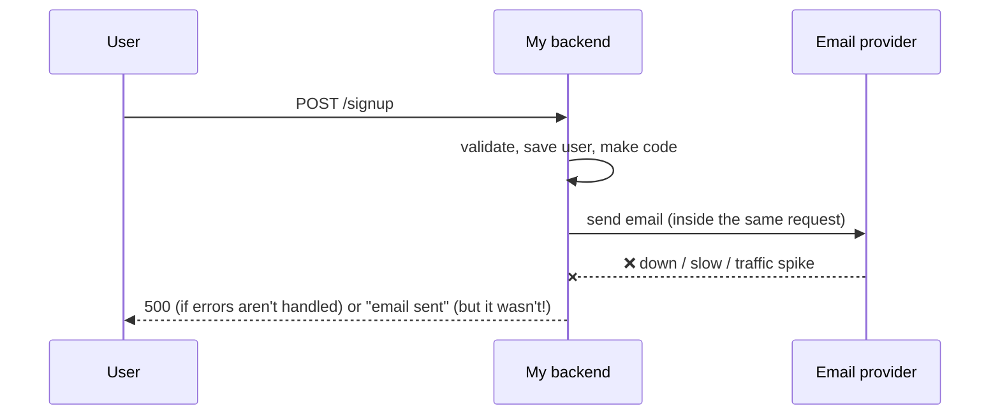
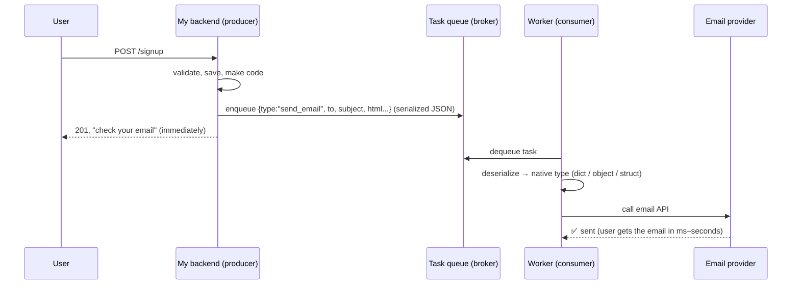
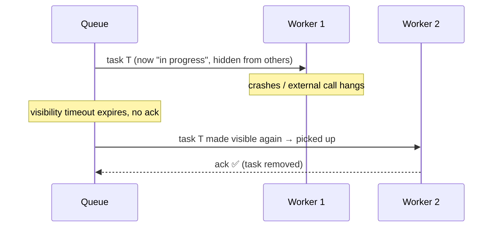
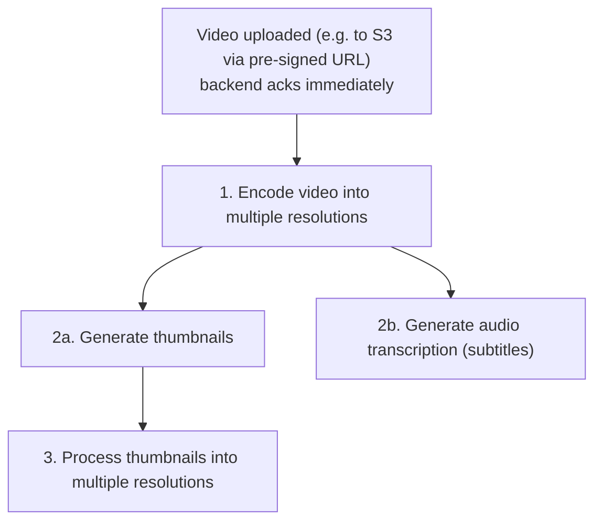

# My Notes: Task Queues and Background Jobs

> **Source:** "14. Task queues and background jobs" by Sriniously, *Backend from first principles* playlist (YouTube, 55:47)
> **Link:** https://www.youtube.com/watch?v=r-nQsyguU1Y
>
> I wrote these from the video's full caption track, summarised in my own words. The diagrams and code sketches are my own.

---

## 1. What a background task is

- **Any code that runs outside the request–response life cycle.**
- It doesn't have to happen **immediately**. It isn't something the client must wait for, so it can be **offloaded to a separate process** and finish on its own schedule.
- Knowing this well is key to building **scalable, responsive** backends.

```
Client ──request──► Server ──response──► Client        ← request-response cycle
                       │
                       └──► (offloaded) background work, done later in another process
```

---

## 2. Why: the sign-up email example

**Flow:** the user signs up (email, name, password) → the frontend calls my API → the backend validates and saves the user → the backend must **send a verification email** (a link, or a 6–8 digit one-time code) to prove the user owns that address.

**Sending email means calling a third party** (e.g. Resend, Mailgun, Brevo): build the HTML template with the code/link, set recipient, sender, subject → call the provider's API → they verify my API key, send, and reply success or failure.

### Doing it synchronously (the problem)

- I **don't control** the other server. It may be down or slow.
- **No proper error handling:** the email call fails, so **the whole signup API fails**. Terrible UX.
- **With error handling:** signup succeeds, but I tell the user "we sent you an email" when **it never went out**. They come back and click "resend". If the service is still down, it fails again, and so on.

### Doing it in the background (the fix)

- The API **packages everything needed** (template, sender, recipient, subject, user info) into a serializable format like **JSON**, **pushes it to a queue**, and **returns immediately** with 200/201.
- A **consumer / worker**, a program in a **separate process**, picks it up, **deserializes** it into the language's native type, and runs the **registered handler**: the same code I'd otherwise have run inline.
- Different queues can serve different jobs (email queue, in-app notification queue, push notification queue…), each with its own consumers. That's all configurable.
- **Latency isn't a concern:** a verification link usually lasts 15–20 minutes, and the email arrives in milliseconds, or 5–10 seconds under heavy load.

---

## 3. Retries and exponential backoff

If the email service is down, the worker's handler **fails**, so the **task fails**. Inline, that would have been a 500. In the background, the framework **re-enqueues it for a retry**.

| Language | Popular library |
|---|---|
| Python | **Celery** |
| Node.js | **BullMQ** |
| Go | **Asynq** |

**Exponential backoff:** each retry waits longer, up to a configured **max retries** (e.g. 5).
```
fail → retry after 1 min → fail → 2 min → fail → 4 min → fail → 8 min → ...
```
- Big providers rarely stay down for minutes on end (outages are seconds), so a task usually succeeds by the 2nd or 3rd attempt. **The user still gets the email, even though the provider was down.**

### Benefits so far
1. **Responsiveness:** the API isn't blocked by slow external services or heavy processing.
2. **Built-in reliability:** retries and failure detection for flaky work.

**Summary:** background tasks offload **time-consuming, non-critical** work, so APIs stay fast, **timeouts** from external dependencies are avoided, and **UX** improves.

---

## 4. What usually goes to the background

| Task | Why background |
|---|---|
| **Sending emails** | Depends on an external provider |
| **Image / video processing** | e.g. resizing an uploaded image into several sizes (small for phones, large for desktop) for different networks and devices. Heavy work |
| **Generating reports** | e.g. a project-management app sending **daily / weekly / monthly** PDF or HTML reports (completed / pending tasks, sprint stats) at fixed times like midnight or Sunday 12:00. Runs on a **schedule (cron)**. Celery and BullMQ support **scheduled tasks** |
| **Push notifications** | (e.g. Swiggy / Zomato phone alerts) |

**How push notifications work:**
```
Install app → device registers with the OS push service (Google / Apple)
           → backend stores the device's token in its DB
To notify  → backend calls Google's / Apple's push service with that token
           → THE OS SERVICE delivers it to the phone (the backend can't directly)
```
That's an external service call, so it goes in the background.

---

## 5. How a task queue works

**Task queue:** a system for **managing and distributing** background jobs, the engine that lets me **reliably hand off work** to another process. Think of it as **a to-do list for the backend**: app code adds items, workers take them one by one and do them.

```
┌──────────────┐  enqueue  ┌────────────────────────┐  dequeue  ┌──────────────┐
│  PRODUCER    │ ────────► │  QUEUE / BROKER         │ ────────► │  CONSUMER /  │
│  (my app:    │ serialize │  holds tasks until a    │           │  WORKER      │
│  Node/Py/Go) │  (JSON)   │  worker is ready        │           │  separate    │
└──────────────┘           │  RabbitMQ · Redis       │ ◄──ack─── │  process/    │
                           │  (pub/sub) · AWS SQS    │           │  thread      │
                           └────────────────────────┘           └──────────────┘
```

| Part | Role |
|---|---|
| **Producer** | My application code. **Creates** the task with **all the info** the worker needs (user ID, name, email, image, report data…), **serializes** it, and **enqueues** it (pushes onto the queue) |
| **Queue / broker** | **Stores tasks temporarily** until a worker is ready. Backed by tech like **RabbitMQ**, **Redis pub/sub**, or **AWS SQS** (managed and multi-region, good for scaling worldwide) |
| **Consumer / worker** | Runs in a **separate process or thread** (same codebase or a separate one). **Watches** the queue, **dequeues** new tasks (takes them off), and **executes** the registered handler |

Details differ by language and library, but the fundamentals are the same.

```js
// BullMQ-style sketch (Node.js)
// producer (inside the signup handler)
await emailQueue.add("verify-email", { to: user.email, code }, {
  attempts: 5, backoff: { type: "exponential", delay: 60_000 },
});
res.status(201).json({ message: "Check your email" });

// consumer (separate worker process)
new Worker("email", async (job) => {
  await emailProvider.send({ to: job.data.to, html: render(job.data.code) });
});
```

---

## 6. Acknowledgements and visibility timeout

- **Acknowledgement (ack):** when a worker **finishes** a task, it sends an **ack** back. The queue then knows it succeeded and **removes** it.
- **No ack:** depending on settings, the queue treats it as unresponsive or failed and applies its **retry** mechanism. Celery, BullMQ, and Asynq handle these edge cases for me.

**Visibility timeout:**

- The window during which a task counts as **in progress** for one worker.
- If no ack arrives in time (the worker **crashed**, or an external service **hung**), the queue makes the task **available to other workers**.
- **Purpose: tasks never get lost.** Someone must eventually ack it as success or failure.

---

## 7. Types of tasks

### 7.1 One-off tasks (the most common)
A single job triggered by an event:
- verification email on sign-up, **welcome email** after verification, **password-reset email**, a **notification** when someone messages a user.

### 7.2 Recurring tasks
Run **periodically** on a schedule:
- **daily / monthly / annual reports**,
- **cleanup / maintenance**: e.g. with stateful auth, users who log in and out over time leave **orphaned / abandoned sessions** in the `sessions` table. A monthly (or every 2–3 months) job deletes stale sessions to free space.

### 7.3 Chained tasks (parent → child)
Tasks that **depend on earlier tasks**. **Example: an LMS (like Udemy)** where an instructor uploads a course video:


- **Encode first**, so it can be served efficiently via CDNs to all devices and networks.
- After encoding: **thumbnails** and **transcription** can run **in parallel** (they don't depend on each other, only on encoding).
- **Thumbnail resizing** depends on thumbnail generation.
- A child runs **only after its parent succeeds**.

### 7.4 Batch tasks
One trigger spawns **many** tasks:

**Delete account:**
- A large user may have data across many tables, shards, and regions, too much to delete in one request (could take 40–60+ seconds, and I can't block an API that long).
- So the API **enqueues a "delete account" task** and **immediately returns 200**. The frontend logs the user out.
  - Optionally a **grace period** ("log back in within 3–7 days to cancel").
- The worker then walks everything: projects the user owns, their entities in those projects, profile, assets (logos, cover images), finally the account, then a "your account was deleted" email. One task fans out into many **sub-tasks**.

**Scheduled reports at scale:** at midnight, enqueue **thousands of "generate & send report" tasks**, one per user.

---

## 8. Design considerations

Especially at scale (thousands of users, large platforms):

| Consideration | What it means |
|---|---|
| **Idempotency** | Tasks must be safe to run **multiple times** without side effects. E.g. in delete-account, do the work inside a **transaction**, so if something fails midway (DB or external call) it **rolls back** and the retry starts **cleanly from 0%** |
| **Error handling** | Everything runs in another process, so be **robust and thorough**: catch and **log** errors, and **retry** failed tasks. Don't miss edge cases |
| **Monitoring** | Always know queue length, successes, failures, and **why** failures happen (external vs internal). E.g. emit **metrics** on each task event to **Prometheus** and view them in **Grafana**. (Logs, traces, metrics, ELK get a later video) |
| **Scalability** | Design to **scale consumers horizontally**: add worker nodes when users double so processing stays responsive |
| **Ordering** | If tasks must run **in order**, make sure the library supports **ordered delivery** |
| **Rate limiting** | When tasks call **external services**, rate-limit them so I don't overload those services, hit their limits, or run up per-call costs |

---

## 9. Best practices

1. **Keep tasks small and focused:** one task = one unit of work.
   - If one fails, others aren't affected.
   - Dependent steps → use **chained tasks**, so a failed child retries alone (with backoff) instead of redoing the whole thing. A huge task that fails late wastes CPU repeating everything.
   - Easier to scale, debug, monitor, and retry.
2. **Avoid long-running tasks:** a task that takes ages is a signal to **split** it into concurrent tasks or parent–child chains.
3. **Proper error handling and logging:** so the queue can retry, and I have what I need to debug (external vs internal failure).
4. **Monitor queue length and worker health** with **alerts**: if the queue grows past a threshold, scale up. If workers keep dying, investigate.

**Recap:** background tasks are essential for **scalable, reliable, responsive** backends. They offload slow, non-critical work, improve UX, prevent timeouts, and give **retries** for external dependencies and heavy processing.

---

## 10. My cheat sheet

```
BACKGROUND TASK = code outside the request-response cycle; not needed immediately

WHY
  external services (email/push) can be slow or down → don't block or fail the API
  heavy work (image/video, reports) → don't make the user wait
  free retries + failure detection

FLOW
  API (producer) → serialize task (JSON) → ENQUEUE → broker → worker DEQUEUES
  → deserialize → run handler → ACK (removed)    API returns 200/201 right away

TOOLS
  libraries: Celery (Python) · BullMQ (Node) · Asynq (Go)
  brokers:   RabbitMQ · Redis pub/sub · AWS SQS (managed, multi-region)

RELIABILITY
  retries with exponential backoff (1→2→4→8 min, max N)
  ack on success · visibility timeout → re-offer to other workers → tasks never lost

TYPICAL JOBS
  emails · image/video processing · scheduled reports (cron) · push notifications (via Google/Apple)

TASK TYPES
  one-off (verify/welcome/reset email) · recurring (reports, session cleanup)
  chained (encode → thumbnails + transcripts in parallel → resize thumbnails)
  batch (delete account fan-out; thousands of nightly reports)

DESIGN
  idempotent (transaction + rollback → clean retry) · robust errors + logging
  monitoring (Prometheus + Grafana) · horizontal worker scaling · ordering · rate-limit externals

BEST PRACTICES
  small focused tasks · split long ones · log everything · alert on queue length & worker health
```
