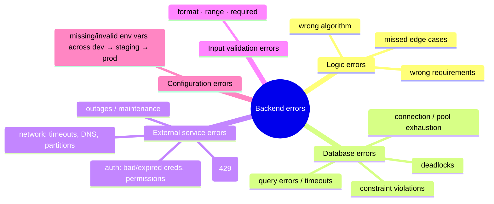
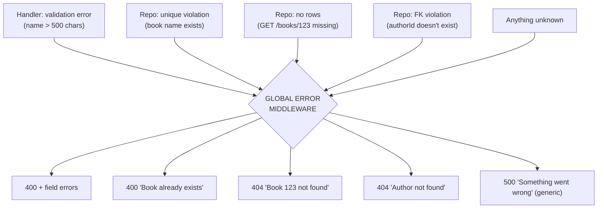

# My Notes: Error Handling and Building Fault-Tolerant Systems

> **Source:** "16. Error Handling and Building Fault Tolerant Systems" by Sriniously, *Backend from first principles* playlist (YouTube, 1:09:25)
> **Link:** https://www.youtube.com/watch?v=8NaM_9aKS24
>
> I wrote these from the video's full caption track, summarised in my own words. The diagrams and code sketches are my own (the video itself shows no code; it's about mindset).

---

## 1. The mindset

- Errors aren't rare problems. They're a **normal part** of backend systems.
- DB queries **will** fail, external APIs **will** time out, users **will** send bad data, business logic **will** hit edge cases.
- **The question isn't *if* errors happen, but *how I handle them* when they do.**
- No tools or frameworks here. It's a **fault-tolerant mindset**: be ready for the worst, know what to watch, how to detect, how to prevent.

---

## 2. Types of errors



### 2.1 Logic errors (the sneakiest and most dangerous)
- The app **doesn't crash**. It just **does the wrong thing**: code runs, results are wrong.
- **Example:** an e-commerce store applies a discount **twice**, producing **negative shipping costs**. Nothing breaks, but the business **loses money on every order**, possibly for **weeks or months** unless monitoring or users catch it.
- **Common causes:**
  - **Misunderstood requirements** (unclear points from a client/PM meeting get built as written, and with weak testing they reach production).
  - **Incorrect algorithms** (e.g. a complex discount engine based on purchase history with one small miscalculation).
  - **Unconsidered edge cases** (unexpected user behaviour in payment or discount flows).
- In payments, money, or security, they can **silently corrupt data** and **business results**.

### 2.2 Database errors (can take the whole system down)
Most backends depend heavily on the DB.

| Kind | Examples / notes |
|---|---|
| **Connection errors** | App can't reach the DB: network down, DB overloaded, **connection pool exhausted**. (Pooling keeps open TCP connections so each request skips the handshake.) Result: 500s and empty frontends, so the app can't function |
| **Constraint violations** | **Unique**: creating a user with an existing email. **Foreign key**: inserting an order with a `customer_id` that doesn't exist. Often a sign of a **weak validation layer** (front and back). Unique violations **can't** be prevented upfront (only the DB knows), so **format a friendly error** ("this email already exists, try another"). Unhandled, they bubble up as **500s** |
| **Query errors** | Malformed SQL, e.g. a **typo** in a table name (`customrs` instead of `customers`), or overly complex queries that **time out** |
| **Deadlocks** | Several operations **waiting on each other** in a circular dependency. Tricky |

### 2.3 External service errors
Modern SaaS depends on **payment processors, email providers, object storage (S3), Redis, auth providers (Auth0, Clerk)**… **Each is a point of failure I don't control.** I can't avoid them (rebuilding all that isn't practical), so I **plan for their failure**.

| Cause | Notes |
|---|---|
| **Network** | Timeouts, DNS failures, network partitions. The internet isn't perfect |
| **Authentication** | Requests rejected for bad credentials, expired tokens, insufficient permissions. Also: using an auth provider doesn't make **my** backend secure. I can still leak sensitive data in **my logs** |
| **Rate limiting** | Providers (OpenAI, Resend…) limit request rates to stop abuse. A traffic spike or a logic bug can make me exceed it, and I get **429 Too Many Requests**. Handle with **exponential backoff**: wait 1 min → 2 → 4… until success |
| **Outages** | Big cloud incidents (GCP, AWS) take down lots of their clients. Also planned maintenance. Handle **gracefully** with **fallbacks**: e.g. Redis down → in-memory cache or a second Redis node, so critical flows (payments, orders) keep working |

```
429 → wait 1m → retry → 429 → wait 2m → retry → 429 → wait 4m → retry → ✅
```

### 2.4 Input validation errors (the easiest to handle)
- Caused by users sending data that doesn't meet my rules. The **validation layer** at the entry point is my **first line of defence** against bad or malicious input. (See video 9.)
  - **Format:** email, phone, date, or any custom format. Be **explicit** and accept **only** that.
  - **Range:** amounts too high/low, strings too long/short, arrays with fewer than 3 or more than 100 items…
  - **Required fields:** mandatory fields present.
- Respond with **400 Bad Request**.
- I already know my data requirements, so these are the easiest to anticipate. **Always have a robust validation layer.**

### 2.5 Configuration errors
- Show up when moving between **dev → staging → production**.
- **Example:** I add `OPENAI_API_KEY` locally, merge the PR, but **forget to add it in production** (manual setup, AWS Parameter Store…).

```
Scenario A (GOOD): validate required config AT STARTUP
  missing var → app refuses to start → blue-green deploy keeps old version running → no outage

Scenario B (BAD): no startup check
  app starts → later a user hits the image-generation API → service reads missing key → 500 at runtime
```
- **Rule:** **validate all required (non-optional) config before the server starts.** Fail fast and loudly. **Crashing at startup beats failing in front of real users.** (Config management gets its own video next.)

```js
const required = ["DATABASE_URL", "OPENAI_API_KEY", "JWT_SECRET"];
for (const key of required) {
  if (!process.env[key]) {
    console.error(`Missing required config: ${key}`);
    process.exit(1);           // fail before serving traffic
  }
}
```

---

## 3. Prevention: catch errors before they spread

**Key idea: the best error handling starts before errors happen.** Detect issues the moment they appear, before they cause damage. That holds for frontend, backend, or infra.

### Health checks
- Expose an endpoint like **`/health`** or **`/status`**. What matters is the **status code**: **200 = running**; 4xx/5xx = problem. External tools ping it continuously.
- **But "is it running" isn't enough.** Also check that it's **actually doing its job**:

| Check | What to verify |
|---|---|
| **Database** | Connectivity, **query performance** (a query that used to take 500 ms now taking 4–5 s is a warning), data integrity. Run a **representative query** and track its time |
| **External services** | **Payments:** periodic **test transactions** (if one succeeded 5 minutes ago, real ones should work). **Email:** send test emails to internal addresses. **Auth:** generate test tokens and validate them against the provider's endpoints |
| **Core functionality** | Config **loaded correctly**, required **caches populated**, internal data structures **consistent** |

Together that's **proactive error detection**.

---

## 4. Monitoring and observability (brief)

Covered in depth in a later video. Key points here:
- Goal: **detect errors quickly as they happen**, with **enough context to debug**.
- **Don't just track error rates.** **Performance degradation** is often an **early warning** before failure.
- Cover **every error source**: HTTP, database, external services, business logic.
- **Performance metrics:** response times, resource usage, throughput.
- **Business metrics:** e.g. a **sudden drop in successful transactions** can reveal a technical issue **even when error rates look normal**. Also track successful logins, etc.
- **Logging:** use **structured logs (JSON)**, easy to parse and enrich. Aggregate and explore them in tools like **Grafana / Loki** (dashboards, search, storage).

---

## 5. Philosophies for responding to errors

### 5.1 Immediate response: recoverable vs non-recoverable
| Kind | Example | Strategy |
|---|---|---|
| **Recoverable** | Email provider failed (delay is acceptable), network blips, temporary resource limits like **exhausted DB connections** | **Retries / exponential backoff**. ⚠️ Don't **overwhelm an already stressed system** with aggressive retries |
| **Non-recoverable** | Something can't be fixed by retrying | **Containment + graceful degradation**: serve **cached data**, **disable non-essential features**, offer **alternative/fallback** functionality, **limit the blast radius** |

### 5.2 Recovery strategies
- **Automatic recovery** (no humans): **restart** a hung service or process, **clean up corrupted caches**, **switch to backup systems**. Design carefully, because these can make things **worse**. Test them by deliberately pushing services to failure thresholds ahead of time and seeing what works.
- **Manual recovery** (needs human judgement): **document** the runbooks so the whole team and new hires know what to do in an incident, and **test** them so they run **quickly under stress**.
- **Data recovery:** **data is the most important thing**. Code and services are replaceable; user, transaction, and order data isn't. **Protect data integrity first**: backups at key moments, restore from backups, replay transaction logs, specialised recovery tools.

### 5.3 Propagation control
- Not every error should be handled **where it occurs**. Often it should **bubble up** to a level with **more context** (think stack traces).
- Keep bubbling **under control**, so it doesn't spread to other services or crash the main process.
- **Exception hierarchies** (try/catch in JS/Python): catch low-level errors, **wrap them with context**, rethrow higher up, so I can log properly, send a meaningful response, or trigger recovery.

### 5.4 Error boundaries
- Points where errors **stop propagating**. In service architectures they keep **one service's failure from taking down others**:
  - **Separate processes**
  - **Timeouts** at service boundaries
  - **Message queues** (e.g. **RabbitMQ**) for **async, decoupled** communication, so a bug in one service doesn't break another

---

## 6. Global error handling: the final safety net

His favourite mechanism. A **one-time effort** at setup (then small tweaks), and it pays off immediately.

### The architecture recap
```
ROUTER → HANDLER (deserialize, validate, bind) → SERVICE (orchestrates) → REPOSITORY (one DB query each)
  e.g. service getUserWithPosts() calls repo getUserById() + repo getPostsByUser()
```

### The pattern
- Errors can come from **any layer**:
  - **Handler:** validation errors
  - **Service:** internal / business errors
  - **Repository:** database errors
- **Bubble every error up** to a single **global error-handling middleware** (it sees all requests and responses):
  - JS/Python: **throw**, and the middleware **catches**.
  - Go: **return** errors up the chain (repo → service → handler → middleware).
- Use **custom error types** (every language supports them).
- The middleware **inspects the error type** and returns the right HTTP response.



### Worked examples (book-management app, Goodreads-like)
| Situation | Raw error | Response |
|---|---|---|
| `POST /books` with a 700-char name (rule: max 500) | Validation error from handler | **400** + validation messages |
| `POST /books` with a name that already exists | **Unique constraint violation** from DB | **400** "Book already exists" |
| `GET /books/123` where 123 doesn't exist (bad or malicious link) | DB driver's **"no rows"** error | **404** "Book with ID 123 doesn't exist" |
| `POST /books` with an `authorId` that doesn't exist | **Foreign key violation** | **404** "Author not found" |
| Anything else unrecognised | Unknown | **500** "Something went wrong" |

```js
// sketch of a global error middleware (Express-style)
app.use((err, req, res, next) => {
  if (err instanceof ValidationError)
    return res.status(400).json({ code: 400, message: "Invalid input", errors: err.fields });
  if (err.code === "23505")            // Postgres unique_violation
    return res.status(400).json({ code: 400, message: "Book already exists" });
  if (err.code === "23503")            // Postgres foreign_key_violation
    return res.status(404).json({ code: 404, message: "Referenced resource not found" });
  if (err instanceof NoRowsError)
    return res.status(404).json({ code: 404, message: "Resource not found" });
  logger.error({ err, requestId: req.ctx?.requestId });   // log details internally
  return res.status(500).json({ code: 500, message: "Something went wrong" });
});
```

**Typical HTTP error structure:** `code` (HTTP status), `message`, plus optional **field errors** (an array of objects) for forms.

### Why it's worth it
1. **More robust:** no layer can **forget** a condition. Without it, if one repository method forgets to handle a unique violation, the user gets a vague **500** instead of "book already exists."
2. **Less redundancy:** no repeating "is it unique? is it FK?…" checks in every repository method. That repetition means more code and more bugs.

---

## 7. Security in error handling

### 7.1 Don't leak internals in error messages
- Raw DB errors can contain **table names, index names, constraint names**. Passing them straight to the client lets attackers **map the system** and try advanced attacks (smarter SQL injection), or make my platform a target.
- **Control every message.** The **default/fallback 500** should just say **"Something went wrong" / "Internal server error"**. If it got that far, it's unknown and likely has internal details.
- Leaking **user data** is even worse than leaking platform internals. It destroys trust and goodwill.

### 7.2 Auth endpoints: don't reveal which part failed
- Auth is one of the **most attacked** modules. Follow the **OWASP Cheat Sheet Series** for relevant guidance.
- ❌ "No user with this email" / "Incorrect password"
- ✅ **"Invalid email or password"** for both cases.

```
Attacker loop with detailed errors:
  try emails with one password → "user doesn't exist" ... "user doesn't exist" ...
  → "incorrect password"  ← now they KNOW this email is real
  → brute-force common passwords on that one account
Generic message → they can't tell which part was wrong
```

### 7.3 Don't log sensitive data
- **Never log** emails, passwords, API keys, credit card numbers.
- Logs aren't as private as they seem. At scale (hundreds of GB per day) companies use **multiple external services** for storage, analysis, and observability, and **many major breaches involve leaked logs**.
- Log **user IDs** and **correlation/request IDs** instead, enough context without the risk.

```js
// ❌ logger.error(`Login failed for ${email} with password ${password}`);
// ✅
logger.warn({ event: "login_failed", userId: user?.id ?? null, requestId });
```

---

## 8. My cheat sheet

```
MINDSET   errors WILL happen; plan how to detect, contain, recover

ERROR TYPES
  Logic        no crash, wrong results (double discount → negative shipping) — most dangerous
  Database     connection/pool · unique & FK violations · malformed/slow queries · deadlocks
  External     network (timeouts/DNS/partitions) · auth · rate limit 429 → exponential backoff
               outages → fallbacks (e.g. Redis down → in-memory / second node)
  Validation   format · range · required → 400 (easiest; robust validation layer)
  Config       validate required env vars AT STARTUP → fail fast (blue-green keeps old version up)

PREVENTION
  /health (status code matters) + deep checks: DB query timing · test payments/emails/tokens
  · config loaded · caches warm · data consistent

MONITORING
  errors + PERFORMANCE (early warning) + BUSINESS metrics (drop in successful transactions)
  structured JSON logs → Grafana/Loki

RESPONSE
  recoverable → retry/backoff (don't overload stressed systems)
  non-recoverable → contain + degrade gracefully (cache, disable non-essentials, fallback)
  automatic recovery (restart, clean caches, failover) · manual runbooks (documented, tested)
  DATA INTEGRITY FIRST (backups, restore, replay logs)
  propagate with context · error boundaries (processes, timeouts, message queues)

GLOBAL ERROR MIDDLEWARE (final safety net)
  bubble errors from handler/service/repo → one place → map to responses
  validation → 400 · unique → 400 · no rows → 404 · FK → 404 · unknown → 500 generic
  + robust (nothing forgotten) + no redundancy

SECURITY
  never expose DB internals · generic 500 message
  login: "Invalid email or password" (OWASP cheat sheets)
  never log emails/passwords/API keys/cards → log userId + requestId
```
