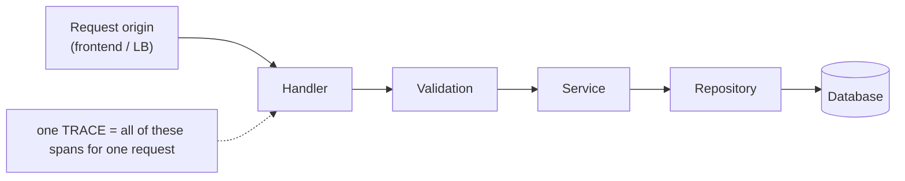
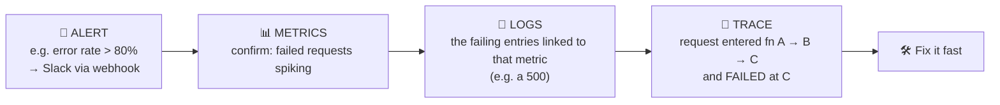

# My Notes: Logging, Monitoring and Observability

> **Source:** "18. Logging, Monitoring and Observability" by Sriniously, *Backend from first principles* playlist (YouTube, 39:51)
> **Link:** https://www.youtube.com/watch?v=5PEuwgLOQQM
>
> I wrote these from the video's full caption track, summarised in my own words. He demos a Go to-do backend instrumented with New Relic. The code below is my own simplified sketch of the same ideas, not his code. (A sponsor segment is left out.)

---

## 1. It's a spectrum, not a checklist

- Each of logging, monitoring, and observability could fill its own video.
- These are **practices**, not fixed rules. Companies adopt them **to varying degrees**. No one can claim to follow "all" the best practices.
- Good to know so I don't feel **intimidated** by all the buzzwords, products, and tools.
- He **breaks the "no code" rule** for this video: these practices only make sense next to code.

---

## 2. Why we need it

- Modern backends run **distributed**: many servers, many regions, users worldwide.
- I need **tools, practices, and methods** to **keep track of what's happening** across all services and infrastructure.
- (These apply to frontends too, but the focus here is backend.)

---

## 3. The three terms

| Term | What it means | Analogy / question answered |
|---|---|---|
| **Logging** | **Record important events** (business events, suspicious and security events, errors) **with metadata**: user ID, latency, which function or method ran… | The app's **journal/diary**. *What happened, when, and why?* |
| **Monitoring** | **Continuously track the health and performance** of the system and its parts: server CPU, memory, requests/sec, DB connections in the pool… plus patterns **over time** | *Is it healthy right now? What's the trend?* |
| **Observability** | Being able to **work out the internal state** of the system **from its external outputs** | *What exactly is wrong, and where?* |

**"Real time" is approximate:** usually about a **10–15 second delay**, so the logging/monitoring systems aren't flooded with data every millisecond. (Some tools go near-instant.)

---

## 4. Three pillars of observability

A system counts as **observable** only if **all three** are in place:

```
        ┌──────────────────── OBSERVABILITY ────────────────────┐
        │                                                       │
   ┌─────────┐            ┌──────────┐            ┌──────────┐
   │  LOGS   │            │ METRICS  │            │  TRACES  │
   │ what    │            │ patterns │            │ how      │
   │ happened│            │ & trends │            │components│
   │         │            │ (numbers)│            │ interact │
   └─────────┘            └──────────┘            └──────────┘
```

| Pillar | Description |
|---|---|
| **Logs** | Records of important events across the request life cycle, app startup, shutdown… |
| **Metrics** | **Numbers** over time, current or historical: requests processed, requests failed (e.g. status ≥ 400), to-dos created / failed in the last 30 min or 1 hr… I **decide which metrics matter** when configuring, both in code and in the tool. Closely tied to **monitoring** |
| **Traces** | A **transaction's full journey**: where the request **originated** (frontend, load balancer, or the backend itself) and **every component** it passed through (handler → validation → service → repository → DB) |



---

## 5. Monitoring vs observability

- Observability is **fairly modern** (the last few years).
- **About a decade ago**, catching problems at the infra level relied mostly on **monitoring** plus alerts (e.g. Grafana alerts).
- **Monitoring tells me *that* something is wrong.** That's where it stops.
- **Observability** (logs + metrics + traces in place) tells me **that** something is wrong **and exactly what and where**.

---

## 6. How they work together: the debugging flow



1. An **alert** fires (e.g. error rate above 80%) and a **Slack** message arrives via webhook.
2. Open **metrics** to confirm the error spike.
3. From the metric, jump to the **related logs** (all the failed ones). Tools like **Grafana** (open source) or **New Relic** (proprietary) link them.
4. Click a log (e.g. a 500) to open its **trace**: the request started in this function, moved to that one, **failed at this exact point**.
5. **Debug immediately.** That's the payoff.

---

## 7. Logging in practice

### 7.1 Log levels
| Level | Use | Environment |
|---|---|---|
| **DEBUG** | Very detailed info for **troubleshooting**. Can be overwhelming | **Development only**, usually disabled in prod |
| **INFO** | Normal operations, **business events**, successful operations (e.g. "to-do created") | Prod + dev |
| **WARN** | Between info and error: not success, not critical. E.g. **a user typed the wrong password** (not my fault, not an error) | Prod + dev |
| **ERROR** | Errors: **validation failures**, **failed DB queries**… The most common reason to log at all | Prod + dev |
| **FATAL** | Very serious. **The app shuts down** (and may restart, depending on infra) | Prod + dev |

### 7.2 Structured vs unstructured logs
| | **Unstructured (console / pretty)** | **Structured (JSON)** |
|---|---|---|
| Where | **Development** (terminal, VS Code console) | **Production** |
| Why | **Human-readable**, colours, easy to spot issues | **Machine-parseable** by log tools (ELK, Loki + Promtail + Grafana) to extract `userId`, `requestId`… Plain text is hard and error-prone for them to parse |

```
DEV (console):
  12:01:03 INF connecting to database
  12:01:03 INF started background job server
  12:01:04 INF starting server port=8080

PROD (JSON):
  {"level":"info","time":"…","msg":"starting server","port":8080,"service":"todo-api","env":"production"}
```

### 7.3 Choosing level and format by environment (my sketch)
```go
func logLevel(env string) zerolog.Level {
    if env == "production" {
        return zerolog.InfoLevel   // less noise in prod
    }
    return zerolog.DebugLevel      // max detail locally
}

func newLogger(env, format string) zerolog.Logger {
    var out io.Writer = os.Stdout
    if format == "console" {       // dev: pretty, human-readable
        out = zerolog.ConsoleWriter{Out: os.Stdout}
    }                              // prod: raw JSON for log pipelines
    return zerolog.New(out).Level(logLevel(env)).With().Timestamp().Logger()
}
```
In the demo, switching the config to `json` + `production` printed JSON logs. Switching back to `console` + `local` printed readable lines: "connecting to database", "started background job server", "starting server".

---

## 8. Instrumentation and OpenTelemetry

- **Instrumentation:** actually **measuring attributes** of functions and requests (timings, errors, metadata) so the system becomes observable.
- **OpenTelemetry (OTel):** a newer **open standard** with an ecosystem of **SDKs, APIs, tools, and best practices** for instrumenting apps in **any major language** (Node, Go, Python…).
- Even with a proprietary tool like New Relic, I can add an **OTel collector** for more control over instrumentation.

---

## 9. The demo: Go to-do app + New Relic

He picks **New Relic** because self-hosting the open-source stack is complex. Without the team or time to run it, a **managed tool** makes sense.

### 9.1 Monitoring middleware
- A **New Relic middleware** wraps the whole app, so **every request is instrumented** automatically.

### 9.2 Tracing middleware: start a transaction per request
At the first point of contact, a middleware:
1. **creates a transaction**,
2. attaches attributes: **service name** (from config), **environment** (local/prod), **IP**, **user agent**, **request ID**, **user ID**, **user email**, **tenant ID**…
3. **stores it in the request context**, so later layers add to the **same trace**.

### 9.3 Inside a service (e.g. `CreateTodo`): what gets recorded
```go
// my simplified sketch of the pattern
func (s *TodoService) CreateTodo(ctx context.Context, userID string, in CreateTodoInput) (*Todo, error) {
    txn := newrelic.FromContext(ctx)                       // same trace as the middleware
    seg := txn.StartSegment("TodoService.CreateTodo")
    defer seg.End()                                        // close this span on return

    txn.AddAttribute("user_id", userID)
    txn.AddAttribute("todo_title", in.Title)
    if in.Priority != nil {
        txn.AddAttribute("todo_priority", *in.Priority)
    }

    s.log.Info().Str("op", "create_todo").Str("title", in.Title).Msg("creating todo")

    todo, err := s.repo.Insert(ctx, userID, in)
    if err != nil {
        s.log.Error().Err(err).Str("op", "create_todo").Msg("db insert failed")
        txn.NoticeError(err)                               // error attached to the trace
        txn.AddAttribute("operation_result", "error")
        return nil, err
    }

    txn.AddAttribute("operation_result", "success")
    s.log.Debug().Str("todo_id", todo.ID).Msg("todo created")          // hidden in prod
    s.log.Info().Str("event", "todo_created").Str("todo_id", todo.ID). // business event
        Str("category_id", todo.CategoryID).Msg("business event")
    return todo, nil
}
```
What that pattern does:
- **Pull the transaction from context**, start a **segment** for this function, **end it on return**.
- Add **attributes** (user ID, title, priority if sent).
- **Log** the operation (info), plus any validation done (parent/child checks in the demo).
- On **DB error**: log at **error** level, **attach the error to the trace**, tag the operation result.
- On **success**: tag success, **debug** log with the new ID (invisible in prod), and an **info business-event log** with ID, title, category, priority.

One request → **one trace**: middleware → validation → service → repository → DB.

### 9.4 What the dashboard showed
- **Summary metrics:** average **transaction time**, **throughput**, **error rate**.
- He called `GET /todos` repeatedly **without a token**, producing **401 Unauthorized** errors.
- **Errors → HTTP error type:** the 401s appear with **related logs**.
- Clicking a log shows full context: app name, **environment**, **error code**, **host**, **IP**, **level**, **message**, **method (GET)**, **route (`/todos`)**, **span ID**, **timestamp**…
- From the log, open the **trace** for the full journey.
- **Transactions view:** per route (e.g. `/todos`) error rate, response time, etc.
- **Go runtime view:** **GC time**, **memory usage** (~3 MB), throughput, response time.

---

## 10. Tools

| Route | Tools |
|---|---|
| **Open source** | **Grafana** (dashboards) · **Prometheus** (metrics) · **Loki + Promtail** (logs) · **Jaeger** (traces) · also the **ELK** stack |
| **Managed / proprietary** | **New Relic**, **Datadog**… simpler setup, one-stop |

**It's a shared effort:**
- **Developers** must instrument at the **code level** (logs, attributes, traces, metrics).
- **DevOps / infra** must set up **collection** of metrics, logs, and traces.

Not a single skill to "learn", but a **critical part of any production system** to keep in mind.

---

## 11. My cheat sheet

```
SPECTRUM   practices adopted in degrees; nobody is "100% observable"

LOGGING        record important events + metadata (userId, latency, fn) → "what happened"
MONITORING     continuous health/performance (CPU, memory, req/s, DB pool) → "is it OK / trends"
OBSERVABILITY  infer internal state from outputs → "what exactly broke, where"
  3 pillars: LOGS (events) · METRICS (numbers over time) · TRACES (request journey across components)
  monitoring says THAT; observability says WHAT + WHERE

DEBUG FLOW  alert (error rate > 80% → Slack) → metrics → related logs → trace → exact failing fn

LOG LEVELS  DEBUG (dev only) · INFO (business events/success) · WARN (wrong password)
            ERROR (validation/DB failures) · FATAL (app shuts down)
FORMAT      dev = pretty console (human) · prod = JSON (machine-parseable for ELK / Loki)

INSTRUMENTATION  measure fn/request attributes · OpenTelemetry = open standard + SDKs for all langs

PATTERN (per request)
  middleware: start transaction + attrs (service, env, IP, UA, requestId, userId, tenant) → context
  service: segment + attrs + logs; on error → log error + attach to trace; on success → business log

TOOLS  OSS: Grafana · Prometheus · Loki/Promtail · Jaeger · ELK
       managed: New Relic · Datadog
TEAMWORK  devs instrument code · DevOps collects & visualises
```
