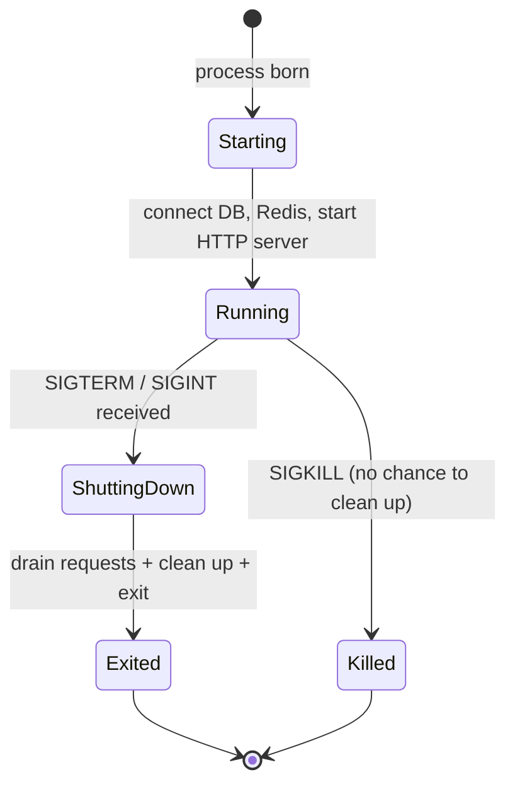
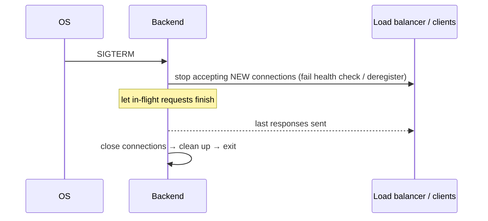

# My Notes: Graceful Shutdown

> **Source:** "19. Graceful Shutdown" by Sriniously, *Backend from first principles* playlist (YouTube, 35:56)
> **Link:** https://www.youtube.com/watch?v=6rfBgphiCWM
>
> I wrote these from the video's full caption track, summarised in my own words. The diagrams and code sketches are my own (he briefly shows a Go backend; the code below is my simplified version of the idea).

---

## 1. The problem

- I'm mid-way through a **critical payment** and the server must restart for a **deployment**.
- **Zero-downtime deployment** keeps the old server running until the new one is ready, but **at some point the old server has to stop** and traffic moves to the new one.
- Shopping on Amazon or Flipkart at **that exact moment**: does my payment **vanish**? Does a race condition **charge me twice**?
- This problem is as old as servers, and the standard solution is **graceful shutdown**.

---

## 2. Graceful shutdown = good manners

- Don't stop **abruptly**. Stop **politely**.
- **Analogy:** when guests are over and it's bedtime, I don't shove them out and slam the door. I **finish the conversation, say goodbye, clean up, then close the door**.
- **Benefits:** good UX, no **data corruption**, no lost or double-charged transactions, fewer refunds to process.

---

## 3. Process life cycle

- Every application, my backend included, runs inside an **OS process**.
- Like living things, a process has a **life cycle**: **born** (starts) → **lives** (executes) → **dies** (terminates).
- When the OS wants my app to stop, it doesn't just pull the plug. It follows an **established protocol**, a kind of conversation:

```
OS:   "Hey, it's time for you to stop."
App:  "OK, give me a few seconds to wrap up, then I'll exit."
```



---

## 4. Signals: how the OS asks a process to stop

- That "conversation" uses **signals**, a **Unix** concept for **IPC (inter-process communication)** between processes.
- **Unix** here means **Linux** (Ubuntu, Arch…) and **macOS** (Unix-based kernel). **Servers almost always run Linux**; Windows Server is a niche case.
- My app **registers signal handlers**: code that waits for specific signals and runs my shutdown routine when one arrives. In effect: "when you want me to stop, send me *this* signal and I'll handle it properly."

| Signal | Meaning | Who sends it | Can my app catch it? |
|---|---|---|---|
| **SIGTERM** | **Terminate**: a **polite request** to finish up and leave (a gentle tap on the shoulder) | **Programs**: deploy systems, process managers, orchestrators (**Kubernetes, systemd, PM2**) | ✅ Yes |
| **SIGINT** | **Interrupt** | **Humans**: pressing **Ctrl + C** in a terminal (a "user-initiated" shutdown, mostly in dev) | ✅ Yes |
| **SIGKILL** | **Kill immediately** | OS / operator (often after polite signals are ignored or time out) | ❌ **Can't be caught or ignored** |

- **Handle SIGTERM and SIGINT the same way.** Whether a developer presses Ctrl+C locally or PM2 stops the app on an EC2 instance, the **intent** is the same: shut down cleanly.
- **SIGKILL** is the **nuclear option**, like **yanking the power plug** instead of clicking "Shut down". No handler runs and no cleanup happens.
- **That's why graceful shutdown matters:** if I don't respect the polite signals (SIGTERM/SIGINT), I'll eventually get **SIGKILL** and lose the chance to clean up.

**On SIGTERM / SIGINT, the app should:**
1. **Finish existing requests**
2. **Clean up resources**
3. **Exit**

---

## 5. Step 1: Connection draining

**In-flight requests:** at any moment my server may be handling 10, 100s, or 1000s of requests concurrently.

**Restaurant analogy, closing time:**
1. Tell the doorman: **stop letting new customers in**.
2. Announce to diners: **"We're closing. You have 15–20 minutes to finish."**
3. They finish, pay (and tip), leave, and **then** the lights go off.

**Connection draining** for a backend:

1. **Stop accepting new connections/requests** (new ones only make things messier).
2. **Let in-flight work finish.**
3. **Then close.**

**Implementation depends on the kind of app:**
| App type | Draining means |
|---|---|
| **HTTP server** | Stop accepting new HTTP requests, let in-flight ones complete |
| **Database** (also a kind of backend) | Stop taking new queries/transactions, finish existing ones, then close connections |
| **WebSocket server** | **Notify clients** it's closing, **then** close the sockets. Never close abruptly |

It also needs coordination with **load balancers**, **health checks**, and **service discovery** (registering and deregistering instances). Service discovery is how deployed apps (backend, DB, Elasticsearch…) find and talk to each other. That's more advanced.

---

## 6. The shutdown timeout

- I want to give in-flight work **enough** time, but I **can't wait forever**.
- So set a **hard limit**, commonly **30 seconds** (sometimes 60). After that, **force stop**.
- With no new requests coming in, 30 s is usually plenty. If something blocks past it, the backup plan is forced termination.

**Picking the value is a design trade-off:**
```
too SHORT → interrupts legitimate operations
too LONG  → sluggish shutdowns → slower deploys, less responsive system
```
- It depends on the app's **typical request duration** and **operational needs**. Ordinary REST backend → ~30 s is fine. **WebSockets / complex systems** → understand the workload and choose accordingly. No hard rule.

---

## 7. Step 2: Resource cleanup

**Analogy:** before leaving my desk, I put the coffee cup in the sink and tidy the cables.

**Resources** = anything the app acquired while running: **file handles, network connections, DB connections, temp files, caches**, other system resources.

| Resource | Why clean up |
|---|---|
| **File handles** | Accessing a file means asking the OS for a **handle**. Never releasing them keeps eating **memory/RAM** until it runs out |
| **Network connections** | All traffic goes **through the OS** (from the network card to my app). The OS **limits** how many handles and connections a process can hold, so leaking them causes exhaustion or performance problems |
| **DB connections / transactions** | Open transactions must be **committed or rolled back explicitly** before exit. Otherwise: **inconsistent state, deadlocks, data corruption** |

### Clean up in REVERSE order of acquisition
```
Startup order:     1. Redis   →  2. Database  →  3. HTTP server
Shutdown order:    3. HTTP server  →  2. Database  →  1. Redis
```
So nothing still running depends on something already torn down.

### DB pool detail
- Backend ↔ DB communicate over **TCP connections**. A **pool** keeps several open.
- Closing the DB gracefully: **stop accepting new queries** on those connections → **finish existing queries/transactions** → **close each connection**.

---

## 8. What it looks like in code

He shows a Go backend. The narrative matters more than the exact code, and most frameworks (Node, Go, Rust, Python…) have **ready-made snippets**.

```go
// my simplified sketch
func main() {
    redis := connectRedis()           // acquired 1st
    db := connectDB()                 // acquired 2nd
    jobs := startJobServer(redis)     // background jobs (e.g. Asynq)
    srv := &http.Server{Addr: ":8080", Handler: router(db)}

    go func() {
        if err := srv.ListenAndServe(); err != nil && err != http.ErrServerClosed {
            log.Fatal(err)
        }
    }()

    // 1. register handlers for the polite signals
    ctx, stop := signal.NotifyContext(context.Background(), os.Interrupt, syscall.SIGTERM)
    defer stop()
    <-ctx.Done()                      // block until SIGINT (Ctrl+C) or SIGTERM
    log.Println("shutdown signal received")

    // 2. hard timeout for the whole shutdown
    shutdownCtx, cancel := context.WithTimeout(context.Background(), 30*time.Second)
    defer cancel()

    // 3. drain HTTP: stop new conns, wait for in-flight requests
    if err := srv.Shutdown(shutdownCtx); err != nil {
        log.Println("forced HTTP shutdown:", err)
    }
    // 4. clean up in reverse order
    db.Close()                        // finish queries, close pooled TCP conns
    jobs.Shutdown()                   // waits for workers, closes Redis connection
    log.Println("server exited gracefully")
}
```

```js
// Node/Express equivalent idea
const server = app.listen(8080);
async function shutdown(signal) {
  console.log(`${signal} received, draining...`);
  const force = setTimeout(() => process.exit(1), 30_000);  // hard timeout
  server.close(async () => {          // stops new conns, waits for in-flight
    await db.end();                   // reverse order cleanup
    await redis.quit();
    clearTimeout(force);
    process.exit(0);
  });
}
process.on("SIGTERM", shutdown);
process.on("SIGINT", shutdown);
```

### The demo run
```
startup logs:   connected to database → starting background job server → server started
^C (SIGINT)
shutdown logs:  signal received (interrupt) → closing database connection
                → stopping background job server
                  (Asynq: "starting graceful shutdown" → "waiting for all workers to finish"
                   → "all workers have finished" → "exiting")
                → server exited properly
```
- With no in-flight requests (local machine), it still took about **1 second** to shut down cleanly.

**Takeaway:** I don't need to memorise the code (libraries provide it), but I **must understand what happens and why**, especially for **deployments**, so I don't corrupt in-flight requests or workflows and users get a smooth experience.

---

## 9. My cheat sheet

```
PROBLEM   deploy/restart mid-request → lost or double payments, corrupted data
SOLUTION  GRACEFUL SHUTDOWN: finish work, clean up, then exit (good manners)

PROCESS LIFE CYCLE  start → run → terminate; OS talks to the process via SIGNALS (Unix IPC)

SIGNALS
  SIGTERM  polite "please finish & leave" — sent by K8s / systemd / PM2 / deploy tools   (catchable)
  SIGINT   interrupt — Ctrl+C by a developer                                             (catchable)
  SIGKILL  instant kill, can't be caught/ignored — the "pull the plug" option
  → handle SIGTERM + SIGINT identically; ignore them and you'll eventually get SIGKILL

ON SIGNAL
  1. CONNECTION DRAINING  stop accepting new → let in-flight finish → close
       HTTP: no new requests · DB: no new queries, finish txns · WS: notify clients, then close
       coordinate with load balancer, health checks, service discovery (deregister)
  2. TIMEOUT              hard limit (~30 s); too short = cut legit work, too long = slow deploys
  3. RESOURCE CLEANUP     file handles · network conns · DB conns (commit/rollback txns) · temp files · caches
                          REVERSE order of acquisition (HTTP → DB → Redis)
  4. EXIT

CODE      register signal handler → server.Shutdown(ctx with timeout) → close DB → stop job workers → exit
          frameworks ship ready snippets; understand WHY
```
