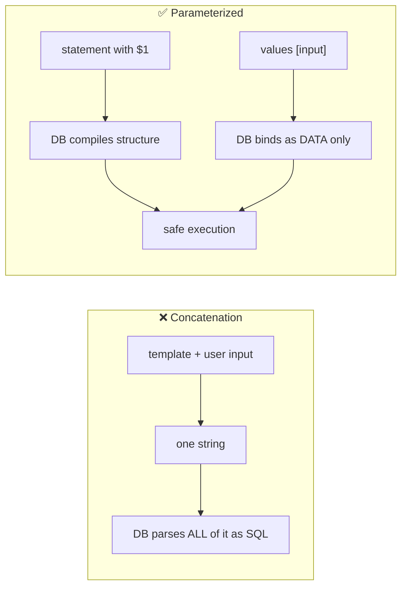
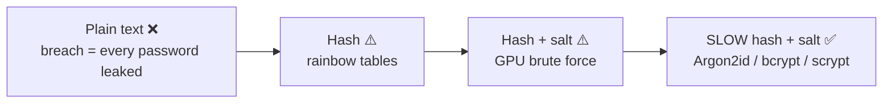
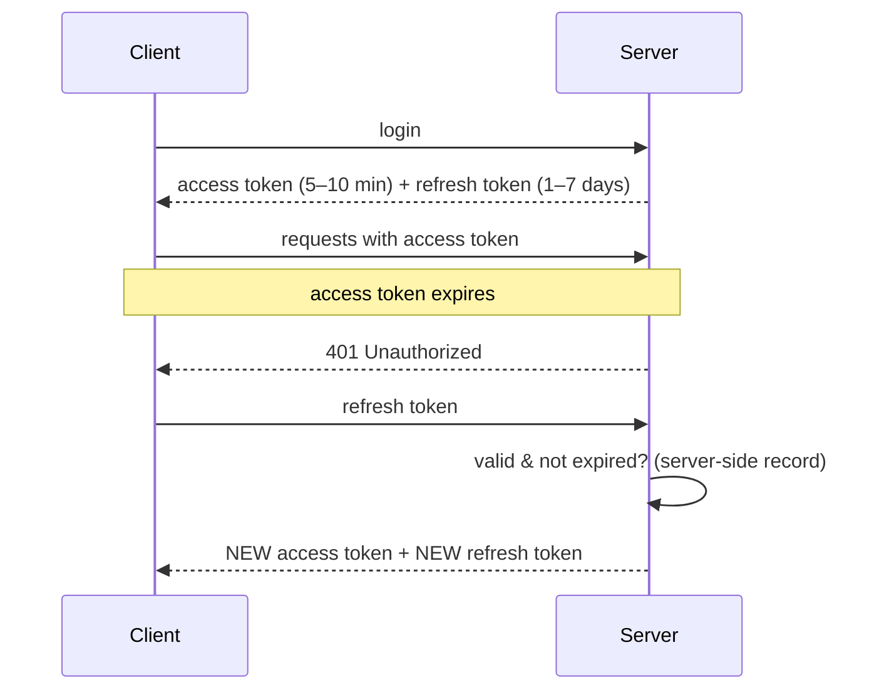
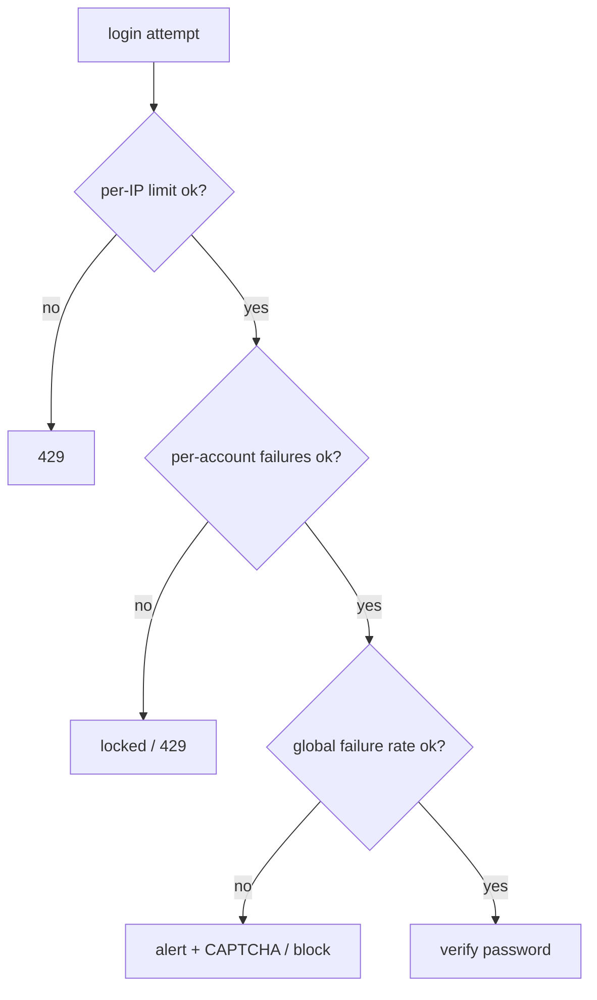
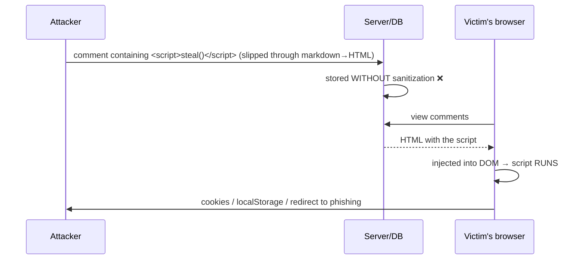

# My Notes: Backend Security (Everything I Need to Know)

> **Source:** "20. Backend Security: Everything You Need to Know" by Sriniously, *Backend from first principles* playlist (YouTube, 2:50:03)
> **Link:** https://www.youtube.com/watch?v=xB1C1xZZW4k
>
> I wrote these from the video's full caption track, summarised in my own words. The diagrams, SQL and code sketches are my own illustrations of the attacks and fixes he explains.

---

## 1. Scope and goal: become paranoid

- Security failures have **destructive** effects: financial, business, resources. It all comes back to money.
- Security is **huge**: browser security (HTML, cookies, localStorage), network security (HTTP/HTTPS, encryption), **server/OS** security, and **backend** security (vulnerabilities in **my code**). This video sticks to **backend**.
- **No app is ever "truly secure"**. Tech, libraries, and languages keep changing, so new vulnerabilities keep appearing. I just do my best.
- **The goal isn't to learn fancy techniques to ship tomorrow.** It's a **paranoid mindset**: keep security in the back of my head every time I write code. If I miss a specific threat here, the mindset is what counts.

---

## 2. Think like an attacker: "where did the developer assume?"

- Attackers don't care about my language or framework. They ask one thing: **where did the developer make an assumption?**
- **Every vulnerability traces back to an assumption**, such as:
  - the input from the frontend will be **clean**,
  - the user is **who they say they are**,
  - the request is **coming from my frontend**,
  - **nobody will open the network tab** and tamper with parameters.
- Under startup deadlines these feel reasonable, because I'm thinking about the **happy path**: users fill forms correctly, click the right buttons, navigate as intended.
- **Attackers don't use the app as intended.** They poke every boundary, break every input, and probe every assumption.
- The habit to build, in Go, Python, Node, Rust, anything: **"What could go wrong here, security-wise?"** on every piece of code.

---

## 3. Injection attacks: the root cause

**My app speaks many languages:**
```
                ┌──────────────┐
   Browser ◄──► │              │ ──► SQL ──────► Database
 (HTML/CSS/JS)  │   MY BACKEND │
                │              │ ──► shell ────► Operating system
                └──────────────┘
```
- Each language has its **own grammar, special characters, and way of separating commands from data**.
- **Vulnerabilities appear when user input from one context crosses into another**, where its characters carry **special meaning** (SQL injection, XSS…).
- **The root of all injection: confusing DATA with CODE.**

---

## 4. SQL injection

### The vulnerable code: string concatenation
```js
// ❌ building SQL by concatenating user input
const sql = "SELECT * FROM users WHERE email = '" + email + "'";
```

**Happy path:** `alice@gmail.com` → `SELECT * FROM users WHERE email = 'alice@gmail.com'` → one user.

### Attack 1: dump every row
Input in the email field:
```
' OR '1'='1' --
```
Resulting query:
```sql
SELECT * FROM users WHERE email = '' OR '1'='1' --'
--                                ↑    ↑         ↑
--                 1st quote closes   always     "--" comments out
--                 the opening quote  TRUE       the trailing quote
```
- `email = ''` is false, **but** `'1'='1'` is **always true**, and **OR** makes the whole condition true.
- `--` comments out the leftover quote, so there's **no syntax error**.
- Effectively `SELECT * FROM users`, returning **every user**. His demo table (Alice, Bob) returns both. In production that could include **password hashes, addresses, phone numbers**…

### Attack 2: destroy data
```
'; DROP TABLE users; --
```
```sql
SELECT * FROM users WHERE email = ''; DROP TABLE users; --'
```
- `;` ends the first statement, so the **second statement deletes the table**.
- In his GUI demo it didn't run: **modern drivers block stacked statements by default**. **Older or less safe drivers would execute it.**
- Skilled attackers go further: **UNION** to pull data from other tables (e.g. payments), DB functions to **read server files**, sometimes even **run OS commands**.

### Defence: least-privilege DB user
- The app's DB credentials should only allow **DML** (`SELECT`/`INSERT`/`UPDATE`/`DELETE`), **not DDL** (`DROP`/`ALTER`/`CREATE`).

### The real fix: parameterized queries (prepared statements)
```js
// ✅ structure and data sent separately
const sql = "SELECT * FROM users WHERE email = $1";
await db.query(sql, [email]);           // value bound to the $1 slot
```
- I send **two things**: the **statement** (no user data) and the **values** for its **parameters/slots**.
- The DB treats whatever fills the slot as **pure data (a string)**. `' OR '1'='1' --` becomes a **harmless garbage string**: no rows, no damage.
- A strict **validation layer** should reject that input anyway (it isn't an email), but parameterization is the safety net.
- **Every modern driver supports parameters and every ORM uses them by default.** The only way to be vulnerable is to **deliberately build raw strings** yourself.



---

## 5. NoSQL injection

- "I use MongoDB, so no SQL means I'm safe"? **No.**
- Mongo queries are JSON-like objects and can contain **operators** (`$ne`, `$gt`, `$exists`…) as nested objects with `$` keys.
- If the app passes **user-supplied JSON straight into a query**, an attacker can control the **structure**, not just the value:

```js
// ❌ user sends: { "email": { "$ne": null }, "password": { "$ne": null } }
db.users.findOne(req.body);       // matches the first user → login bypass
```
- Fix: validate and **coerce types** (email must be a string), never pass raw request objects into queries.

---

## 6. Command injection

Same idea, but the target is the **OS shell**.

**Scenario:** users upload images. My server runs a CLI like **FFmpeg** to resize or compress them, and lets the user choose the **output filename**.
```bash
# ❌ built by concatenation
ffmpeg -i in.jpg -vf scale=120:220 <USER_FILENAME>

# attacker filename:  out.jpg; rm -rf /
ffmpeg -i in.jpg -vf scale=120:220 out.jpg; rm -rf /     # second command wipes the root!
```
- Attackers can also use **pipes** `|` to chain into worse commands, or **`&`** to run things in the background (e.g. spyware). Each shell (bash, zsh, fish) has its own special characters and escape sequences.

**Fix: separate the command from its arguments.** Use the language's APIs that pass an **argument array directly to the process**, **bypassing the shell interpreter**:
```js
// ❌ exec(`ffmpeg ... ${name}`)            → goes through a shell
// ✅ execFile("ffmpeg", ["-i", "in.jpg", "-vf", "scale=120:220", name]);   // no shell parsing
```
```go
exec.Command("ffmpeg", "-i", "in.jpg", "-vf", "scale=120:220", name)   // args, not a shell string
```

### Injection mental model
- Whenever user input reaches **another interpreter** (SQL, NoSQL, shell, HTML, LDAP, XML…), make sure it's treated **purely as data**, never as executable or interpretable.
- Use APIs that **separate structure from data**: **parameterized queries** for DBs, **argument arrays** for commands.
- **Never** build these strings with **concatenation or template strings** mixing user input into control syntax.
- **The paranoia trigger:** "Am I building a string another system will interpret, and does it include user input?" Stop and find the **parameterized alternative**. One almost always exists.

---

## 7. Authentication: use a provider, but still understand it

- Get authentication wrong and attackers can **impersonate users**, read private data, act on their behalf, **steal money**. Account takeovers happen every day.

**His advice: if budget allows, use an auth provider in production** (e.g. **Clerk**). Building production auth yourself is far more than "sign a JWT, put it in a cookie":
- **Stateful sessions** (list of logged-in devices, revoke one or all) → DB + Redis, permission storage, timeouts, revocation in both.
- **Social login** (Google, GitHub, Twitter) → OAuth flows on **both backend and frontend** with smooth redirects.
- **Account linking:** someone who signed up with email+password later clicks "Sign in with Google" with the **same email** → must be **the same user**, not a duplicate.
- …weeks of developer time, or cut corners that hurt **security** or **UX**.
- Providers are **security companies** with dedicated teams working on it 24/7, handling edge cases and new attacks quickly. Many also offer **RBAC** and more. They aren't flawless, but their whole business is auth.
- Once the bill hits ~$10–20k/month (thousands to millions of users), I'll have the **revenue and bandwidth** to consider **migrating to in-house auth**.
- **Even with a provider, I must understand how auth works** to configure and integrate it securely.

---

## 8. Password storage: plain → hash → salt → slow hash



### 8.1 Plain text: never
- **DB breaches happen every day**, to companies of every size (insider revenge, a breached third-party vendor…).
- A breach exposes **every password**, and since **70%+ of users reuse passwords**, attackers try those email/password pairs on **payment, e-commerce, social** sites. Users rarely hear about breaches.
- Even without a breach, **devs, DBAs, contractors** (anyone with DB access) can see every password.

### 8.2 Hashing
A **hash function**:
1. takes input of **any length** → output of **fixed length**,
2. is **deterministic**: same input → same output, always,
3. is **one-way**: impossible (with current computing) to recover the input.

```
sign-up: store  bcrypt("12345") → "$2b$10$Xyz..."
login:   bcrypt(entered) == stored hash ?  → allow
breach:  attacker gets hashes only, not passwords
```

### 8.3 Rainbow tables break plain hashing
- Hashing is the known standard, so attackers keep **precomputed tables: common password → its hash** (with the popular algorithms).
- From a breached DB, they **look up** hashes, and any user with `12345`, `password`, `password@123`… is **reversed instantly**.

### 8.4 Salting
- Generate a **random salt per user** with a **cryptographically secure pseudo-random generator** (e.g. from **OpenSSL**), store it, and hash **password + salt**.

```
user 14:  salt = "SP3k9..."   stored_hash = hash("12345" + "SP3k9...")
```
- Two users with `12345` now get **different hashes**, and nothing matches any rainbow table. **Zero hits.**

### 8.5 GPU brute force breaks fast hashes
- Modern GPUs compute **billions of SHA-256 hashes per second**.
- Even with salts, attackers can **brute-force offline** per user (salt + every common password / pattern / 8-char combo) **within days**.
- **So never use general-purpose fast hashes** (**MD5, SHA-256**) for passwords. They're meant for things like file-integrity checks.

### 8.6 Slow, password-specific hashes
- **bcrypt** (long-time default), **scrypt**, and **Argon2id** (the **current industry standard**: most secure and performant).
- They have a **cost / work factor**, so I choose how slow they are (e.g. ~400 ms per hash), based on my system's capacity.

```
Legit user login:   ~400–600 ms  → barely noticeable
Attacker offline:   billions/sec → ~4–5 guesses/sec → decades or centuries
```

```js
import argon2 from "argon2";
const hash = await argon2.hash(password, { type: argon2.argon2id });   // salt handled internally
const ok   = await argon2.verify(hash, attempt);
```

📖 **Recommended reading:** **Lucia** (formerly an auth library, now a **guide** to implementing secure auth with industry practices).

---

## 9. Sessions and cookie flags

After login I can't ask for the password on every request, so I **remember** the user via a **session**:

1. **Generate a random session ID**: long (128–256 bits), from a **CSPRNG**. At 128 bits there are more possible IDs than **atoms in the universe**, so guessing is practically impossible. (A guessable ID means any session can be hijacked.)
2. **Store it** in **Redis** (fast) or the primary DB (Postgres/MySQL) with **metadata**: owning user, created-at, **expiry** (e.g. 7 days), **IP** (to show login locations), **user agent** (device/browser: Chrome, Firefox, Android, iPhone…).
3. **Send it to the browser in a cookie**. Every later request carries it automatically. The server looks it up and identifies the user.

(JWTs follow the same identification idea, just stateless.)

### Cookie flags for production
| Flag | Effect | Prevents |
|---|---|---|
| **`HttpOnly`** | JavaScript **can't read** the cookie | Token theft via **XSS** (which is also why **localStorage is discouraged** for tokens) |
| **`Secure`** | Sent **only over HTTPS** | Interception on public Wi-Fi, malicious ISPs or routers, sniffers like **Wireshark** |
| **`SameSite=Strict`** | Sent only for requests **originating from my own site** | **CSRF** |
| **`SameSite=Lax`** | Sent on **top-level navigation** links, but **not** for images/iframes etc. | CSRF (most cases) |
| `SameSite=None` | Sent on all cross-site requests (**requires `Secure`**) | Nothing; avoid for session cookies |

```js
res.cookie("sid", sessionId, {
  httpOnly: true, secure: true, sameSite: "strict",
  maxAge: 7 * 24 * 3600 * 1000,
});
```
For a session cookie: **Strict** is best, **Lax** if frontend and backend are on different domains, **never None**.

---

## 10. JWTs: trade-offs and workarounds

**Sessions vs JWT:**
```
Session:  server stores the data, client holds only the ID
JWT:      client holds the DATA itself (signed); server stores nothing
```

**"Can't the client just claim to be someone else?"** No, because of how JWTs are built:

| Part | Content |
|---|---|
| **Header** | Algorithm used |
| **Payload (claims)** | `sub` (subject = user ID), `iat` (issued at, used for expiry), plus **custom claims** (e.g. `name`, `admin: true`) |
| **Signature** | **header + payload signed with a secret** (random, kept in an env var) |

**Flow:** login (same hashing + salting as before) → server builds payload → **signs** it → client stores it → sends `Authorization: Bearer <jwt>` → server **verifies** with the secret. **Tampering fails verification.**

**Demo:** decode the Base64 payload, change "John Doe" to "John Do", re-encode, paste it back, and jwt.io shows **signature verification failed**.

**Advantage:** no DB/Redis lookup, so it's **easy to scale**.

### Downsides
1. **Revocation is hard.** If a user reports a compromised account and asks to log out everywhere, a pure stateless setup **can't help immediately**.
2. **The payload is just Base64, not encrypted.** Anyone can read it, so **never put sensitive data inside**.
3. **Where to store it?** **localStorage** is readable by any script during **XSS**. An **HttpOnly cookie** works, but then I'm basically back to cookie sessions.

### Community workarounds
- **Blacklisted tokens** in DB/Redis (checked on each request).
- **Short-lived access token + refresh token:**


A stolen access token is useful for **only minutes**. A stolen refresh token still **expires** (e.g. in a day).

### His recommendation
- **Prefer stateful sessions** unless there's a specific scaling need. Even then, **Redis** can share sessions across many servers.
- Sessions are **simpler**, revocation is **straightforward**, and they fit most SaaS.
- If I **do** use JWTs: **short expiry** (minutes to hours, not days), **refresh flow with server-side storage**, **HttpOnly cookies** rather than localStorage. These work, but they still feel like **hacks** compared with sessions.

---

## 11. Rate limiting auth (layered)

Without rate limiting, attackers can fire **thousands to billions** of login attempts:
1. they may **crack** an account, or
2. the flood **crashes** the server.

**Be stricter on auth endpoints, more generous elsewhere.**

| Layer | Rule (example) | Stops | Weakness |
|---|---|---|---|
| **Per-IP** | ~10 attempts/min per IP | Simple automated attacks | Shared IPs (offices, universities behind one hop), and attackers rotate IPs (**botnets, proxies, VPNs**) |
| **Per-account** | 5 failures / 15 min → **lock 24 h** (unless support unlocks) | IP-rotating attacks on **one** account | **Password spraying**: one password (e.g. `12345`) tried across **many** accounts |
| **Global** | e.g. **≤ 100 failed logins/min system-wide** | Spraying across accounts and IPs | Triggers **alerts**, then block IPs, show **CAPTCHAs** to separate humans from bots |



---

## 12. Authorization vulnerabilities

**Recap:** authentication = which `users` row this is. Authorization = what that user may do.

### The core confusion
```
ROUTER ──[requireAuth ✓]──[permission: read:books ✓]──► HANDLER → SERVICE → REPOSITORY
                                                                         SELECT * FROM books WHERE id = 5   ❌
```
- Auth middleware sits at the **routing layer** (public routes like login skip it). It checks the session cookie (stateful) or the JWT header (stateless), and returns 401/403 if it fails. Role and permission checks (`member`/`admin`, `read:books`) often live there too.
- **False sense of security:** "authenticated and has `read:books`" **doesn't** mean they may read **any** book.

**Example:** the books UI has a filter for book IDs. The user sends `GET /books?id=5` → passes auth + permission → the repository runs `SELECT * FROM books WHERE id = 5` → returns **someone else's book**.

### 12.1 BOLA: broken object-level authorization (a.k.a. IDOR)
- Authorization is checked at the route level, but **not at the data/object level**.
- With a script, attackers can **iterate IDs** and download every **invoice** or payment record, or **tamper** with them.

**Fix: check ownership at the point of data access, in the query itself:**
```sql
SELECT * FROM books
WHERE id = $1 AND user_id = $2;      -- $2 = ctx.userId from the auth middleware
```
Do this for **every** query type: **SELECT, UPDATE, DELETE, INSERT**.

### Don't leak existence: 404, not 403
```js
// ❌ fetch first, then compare
const inv = await db.getInvoice(id);
if (inv.userId !== ctx.userId) return res.status(403);   // confirms invoice #5 EXISTS
```
- A **403** tells the attacker the guessed ID **exists**. They can **enumerate** IDs (5, 17, 18…) and plan follow-up attacks such as **social engineering** (tricking humans into revealing details).

```js
// ✅ one scoped query
const inv = await db.query(
  "SELECT * FROM invoices WHERE id = $1 AND user_id = $2", [id, ctx.userId]);
if (!inv) return res.status(404).json({ message: "Not found" });
```
- **"Doesn't exist" and "exists but isn't yours" look identical** to the attacker.

### 12.2 BFLA: broken function-level authorization
- About restricting **functions**, especially **admin-only** ones, not data.
- **Example:** `GET /admin/invoices` lists **all** invoices for support staff, so it can't be scoped by `user_id` (only filters like active/pending).
- **Bad "security":** the admin panel URL is just **kept secret**. Any logged-in user who discovers it (e.g. by watching traffic) can call the API.
- That's **security through obscurity**: hiding things instead of protecting them.
- **Fix:** a **role check** middleware on top of permissions. Regular users and admins might both have `read:invoices`, but only **`role = admin`** may call admin functions.

```js
router.get("/admin/invoices", requireAuth, requirePermission("read:invoices"), requireRole("admin"), listAllInvoices);
```

### 12.3 Predictable (sequential) IDs
- `/invoices/102` → attackers guess 101, 103, 109… (**enumeration**).
- Use **UUIDs** for primary keys: random, URL-friendly. (UUIDs have some **performance trade-offs** worth reading about.)

### 12.4 The mental model: horizontal vs vertical
```
            VERTICAL (BFLA): member → admin functions
                 ▲
                 │
   user A ───────┼──────► user B's resources
                 │      HORIZONTAL (BOLA / IDOR)
```
| Type | Meaning | Cause |
|---|---|---|
| **Horizontal** | User A reaches **user B's** resources | Ignoring authorization at the **DB/object level** (BOLA, IDOR) |
| **Vertical** | A user reaches **higher-privilege functions** (admin) | Missing **role** checks (BFLA) |

### 12.5 Prevention framework
1. **Centralise authorization logic** in one layer every request passes through. No scattered, inconsistent, forgettable checks. Easy to understand, maintain, scale.
2. **Default deny:** anything **not explicitly allowed is denied**, so new endpoints and resources are **protected by default** even if I forget to configure them.
3. **Test authorization specifically, with automated tests** (run in CI/CD), not just happy paths:
   - user A **can't** access user B's resources,
   - a **member can't** call admin functions,
   - **unauthenticated** users can't reach authenticated resources.
   Manual testing misses cases as the code changes. Automated suites keep it secure over time.
4. **Audit logs:** log every **sensitive access** (admin endpoints: who, when). Flag every **failed authorization** (A trying B's data) as a **security event**, since someone may be **probing** the system.

---

## 13. XSS (cross-site scripting)

**Definition:** an attacker gets **their JavaScript running in another user's browser** **in the context of my site**.

**Why it's dangerous:** that script can
- **read everything on the page**, including sensitive data,
- make **API calls as the logged-in user** (it can read cookies and localStorage unless HttpOnly),
- **redirect** to **phishing** pages,
- **alter the page** to deceive the user.

### Stored XSS: comments example

- A blog with markdown comments: markdown → HTML (React ecosystem: **remark / rehype** plugins) → **injected into the DOM**.
- Popular libraries handle safety, but in custom or legacy setups an attacker may sneak in a **`<script>`**. If it's stored and later injected, it **runs for every viewer**.
- React names its API **`dangerouslySetInnerHTML`** on purpose, as a warning that I'm on my own regarding XSS.
- **The fix isn't "never inject HTML"** (rendering user markup needs it). **Sanitize on the server before storing**: detect and **strip** things like `<script>`.

**Other variants:**
- **Reflected XSS:** script carried in the **URL** and reflected into the page.
- **DOM-based XSS:** client code writes untrusted data into the DOM (e.g. `innerHTML`).

**Root cause, same as SQL injection:** user content treated as **code** instead of **data**. Here it happens **in the browser** (HTML+JS) rather than the DB.

### Defences
1. **Sanitize** user-provided content in the validation layer **before storing**.
   - A general rule again: any user data (search queries, HTML, huge images, files) needs care about **how it's handled**, **what access it gets**, and **how many resources** it consumes. That alone avoids most vulnerabilities.
2. **CSP (Content-Security-Policy)** header: the server tells the browser **what it may execute or load**:
   - scripts **only from my domains**,
   - **no inline scripts at all**, which blocks the injected `<script>` above,
   - **images only from allowed domains**…

```http
Content-Security-Policy: default-src 'self'; script-src 'self'; img-src 'self' https://cdn.example.com
```
- ⚠️ **CSP is not the fix.** It's the **last line of defence** for anything that slips past sanitization. Fix the root cause first.

---

## 14. CSRF (briefly)

- **Not a major threat** for modern apps on current libraries and frameworks (legacy systems still exist).
- **How it works:** I'm logged into `bank.com` and my browser holds its cookie. I visit `evil.com` (via phishing or ordinary browsing), which **auto-submits a form** or uses an **image/iframe** to fire a request to `bank.com`. **My browser attaches the bank cookie**, so the bank treats it as legitimate.
- **Why it's mostly handled now:**
  - **`SameSite`** cookies: browsers **default to Lax**. Unless I set **None**, I'm protected.
  - **CORS** config: not a security mechanism as such, but the backend only sets CORS headers for my own frontend's origin, so browsers block other cross-origin reads. Another line of defence.

---

## 15. Misconfiguration

### 15.1 Secrets management
- **Never commit secrets** (API keys, DB passwords, encryption keys, JWT/auth secrets) to source control. Anyone with repo access (GitHub / GitLab / Bitbucket) could reach the DB, external services, and user data.
- Keep them in **env vars** or a **secrets manager** (AWS Parameter Store, HashiCorp Vault…).
- **If one is committed by accident, deleting it isn't enough.** It stays in **git history**. **Rotate it immediately** (revoke and create a new one).

### 15.2 Debug mode in production
- Locally I use **debug** logging: **detailed errors with stack traces** (revealing function and file names, code structure), **raw SQL**, **DB pool/transaction info**, maybe **sensitive user data**.
- Production must be **info** (or at least not debug). If prod logs are verbose and get **breached**, attackers learn my code structure, DB details, and user data.
- **Know the log level of local, staging, and production.**

### 15.3 Security headers
| Header | Purpose |
|---|---|
| **Content-Security-Policy** | Limit executable/loadable sources (XSS) |
| **X-Frame-Options** | Stop other sites **embedding mine in an iframe**, preventing **clickjacking** / phishing overlays that capture credentials |
| Others (HSTS, X-Content-Type-Options…) | Standard hardening |

- Every major framework (**Express, Echo, Gin, Django**…) has **security middleware** that sets the industry-standard headers in **one line**.

```js
import helmet from "helmet";
app.use(helmet());   // sets CSP, X-Frame-Options, HSTS, etc.
```

---

## 16. The big picture: boundaries and defence in depth

**Every vulnerability is about data crossing a BOUNDARY:**
| Vulnerability | Boundary crossed |
|---|---|
| SQL injection | user input → **database query language** |
| XSS | user markdown → **HTML/JS** |
| Broken authorization | requests → **what different users may access** |

**Ask three questions every time I write code:**
1. **Where is data crossing a boundary?**
2. **What assumptions am I making about that data?**
3. **What if those assumptions are wrong?**

He promises that asking these repeatedly avoids **~99%** of common backend vulnerabilities.

### Defence in depth: no single defence is perfect
```
1. INPUT VALIDATION        strict, at the entry point (after routing); data leaving it has
                           exactly the expected shape — no surprises downstream
2. PARAMETERIZED OPS       DB params, OS argument arrays — never string concatenation
3. AUTHZ AT POINT OF ACCESS check where the data is actually accessed (the repository),
                           not just a few layers upstream
4. HEADERS & POLICIES      CORS, CSP, security headers — limit damage if something slips through
5. MONITORING & LOGGING    log suspicious activity, ship to the logging service, alert
```
An attacker would have to **beat every layer at once**, which is unlikely.

**Security isn't a technique you learn once. It's a paranoid mindset you bring to every line of code: always think about boundaries and assumptions.**

---

## 17. Resources

| Resource | What it offers |
|---|---|
| **PortSwigger Web Security Academy** | From the makers of **Burp Suite**. A free, comprehensive catalogue of vulnerabilities with **hands-on labs** and theory: SQLi, XSS, CSRF, clickjacking, SSRF, OS command injection, auth, OAuth, JWT attacks, and more. He learned a lot here |
| **OWASP Top 10** | Regularly updated list of the most critical web risks. Currently topped by **Broken Access Control** (BOLA/BFLA…), plus **Security Misconfiguration**, **Injection**… with severity and real-world cases |
| **OWASP Cheat Sheet Series** | Per-topic best practices (**Authentication**, **Session Management** with CSPRNG session IDs, etc.). He has read them many times over the years |
| **Lucia** | Guide to implementing secure authentication |

---

## 18. My cheat sheet

```
MINDSET   be paranoid · attackers ask "where did the dev ASSUME?" · no app is ever fully secure

INJECTION (data treated as code)
  SQLi: ' OR '1'='1' --   → dumps all rows ·  '; DROP TABLE users; --  → destroys data
        FIX: parameterized queries ($1) · ORMs do it by default · DB user = DML only (no DDL)
  NoSQL: user JSON with $ne/$gt operators → validate types, never pass raw req.body
  Command: "out.jpg; rm -rf /" → FIX: execFile / exec.Command with ARG ARRAYS (no shell)
  RULE: never concatenate user input into anything another interpreter parses

AUTH       use a provider (Clerk...) in prod; still understand it
PASSWORDS  plain ✗ → hash (rainbow tables) ✗ → +salt (GPU brute force) ✗
           → SLOW hash + salt ✓ : Argon2id (standard) / bcrypt / scrypt, tunable cost (~400 ms)
           never MD5/SHA-256 for passwords
SESSIONS   128–256-bit CSPRNG ID · store in Redis/DB with user, expiry, IP, user agent
COOKIES    HttpOnly (no JS) · Secure (HTTPS only) · SameSite=Strict (or Lax; never None)
JWT        header.payload.signature · payload is just Base64 (no secrets) · tamper → verify fails
           cons: hard revocation, storage dilemma · workarounds: blacklist, short access + refresh
           PREFER SESSIONS (Redis scales them)
RATE LIMIT layers: per-IP (~10/min) → per-account lock (5 fails/15m → 24h) → global (alert + CAPTCHA)

AUTHZ      BOLA/IDOR (horizontal): scope EVERY query → WHERE id=$1 AND user_id=$ctx
           return 404 (not 403) so existence isn't leaked
           BFLA (vertical): require ROLE for admin functions; no security-through-obscurity
           UUIDs over sequential IDs · centralise · DEFAULT DENY · automated authz tests · audit logs

XSS        attacker JS runs in victim's browser (stored / reflected / DOM)
           FIX: sanitize before storing · CSP (no inline scripts) as LAST line of defence
CSRF       mostly solved by SameSite=Lax default + CORS

MISCONFIG  no secrets in git (rotate if leaked) · info logs in prod (no debug/stack traces)
           security headers via middleware (helmet etc.): CSP, X-Frame-Options (clickjacking)

BIG PICTURE  boundaries: where does data cross? what do I assume? what if wrong?
DEFENCE IN DEPTH  validation → parameterization → authz at point of access → headers → monitoring
LEARN       PortSwigger Academy · OWASP Top 10 · OWASP Cheat Sheets · Lucia
```
