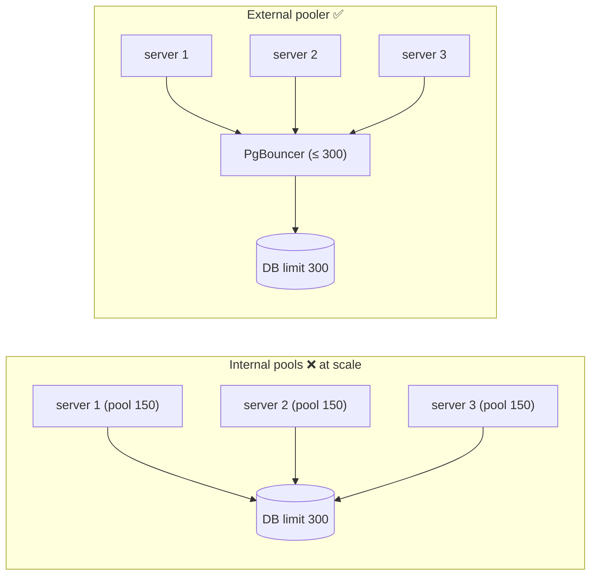

# My Notes: Backend Scaling and Performance Engineering (Part 1)

> **Source:** "21.1. Backend Scaling and Performance Engineering: Part-1" by Sriniously, *Backend from first principles* playlist (YouTube, 1:47:31)
> **Link:** https://www.youtube.com/watch?v=z7kt_p44rjs
>
> I wrote these from the video's full caption track, summarised in my own words. The diagrams, SQL and code sketches are my own illustrations. Part 1 ends right as horizontal scaling's trade-offs are introduced, so the topic continues in part 2.

---

## 1. Goal: learn how to *think* about performance

- "Scaling" and "performance" mean different things for browsers, infrastructure, and backends. The focus here is **backend**.
- Build up layer by layer: what performance means, how systems behave **under load**, where **bottlenecks hide**, how to think clearly when things fall apart.
- The aim isn't just techniques. It's **a way of thinking that applies to any system**.

---

## 2. Latency

**What does "fast" mean?** Follow one click:
```
click → browser sends request → internet → server
      → (DB query?) → (external API, e.g. send email via Resend?)
      → JSON response → internet → browser parses → renders cards
└──────────────────────── LATENCY ────────────────────────┘
```
- **Latency** = total time from the user's action to the result appearing.
- It's what users **feel**. "Your app is slow" means latency, whether they know the word or not.
- **It isn't one number.** It varies per request:
  - one request takes **50 ms** (hit a **CDN** or **Redis** cache, or reached an **idle** server),
  - another takes **200 ms** (went all the way to the DB, or the server was already handling 50 other requests).

---

## 3. Why averages lie: percentiles

- Average of 50 ms and 200 ms = 125 ms. **What does that tell me? Not much.**
- Averages are useful elsewhere, but for performance they **hide the variation**, which is what matters.

**Example:** 1,000 requests, **average ~100 ms**, but:
- **99%** finished under **50 ms**,
- **1%** took **5 seconds**.

At **1 million requests/day**, that 1% is **10,000 requests** where a real user stared at a loader for 5 seconds. The average says "great"; the reality is frustrated users.

### Percentiles
| Term | Meaning (example) |
|---|---|
| **P50** (median) | P50 = 400 ms → **50%** of requests are ≤ 400 ms |
| **P90** | P90 = 900 ms → **10%** of requests take ≥ 900 ms |
| **P99** | P99 = 2 s → **1%** take ≥ 2 s (99% are faster) |

Easy way to read them: **100 − N = the share of users who get the slow experience**.

```
latency
  ▲
  │                                        ╭── P99 (slowest 1%)
  │                                   ╭────╯
  │                              ╭────╯ P90
  │                  ╭───────────╯
  │ ─────────────────╯ P50
  └──────────────────────────────────────────► % of requests
```

**Why backend engineers focus on P95/P99:**
- Not just because of unhappy users. The **slowest requests** usually go through the **most complex business logic, heaviest queries, and external calls** (emails, webhooks…).
- Those are often the **most valuable users**: someone **paying or buying** triggers far more work than someone browsing.

Learn the **vocabulary** (P50 / P90 / P99) so I can follow performance discussions.

---

## 4. Throughput

- **Latency:** how long **one request** takes.
- **Throughput:** how **many requests** the system handles per unit of time (**requests/second** or per minute).

Why I need both:
```
10 req/s     → latency 150 ms   😀
1,000 req/s  → latency 2 s      😱
```
It answers real questions:
- Can we survive the **Black Friday** spike?
- An **email campaign**, a **podcast** mention, a popular blog feature: can we take it?
- **How many concurrent users** before we need more resources?

**The relationship isn't intuitive:** as throughput rises, latency rises **slowly at first, then sharply**.

---

## 5. Utilization and the latency cliff

### The ice cream shop
- **Sunday evening, empty shop:** I order and get it instantly. **Low utilization → low latency.**
- **Tuesday lunch, long queue:** the server still takes **2 minutes per ice cream**, the same speed, but **I wait** for everyone ahead of me.
- **The work rate didn't change. The waiting did.**

Servers behave the same way: at low utilization, requests are handled immediately. As load grows, requests **queue** behind each other. **Higher utilization → longer queue → longer wait.**

### Utilization
- **Utilization** = the **percentage of capacity in use**. 0% = idle. 100% = maxed out, close to collapse.

```
latency
  ▲                               │
  │                               │  ← near 100%: latency EXPLODES
  │                             ╱
  │                          ╱
  │                     ╱
  │ ───────────────╱              (what we naively expect: a straight line)
  └──────────────────────────────► utilization %
  0%            60–80%          100%
```
It's **not linear**. Close to 100%, latency grows **exponentially**.

### The highway analogy
| Capacity | Traffic |
|---|---|
| **50%** | Smooth. Room to overtake, predictable arrival |
| **80%** | Slowdowns. Lane changes need care |
| **90%** | **Unpredictable**: sometimes it flows, sometimes one brake causes a **ripple jam** |
| **100%** | Gridlock. Nobody moves |

### The lesson
- **I can't run at 100% and expect good performance.** I need **headroom**.
- Production systems typically run at **60–80%**, keeping **~20%+ buffer**.
- **Traffic comes in bursts**, not at a steady rate: a flood one minute, nothing the next, a thousand requests half an hour later. Even at **40–50% average**, a burst can push me **past 100%**. Without headroom, the system **crashes**.

---

## 6. Bottlenecks: measure, don't guess

- "The system is slow" means **something specific** is slow. Finding it = **identifying the bottleneck**.
- **Common mistake:** jump straight to "textbook" fixes without measuring:
  - "Add **caching**" (the supposed cure for all latency),
  - "Upgrade **Postgres 16 → 18**", upgrade packages,
  - "Add **more servers**" (horizontal scaling).
- Sometimes it works by luck. Often I spend **days or weeks fixing a problem I don't have**, while the real bottleneck goes untouched.

### The story
```
GET /products/:id is slow
  → assume "database is the problem" → spend 1 week adding Redis caching → deploy
  → STILL slow
  → finally ADD TIMING MEASUREMENTS:
       DB query        ~10 ms
       Redis cache     ~5 ms
       LOGGING CALL   ~500 ms   ← writes to a remote logging service SYNCHRONOUSLY (blocks the request)
  → the DB was never the problem
```
- Other hidden culprits: **JSON/XML serialization**, or a **huge response payload** whose **network transfer** is the slow part even though the code is fast.

> **Never guess. Always measure.**

---

## 7. Profiling, flame graphs, distributed tracing

### Profiling
- Measures **where the app actually spends its time**. A profiler **attaches to the running app**, **samples** live requests, and records which functions run, when they start and end, end to end.
- The output is overwhelming (thousands of functions), so use **flame graphs**:
  - show the **call stack over time**,
  - **wider bars = more time spent**,
  - functions called by others are **stacked on top**.
- The first time I look, I'll be **surprised**: it's rarely where I expect (JSON serialization instead of business logic, **external API calls in a loop** instead of DB queries…).

### The limitation: CPU vs I/O
| Task type | Examples | Profiler good at it? |
|---|---|---|
| **CPU-bound** | Image processing, ML / matrix math | ✅ Yes |
| **I/O-bound** | DB queries, file handling, external API calls, queues (waiting on input/output) | ❌ Not really |

**Most SaaS backend performance problems are I/O-bound.**

### Distributed tracing (observability)
- **Follows a request through the system** and records when it entered each component, when each function and DB query started and finished, each external call…

```
GET /products/5   total ≈ 802 ms
├── business logic ............ 2 ms
└── DB query .................. 800 ms   ← now I know exactly where to focus
```
The best tool for finding **I/O latency quickly**.

---

## 8. Database bottleneck #1: N+1 queries

Databases are often the bottleneck, for good reason: they **persist durably**, survive crashes, guarantee **consistency** under **concurrent reads/writes and locking**, and run complex queries over millions or billions of rows. That takes time, so I shouldn't blame them blindly. But there are **low-hanging fruits**.

### The problem
A blog homepage shows **20 posts with author names**, but the list API doesn't include authors:
```
1 query  → fetch 20 posts
20 queries → fetch each post's author (in a loop)
= 21 queries          (N + 1)
```
```
items:     20 → 21 queries · 100 → 101 · 1,000 → 1,001
```
- The query count grows **linearly** with item count, which is obviously wrong.
- **Every query has overhead:** network round trip, possibly a **TCP connection setup** (without pooling), then the DB **parses, plans, executes**, and returns.
- Even at **5 ms/query**, **1,000 queries = 5 seconds** of loading. Unacceptable today.

### Where it really happens: the server/ORM
The frontend example makes it intuitive, but **classic N+1 happens in the backend**, because **my server is the DB's "client"**:
```js
// ❌ ORM code that LOOKS innocent
const posts = await db.select().from(postsTable);
for (const post of posts) {
  post.author = await db.select().from(users).where(eq(users.id, post.authorId));  // N extra queries
}
```
ORMs make DB access look like normal language code, so I don't notice the hidden SQL.

### The fix: fetch in bulk / join
```sql
-- 1 query with a JOIN
SELECT p.*, u.name AS author_name
FROM posts p JOIN users u ON u.id = p.author_id;

-- or 2 queries: posts, then all authors at once
SELECT * FROM users WHERE id = ANY($1);   -- $1 = array of author IDs
```
**ORM primitives for this:**
| ORM | Bulk / eager loading |
|---|---|
| Django | `select_related` (FK), `prefetch_related` (many) |
| Rails | `includes` |
| TypeORM / Prisma / Drizzle | joins / `include` / eager-load options |

- Always **1–2 queries**, whether it's 20 posts or 1,000.
- **Tip:** turn on the ORM's **SQL logging** in development to see what it actually runs.

---

## 9. Database bottleneck #2: indexes

The **most common** DB performance issue is a **missing index**.

### The library analogy
- A library with **a million books and no catalogue**. Someone asks for all **John Green** books, and I walk every shelf (3 days). Next person asks the same, and I do it all again.
- That walk = **sequential scan / full table scan**: check every row one by one. In a DB it's ~1–2 s on a big table, still slow by modern standards.
- With a **catalogue by author** (author → shelf locations), I go straight there. That catalogue = **an index**.

### How it works
- Usually a **B-tree** (hash indexes exist too).
- Keeps a **sorted copy of the column's values** with **pointers to the rows**.

```
INDEX on books.author_id (sorted)          books table
1 → rows [..]                              ┌────┬───────────┬──────┐
2 → rows [..]                              │ id │ author_id │ ...  │
3 → rows [r17, r902, r4410]  ─────────────►│ .. │     3     │      │
...                                        └────┴───────────┴──────┘
```
- **Example:** ~**4 s → under 100 ms** on a million rows.

### Indexes aren't free
1. **Storage:** they take space, growing with the table.
2. **Write cost (the bigger problem):** **every INSERT / UPDATE / DELETE must update every index** on that table. Index every column and **writes slow dramatically**.

### When to add them
- **Obvious ones up front** in the migration (e.g. `books.author_id`, since "books by author" is clearly common). **Primary keys are auto-indexed** in Postgres.
- **Non-obvious ones: wait and measure.** Use logs and traces to find the hot endpoints and slow queries (e.g. a missing index on `isbn`), *then* add the index.
- Be **cautious, not generous**.

### Composite vs covering indexes
| Type | What | Notes |
|---|---|---|
| **Composite** | One index on **multiple columns**, e.g. `(user_id, created_at)` | Better than two separate indexes for queries using both. **Order matters**: it helps queries on `user_id` + `created_at`, **and** `user_id` alone, but **not `created_at` alone** |
| **Covering** | The index **contains all columns the query needs**, so it's answered **from the index alone** (no table lookup) | e.g. a 100-column `departments` table where the UI only needs `id` + `name`. More columns make the index bigger, so weigh it |

```sql
CREATE INDEX idx_posts_user_created ON posts (user_id, created_at);        -- composite
CREATE INDEX idx_departments_name ON departments (name) INCLUDE (id);      -- covering (Postgres)
```

### Finding WHICH column to index: `EXPLAIN ANALYZE`
```sql
EXPLAIN ANALYZE
SELECT * FROM books WHERE isbn = '978-...';
-- before: Seq Scan on books ... (slow)
-- after CREATE INDEX: Index Scan using idx_books_isbn ... (fast)
```
- Shows the **query plan**: which table it starts from, how it joins, **which indexes it uses**, timings.
- Look for **Seq Scan** on large tables → add an index → re-run and confirm it's now an **Index Scan**.
- **Workflow:** distributed tracing finds the slow query → `EXPLAIN ANALYZE` finds the column → index → verify.

---

## 10. Database bottleneck #3: connections and pooling

Locally, DB connections feel free. **At scale they're expensive.**

### What opening a connection costs
```
server ──► DB
  1. TCP 3-way handshake (SYN / SYN-ACK / ACK)
  2. authentication
  3. negotiate encryption (keys)
  4. set up session state
  5. DB allocates memory for the connection (MBs)
```
Two problems if I **open and close a connection per query**:
1. I **pay that setup latency** on every request.
2. **Connection limits:** a typical Postgres allows a few hundred (~400–500, depending on CPU/RAM). A traffic spike (a sale, a busy day) can **exhaust them, and the DB crashes**.

### The fix: connection pooling
```
                 ┌──────────── POOL ────────────┐
server ── borrow ►│ [conn][conn][conn][conn]...  │──► DB
       ◄─ return ─│  kept OPEN and reused         │
                 └──────────────────────────────┘
```
- A pool **keeps a set of open connections**. The server **borrows** one, runs the query, **returns** it. It's **reused** instead of closed. That solves both problems.

### Internal vs external pooling
| | **Internal** (in the app / driver) | **External** (e.g. **PgBouncer**) |
|---|---|---|
| Where | Each server instance has **its own pool** | **One shared pooler** between all instances and the DB |
| Problem | Autoscaling adds instances: 3 × 150 = **450 possible connections**, but the **DB limit is 300**, so the next spike **crashes the DB** | Total connections capped at the pooler (e.g. 250–300), so the limit **can't be exceeded** however many instances run |


- **In production at scale**, prefer an **external pooler** like **PgBouncer** (lightweight, open source), especially when traffic spikes are expected.

---

## 11. Caching for performance

After optimising queries, adding indexes, and pooling, if the DB is **still** the bottleneck, add **caching** (see the caching video).

**Idea:** store the results of expensive operations (e.g. a complex query) in **Redis**. Next time, check the cache first.
```
without cache:  request → complex DB query      ≈ 800 ms
with cache:     request → Redis HIT             ≈ 50 ms
```

### Cache invalidation (the hard part)
> "There are only two hard things in computer science: cache invalidation and naming things."

- With multi-layer caching (server, CDN, browser, reverse proxies…), when the **underlying data changes**, every stale copy must be dealt with and **kept in sync** with the DB.

| Strategy | How | Trade-off |
|---|---|---|
| **Time-based (TTL)** | Expire after e.g. 5–10 min, then refetch from the source | Choosing the **right TTL** is hard. It depends on access patterns and frequency, and differs per endpoint and service |
| **Event-based** | When data changes (e.g. user updates their profile), **delete/invalidate** that cache entry in the same handler | No guessing, but I must **remember every place** that changes the data. Miss one and users see **stale** data |

### Where the cache lives
| | **Local (in-process)** | **Distributed (external)** |
|---|---|---|
| What | A map/dictionary in the server's memory | **Redis**, **Memcached**, **Valkey** |
| Speed | Almost instant (~2–3 ms, depending on payload/serialization) | Needs a **network round trip** (even internally, maybe tens of ms) |
| Problem | 10 instances = **10 separate caches**, so **inconsistency** | Shared by all instances, so **consistent** |

**Tiered caching (common):** a **small local cache for the hottest data** in front of a **distributed cache**.
```
request → local cache? → hit ✓
                       → miss → Redis? → hit ✓ (maybe promote to local if "hot")
                                       → miss → DB
```

### Caching patterns
| Pattern | How it works | Pros / cons |
|---|---|---|
| **Cache-aside (lazy loading)**, the most common | Read: check cache → miss → DB → store in cache → return. Write: update DB and **invalidate** the cache entry | Intuitive. Small risk of stale data if I forget an invalidation |
| **Write-through** | On write, update **DB and cache together**, then return | **No cache misses**, but **writes are slower** |
| **Write-behind** | On write, update the **cache first**, return success, **write the DB asynchronously** | **Fast writes**, but if the async DB write **fails**, cache and DB are **inconsistent** |

### Cache hit rate
- **Hit rate** = the share of requests served from cache. **90%** means only 10% reach the DB, which is great. **~20%** means something is wrong with the strategy.
- **What affects it:**
  1. **TTL:** longer means more hits, but more **staleness** (7 days defeats the point).
  2. **Cache size:** more memory holds more data, so more hits.
  3. **Access patterns:** if I don't understand which endpoints are hot and when (user behaviour), my caching won't reach a good (70–80%+) hit rate.

---

## 12. Vertical vs horizontal scaling

As traffic grows, servers run out of resources. **How do I get more capacity?**

### Vertical scaling ("scale up"): a bigger machine
| Upgrade | Example |
|---|---|
| **CPU** | 2 → 4 → 8+ cores |
| **Memory (RAM)** | 2 → 4 → 8 → 16 → 32 GB… |
| **Storage** | 30 GB → 300 GB → 1 TB, faster **NVMe SSDs** |
| **Network card** | e.g. 10 Gbps |

**Pros:**
- **Simple and intuitive**: the **architecture and code don't change**, with no statelessness concerns.
- Roughly **linear gains**: 2× CPU ≈ 2× requests. 2× RAM ≈ 2× local cache.
- Often **cheaper**: one machine twice as powerful usually costs **less than two** half-size machines.
- **No distributed-ops overhead**: no multi-machine security, backups, maintenance, load balancers, distributed state.

**Cons:**
1. **Hard ceiling:** cloud providers (AWS, GCP, DigitalOcean…) have a **largest instance**. Past it, I **can't scale further**.
2. **Single point of failure:** one powerful server crashes (dependency issue or anything else) and **the whole service is down** for that window. Standby servers and failover help, but the risk remains.
3. **No geographic distribution:** server in the **USA**, 40% of users in **India**, and that 40% always gets higher latency.

### Horizontal scaling ("scale out"): more machines
Instead of one powerful server, **many medium servers work together**. Most of the industry has moved this way.

**Theoretical advantages:**
- **Additive capacity:** 1 server = 1,000 req/s, so 5 servers ≈ 5,000 req/s.
- **No hard limit:** big campaign coming? Add more instances.
- **Redundancy:** one server dies and traffic is **spread across the rest**, so the service keeps running.
- **Geographic distribution:** put instances in **multiple regions**, and a **load balancer** sends users to the **nearest** one.

```
              ┌──────────────┐
 users ──────►│ LOAD BALANCER│──► server A (US)
              │ (routing     │──► server B (EU)
              │  algorithm)  │──► server C (India)
              └──────────────┘
```

**The catch: complexity (what vertical scaling avoids):**
- **How do I distribute requests?** I need a **load balancer**, a new component in the stack, plus a **load-balancing algorithm** to choose.
- **How do I keep servers in sync?** If a user updates their name via server 1, how does server 2 know?
- **What if the network between servers fails?** They might make **conflicting decisions**.
- **How do I detect a dead server**, stop routing to it, and **start again** when it recovers?

All of these have answers, but they're **complex** and involve **trade-offs**. This is **distributed systems**:

> Distributed systems don't eliminate problems. They **swap one set of problems for another**. Sometimes the new set is more favourable, sometimes the original is easier. Choosing between them is the real engineering decision.

*(Part 2 continues from here.)*

---

## 13. My cheat sheet

```
MINDSET  learn to THINK about performance; never guess — MEASURE

LATENCY      time from user action → result; what users "feel"; varies per request
PERCENTILES  averages hide outliers (99% <50 ms, 1% = 5 s → 10k bad requests/day at 1M)
             P50 / P90 / P99 → "100−N % of users get ≥ this"; focus on P95/P99
             (complex logic, external calls, paying users live there)
THROUGHPUT   requests/sec; latency rises slowly, then sharply, as throughput grows
UTILIZATION  % capacity used; latency explodes exponentially near 100%
             run at 60–80%, keep headroom — traffic is BURSTY

BOTTLENECKS  find the specific slow part before "fixing" (caching/upgrades/more servers)
             real example: synchronous remote logging = 500 ms, DB = 10 ms
TOOLS        profilers + flame graphs (CPU-bound) · DISTRIBUTED TRACING (I/O-bound — most SaaS)

DB #1  N+1 queries → 1 list query + N detail queries; fix with JOINs / bulk fetch
       ORMs: select_related/prefetch_related (Django), includes (Rails), joins/include (Prisma/Drizzle)
       log the ORM's SQL in dev
DB #2  indexes (B-tree: sorted values + row pointers): seq scan → index scan (4 s → <100 ms)
       cost: storage + slower writes (every index updated) → add obvious ones, measure for the rest
       composite (order matters: (user_id, created_at)) · covering (answer from index only)
       EXPLAIN ANALYZE → spot Seq Scan → index → verify Index Scan
DB #3  connections expensive (TCP handshake, auth, TLS, session, memory) + DB limits (~300–500)
       pooling: borrow/return open connections
       internal pools × autoscaled instances can exceed the DB limit → external pooler (PgBouncer)

CACHING   cache expensive results (800 ms → 50 ms)
          invalidation: TTL (pick duration) vs event-based (don't forget any write path)
          local (fast, inconsistent across instances) vs distributed (Redis/Memcached/Valkey) → tiered
          patterns: cache-aside (common) · write-through (no misses, slower writes)
                    · write-behind (fast writes, inconsistency risk)
          hit rate (aim high, ~90%) ← TTL, cache size, understanding access patterns

SCALING
  vertical (scale up: CPU/RAM/NVMe/NIC): simple, no code change, cheap-ish
     ✗ hard ceiling ✗ single point of failure ✗ no geo distribution
  horizontal (scale out: more instances + load balancer): additive capacity, no ceiling,
     redundancy, multi-region  ✗ complexity: routing algorithm, state sync, network partitions,
     health/failover
  distributed systems trade one set of problems for another → choose consciously
```
