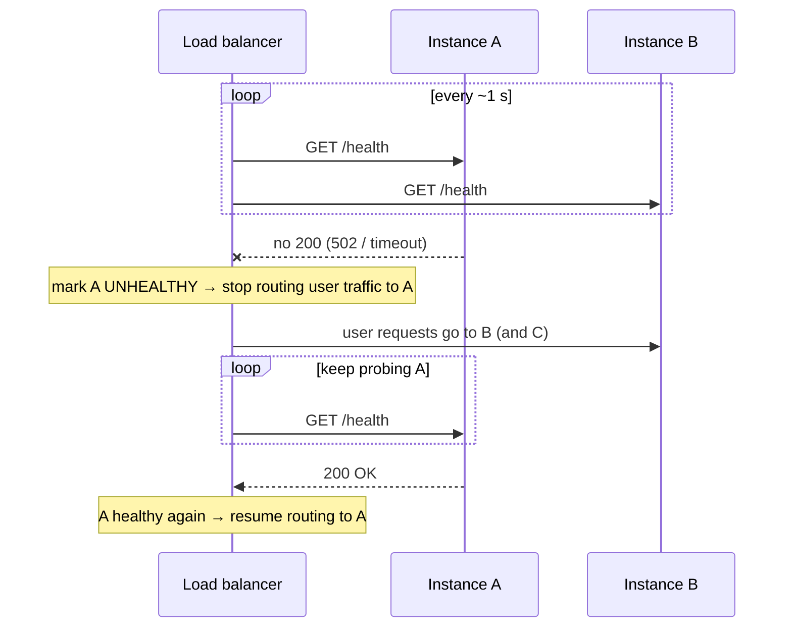
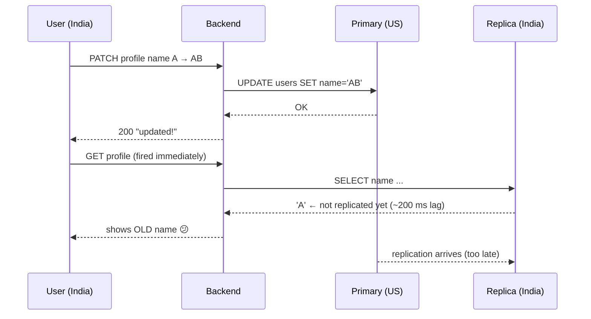
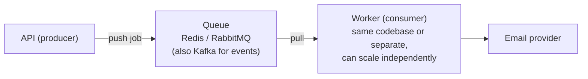

# My Notes: Backend Scaling and Performance Engineering (Part 2)

> **Source:** "21.2. Backend Scaling and Performance Engineering: Part-2" by Sriniously, *Backend from first principles* playlist (YouTube, 2:18:11)
> **Link:** https://www.youtube.com/watch?v=sOhAopEwjH4
>
> I wrote these from the video's full caption track, summarised in my own words. The diagrams and examples are my own illustrations. This continues part 1, which ended at horizontal scaling. He split it into two videos only because of a recording glitch.

---

## 1. Statelessness: the key to horizontal scaling

- Horizontal scaling = **many instances running the same code**, with traffic spread across them.
- It only works if instances are **stateless**: **no instance holds data that only it has**.
  - **Stateful** = an instance remembers something (about the client/user) that the others can't see. That leads to weird bugs.
- **Rule:** whichever instance handles a request, the **result must be the same**. Remove instance B and A + C + D must behave identically.
- That's why horizontal scaling needs **planning from the ground up** (it affects code, infra, the whole stack), while vertical scaling is "just upgrade the machine."

**Move all state outside the instances, somewhere shared:**

| State | ❌ Stateful (breaks) | ✅ Stateless (works) |
|---|---|---|
| **Sessions** | Instance A stores the session in an **in-memory array**. The next request lands on B, which doesn't know the user, so **401** and a confused user | Store sessions in **Redis**, shared by all instances |
| **File uploads** | Saved to instance A's **local disk**. The next request hits C, which can't find it | Upload to **object storage**: **S3**, **Cloudflare R2**, self-hosted **MinIO** |
| **Database** | **SQLite** file on one server | Centralised DB: **Postgres**, **RDS** (or centralised SQLite) |

```
            ┌── instance A ─┐
users ─► LB ┼── instance B ─┼──► shared: Redis (sessions/cache) · S3 (files) · Postgres (data)
            └── instance C ─┘
         (nothing stored inside the instances themselves)
```

---

## 2. Load balancers

- A **mandatory** part of horizontal scaling. The setup really **starts** with one.
- **The question it answers:** with many instances, **who decides which instance gets each request, and where does that happen?**
- All client traffic goes to the **load balancer (LB)**, not directly to the servers. The LB:
  1. picks an instance using an **algorithm**,
  2. forwards the request,
  3. receives the response and sends it back over the same HTTP connection.
- It's a **middleman**. The interesting part is the **routing logic**.

---

## 3. Load-balancing algorithms

### 3.1 Round robin
```
req1 → A · req2 → B · req3 → C · req4 → A · req5 → B · req6 → C ...
```
- Sends requests in **rotating order**.
- Works well when **requests cost about the same** and **servers have equal capacity** (e.g. 4 GB RAM, 2 cores each).
- **Problem: mixed request costs.**
  - Type 1: a light `SELECT` (user profile), ~200–300 ms.
  - Type 2: heavy. An external call (Elasticsearch, email…) plus a **write to a huge, heavily indexed table** (every index updated), ~2 s.
  - Round robin is "mindless" and can keep piling heavy requests on **one** server until it **crashes**.

### 3.2 Weighted round robin
- Servers with **more capacity get proportionally more requests**.
- A (8 GB / 4 cores) gets **2×** what B and C (4 GB / 2 cores) get: A, A, B, C, A, A, B, C…
- Still blind to **what kind** of request it's sending.

### 3.3 Least connections (smarter)
- Send each request to the server with the **fewest active connections**.
- An HTTP request keeps its **connection open** while the server works (DB writes, external calls…). (HTTP/1.1 closes it after the response; HTTP/2 and HTTP/3 multiplex, but the idea holds.)
- So servers busy with **heavy requests** stay "busy" longer and get fewer new ones:

```
t0: A ← heavy (2 s)      B ← light       C ← light
t1: B and C finish light requests (0 active) → next request goes to B or C, NOT busy A
```
- **Weighted least connections** adds capacity weights on top.

### 3.4 Others
| Algorithm | Picks the server with… |
|---|---|
| **Least response time** | The **fastest recent responses** (struggling servers get less) |
| **Resource-based** | The **lowest CPU / memory usage** |

All follow the same idea: **logic decides which instance gets the next request**.

---

## 4. Health checks

**Problem:** instance A **crashes** (overload, misconfiguration). Round robin keeps sending it requests, so those users get **502/503**. Other users get unlucky on their next request too. **Frustrating.**

**Solution: health checks.**

- Alongside real traffic, the LB sends a **cheap test request** (e.g. a simple GET) to **every** instance **every second**. It costs almost nothing.
- It expects **200**. Anything else **removes** the instance from rotation (a kind of blacklist).
- It **keeps probing** the removed instance, and **once it returns 200 again**, puts it back.

This was a brief introduction. Load balancers are a big topic worth reading more on.

---

## 5. Scaling the database

- App servers become easy to scale **once state is externalised**: add servers behind the LB and capacity grows roughly linearly.
- **The database is the stateful part** and can't simply be duplicated. Each instance holds data, and it must stay **consistent** across instances (the same query must return the same data from any of them).
- Two proven approaches: **read replicas** and **sharding**.

---

## 6. Read replicas and replication lag

**Problem:** all those scaled app servers still talk to **one DB server**, which eventually runs out of resources.

```
                      ┌────────────────────┐
     writes ─────────►│ PRIMARY (US)       │   (a.k.a. master / parent)
     (INSERT/UPDATE/  │ handles ALL writes │
      DELETE)         └─────────┬──────────┘
                                │ replication (built into Postgres/MySQL/...)
               ┌────────────────┼────────────────┐
               ▼                ▼                ▼
        ┌────────────┐   ┌────────────┐   ┌────────────┐
reads ─►│ replica IN │   │ replica CN │   │ replica JP │   READ-ONLY (SELECT)
        └────────────┘   └────────────┘   └────────────┘
```
- **Primary** takes **all writes**. **Replicas** (secondary / child) hold copies and serve **reads only**.
- Put replicas **near users** (e.g. India, China, Japan), assuming app servers are there too.

**Benefits:**
1. **Less load on the primary:** most SaaS traffic is **reads** (~70–90%), so replicas take most of it. The primary goes from 100% of queries to roughly 30%.
2. **Lower latency** for users far from the primary.

### The catch: consistency and replication lag

- Replication across the world takes time: **physics**. Data travels through **undersea fibre**, so US to India might take ~200 ms. That delay is **replication lag**.
- SPAs often **refetch right after a successful save**, so the read can hit a replica **before** the update arrives. The UI says "updated" and then shows the old value. For **payments or invoices**, this can cause real damage.

**Mitigations (each a trade-off):**
1. **Read-your-writes routing:** after a write to a table (e.g. `users`), send that user's **following reads to the primary**.
2. **Track replication lag** and make reads **wait** until replication catches up.
3. **Frontend timing:** delay the refetch (e.g. ~300 ms).

- In distributed systems, the trade-off is **almost always about consistency**.
- **Managed providers** (AWS RDS, Google Cloud SQL…) make replicas a few flags or toggles, with robust consistency handling. I don't have to build this, but I should **understand** it.

---

## 7. Sharding (partitioning)

**Problem:** an e-commerce `orders` table grows to **billions of rows**.
```sql
SELECT * FROM orders WHERE user_id = 5;   -- slow even WITH an index, due to sheer volume
```
Two problems: **query latency** and needing **more DB instances** to handle the load.

**Sharding:** **split one table across multiple physical DB instances**.
```
orders (10 "rows" ≈ 10 billion)
   │  shard key = order_date
   ├──► DB instance 1: Jan–Jun   (5 billion)
   └──► DB instance 2: Jul–Dec   (5 billion)
   (or one shard per month, depending on volume)
```
- **Choosing the shard key** (the criterion that decides **which data lives where**) is one of the trickiest parts.
- **Benefits:**
  1. **More instances**, so more requests per second.
  2. **Fewer rows per instance**, so faster queries.
- A **routing layer** (in the backend or DB layer) decides **which shard holds the data** before sending the query.

Implementation is complex. Here it's about knowing the concepts (**replicas vs shards**) so I can read further.

---

## 8. Distributed / managed databases

- **Current trend (late 2025): distributed databases** that handle **sharding, replication, distributed transactions** automatically:

| Product | Notes |
|---|---|
| **PlanetScale** | MySQL-based, uses **Vitess** underneath |
| **Neon** | Serverless **Postgres** (written in Rust) |
| **CockroachDB**, **YugabyteDB** | Distributed SQL |

- **Realistically:** **don't run your own DB infrastructure** unless you have deep DB-admin expertise (replication, sharding, **backups**, keeping data safe in multiple places…).
- Pick a provider (RDS, Neon, PlanetScale…) by features, price, and team preference. Sign up, get a URL and credentials, plug them in.
- **I still need the concepts** to **configure** the provider: backup frequency, **which regions get replicas**, **sharding plans**.

---

## 9. CDNs: beating the speed of light

(He has a separate, deeper CDN video; this is the scaling angle.)

### The physics limit
- Light in **fibre optic cable** travels ~**200,000 km/s**. That's the internet's speed cap (undersea cables).
- **Tokyo ↔ US-East-1 (N. Virginia, where many apps live)**: ~**20,000 km round trip**, so about **100 ms minimum** before **any** processing.
- Add routing (fast, regex-based), **JSON deserialization** (depends on payload size), **business logic + DB** (50–100 ms for mid-complexity queries even in the same region), **external APIs** (~200 ms)… and that Tokyo user sees **~500–800 ms**.
- Even after all the DB and caching optimisation, **geographic distance** remains.

### What a CDN does
- Put **edge locations / PoPs** **near users** (Tokyo, Mumbai, Singapore…) and cache content there.

```
Without CDN:  Tokyo ──20,000 km──► US server       ≈ 100 ms+ round trip
With CDN:     Tokyo ──100–200 km──► Tokyo PoP       ≈ 2–3 ms
```

**Wins:**
1. **Latency** (e.g. 100 ms → 2–3 ms).
2. **Less load** on the origin: traffic spreads across CDN nodes, so I need horizontal scaling less often.
3. **Security / DDoS protection** (Cloudflare's big selling point):
   - **DDoS:** an attacker controls ~20,000 malware-infected **bots** and floods my server. Either it **crashes**, or **autoscaling spins up instance after instance** and I get a huge bill (e.g. $50k in a day).
   - With **Cloudflare in front**, all traffic passes through it. It **detects attacks**, challenges suspicious users with **CAPTCHAs**, and absorbs terabytes or petabytes across its huge network.

### What to put on a CDN
- **Static content:** **JS/CSS bundles, HTML**, images, videos, fonts. A deployed **SPA** bundle and static blogs are ideal.
- **Some API responses:** e.g. an e-commerce **product catalogue** that rarely changes.
- **Purging (invalidation):** e.g. Cloudflare **cache tags**. When a user publishes a new blog, purge the tag for that user's posts and refetch from the origin.

---

## 10. Edge computing

- **"Edge" originally** meant CDN nodes sitting **at the edge of the network**, the first point of contact, often placed with **ISPs**. That's why they're fast.
- **Traditional CDN:** request a file, get the file. **No processing.**
- **Edge computing:** **run code on the edge node** before responding.
  - Edge nodes vastly **outnumber** primary data centres (those need huge financial and operational investment).
  - Processing time may be the same as on the origin, but the **round trip is tiny**, so it **feels much faster**.

### Use cases
| Use case | Why at the edge |
|---|---|
| **Auth checks** | Check the session or token at the edge. An unauthorised request gets **401 in ~2–3 ms** instead of ~100 ms, and **the origin only sees legitimate traffic** |
| **Localisation / personalisation** | The edge knows the region and headers (e.g. browser language **Japanese**) and serves the **Japanese version** directly |
| **Validation, routing** | Decide which server should get the request, reject bad input early |

### Why not run everything at the edge?
1. **Resource limits:** edge nodes often sit on **ISP infrastructure** whose main job is routing. Expect something like **1 GB RAM / 1 core**, not 8–16 GB.
2. **Runtime limits:** e.g. **Cloudflare Workers** run on **V8 isolates** (Chrome's JS engine) with restrictions: **no filesystem**, limited **TCP**, etc.

So **edge + origin work together**. Offload strategic logic to the edge; the robust origin still does the heavy lifting.

---

## 11. Asynchronous processing

- One of the easiest ways to cut **perceived latency**, and something to adopt **from the start** (unlike horizontal scaling, which comes at a traffic threshold).
- **Synchronous ops** must finish before responding. E.g. update a name: the DB write must succeed before I say "updated."
- **Some ops don't need to finish before the response.**

### Example: inviting a team member (Jira/Notion-style workspaces)
```
POST /invites { email: "user1@gmail.com" }
 1. check not already a member (DB)         ┐
 2. insert invite row (status = pending)    ┘ ~50–100 ms (same-region DB)
 3. call email provider (Mailchimp / SendGrid / Resend)   ~200–300 ms, out of my control
 4. respond
```
- **Synchronous:** the user watches a spinner for **~400 ms**.
- **Async:** after steps 1–2, **enqueue a "send invite email" job** and **respond immediately**, so **~100 ms**. The user sees the pending invite, and the email arrives shortly after. A snappier UX, and it survives slow or **down** email providers.


(See the task-queue video.)

### Good candidates
| Task | Why async is fine |
|---|---|
| **Emails, notifications** | Nobody expects them within milliseconds |
| **Video processing** (YouTube) | Once upload finishes you can close the tab. **Thumbnails, HD encoding, subtitles** run in the background over 10–20+ minutes |
| **Image uploads / resizing** | Background work |
| **Delete account** | A user with 10 years of data (a million to-dos, categories, calendar entries, profile…) could take **~8 s** of deletes in a transaction. Instead: quick checks (~50–80 ms) → **respond and log out** → enqueue **"delete user"** → the worker deletes everything, however long it takes |

**Tools:** a managed Redis (e.g. **Upstash**) + **BullMQ** (Node), which handles retries, error handling, rate limiting. **First identify which tasks don't need an immediate result**, then offload them.

---

## 12. Monolith vs microservices

### Monolith
- **One deployable unit**: auth, orders, notifications, payments, webhooks are just **modules/files** in **one codebase**, running as **one process** (or several identical ones when scaled horizontally).
- **Easy to develop, test, deploy, refactor.**
- And I can still **scale it horizontally**.

### Microservices: mainly about scaling the TEAM
> Microservices are **less about machine performance** and **more about human/organisational scaling**. Prerequisite: a **large team** (e.g. **100–200+ developers**).

**Monolith pain points at large scale:**
| Problem | Example |
|---|---|
| **Deployment coupling** | The payments team wants to ship a critical change, but `main` contains a notifications change that isn't ready. Feature flags and git discipline help, but with 500–1,000 devs and loose cross-team communication it keeps happening. (In a 10–30 person startup, everyone knows what everyone's doing.) |
| **Uneven scaling** | Notifications are light (DB inserts, some WebSockets) while **orders/payments are heavy**. A monolith scales **everything together**. Microservices scale **only what needs it** |
| **Tech stack** | A blog platform (Medium / Hashnode / dev.to) needs **Node** or **Python** for a markdown-parsing library, but wants **Go/Rust** for CPU-bound **image manipulation** (e.g. 500 ms → 50 ms). One deployable unit means one language |

### Microservices' costs
1. **Network:** function calls become **network calls** (HTTP/gRPC). That means **latency**, **failures**, **retries**, **timeouts**.
2. **Debugging:** one request flows LB → router → orders → payments → notifications, so **logs from 4+ services**. **Distributed tracing** is required.
3. **Data consistency:** each service often has **its own DB**, so replication-lag and consistency headaches.
4. …and more.

### When to consider them
- **Large team** with clear boundaries (organisation structure maps to service boundaries).
- **Genuinely different scaling needs** per part.
- **Different technologies** genuinely needed.
- The complexity usually **outweighs the benefits**, so it's a big decision. Without clear answers, **it's not worth it**.

---

## 13. Serverless

(He has a separate serverless playlist.)

### Before serverless: traditional servers
- Rent a VM (e.g. EC2 with Ubuntu), install and configure Nginx, Docker, the build and run pipeline, and **manage it for its lifetime** (config, DNS…).
- I know exactly what I have (e.g. 4 GB RAM, 2 cores, 30 GB disk, 1 TB/month bandwidth).

**Problem: capacity planning (predicting traffic upfront):**
| Mistake | Result |
|---|---|
| **Under-provision** (4 GB) and a spike hits | Crashes or 3–4 s responses, users leave, lost conversions and reputation |
| **Over-provision** (32 GB when 8 GB would do) | Pay for idle capacity. E.g. ~$5,000/week instead of ~$500, using only 20% |

**Autoscaling** helps (e.g. instances above 70% memory → add another, load drops to ~40%), but:
1. **Time:** a new instance must **boot an OS**, fetch/build the code, start the process, register with the LB. **Seconds to minutes.** A spike within 3–4 seconds can beat it.
2. **Min/max limits:** max too low and I'm under-provisioned again. Max too high (e.g. 1,000) and an attack or Black Friday spins up 500–600 instances, maybe **$100k in a day**.
3. **Reactive, not proactive:** it scales **after** overload is detected, so I may already be failing.
4. **Always-on cost:** there's always a **minimum** that I pay for **24/7**, even at zero traffic.

Fine for **steady, predictable traffic** (most SaaS).

### Serverless
- **There are still servers.** I just **don't manage them**: no OS, no machine size, no configuration.
- I provide only **functions (code)** and **events (triggers)**.

```
request → API GATEWAY (maps route → function) → provider spins up an instance → runs MY function → response
                                                     (instance lives a few seconds or returns to a pool)
```

| | Traditional | Serverless |
|---|---|---|
| Compute | Machine always on, listening | **Instance created on demand** when a request or event arrives |
| Pricing | **24/7** for the machine | **Pay only for execution time** (CPU/memory milliseconds per invocation) |

### Serverless trade-offs
1. **Cold starts (the #1 problem):** no machine is waiting, so the **first request pays the spin-up time**.
   - **Workarounds:**
     - **Keep-warm pings** (scheduled requests keep instances alive). Overdo it and you're paying 24/7 again.
     - **Fast runtimes:**
       - **AWS Lambda** uses **Firecracker** (KVM-based **micro-VMs**), now the industry standard, to cut OS boot time.
       - **Cloudflare Workers** use **V8 isolates** (claimed ~0–1 ms to start) plus **JavaScript** (interpreted, no compile step) for **very low cold starts (~5 ms)**.
     - Language matters: **JS/Python** start faster than JVM languages with heavy compile/runtime steps.
   - Cold starts will **never be zero**. Always-on servers win there.
2. **Execution limits:** e.g. **Lambda max ~15 minutes**, so a 30-minute job fails partway.
3. **Statelessness:** instances keep getting **replaced**, so stateful patterns (**persistent DB TCP connections**, **WebSockets**, local data) must be **rethought** (e.g. serverless DBs).

### When to use it (and not)
| ❌ Avoid | ✅ Good fit |
|---|---|
| **Latency-sensitive** user-facing apps (banking, payments) | **Occasional heavy jobs**: video / image processing and resizing (don't pay for idle heavy infra) |
| **Long-running** requests / WebSockets | **Event-driven** work: new queue message, file upload, DB change triggers |
| Apps needing **many DB connections** (would need serverless DBs) | |

His view: **somewhat over-hyped**. A powerful tool for **specific** cases, **not a universal replacement for servers**.

---

## 14. Final mental models

1. **Start with the problem.** Everything here is a **solution**. First learn **whether** and **where** the system is slow: observability (traces, metrics, logs), **performance and load testing**.
   - Know the **specific** cause ("the DB is slow **because this index is missing**", or "**because it's not sharded**") before choosing a fix. Otherwise it's **premature optimisation**.
   - Tools: **Prometheus + Grafana**, or a managed tool like **New Relic**.
   - The worst outcome is **fixing the wrong bottleneck**. It feels solved and grows into a bigger problem.
2. **Prefer simple solutions.** Complexity **costs**: every component can fail and must be monitored, understood, operated.
   - **One big vertically scaled server** < horizontal scaling from day one.
   - **Proper indexes** < Redis in front of every query.
   - **Monolith** < microservices. **Kubernetes** only when truly needed.
   - Accept complexity only when **simplicity genuinely isn't enough**, and justify it.
3. **Scale for the problems you have.** Don't build for a million users on day one (most platforms never get there). Build for **current scale plus reasonable headroom**, and learn real bottlenecks as you grow. **Big-tech blog advice (Netflix, Facebook, Google) may not fit my system.** Learn from **measuring my own**.
4. **Measure, from day one.** The **one exception to "keep it simple"**: set up **production-grade observability (logs, metrics, traces) from the start**. No random crashes, no guessing, and early warning before problems hit.
5. **It's a mindset.** Like security, performance and scaling are **continuous learning from experience**: build, watch it struggle, optimise, see what helps. No tutorial can teach it all. **The job isn't predicting every problem. It's building systems that handle problems gracefully, and the skill to measure, diagnose, and fix quickly.**

---

## 15. My cheat sheet

```
STATELESSNESS  no instance-only state → sessions in Redis · files in S3/R2/MinIO · central DB
LOAD BALANCER  single entry → picks instance → forwards → returns response
ALGORITHMS     round robin (equal reqs/servers) · weighted RR (capacity) · least connections (smart)
               · weighted least conn · least response time · resource-based (CPU/mem)
HEALTH CHECKS  LB pings /health ~1 s → non-200 → remove from rotation → keep probing → re-add

DB SCALING (the stateful part)
  read replicas: primary = writes, replicas = reads (~70–90% of traffic), place near users
    replication lag (~200 ms US↔IN) → stale reads after writes
    fixes: read-your-writes → primary · wait for lag · delay frontend refetch
  sharding: split a table across instances by SHARD KEY (e.g. order date/month) + routing layer
  managed/distributed DBs: PlanetScale (Vitess) · Neon (serverless PG) · CockroachDB · YugabyteDB
    → don't self-host DB infra; know the concepts to configure backups/replicas/shards

CDN       light in fibre ≈ 200,000 km/s → Tokyo↔US ≈ 100 ms min → edge PoPs ≈ 2–3 ms
          wins: latency · origin offload · DDoS protection (Cloudflare)
          cache: static (JS/CSS/HTML/images/video/fonts, SPAs) + some API responses; purge via tags
EDGE COMPUTE  run code at the edge: auth rejects (401 in ms), localisation, validation, routing
          limits: tiny resources, restricted runtimes (Workers / V8 isolates: no FS/TCP)

ASYNC     respond after essential work; queue the rest (Redis/RabbitMQ/Kafka + workers, BullMQ)
          invite email 400 ms → 100 ms · video pipeline · image resize · delete account

MICROSERVICES  scale TEAMS (100–200+ devs), not machines
          + independent deploys · independent scaling · per-service tech stack
          − network calls/failures · cross-service debugging (tracing) · data consistency
          default: monolith

SERVERLESS  functions + events, API gateway, pay per execution
          vs servers: capacity planning, autoscaling delays/limits/reactiveness, 24/7 min cost
          − cold starts (Firecracker micro-VMs, V8 isolates, keep-warm) · time limits (Lambda ~15 min)
            · statelessness (DB conns, WebSockets)
          use for spiky/event-driven/heavy-occasional jobs; avoid for latency-critical/long-running

MENTAL MODELS  start with the problem (measure first) · prefer simple · scale for today + headroom
               · observability from DAY ONE · performance is a mindset
```
