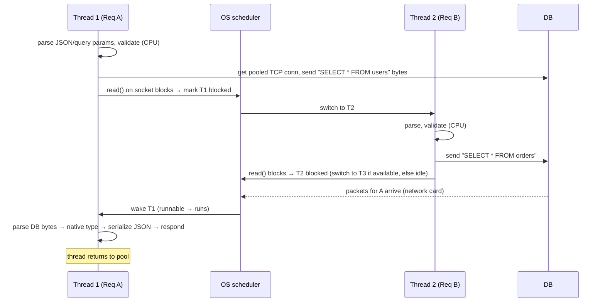

# My Notes: Concurrency & Parallelism, IO-Bound vs CPU-Bound

> **Source:** "22. Concurrency & Parallelism: IO Bound vs CPU Bound" by Sriniously, *Backend from first principles* playlist (YouTube, 1:28:06)
> **Link:** https://www.youtube.com/watch?v=bs9MEYRTA30
>
> I wrote these from the video's full caption track, summarised in my own words. The diagrams and code snippets are my own illustrations of the ideas.

---

## 1. Why this matters

- Every backend must **handle many things at once**. A server that handles **one request at a time** makes the other ~1,000 users wait or get "busy" errors. That's impossible in production.
- Languages and runtimes (**Node.js, Python, Rust, Go**) each expose this differently: `async/await`, threads, goroutines…
- There are **no concrete tips** in this video. The point is a **mental model** of how my backend juggles requests, which helps with **debugging, structuring code, and big architectural decisions**.
- We often use `async`/`await` and threads **without knowing what they do mechanically**. We can get far that way, but understanding them puts me a step ahead.

---

## 2. The waiting problem: idle CPU

A typical request: client → server (routing, handler, service, repository) → **DB query** → **wait** → respond.

| DB location | Typical simple-query wait |
|---|---|
| Local (localhost) | ~1–2 ms |
| Different availability zone | ~20–30 ms |
| Different, far region | ~90–100 ms |

**What is the server doing while it waits?** If it processes **synchronously** (line by line, one request at a time): **nothing. The CPU is idle.**

### Quantifying the waste
- A modern CPU runs ~**3 billion instructions/second** ≈ **3 million per millisecond**.
- Waiting **100 ms** idle = **300 million instructions not executed**.

### A realistic API call
```
3–5 DB queries + 1–2 external calls (email, Redis…) ≈ 5 network operations × ~50 ms
  = ~250 ms WAITING ON I/O
  + ~10 ms actual CPU work
→ CPU/memory idle ~95% of the time
```
- More than ~70% of a typical backend's time goes to waiting on **I/O**: DB, external APIs, file system, logging.
- **Concurrency's job:** use the CPU for **other work while waiting on I/O**.

**I/O (input/output)** = network, files, stdin/stdout (keyboard, display)… anything where the CPU is just waiting on something else.

---

## 3. Concurrency vs parallelism

| | **Parallelism** | **Concurrency** |
|---|---|---|
| Meaning | **Executing** multiple instructions **at the same instant** | **Structuring** a program to **start, pause, resume** many tasks so they all make progress |
| Needs hardware? | **Yes**: ≥ 2 CPU cores (one core = one instruction at a moment) | **No**: works on **one core** |
| One-liner | **Doing** many things at once | **Dealing with** many things at once |

### Timeline: one core, two requests (concurrency)
```
time (ms):  0    5        15         40   50   55   65
Req A:     [CPU]──── wait for DB ─────────[CPU]
Req B:          [ CPU ]──── wait for DB ──────────[CPU]
           ▲ A parses (CPU) → A waits on DB → B gets the CPU → B waits → A's DB is back,
             scheduler gives A the CPU again (not necessarily instantly) → A responds → B continues
```
- **Both requests are "in progress"** from the client's view, but **at any instant only one uses the CPU**. No CPU time is wasted.
- In reality the CPU is juggling not just requests but **logging (I/O), telemetry, background jobs**… hundreds of things.

### With two cores (parallelism)
```
core 1: Req A [CPU]──wait──[CPU]
core 2: Req B [CPU]──wait──[CPU]        ← both truly executing in the same time window
```

---

## 4. IO-bound vs CPU-bound

| | **I/O-bound** | **CPU-bound** |
|---|---|---|
| What dominates | **Waiting** on external resources | **Actual computation** (CPU cycles) |
| Examples | DB queries, external APIs, file system, logging, stdin/stdout | JSON parsing/validation (light, ~1–2 ms), **image processing** (matrix maths), **encryption** (e.g. verifying JWTs), video encoding, ML |
| What helps most | **Concurrency** (mandatory) | **Parallelism** (multiple cores) |
| More cores help? | Not much. The bottleneck is I/O | Yes |

- **Most backends are I/O-bound.** Heavy CPU work is niche (video encoding, crypto-heavy work…).
- A backend needs **both**: concurrency for I/O (DB, APIs, files, logs, jobs) and parallelism for heavy computation.

---

## 5. How computers do many things: threads

Fundamentally there are **two mechanisms**, and every language primitive (**goroutines**, **async/await**, Java **virtual threads**…) builds on them:
1. **Threads**
2. **Event loops**

### Threads (OS-level)
- An **independent unit of execution managed by the operating system**.
- When created, the OS gives it:
  - a **stack**: function-call frames (main → getUsers → …) and **local variables** (`let a = 3`),
  - an **instruction pointer**: where it is in the code, so it can **resume after a context switch**.
- **The scheduler is controlled by the OS.** (Some runtimes later add **their own** scheduler on top, see Go.)

### Preemptive scheduling
```
scheduler gives each thread a time slice (~ms):
T1 [run 2ms] → pause, save state → T2 [run 2ms] → T3 [run 2ms] → T1 ...
```
- Threads get **preempted**, stopped whether they like it or not.
- 📖 He recommends ***Operating Systems: Three Easy Pieces*** for OS scheduling depth (optional).

### Blocking I/O with threads
- A thread hits a **blocking operation** (network, DB, file, device) → tells the OS → the OS marks it **blocked** → switches to **another thread**.
- When the I/O completes, the thread becomes **runnable** (queued for the scheduler, not instantly running).

### Processes vs threads and memory
```
Process 1                         Process 2
├── Thread 1 ┐ share heap/globals ├── Thread 1
└── Thread 2 ┘ (same address space) └── Thread 2
   ✗ isolated from Process 2 (security, memory safety)
```
- Threads **in the same process share memory** (heap, globals, dynamically allocated objects). T1 creates an object, and T2 can access it **via a pointer**.
- Communicating via **shared memory** is **fast** (no copying or serialization), but **dangerous** (section 12).
- With **multiple cores**, threads run **in parallel**: 2 cores → 2 threads truly simultaneous, 4 → 4. Great for CPU-bound work.

---

## 6. The cost of threads

| Overhead | Detail |
|---|---|
| **Memory** | Each thread gets its own **stack** (on Linux up to ~**8 MB virtual**; physical pages only as needed, but still KBs–MBs). **Thread-per-request** at a spike: 10,000 requests × ~0.5–1 MB ≈ **8–9+ GB** just for stacks → **out of memory, crash** |
| **Creation** | A **syscall** to the kernel: set up the stack, allocate bookkeeping, add to the scheduler. **Microseconds to milliseconds** each |
| **Context switching** (the biggest) | Save CPU registers, update bookkeeping, pick the next thread, restore its registers. ~**1–10 µs** per switch. With 100s–1,000s of threads on 4 cores, this pure **maintenance** work adds up to **milliseconds** of wasted CPU |

That's why **thread-per-request** models struggle with **high concurrency**.

---

## 7. Event loops

- Typically **ONE thread** that juggles many tasks using **waiting + callbacks**.
- **Golden rule: NEVER block the event loop.**

### How it works
```
┌──────────────────────── EVENT LOOP (single thread) ────────────────────────┐
│ loop forever:                                                               │
│   1. ask the OS which I/O operations completed (epoll / kqueue / IOCP)      │
│   2. queue their callbacks                                                  │
│   3. run ready callbacks (must be FAST)                                     │
│ task hits I/O → registers callback "resume me when DB replies" → yields     │
└─────────────────────────────────────────────────────────────────────────────┘
```
- When a task needs I/O (e.g. a DB query), it **registers a callback** and **gives control back** to the loop, which runs other work.
- The loop has queues and priorities (simplified here to one queue).
- **OS support is required:** **epoll** (Linux), **kqueue** (macOS), and an equivalent on Windows. These let one thread **monitor thousands of connections** efficiently.

### Why it's efficient for I/O
- **No context switches** (one thread) and **no per-task stacks** (no MBs/GBs of stack memory).
- For **I/O-bound** work, adding threads doesn't help and actually adds context switching. **The event loop wins.**
- For **CPU-bound** work, **threads (parallelism) win**.

### The trade-off
- Any **CPU-heavy callback** (e.g. 100+ ms of computation) **freezes the whole loop**. Nothing else runs.
- Typical SaaS backends rarely have such tasks (images, video rendering, ML are the exceptions), so it's usually fine.
- That's why event-loop languages like **JavaScript** give **callbacks → promises → async/await**: tools to **yield control at I/O points** and never block.

---

## 8. Walkthrough: threads vs event loop handling two requests

### Thread model

```python
# thread model (sync code; blocking is invisible in the code)
def handle_request(req):
    user = db.query("SELECT * FROM users WHERE id = %s", (req.id,))  # thread blocks here, OS switches away
    return to_json(user)
```
The code **looks sequential**. The blocking and switching happen **behind the scenes**.

### Event-loop model
- Same steps, but at the DB call the task **registers a callback** and **returns control to the loop**, which then handles request B. Each loop iteration checks (via epoll) whether A's or B's socket is **readable**. When B's DB reply arrives first, **B's callback runs** (process → serialize → respond), then A's.
- **The difference:** threads pause and resume using **heavy OS structures** (stacks, instruction pointers). The event loop pauses and resumes using **callbacks**.

---

## 9. Callbacks → async/await

### Callback style (pre-ES6 JavaScript)
```js
function handleRequest(req, res) {
  db.query("SELECT * FROM users WHERE id = ?", [req.userId], (err, user) => {
    if (err) return res.status(500).send();
    res.json(user);                        // runs when the DB reply arrives
  });
}
```

### Nested callbacks get ugly ("callback hell")
```js
db.query(q1, (e, a) => {
  db.query(q2, (e, b) => {
    api.call(x, (e, c) => {
      db.query(q3, (e, d) => { /* ...deeper and deeper */ });
    });
  });
});
```

### async/await: **syntactic sugar over callbacks**
```js
async function handleRequest(req, res) {
  const user = await db.query("SELECT * FROM users WHERE id = ?", [req.userId]);
  // ↑ everything below this line is effectively "the callback"
  const orders = await db.query("SELECT * FROM orders WHERE user_id = ?", [user.id]);
  res.json({ user, orders });
}
```
- `await` means: **give control to the event loop until this I/O finishes, then continue from here**.
- Within that function, everything after an `await` acts like a callback passed to that I/O. Multiple awaits, **no nesting**.

---

## 10. Go's model: goroutines (virtual threads)

- Not pure threads, not an event loop. Conceptually **virtual threads**, which Go calls **goroutines**.
- A Go program starts as the **main goroutine**, which can spawn more with the **`go`** keyword.
- **Go's `net/http` server spawns a new goroutine per request** (its `Serve` loop accepts connections and runs `go c.serve(...)`, calling the registered handler). Goroutines are cheap enough to do this.

### The Go runtime scheduler (M:N mapping)
```
                 GO RUNTIME SCHEDULER (in the Go runtime, not the OS)
   goroutines:  G1 G2 G3 G4 G5 G6 G7 G8 ... (thousands to millions)
                  │   │   │   │   │   │
   queues  →   [ M1 ]  [ M2 ]  [ M3 ]  [ M4 ]    OS threads (≈ GOMAXPROCS, default = #CPU cores)
                  │       │       │       │
   cores   →    core1   core2   core3   core4
```
- **GOMAXPROCS** sets how many OS threads run Go code (default = number of CPU cores). E.g. 4 cores → **4 OS threads (M1–M4)**.
- Each OS thread has a **queue of goroutines**. The runtime scheduler places goroutines on queues by its own algorithm.
- When **G1 blocks on I/O**, the runtime **parks G1** and **M1 runs G2**. Switching goroutines is roughly **a pointer switch**: very lightweight.
- So Go can run **~100× more goroutines than OS threads** (memory is the eventual limit). That's why it's efficient for **both I/O and CPU** work, without an event loop.

```go
func handler(w http.ResponseWriter, r *http.Request) {
    var u User
    // this goroutine parks here; the Go scheduler runs others on the same OS thread
    err := db.QueryRow("SELECT * FROM users WHERE id = $1", r.URL.Query().Get("id")).Scan(&u.ID, &u.Name)
    if err != nil { http.Error(w, "not found", 404); return }
    json.NewEncoder(w).Encode(u)
}
```
**The difference:** the same idea as threads, plus **another abstraction layer**: the **Go scheduler** instead of the OS scheduler, **goroutines** instead of OS threads, hence lightweight.

---

## 11. async functions as state machines

How a runtime can think of an `async` function:
```js
async function fetchUserData(userId) {
  const user = await db.getUser(userId);
  const orders = await db.getOrders(user.id);
  return { user, orders };
}
```
is conceptually transformed into a **state machine**:
```js
function fetchUserData(userId) {
  let state = 0, user, orders;
  function step(resolve) {
    switch (state) {
      case 0:
        state = 1;
        db.getUser(userId).then(u => { user = u; step(resolve); });     // yield to event loop
        return;
      case 1:
        state = 2;
        db.getOrders(user.id).then(o => { orders = o; step(resolve); }); // yield again
        return;
      case 2:
        resolve({ user, orders });                                       // done
    }
  }
  return new Promise(step);
}
```
- Each **`await` is a state transition**. Between states, the event loop is **free** to run other tasks.

**This explains two rules:**
1. **`await` only works inside `async` functions**, because the function must be transformed into a state machine.
2. **Blocking the event loop is terrible**, because no state machine can advance to its next state.

(I don't need to fully internalise this. It just helps.)

---

## 12. The danger: shared state and race conditions

Most concurrency bugs come from **shared state / shared memory**.

### Counter example: the lost update
`counter++` is really **three steps**: **read** into a register → **add 1** → **write back**.
```
t1  Thread A: read counter (0) → regA = 0
t2  Thread B: read counter (0) → regB = 0      ← before A wrote!
t3  Thread A: regA = 1
t4  Thread B: regB = 1
t5  Thread A: write → counter = 1
t6  Thread B: write → counter = 1      ✗ expected 2 — A's increment is LOST
```
- This is a **lost update**, an example of a **race condition**.

### "I use single-threaded JS with async/await, so I'm safe?" No.
```js
let balance = 100;

async function withdraw(amount) {
  if (balance >= amount) {             // check
    await processWithdrawal(amount);   // ← yields to the event loop!
    balance -= amount;                 // act (check result may be stale now)
  }
}

withdraw(100);
withdraw(100);
```
```
call 1: 100 >= 100 ✓ → await (yields)
call 2: 100 >= 100 ✓ → await (yields)          ← check passes on stale state
call 1 resumes: balance = 100 − 100 = 0
call 2 resumes: balance = 0 − 100 = −100        ✗ invalid
```
- **Check-then-act across an `await`** lets another task slip in between. **A single thread doesn't prevent races.**

---

## 13. Preventing race conditions

(A deep topic; see OS books. Two common tools.)

### Locks / mutexes (mutual exclusion)
```python
import threading
lock = threading.Lock()
counter = 0

def increment():
    global counter
    with lock:            # only ONE thread inside this block at a time
        counter += 1      # read-modify-write is now safe
```
- Others **wait** to acquire the lock until the holder releases it.

### Go channels: communicate instead of sharing
```go
// one goroutine owns the state; others send messages
updates := make(chan int)
go func() {
    counter := 0
    for delta := range updates { counter += delta }   // single writer, no race
}()
updates <- 1
updates <- 1
```
- Instead of many goroutines writing a shared variable, they **pass messages**, and **one goroutine** updates the value.

(Also: DB-level fixes for the balance case, e.g. atomic `UPDATE ... SET balance = balance - $1 WHERE balance >= $1`, or row locks. That's my own addition.)

The video's real goal isn't mastering threads and locks. It's understanding **I/O-bound vs CPU-bound**.

---

## 14. Summary

| Workload | Best tool |
|---|---|
| **I/O-bound, high concurrency**: web servers, API gateways, services calling many other services | **async/await** (event loop), **goroutines**, Java **virtual threads**, all more efficient than raw OS threads |
| **CPU-bound**: number crunching, string/image/video manipulation, anything that keeps the CPU busy | **Threads + parallelism** (multiple cores) |

- **Concurrency** keeps the program **productive while waiting on I/O** (network card packets, stdin/stdout, external APIs, databases…), so no CPU cycles are wasted.
- **Parallelism** uses **multiple cores at the same instant**.
- **Most backend work leans on concurrency**, but some cases need parallelism, or both. Knowing the difference lets me **pick the right tools**.

---

## 15. My cheat sheet

```
WHY       servers must handle many requests; sync one-at-a-time = CPU idle ~95% (waiting on I/O)
          3M instructions/ms → 100 ms DB wait = 300M instructions wasted

CONCURRENCY  dealing with many things (start/pause/resume), works on 1 core
PARALLELISM  doing many things at the same instant, needs ≥2 cores

I/O-BOUND   DB, APIs, files, logs (most backends) → concurrency
CPU-BOUND   image/video, crypto/JWT, ML, heavy parsing → parallelism

THREADS (OS)  stack + instruction pointer; OS preemptive scheduler; blocked on I/O → switch
              same-process threads SHARE memory (fast but dangerous); parallel across cores
              costs: stack memory (~MBs) · creation syscalls · context switches (1–10 µs each)
              → thread-per-request struggles at high concurrency

EVENT LOOP    1 thread · register callback on I/O, yield · epoll/kqueue watch sockets
              no context switches, no per-task stacks → great for I/O
              NEVER BLOCK IT (CPU-heavy work freezes everything)
              callbacks → callback hell → async/await (sugar; code after await = callback)

GO            goroutines (virtual threads) on GOMAXPROCS OS threads (M:N)
              runtime scheduler parks a blocked goroutine, runs another (cheap pointer switch)
              net/http: one goroutine per request

ASYNC = STATE MACHINE  each await = state transition → await only inside async; blocking stalls all

RACES      shared state: counter++ = read/add/write → lost update
           async check-then-act across await → balance −100 (single thread isn't safe!)
FIXES      locks/mutexes (mutual exclusion) · Go channels (one owner, message passing)
           · atomic DB updates / row locks
```
