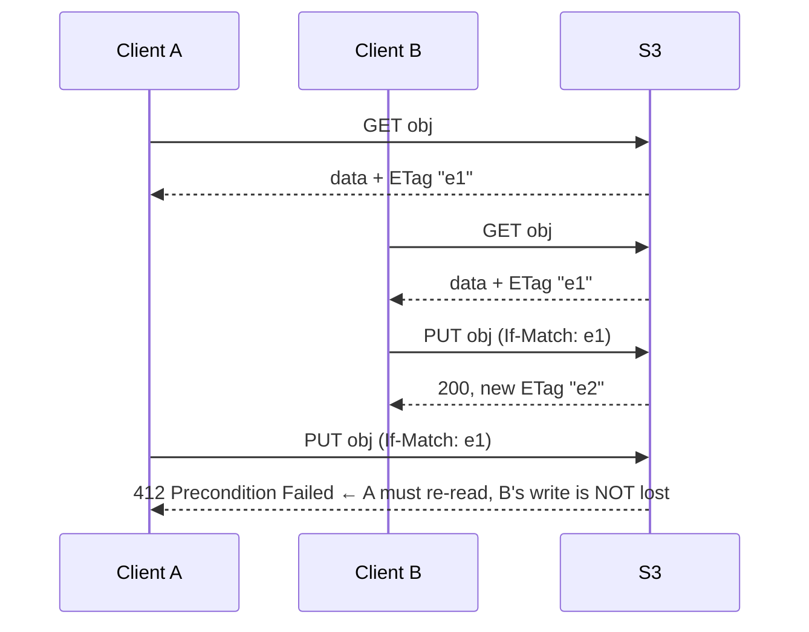
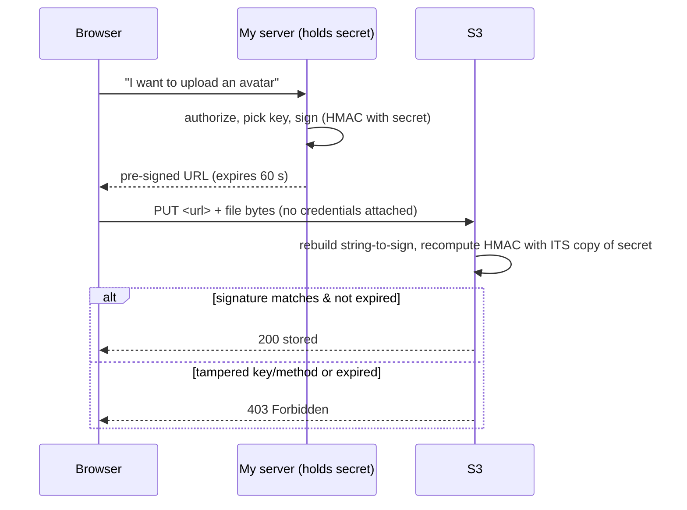
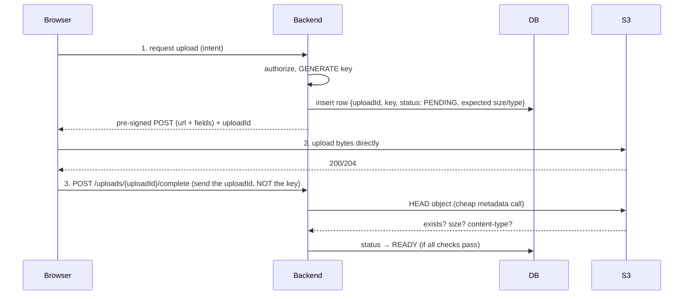

# My Notes: Object Storage, Everything I Need to Know (Part 1)

> **Source:** "23. Object Storage - Everything You Need to Know: Part -1" by Sriniously, *Backend from first principles* playlist (YouTube, 1:29:29)
> **Link:** https://www.youtube.com/watch?v=Ie0TjKI9cDI
>
> I wrote these from the video's full caption track, summarised in my own words. The diagrams, CLI commands and code are my own illustrations of what he explains and demos. Part 1 ends with pre-signed uploads and CORS. Part 2 covers multipart/resumable uploads, range requests, video seeking and costs.

---

## 1. The new requirement: users upload files

My backend has auth, a DB, handlers, services, repositories. Now **users need to upload a profile picture**.

**The intuitive (naive) approach:**
```
browser → multipart form data → server extracts the file
        → save to LOCAL file system (ext4 / XFS on Linux)
        → store the file PATH in the DB
        → later: read the path from the DB, read the file, send it back
```
It works in the happy path (profile pictures are small: ~300 KB–10 MB, maybe 15–20 MB from a mirrorless camera). **Then it falls apart.**

**The disaster scenario:** a new feature lets users post **videos** (MBs to **GBs**). Someone uploads **4 GB** to an instance with **4 GB RAM**. The framework helpfully reads the **whole file into memory** → **out of memory** → **container killed** → it restarts → **every file stored on that instance is gone** (container disks are ephemeral). And with **3 instances**, files that survived live only on *other* instances, so **~1 in 3 profile-picture requests return 404**.

**The wrong assumption:** "a file is something my app owns." Files are a **different shape of data** from the JSON my server handles ~95% of the time. Different **access pattern**, different **cost profile**, so they need a **different storage system: object storage**.

---

## 2. Six reasons the naive way breaks

| # | Problem | Details |
|---|---|---|
| 1 | **Server disk is ephemeral** | Containers (Docker/K8s, Railway, Render, Vercel, Netlify…) are **replaced on every deploy or restart**. The image contains **code, not users' files**, so files are **wiped**. *Persistent volumes* fix this one, but **not** problems 2–3 |
| 2 | **Horizontal scaling** | 3 instances behind a load balancer: upload lands on instance 1, the next request (round robin) goes to 3, so **404**. Hit chance ≈ **1 / number of instances**. **Breaks statelessness** |
| 3 | **Fixed disk size** | Disks grow **vertically only** (resize = usually downtime) and have a **ceiling**. Uploads are often the **fastest-growing data** (1,000 users × 100 MB = 100 GB/month) and rarely shrink |
| 4 | **Durability** | One disk; disks **do** die (power, hardware). Only copy gone = data gone |
| 5 | **Downloads tie up the server** | A 50 MB file to a ~2 Mbit/s phone ≈ **3.5 minutes** of a worker (goroutine / event-loop slot) just **copying bytes**. My server becomes a slow, expensive **CDN** with maybe ~100 concurrent connections. Pure I/O-bound work I should avoid |
| 6 | **No transaction between files and DB rows** | Write file → DB insert fails → **orphan file** (wasted money). Insert row → file write fails → **row points to nothing** (500/404). Two systems, no atomicity. Object storage **doesn't remove this**, it just makes it **easier to solve** (see section 16) |

### Availability vs durability
| Term | Meaning | Recovery |
|---|---|---|
| **Availability** | Can I reach the data **right now**? | **Wait** for the fix |
| **Durability** | Does the data **still exist anywhere**? | **Can't recover by waiting.** It's gone |

The industry answer to durability is **replication** (multiple copies), plus **checksums** and **background repair** processes. That's a whole engineering field, and not something I want to build for a to-do app.

---

## 3. Three kinds of storage

| | **Block storage** | **File storage** | **Object storage** |
|---|---|---|---|
| Interface | Raw array of fixed-size **numbered blocks** (512 B / 4 KB). "Read/write block 9,000,000". No files, names, folders | Hierarchy on top of blocks: **directories, files, paths, permissions, inodes** | Minimal: **PUT, GET, DELETE by key, LIST keys** |
| Examples | SSD, **AWS EBS** | ext4, XFS, NTFS; **NFS** over network | **AWS S3**, **Cloudflare R2**, **Backblaze B2**, MinIO |
| Latency | **Microseconds** (fastest) | Microseconds (local) | **Milliseconds to tens of ms** (every op is an **HTTP request** over a network) |
| Notes | Databases (Postgres, MySQL) sit close to this for speed. **Attaches to ONE machine at a time.** Too primitive for apps directly | Rich **POSIX semantics**: open, close, seek, overwrite bytes mid-file, **atomic rename**, locks, append. Needs **coordination**, which **doesn't scale across networks or continents** | Built to scale **without limit** ("planet scale", exabytes) |

### POSIX coordination examples
- **Atomic rename:** must fully succeed or fail. Lots of software depends on that.
- **Consistent partial writes:** editors like VS Code write to a **temp file**, then on save **swap in a new file**, so readers see the old **or** new version, never half.
- **Locking:** multiple processes writing the same **log file** need locks.

---

## 4. What object storage trades away (and gains)

**Design question:** *what is the **minimum** interface that lets this scale infinitely?*

### Gives up
- ❌ **No in-place modification**: no update, append, seek, or partial write. To change 1 byte of a 1 GB object, **download 1 GB, edit, re-upload 1 GB** with the same key. Objects are **immutable**, only **replaceable**.
- ❌ **No real directories** (only "prefixes", section 6).
- ❌ **No rename**: rename = **copy to a new key + delete the old**, costing the **full object size**.
- ❌ **No file locking.**
- ❌ **Higher latency** (ms, over HTTP).

### Gains
- ✅ **Nothing to coordinate** (no mutation), so a whole class of **distributed-systems problems disappears**.
- ✅ **No hierarchy**, so no tree to maintain, lock, or rebalance.
- ✅ Every op is a **self-contained HTTP request**, so any of ~10,000 servers can handle any request and it **scales horizontally without limit**.
- ✅ **Effectively infinite capacity**: no provisioning, no resizing.
- ✅ **Durability**: S3's famous **"11 nines"**.
- ✅ **Directly addressable over HTTP**: browsers, video players, mobile apps, anything that speaks HTTP can fetch objects **without my server in between**.

> **Distributed-systems pattern:** reaching "infinite scale" almost always means **giving up mutability**. The same trade shows up in caching, stateless servers, immutable deployments. Object storage is one of the purest examples.

---

## 5. Anatomy of an object and buckets

```
OBJECT
├── key       "uploads/2026/cat.png"     ← the object's ENTIRE identity (a string)
├── value     <bytes>                    ← binary blob
├── system metadata   size · last-modified · content-type · ETag
└── user metadata     custom key-values, e.g. uploaded-by = user_123
```
- Objects live in a **bucket**: a **named container** one level above objects (not a folder).
- **Bucket names must be globally unique** across the platform (e.g. all of AWS).

---

## 6. Folders are an illusion

- The S3 or Cloudflare console shows `uploads/` → `2026/` → `cat.png`. **There are no folders.**
- There's **one object** whose key is the full string `uploads/2026/cat.png`. The `/` is **just a character**. It could be `-`, `@`, `#`.
- No parents, no nesting. **One bucket, a flat namespace of string keys.**

```bash
aws s3api put-object --bucket demo --key uploads/2026/cat.png --body cat.png

aws s3api list-objects-v2 --bucket demo
# → one key: "uploads/2026/cat.png"   (the console "invented" two folders)

aws s3api list-objects-v2 --bucket demo --prefix uploads/ --delimiter /
# → "CommonPrefixes": [{ "Prefix": "uploads/2026/" }]   ← that IS the whole "folder" feature
```
**How "folders" are computed:** find every key starting with the **prefix**. For each, if the remainder contains the **delimiter**, cut there and report that once as a **common prefix**. Basically a **GROUP BY on strings**.

**Consequences:**
- **"Moving a folder"** = copying and deleting **every object** under it (e.g. 40,000 of them): **slow and costs money**.
- **Empty folders can't exist** (folders have no identity). Some tools fake them with a **zero-byte object** whose key ends in `/`.

---

## 7. Designing object keys

The key is the object's whole identity, so it deserves real thought.

### Rule 1 (non-negotiable): never use the user's filename as the key
1. **Collisions:** two users upload `resume.pdf`, and the second **silently overwrites** the first. It's called **PUT** for a reason: it **replaces** (unlike POST, which creates). No error, no warning.
2. **Path traversal:** filenames can contain `..`, `/` and other special characters that **escape the intended prefix** downstream.
3. **Garbage input:** emojis, **right-to-left override** characters, **null bytes**… potential bugs.

**Fix:** **generate the key myself** (random). Store the **original filename in the DB** (and optionally in **user metadata**). Use it only when someone downloads the file.

### Rule 2: put randomness at the FRONT
- Storage **partitions its index by key prefix**. `uploads/<timestamp>/<id>` sends every key in the same hour to **one partition**, a **hot partition**, causing **`503 SlowDown`** under load.
- Put **high-entropy** parts (UUID, hash prefix…) **early**.
- AWS has improved automatic partitioning, and I may never hit this at my scale, but **doing it right from day one costs nothing**.

### Rule 3 (his preference): make the key carry OWNERSHIP
```
✅ <tenantId>/<userId>/<objectId>
```
- Authorization becomes a **string prefix check** in middleware, **before** touching S3.
- IAM/access policies can **scope credentials to one prefix**.
- With flat random UUIDs, **every** auth check needs a **DB lookup** (an extra network hop).

```js
const key = `${tenantId}/${userId}/${crypto.randomUUID()}`;   // random, owned, collision-free
await db.files.insert({ key, originalName: file.name, userId, status: "pending" });
```

---

## 8. Behind the scenes: data plane vs metadata plane

A 100 MB PUT arrives:
1. It lands on one of **many stateless front-end nodes**.
2. The node **authenticates** (recomputes the request **signature**).
3. The system splits into **two separate problems**, the core architectural idea:

```
                 PUT uploads/2026/cat.png (100 MB)
                              │
              ┌───────────────┴────────────────┐
              ▼                                ▼
     ┌─────────────────┐              ┌──────────────────────┐
     │   DATA PLANE    │              │   METADATA PLANE     │
     │ store the bytes │              │ key → shard locations│
     │ so they SURVIVE │              │ + size, ETag, type…  │
     │ huge volume,    │              │ small volume, HUGE   │
     │ simple ops      │              │ op count, STRONGLY   │
     │ (solved problem)│              │ CONSISTENT, fast     │
     └─────────────────┘              │ (the hard problem)   │
                                      └──────────────────────┘
```

**Strong vs eventual consistency:**
- **Strongly consistent:** once a write succeeds, **any** reader sees it **immediately**.
- **Eventually consistent:** readers may see the old state **for a while** after a write.

Storing exabytes on drives has been solved for decades. A **strongly consistent, globally distributed, sorted index of hundreds of trillions of keys with millisecond lookups** is the **hard** part.

---

## 9. Durability: replication vs erasure coding

### Naive: 3× replication
- 3 copies on 3 machines in **separate failure domains**. Simple: if one dies, copy from another.
- **Cost:** 1 PB of data needs **3 PB of drives** (~**200% overhead**), billions of dollars at cloud scale.

### Erasure coding (what big providers use)
```
object ──split──► 14 data shards
              ──Reed–Solomon──► + 6 parity shards  = 20 shards
scatter the 20 across 20 drives / racks / power domains / buildings
ANY 14 of the 20 → reconstruct the full object
```
| | 3× replication | Erasure coding (14+6) |
|---|---|---|
| Storage overhead | **3×** | **~1.43×** (about half the cost) |
| Simultaneous failures tolerated | 2 | **6** |
| Extra cost | Drives | **CPU** to compute parity and rebuild (cheaper than drives) |

### "11 nines" (S3)
- **99.999999999% durability.** Roughly: store **10 million objects**, statistically expect to lose **one every ~10,000 years**. It comes from this shard maths.

---

## 10. Durability ≠ backup

- 11 nines protects against **drives dying**, **not against my own actions**.
- `DELETE` the wrong prefix (a bug or human error) and S3 will **durably, reliably, accurately delete it all**. No getting it back.
- A bug **overwrites** objects, and S3 durably stores the **corrupted** version.

**Protections:**
1. **Turn on versioning:** overwrites and deletes create **new versions** instead of destroying the old.
2. **Replicate to a second bucket in a DIFFERENT cloud account**, so leaked credentials can't wipe both.

---

## 11. The metadata index, LIST, and consistency

- Conceptually a huge **sorted key → location index** (think a **distributed B-tree**): bucket + key → shard locations, size, ETag, content type…
- **Partitioned by key range**, hence the hot-partition issue.

**Consequences:**
- **LIST is slow:** it's a **range scan** over a distributed sorted index (paginated ~1,000 keys at a time), much costlier than a key lookup.
  - 🚨 **Never call LIST in the request path.** **My database is the index** of which files exist. The **bucket just holds the bytes**. "What files does this user have?" is a **DB query**, not `ListObjects`.
- **No atomic rename:** renaming changes the key, which **decides the partition**, so it's hard.
- **Size and metadata are instant** (HEAD reads the index, not the drives).

### Consistency history
- **S3 used to be eventually consistent**: PUT then immediate GET could return **404** (it hit a stale index replica). Old blogs and Stack Overflow answers suggest **retry loops or sleeps** for this.
- **Since December 2020: strong read-after-write consistency.** Upload succeeds, then an immediate GET works. **Those workarounds are obsolete.**

---

## 12. Conditional writes

- For ~20 years, PUT **always overwrote**. Two concurrent writers to one key: one silently won, and there was **no way to detect** or express "only write if…".
- **2024: S3 added conditional writes.**

| Header | Meaning | On conflict |
|---|---|---|
| **`If-None-Match: *`** | Create **only if the key doesn't exist** | **412 Precondition Failed** (no silent overwrite) |
| **`If-Match: <etag>`** | Replace **only if the object still has the ETag I read** (compare-and-swap) | **412** |

```bash
aws s3api put-object --bucket demo --key locks/job-1 --body x --if-none-match '*'   # → 200 + ETag
aws s3api put-object --bucket demo --key locks/job-1 --body x --if-none-match '*'   # → 412 PreconditionFailed
```

### Compare-and-swap (`If-Match`)


**Why it's a big deal:**
- It's a **coordination primitive** (effectively a **distributed lock**). With **strong consistency**, it enables **leader election**, distributed systems, and even **databases storing write-ahead logs (WAL) on S3** ("exactly one writer wins" is exactly what a WAL needs). This is the source of the current buzz.
- **For me, more simply:** uploads **can never silently clobber** an existing object (stops the duplicate-key bug).

⚠️ **"S3-compatible" ≠ every feature.** It means roughly "speaks the S3 protocol" (e.g. **Cloudflare R2** works with the AWS SDK). Some (he cites **Backblaze**) **lack conditional writes**. **Check the docs** before depending on it.

---

## 13. Upload architecture 1: through your server

```
browser ──POST file──► MY API ──► S3
```
**Pros:** the backend **sees every byte**: validate, scan, hash, reject before storage. Auth is the normal middleware, with no extra CORS. **Fine for small files** (avatars, CSVs, docs under a few MB).

### The hidden trap: buffering
- E.g. Go's **`ParseMultipartForm`**, or a Node framework's default body parser, **reads the whole file into RAM**.
- 100 MB upload = 100 MB RAM. **20 concurrent** = **2 GB** → container **OOM-killed** → back to the opening disaster.
- **Invisible in dev:** small test files, fast network, 16+ GB machine.

### If you use this pattern: STREAM it
- Read the body **in chunks** and pipe them straight to the storage client. Memory stays ~**one small buffer (KBs)** regardless of file size.

```go
func upload(w http.ResponseWriter, r *http.Request) {
    r.Body = http.MaxBytesReader(w, r.Body, 50<<20)   // hard size cap FIRST (50 MB)
    mr, err := r.MultipartReader()                    // stream parts, don't parse the whole form
    if err != nil { http.Error(w, "bad request", 400); return }
    part, err := mr.NextPart()
    if err != nil { http.Error(w, "bad request", 400); return }
    _, err = uploader.Upload(r.Context(), &s3.PutObjectInput{   // hand the reader straight through
        Bucket: aws.String("uploads"), Key: aws.String(newKey()), Body: part,
    })
    // ...
}
```
- **Always wrap the body in a size limit before reading.** A 4 GB attempt gets **cut off**.

**Demo (watching memory in `btop`, uploading 500 MB twice):**
| Version | Time | Memory |
|---|---|---|
| **Buffered** | ~6.5 s | **Climbs ~+500 MB** |
| **Streaming** | ~6.5 s (same) | **Flat**, one chunk at a time |

### Limits even streaming can't escape (bandwidth is now the bottleneck)
- **Load balancer idle timeout** (~**60 s** default) on slow mobile uploads.
- **Reverse proxy body limits:** Nginx's notorious **`413 Request Entity Too Large`**.
- **Serverless / API gateway hard payload caps** (a few MB, **can't raise**).

→ It works for small files with luck, but it's **not production-grade**.

---

## 14. Upload architecture 2: pre-signed URLs

**Let the browser upload directly to the bucket.** Bytes **never touch my server**.

**Constraints:** the bucket must stay **private** (public = major security risk), and I can't give the browser my **storage credentials**.

**Need:** let the client do **exactly one operation**, on **exactly one key**, for **a few minutes**, **without leaking credentials**. That's a **pre-signed URL**.

### What's in it
```
https://my-bucket.s3.amazonaws.com/<tenant>/<user>/<uuid>
  ?X-Amz-Algorithm=AWS4-HMAC-SHA256
  &X-Amz-Credential=<accessKeyId>/<date>/<region>/s3/aws4_request
  &X-Amz-Date=<timestamp>
  &X-Amz-Expires=60
  &X-Amz-SignedHeaders=host
  &X-Amz-Signature=<HMAC over method + bucket + key + expiry + ... using the SECRET key>
```

### How verification works

- **The secret never leaves my server**, but the browser gets a **narrow, temporary capability**.

```js
import { PutObjectCommand } from "@aws-sdk/client-s3";
import { getSignedUrl } from "@aws-sdk/s3-request-presigner";
const url = await getSignedUrl(s3, new PutObjectCommand({ Bucket, Key: key }), { expiresIn: 60 });
```

**Demo:**
- The page gets a URL from **my server** (algorithm, credential, date, **60 s expiry**, signed headers, signature).
- Upload: the network tab shows a **PUT straight to the bucket's domain**, **no credentials**, **200**.
- "Wait 60 s and resend" → **403** (expired).
- Change **one character** of the key → **403** (signature mismatch).

### The bug: no size limit
- The signature covers **method, bucket, key**, **not body size**. A "profile picture" URL accepts **5 GB** just fine.

---

## 15. Pre-signed POST policies (enforce size/type/prefix)

- Instead of signing a URL, sign a small **JSON policy** and return **URL + form fields**. **The storage service enforces the conditions itself.**

```js
import { createPresignedPost } from "@aws-sdk/s3-presigned-post";

const { url, fields } = await createPresignedPost(s3, {
  Bucket: "uploads",
  Key: `${tenantId}/${userId}/${uuid}`,
  Conditions: [
    ["content-length-range", 1024, 5 * 1024 * 1024],        // 1 KB – 5 MB, enforced by S3
    ["starts-with", "$Content-Type", "image/"],             // images only
    ["starts-with", "$key", `${tenantId}/${userId}/`],      // can't write outside own prefix
  ],
  Expires: 60,
});
```

**Client side, two gotchas:**
```js
const form = new FormData();
Object.entries(fields).forEach(([k, v]) => form.append(k, v));
form.append("file", file);              // 1) the file field must be appended LAST
await fetch(url, { method: "POST", body: form });  // 2) DON'T set Content-Type — let the browser set the multipart boundary
```

**Demo:**
| Attempt | Result |
|---|---|
| Plain pre-signed **PUT** for an avatar, upload **300 MB** | **200**. S3 now holds ~314 million bytes "for a profile picture" ❌ |
| **POST + policy**, same 300 MB | **400 EntityTooLarge**, nothing stored ✅ |
| POST + policy, **~415 KB image** | **Stored** ✅ |
| POST + policy, key in **another user's prefix** | **403**, S3 names the failed condition ✅ |

---

## 16. Two-phase upload flow + cleanup

**Problem:** with direct uploads, **my server never sees the upload**. How does the DB learn the key?


- **Before any bytes move, the DB already records the intent and the object's identity.**
- On completion, a **HEAD** call (essentially free) **verifies** existence, size range, content type.

### Cleanup (essential)
- Some uploads **get abandoned**: flaky mobile networks, closed tabs, an upload that finished but `/complete` never got called…
- **Bucket lifecycle rule:** delete anything under the **pending** prefix after **24 hours**.
- **Background job:** scan **PENDING** rows older than 24 h and mark them **EXPIRED**.
- This stops the **DB** (source of truth for **which files exist**) and the **bucket** (source of truth for **bytes**) from **drifting apart**. Whenever two sources of truth disagree, a background job must **reconcile** them. *(This is how object storage makes problem #6 easier.)*

---

## 17. CORS for direct uploads

- A browser uploading to S3 / R2 / B2 is a **cross-origin request**, so **CORS applies**.
- The **bucket's CORS config** must:
  - **allow my frontend's origin**,
  - allow **PUT / POST**,
  - **expose the `ETag` header** (needed for multipart uploads in part 2).
- **If it works in curl or Postman but fails in the browser, check the bucket's CORS policy first.**

```json
[
  {
    "AllowedOrigins": ["https://app.example.com"],
    "AllowedMethods": ["PUT", "POST", "GET"],
    "AllowedHeaders": ["*"],
    "ExposeHeaders": ["ETag"],
    "MaxAgeSeconds": 3600
  }
]
```

---

## 18. My cheat sheet

```
NAIVE (local disk + path in DB) BREAKS:
  1 ephemeral container disks (wiped on deploy/restart)   2 horizontal scaling → 404s (1/N hit)
  3 fixed disk, vertical-only growth, ceiling            4 durability (one disk dies → gone)
  5 downloads tie up workers (server as a slow CDN)      6 no transaction between file + DB row
  availability = reachable now (wait it out) · durability = exists anywhere (can't wait it out)

STORAGE TYPES
  block (EBS/SSD): numbered blocks, µs, 1 machine · file (ext4/NFS): POSIX, rich, needs coordination
  object (S3/R2/B2/MinIO): PUT/GET/DELETE/LIST over HTTP, ms latency, infinite scale

OBJECT STORAGE TRADE
  ✗ immutable (replace only), no rename (copy+delete), no locks, no real folders
  ✓ no coordination, horizontal scale, infinite capacity, 11 nines, HTTP-addressable
  infinite scale ⇔ give up mutability (general distributed-systems rule)

OBJECT = key (identity) + bytes + system metadata (size/type/ETag) + user metadata · lives in a BUCKET
FOLDERS = illusion → prefix + delimiter "group by" → moving "folders" = copy every object

KEYS   never use the user's filename (collisions via PUT overwrite, path traversal, weird chars)
       generate random keys; randomness EARLY (avoid hot partitions / 503 SlowDown)
       ownership in key: tenant/user/uuid → prefix auth checks & scoped policies

INTERNALS  data plane (bytes, easy) vs metadata plane (sorted strongly consistent index, hard)
           erasure coding 14+6 (Reed–Solomon): ~1.43× vs 3× replication, survives 6 failures
           11 nines ≈ lose 1 of 10M objects per ~10,000 years
DURABILITY ≠ BACKUP  → versioning + replicate to a bucket in ANOTHER account
LIST       slow range scan → NEVER in the request path; the DB is the file index
CONSISTENCY  S3 strong read-after-write since Dec 2020 (drop retry/sleep hacks)
CONDITIONAL  If-None-Match: * (create-only) · If-Match: <etag> (CAS) → 412 on conflict (2024)
             enables locks/leader election/WAL on S3 · "S3-compatible" may lack it (check docs)

UPLOADS
  via server: OK for small files; STREAM (MultipartReader → uploader) + MaxBytesReader cap
              buffering = OOM; limits: LB idle timeout ~60 s, Nginx 413, serverless payload caps
  PRE-SIGNED URL: server signs (HMAC with secret), browser PUTs direct, expires (60 s), 403 if tampered
  PRE-SIGNED POST + POLICY: content-length-range · Content-Type starts-with image/ · key starts-with prefix
              client: append file LAST, don't set Content-Type
  TWO-PHASE: intent → DB row PENDING + generated key → direct upload → /complete(uploadId)
             → HEAD verify → READY · lifecycle rule (24 h) + job to EXPIRE stale pending rows
  CORS on bucket: allow origin, PUT/POST, expose ETag ("works in curl, fails in browser" = CORS)
```
