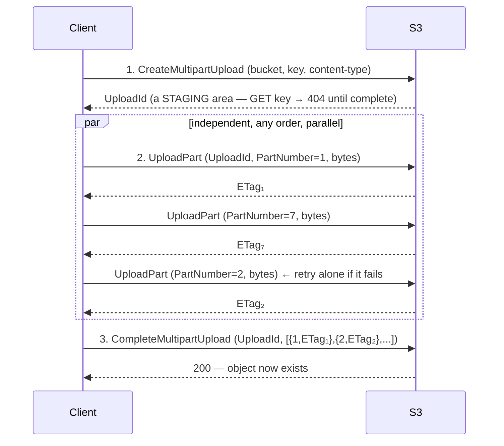
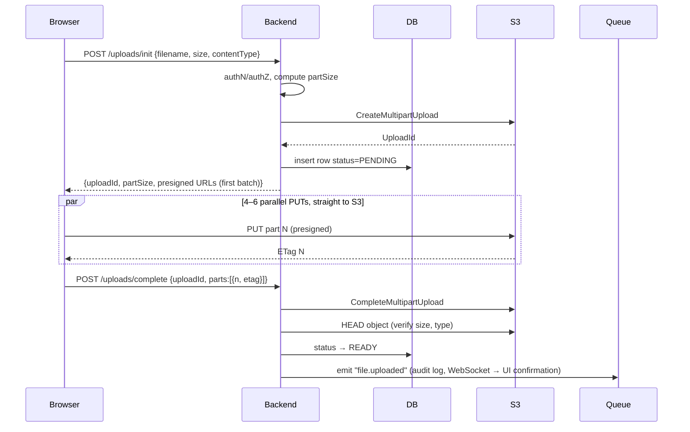

# My Notes: Object Storage, Everything I Need to Know (Part 2)

> **Source:** "24. Object Storage - Everything You Need to Know: Part - 2" by Sriniously, *Backend from first principles* playlist (YouTube, 49:37)
> **Link:** https://www.youtube.com/watch?v=iWrVCxexUWY
>
> I wrote these from the video's full caption track, summarised in my own words. The diagrams, CLI commands and code are my own illustrations. Continues from part 1 (keys, internals, pre-signed uploads).

---

## 1. Why a single PUT fails for large files

Fine for a few hundred MB, but for big files (long videos, CAD files, DB dumps, wedding or drone footage) there are four problems:

| # | Problem | Detail |
|---|---|---|
| 1 | **Hard limit** | A single PUT **can't exceed 5 GB**. That's enforced by the **storage API itself**. Accepting large files **architecturally requires** something else |
| 2 | **All or nothing** | At 4.8 of 5 GB the Wi-Fi blips (e.g. a switch to backup power) and the **upload is cancelled**, with **no resume**. On consumer mobile networks a big upload can take **20–30 min**, and blips are common |
| 3 | **Throughput** | One **TCP** connection can't saturate the link. Throughput ≈ **window size ÷ round-trip time**, and **one lost packet collapses the congestion window**. A 200–500 Mbit connection might still upload at ~30 Mbit. **Fix: multiple parallel connections**, each with its own window, so one stall doesn't hurt the rest. (That's how **download managers** like IDM "speed up" downloads: ~8 parallel connections, no physical magic) |
| 4 | **UX** | Coarse progress, **no pause**, can't survive a closed tab or network error |

→ Solution: **multipart upload**.

---

## 2. Multipart upload: the protocol



1. **CreateMultipartUpload:** returns an **`UploadId`**, a **staging area** (like git's staging area: not committed, can be discarded). **Nothing exists at the key yet**, so a GET returns **404**.
2. **UploadPart** (once per chunk): `UploadId` + **part number** + bytes.
   - Each part is an **independent HTTP request**, so they can run **in parallel** and **in any order** (part 7 before part 2 is fine).
   - A failed part **retries on its own**.
   - Each success returns an **ETag. Keep them all.**
3. **CompleteMultipartUpload:** send `UploadId` + the **list of (part number, ETag)** in order. The service assembles the object.
   - **It's fast regardless of size** (even 50 GB). It doesn't physically merge bytes. It's a **metadata operation** recording "this object = these parts in this order" (metadata plane vs data plane from part 1).
4. **AbortMultipartUpload:** discard the staging area (see section 5).

```bash
aws s3api create-multipart-upload --bucket demo --key videos/big.mp4
aws s3api upload-part --bucket demo --key videos/big.mp4 --upload-id $ID --part-number 1 --body part1
aws s3api complete-multipart-upload --bucket demo --key videos/big.mp4 --upload-id $ID \
  --multipart-upload file://parts.json     # [{"PartNumber":1,"ETag":"\"...\""}, ...]
```

---

## 3. Choosing the part size

- **Hard cap: 10,000 parts per upload.**
- With a fixed **5 MB** part size, the max file is **5 MB × 10,000 = 50 GB**. Upload a **60 GB** file and it **fails at part 10,001, after 50 GB has already gone up**. Expensive.

**Compute it dynamically, with a floor:**
```js
const MAX_PARTS = 10_000;
const FLOOR = 16 * 1024 * 1024;                        // 16 MB (he uses 16–32 MB)
const partSize = Math.max(FLOOR, Math.ceil(fileSize / MAX_PARTS));
const partCount = Math.ceil(fileSize / partSize);
```
- A **16 / 32 MB floor** handles files up to **~160 / 320 GB** without thinking about it.
- **Why not huge parts?** The part size is the **retry granularity**: a failed 500 MB part on mobile means re-sending 500 MB. Small parts make retries **cheap**.
- **Sweet spot: ~16–64 MB.**

---

## 4. The ETag integrity trap

- **Single PUT:** ETag = **MD5 of the content**, so people (reasonably) compare a local MD5 with the ETag.
- **Multipart:** ETag = **MD5 of the concatenated part MD5s + `-<partCount>`**, e.g. `"…-42"`. **Not the file's MD5.** Comparing breaks.

**For real end-to-end integrity, don't use ETags:**
1. Use the **checksum feature**: modern AWS SDKs compute **CRC32C / SHA-256 per part** and can request a **full-object checksum** that the **service verifies**.
2. Or (his approach) compute **SHA-256 on the client**, send it as **user metadata**, and **verify in a background job** after upload. **Bonus: free deduplication.**

---

## 5. Abandoned uploads: the invisible bill

- **Scenario:** 300 parts × 32 MB ≈ **10 GB** in staging, then the user closes the tab. **Complete never called, Abort never called.**
- Those 10 GB **stay stored and billed every month, forever**, and they're **invisible**: not in the console, not in `ListObjects` (the object doesn't exist yet).

**Demo:**
```bash
# console shows: 1 object, 184 MB
aws s3api list-multipart-uploads --bucket demo
# → 3 uploads started days ago, parts totalling ~460 MB — never shown anywhere, still billed
```

**Fix: a lifecycle rule on EVERY bucket, from day one, before writing any feature code:**
```json
{
  "Rules": [{
    "ID": "abort-incomplete-mpu",
    "Status": "Enabled",
    "Filter": {},
    "AbortIncompleteMultipartUpload": { "DaysAfterInitiation": 7 }
  }]
}
```
**7 days** is a good default. It costs nothing and **permanently closes the leak**.

---

## 6. Production flow: multipart + pre-signed URLs



### Practical notes
1. **Don't pre-sign all 10,000 URLs upfront.** That makes the init response megabytes of JSON. **Pre-sign in batches (~100)** as the browser progresses.
2. **Concurrency 4–6** parallel PUTs is the sweet spot. More just fights for the same bandwidth.
3. **The browser reads slices lazily:** `file.slice(start, end)` returns a **Blob** that loads **only when sent**, so memory ≈ **part size × concurrency**, not the file size.
4. **CORS must expose `ETag`**, or JavaScript can't read part ETags and **can't complete** the upload.

```js
async function uploadPart(file, partNumber, partSize, url) {
  const blob = file.slice((partNumber - 1) * partSize, partNumber * partSize); // lazy slice
  const res = await fetch(url, { method: "PUT", body: blob });
  return { PartNumber: partNumber, ETag: res.headers.get("ETag") };           // needs ExposeHeaders: ETag
}
```

### Demo: a 2 GB file
- Server plan: **16 MB parts, 125 parts, concurrency 5**.
- The UI grid shows each square as a part: **gray** = waiting, **blinking blue** = in flight (5 at a time), **green** = done.
- Network tab: **~125 separate PUTs straight to the bucket's domain**, none to the backend.
- **Rate and ETA are computed client-side** from finished and waiting parts, so the progress bar is **smooth**, not jumpy.
- After the last part: **one `complete` request to the API** (not S3) with parts and ETags.

---

## 7. Resumable uploads

Comes almost for free with this design:
```
page refresh → client: "do I have an upload in progress for this file?"
            → API: find the PENDING row in the DB
            → API: S3 ListParts(UploadId) → which parts already exist in staging
            → API: fresh presigned URLs ONLY for missing parts
            → client resumes from e.g. part 341 instead of 0
```

---

## 8. Downloads: never relay through your server

Downloads matter more for cost: files are **fetched far more often than uploaded**.

**Don't proxy downloads** (handler does `GetObject`, then copies bytes to the response):
- **Ties up a worker** (goroutine / event-loop slot) for the whole download.
- **You pay bandwidth** (every cloud / PaaS charges for data out), on top of CPU and memory.
- **Slow** compared with CDNs spread across every region.

→ Bytes should go **bucket → user**, or **CDN → user**. Never through my server.

---

## 9. Three download patterns

### Pattern 1: public content (+ CDN)
- For genuinely public assets: **site images, CSS/JS bundles, public product images**.
- Better than a public bucket: **private bucket + CDN in front**, with **only the CDN allowed to read** the bucket.
- Set a **long `Cache-Control`** and use **content-addressed keys** (key = **hash of the contents**), so the **URL changes whenever the content changes**, which is perfect for caching.
- **Cheapest and fastest option.**

```
assets/3f9a1c...e7.png   ← hash of the bytes; new content → new key → no stale caches
Cache-Control: public, max-age=31536000, immutable
```

### Pattern 2: pre-signed GET (private content)
- Same idea as a pre-signed PUT: the browser asks my server, the server **authorizes** (does this user own the file?), and returns a **GET URL valid ~5–15 min**.

**The CDN catch:**
- A pre-signed URL embeds a **timestamp + signature**, so **every request has a different URL**. To the CDN each is a **different resource**, so the **cache hit rate is ~0**. I'd pay for a CDN that caches nothing **and** full **egress** (data out).

**Fixes:**
| Fix | How | Trade-off |
|---|---|---|
| **Cheap** | Sign with expiry **"until the top of the next hour"** instead of "now + 15 min" | Everyone in that hour gets the **same URL**, so it's cacheable. Less precise expiry |
| **Proper (at scale)** | Use the **CDN's own signed URLs / signed cookies** | Authorization happens **at the edge**, and the CDN fully controls caching. **Signed cookies are great for video**: one session pulls **hundreds or thousands of segments**, which I'd otherwise have to sign one by one |

```js
// cheap fix: round expiry up to the next hour so URLs repeat within the hour
const now = Math.floor(Date.now() / 1000);
const nextHour = Math.ceil((now + 1) / 3600) * 3600;
const url = await getSignedUrl(s3, new GetObjectCommand({ Bucket, Key }), { expiresIn: nextHour - now });
```
⚠️ For the URL to be truly identical, the **signing timestamp** also has to be fixed (e.g. pinned to the start of the hour), not just the expiry. *(My note, not from the video.)*

### Pattern 3: CDN signed URLs / cookies
- The scalable version described in pattern 2's "proper" fix.

---

## 10. Range requests

**An HTTP feature** (not invented by object storage), which S3 supports natively because it speaks HTTP.

```
Client: Range: bytes=1000000-2999999
Server: 206 Partial Content
        Content-Range: bytes 1000000-2999999/52428800
Invalid range → 416 Range Not Satisfiable
```

**What it unlocks:**
| Use | How |
|---|---|
| **Video seeking** | Drag to 30:00, the player uses the file's **index** to map that time to a **byte offset**, then requests a **range from there**. **The first 30 minutes are never downloaded** |
| **Resumable downloads** | Dropped at byte 400,000,000? Re-request `bytes=400000000-` |
| **Parallel downloads** | Open ~6 connections, each fetching a **different range** (download-manager style) |
| **Sniffing file type** | Read just the first few bytes |

**Demo (against a local MinIO in Docker):**
```bash
curl -s -o /dev/null -w "%{http_code}\n" -H "Range: bytes=0-99" http://localhost:9000/demo/image.png
# → 206

curl -s -H "Range: bytes=0-7" http://localhost:9000/demo/image.png | xxd
# → 8950 4e47 0d0a 1a0a   ← PNG signature: it's a PNG, without downloading the image

curl -C - -o big.bin http://localhost:9000/demo/big.bin   # kill mid-way, rerun → resumes from the missing range
```
Small tricks like this cut **latency** and wasted **bandwidth and processing**.

---

## 11. Video: segmented / adaptive streaming

- **Limitation of progressive download over ranges:** there's **one version** of the file. Everyone gets the same quality, whatever their connection.
- Netflix, YouTube, Prime Video, Hotstar… serve **different quality per user** using **segmented streaming**: **HLS** or **DASH**.

```
original video
   └─ TRANSCODE → 240p · 480p · 720p · 1080p · 4K
        └─ CHOP each into few-second SEGMENTS
             └─ write a MANIFEST (lists renditions + segments)

player: fetch manifest → fetch segments one by one
        → measure its own download speed per segment
        → pick a higher or lower quality for the next segment  = ADAPTIVE BITRATE
```
- **Nothing changes on the storage side.** **Segments are objects, the manifest is an object.** Object storage + CDN is everything needed to **serve** streaming video.
- **The hard engineering** is the **transcoding pipeline**: a background job on every upload, queues, workers…
- **Advice:**
  - Video is a **small feature** of my product → use a **hosted video service** (he's used **Mux** and **Bunny CDN**) and let them transcode.
  - **Video is ~90% of my product** (a streaming platform) → **build the pipeline** myself so the costs make sense.

---

## 12. Cost model

Pricing **shapes architecture**. I pay for three things:

| Dimension | Unit | Note |
|---|---|---|
| **Storage** | per GB-month | Includes invisible multipart staging (section 5) |
| **Operations** | per request | **Writes (PUT/POST/LIST/…) ≈ 10× pricier than reads (GET)** |
| **Egress** | per GB out | Data leaving the provider (every download). **Cloudflare R2** is famous for **free egress**, a huge deal at volume |

- Exact prices keep changing, so check providers' **pricing pages**.

---

## 13. Full recap (both parts)

1. **Object storage exists because local file storage doesn't scale.** It scales by **giving up mutability** (no in-place edits, no rename, no folders, no locks) in exchange for **effectively infinite capacity**, **11 nines of durability**, and a **pure HTTP interface**.
2. **Object = key + bytes + metadata** in a **flat namespace** (bucket). **Folders = GROUP BY on strings.**
3. **Keys:** generate them yourself, **high entropy at the front**, **encode ownership**. **Set metadata at write time** (changing it means rewriting the object).
4. **Internals:** **metadata plane + data plane**. Durability via **erasure coding** (cheaper and stronger than replication).
5. **Durability ≠ backup.** Turn on **versioning** and **replication** explicitly.
6. **Never LIST** in the request path. **The DB records which files exist.** Object storage just returns the exact file.
7. **Small files** may go through the server **if streamed with a body-size limit**.
8. **Large files go directly from the browser via pre-signed URLs.** Prefer **pre-signed POST with `content-length-range`**. A plain pre-signed PUT is an **unlimited write capability**.
9. **Record intent in the DB before upload → upload → `complete` → HEAD verify → background cleanup** of abandoned uploads.
10. **Multipart:** create → parallel parts → complete. **Part size computed from file size.** **Don't trust multipart ETags** for integrity. **Abort-incomplete lifecycle rule on every bucket from day one.**
11. **Downloads:** **never relay through the server.** Use **pre-signed GETs** and the **CDN + private bucket** pattern.
12. **Range requests** power seeking, resuming, and parallel downloads, natively.
13. **Video:** **segment it** (HLS/DASH), and players **adapt** per segment.

---

## 14. My cheat sheet

```
SINGLE PUT LIMITS   5 GB hard cap · all-or-nothing · one TCP stream can't saturate the link · poor UX

MULTIPART  CreateMultipartUpload → UploadId (staging, GET = 404)
           UploadPart (independent, parallel, any order, retry alone) → keep each ETag
           CompleteMultipartUpload (parts + ETags; metadata op, fast even at 50 GB)
           AbortMultipartUpload
PART SIZE  max 10,000 parts → partSize = max(16–32 MB floor, ceil(size / 10,000)); sweet spot 16–64 MB
           (5 MB fixed → max 50 GB → 60 GB file fails at part 10,001)
ETAG TRAP  multipart ETag = md5(part md5s) + "-N" ≠ file md5 → use SDK checksums (CRC32C/SHA-256)
           or client SHA-256 in user metadata + background verify (free dedup)
LEAK       incomplete uploads = invisible storage billed forever (list-multipart-uploads)
           → lifecycle AbortIncompleteMultipartUpload after 7 days, on EVERY bucket, day one

PROD FLOW  /uploads/init → partSize + CreateMPU + DB PENDING + presigned part URLs (batches of ~100)
           → browser 4–6 parallel PUTs (file.slice lazy blobs) → /uploads/complete {parts, etags}
           → CompleteMPU → HEAD verify → READY → emit file.uploaded
           CORS must ExposeHeaders: ETag
RESUME     PENDING row + ListParts → presign only missing parts

DOWNLOADS  never proxy through the server (workers busy, egress cost, slow)
  1 public: private bucket + CDN (only CDN reads), long Cache-Control, content-addressed keys
  2 private: presigned GET (5–15 min) — breaks CDN caching (unique URLs)
      cheap fix: expire at the top of the hour · proper: CDN signed URLs/cookies (great for video)
RANGE      Range: bytes=a-b → 206 + Content-Range · bad range → 416
           seeking · resumable downloads · parallel ranges · sniff headers (PNG magic bytes)
VIDEO      HLS/DASH: transcode → segments → manifest → adaptive bitrate
           storage unchanged (segments + manifest = objects); hard part = transcoding pipeline
           small feature → Mux / Bunny; core product → build it

COST       storage (GB-month) · operations (writes ≈ 10× reads) · egress (Cloudflare R2: free egress)
```
