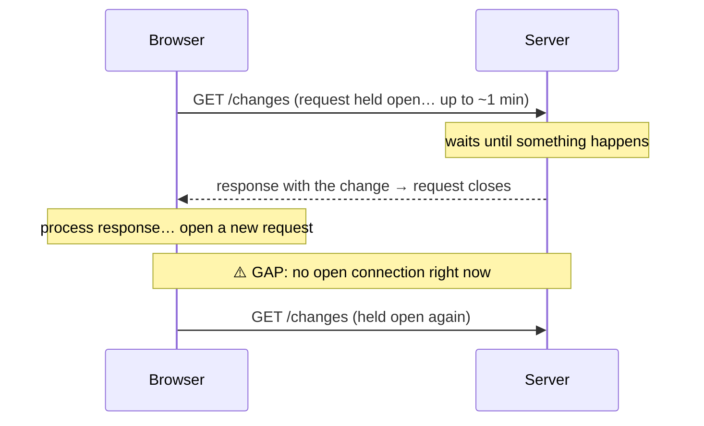
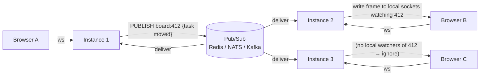

# My Notes: Real-Time Backends

> **Source:** "25. Real-Time Backends" by Sriniously, *Backend from first principles* playlist (YouTube, 51:54)
> **Link:** https://www.youtube.com/watch?v=wUQryt697cs
>
> I wrote these from the video's full caption track, summarised in my own words. The diagrams and code are my own illustrations. Anything marked *(my note)* is my addition, not from the video.

---

## 1. The new requirement: the server must speak first

So far everything my backend has done (auth, DB, services, repositories, caching, background jobs, object storage) has had **one shape: the browser asks, the server answers.**

**New, ordinary product requirement:** a task-management board. Two people look at the same board. One drags a task from *To-do* to *In progress*, and the other, anywhere in the world, sees it move **live**. Not on refresh, not on navigation.

**The limitation:** in HTTP the **client always initiates** (from the HTTP video). The server **has no mechanism to speak first**. It can only reply, or hold a reply for a while. So if the server has news the browser didn't ask for, there's no way to get it there.

```
Classic HTTP:   Client ──request──▶ Server
                Client ◀─response── Server
                (server can never start the conversation)
```

---

## 2. Attempt 1: polling

The most intuitive fix: if the server can't tell me, **the client keeps asking in a loop.**

```
every 3 s:  GET /boards/412/changes?since=…
            → usually "nothing changed"
            → occasionally "yes" → send the change, or "refetch the board" and re-render
```

```js
setInterval(async () => {
  const res = await fetch(`/boards/412/changes?since=${lastSeen}`);
  const { changes } = await res.json();
  if (changes.length) applyChanges(changes);
}, 3000);
```

**Demo:** two browsers side by side, each polling every 3 s, with a *request counter* and an *unchanged counter*. Almost every tick, **both counters go up**: a wasted request. Only when the other user moves a task does a request actually return a change.

**Verdict:** it works. For **internal tooling with a few users**, polling every few seconds is a **perfectly reasonable decision**. For a user-facing product at scale, keep pushing.

---

## 3. Why polling breaks at scale

### Delay
- **Average delay = half the interval.** Pure arithmetic: poll every 3 s and a change waits ~**1.5 s** on average before others see it.
- The obvious fix is to **poll faster** (every 1 s). Then look at what breaks.

### Load
| | 3 s interval | 1 s interval |
|---|---|---|
| 10,000 open boards | **~3,333 req/s**, forever | **10,000 req/s** |

Each one is a **full HTTP request**: load balancer → **auth middleware** (validate token) → **logging middleware** (write a log line) → service → **DB query** → serialize JSON. So roughly 3,000 DB queries/s that almost all say **"nothing changed."**

→ I made the UX 3× better and **the cloud bill 3× worse.**

### The core flaw
- **The cost of polling scales with the number of users, not the number of events.**
- A board where **nothing happens all day** costs the same as a board changing every second.
- I'm paying for the **requests** (the medium), not for the **changes** (the thing that brings value). That feels wrong.

### Mobile
- Every poll **wakes the phone's radio**, one of the most expensive things a phone does. That drains **battery and data** for no changes at all.

### What I actually want
1. **The server speaks first.**
2. **Pay per event**, not per user or per request.

---

## 4. Attempt 2: long polling

Constraint: the server can only answer a question. So **ask, and let the server take its time answering.**



- Documented in **RFC 6202**, **along with everything wrong with it**.
- **The problem is the gap:** after the server answers, the browser processes the response and opens a fresh request. During that window **the server has no connection to me**.
- Per the RFC: **average latency ≈ one network transit**, **worst case more than three**.
- Used for years, but we moved on.

---

## 5. Attempt 3: Server-Sent Events (SSE)

Cleverer: **what if the response just never ends?**

- The browser makes an **ordinary HTTP GET**.
- The server replies **200** with **`Content-Type: text/event-stream`**, and **never closes it**.
- Whenever it has news, it **writes a bit more text** into the same response.
- The connection stays open as long as the tab is open. If the tab closes or the network drops, it closes, and the client's retry logic reopens it.
- **Not a different protocol.** It's still plain HTTP headers + response body.

### Demo (curl as the client)
```bash
curl -N -H "Accept: text/event-stream" http://localhost:8080/api/events
```
```
id: 41
event: task.moved
data: {"taskId":"t-9","from":"todo","to":"in_progress","board":412}

id: 42
event: task.created
data: {"taskId":"t-10","title":"Write notes","board":412}

retry: 5000
```

### The format: just four fields
| Field | Purpose |
|---|---|
| `id` | Event ID. The client remembers the last one, so on reconnect it can say "send me everything since X" and **catch up instantly** |
| `event` | Event name (`task.moved`, `task.deleted`, `task.created`…) |
| `data` | The payload, which the frontend renders directly (insert a card, etc.) |
| `retry` | Server tells the browser **how long to wait before reconnecting** |

### The browser does the hard parts for me
- SSE is in the **HTML standard**, so the browser **implements reconnection itself**. If the connection drops, it waits and reconnects, **no extra code**.
- On reconnect it **automatically sends `Last-Event-ID`** with the last ID it received.

```js
const es = new EventSource("/api/events?board=412");
es.addEventListener("task.moved", e => moveCard(JSON.parse(e.data)));
// reconnection + Last-Event-ID handled by the browser
```

```go
// minimal SSE handler (my sketch)
func events(w http.ResponseWriter, r *http.Request) {
    w.Header().Set("Content-Type", "text/event-stream")
    w.Header().Set("Cache-Control", "no-cache")
    flusher := w.(http.Flusher)
    lastID := r.Header.Get("Last-Event-ID")      // resume point after reconnect
    for ev := range subscribe(r.Context(), lastID) {
        fmt.Fprintf(w, "id: %d\nevent: %s\ndata: %s\n\n", ev.ID, ev.Name, ev.JSON)
        flusher.Flush()
    }
}
```

### SSE is not a toy
Some people think SSE is an inferior version of WebSockets. Not true:
- **Uber's push platform** (telling drivers about trips) was built on SSE.
- **LinkedIn instant messaging** (typing indicators, read receipts) used SSE, with no compatibility worries across devices and environments. It just worked everywhere.
- **Every LLM API** streams tokens to my CLI or browser via SSE. The word-by-word text I watch is exactly that `data` field.

### The limitation: it's in the name
- **One direction only.** The server can talk all day, but the browser **can't send on the same connection**.
- In the board app, dragging a task means a **separate POST request**.
- For lots of products that's **completely fine**. But for the live board I want **both directions on one connection.**

---

## 6. Attempt 4: WebSockets

**Two-way communication on one connection.**

**Demo:** a CLI WebSocket client against a server on port **7821**, endpoint **`/echo`**:
- Info logs, then *connected to … :7821 over TCP*.
- Response headers: **`Upgrade: websocket`**, **`Connection: Upgrade`**, **`Sec-WebSocket-Accept: …`**. That exchange is the **handshake**.
- Then: I send *"task moved on board 412"*, the server echoes it immediately, then the server sends its own messages, I send more… **both directions on one connection.**

```js
const ws = new WebSocket("wss://api.example.com/boards/412");
ws.onmessage = e => applyChange(JSON.parse(e.data));
ws.send(JSON.stringify({ type: "task.move", taskId: "t-9", to: "in_progress" }));
```

---

## 7. The handshake

**A WebSocket doesn't start as a WebSocket.** It starts as a **normal HTTP GET**, which is powerful: it travels through **everything that already understands HTTP** (pretty much every device).

```
GET /echo HTTP/1.1
Host: localhost:7821
Upgrade: websocket
Connection: Upgrade
Sec-WebSocket-Key: dGhlIHNhbXBsZSBub25jZQ==      ← 16 random bytes, base64
Sec-WebSocket-Version: 13

HTTP/1.1 101 Switching Protocols
Upgrade: websocket
Connection: Upgrade
Sec-WebSocket-Accept: s3pPLMBiTxaQ9kYGzzhZRbK+xOo=
```

**How the server computes `Sec-WebSocket-Accept`:**
```
accept = base64( SHA1( Sec-WebSocket-Key + FIXED_STRING ) )
```
- The fixed string is a **constant written in the spec** *(my note: `258EAFA5-E914-47DA-95CA-C5AB0DC85B11`)*.
- It **looks like security but isn't.** Anyone can compute it.
- **Its real job:** prove that whatever answered **understood it was asked for a WebSocket**, and isn't **a cache replaying an old 200**.
- Status **101 = Switching Protocols.**

```python
import base64, hashlib
GUID = "258EAFA5-E914-47DA-95CA-C5AB0DC85B11"
accept = base64.b64encode(hashlib.sha1((key + GUID).encode()).digest()).decode()
```

**After the handshake:** the connection stays open but **it isn't HTTP anymore.** No headers, no methods, no status codes. It's a **bidirectional stream of frames**, and **both sides write whenever they want.**

---

## 8. Frames

The RFC's bit diagram:

```
 0               1               2               3
 0 1 2 3 4 5 6 7 8 9 0 1 2 3 4 5 6 7 8 9 0 1 2 3 4 5 6 7 8 9 0 1
+-+-+-+-+-------+-+-------------+-------------------------------+
|F|R|R|R| opcode|M| Payload len |   Extended payload length     |
|I|S|S|S|  (4)  |A|     (7)     |   (16 or 64 bits, if needed)  |
|N|V|V|V|       |S|             |                               |
| |1|2|3|       |K|             |                               |
+-+-+-+-+-------+-+-------------+-------------------------------+
|  Masking key (4 bytes, only if MASK=1)  |   Payload data ...  |
+-----------------------------------------+---------------------+
```

| Part | Meaning |
|---|---|
| **FIN** (1 bit) | This is the **last piece** of a message |
| **RSV1–3** (3 bits) | Reserved |
| **Opcode** (4 bits) | `0` continuation · `1` text · `2` binary · `8` close · `9` ping · `10` pong |
| **MASK** (1 bit) | Payload is masked (section 9) |
| **Payload len** (7 bits) | Efficient length encoding (below) |

**Length encoding:**
| Payload size | Encoding | Header cost |
|---|---|---|
| **< 126 bytes** | Length goes directly in the 7 bits | **2 bytes total** |
| Bigger | Write **126**, real length in the next **2 bytes** | +2 |
| Huge | Write **127**, real length in the next **8 bytes** | +8 |

→ A small message has a **2-byte header**, compared with **hundreds of bytes of headers** on every polling request.

---

## 9. Masking: why it exists

- **Every frame from browser → server is masked:** each payload byte is **XORed** with one byte of a **4-byte key**, cycling through the key.
- The key is sent **in clear text**, 4 bytes in front of the payload, in every frame. **It's not encryption.** Anyone on the network can unmask it with one line of code.

```python
unmasked = bytes(b ^ key[i % 4] for i, b in enumerate(payload))
```

**So why? Cache poisoning.** While the protocol was being written, someone ran an experiment against **real caching proxies on the internet** and **poisoned them**:

```
1. Malicious page opens a connection to the ATTACKER's server, does something that looks like an upgrade
2. Sends bytes crafted to look like a fresh GET for a popular file
   (e.g. an analytics/tracking script that thousands of sites load)
3. A proxy in the middle that doesn't understand the protocol sees "request + response"
   → CACHES the attacker's response under that popular URL
4. Everyone behind that proxy now gets the attacker's file when asking for the real one
```

**The fix:** the browser XORs everything with a **fresh random key the page's JavaScript can't predict**. The attacker chooses *what* they send but **not what it looks like on the wire**, so they **can't fake an HTTP request inside the stream**.
- That's why the key **must be random**, and per the spec **fresh for each frame**.
- **Masking doesn't protect my data. It protects the network infrastructure between me and my users.**

---

## 10. Ping / pong heartbeats

- Opcode **9 = ping**, **10 = pong.** Either side can ping, and the other **must** pong. That's a **heartbeat**.
- **Why it's needed: TCP.** When a user walks into a lift, or their phone switches Wi-Fi → mobile data, **nothing is sent**: no error, no close.
- The server keeps holding the socket, believing the client is there, potentially **for a very long time**.
- From the socket's point of view, **an idle connection and a dead connection look exactly the same.**
- The only way to tell them apart: **send something and see if anything comes back.**
- Typical rule: **no pong within ~30 s → consider it dead, close it, free the resources.**

```go
// heartbeat sketch (my illustration)
conn.SetPongHandler(func(string) error { conn.SetReadDeadline(time.Now().Add(30 * time.Second)); return nil })
ticker := time.NewTicker(10 * time.Second)
for range ticker.C {
    if err := conn.WriteControl(websocket.PingMessage, nil, time.Now().Add(5*time.Second)); err != nil {
        conn.Close(); return
    }
}
```

---

## 11. How many connections can one machine hold?

**Setup:** a plain Linux box, **16 cores, 61 GB free RAM**, and a WebSocket server in a few lines of **Go** that only **accepts and holds** connections. No application logic, because the point is measuring capacity.

### Limit 1: file descriptors
- In Unix **everything is a file**, including network sockets. **Every connection = a file descriptor** to the kernel.
- `ulimit -n` → **1024**.
- Open 2,000 connections against a server with that limit: it **stops at 1,017**. That's right: ~**7 FDs of overhead** (stdin, stdout, stderr, the listening socket, the **epoll** instance the runtime uses to watch them…).
- **The client saw no "connection refused"**, no error at all. Just a **timeout**, waiting on the handshake.
- **The server logs show the reason: `too many open files`**, retrying with exponential backoff.
- **The server isn't down.** It's healthy and still **answers health checks**, but **refuses new connections**. *(My note: so health checks alone won't catch this. Alert on that error / FD usage.)*

**Language matters:** same shell, same machine:
| Asked from | FD limit |
|---|---|
| shell (`ulimit -n`) | 1,024 |
| **Python** | 1,024 |
| **Go** | **1,048,575** |

- **Why:** the **Go runtime raises its own soft limit at startup.** The Go stdlib comment explains: some systems set an artificially low soft limit for compatibility with code that uses `select`, which has a hard-coded max FD because of the size of `fd_set`. **Go doesn't use `select`**, so the runtime raises the limit for itself and leaves old software alone.
- It sets it to **max − 1 on purpose**, so it can **detect someone else changing the limit later**. That's why it's **1,048,575, not 1,048,576**.
- **"You'll hit the 1,000-FD problem" is true but language-dependent.** In **Node / Python / Java** I'll hit it (raise it myself). Go gives far more room.

```bash
ulimit -n            # soft limit for this shell
ulimit -n 1048576    # raise it (needs a hard limit that allows it), or set LimitNOFILE in systemd
```

### Limit 2: ports (but on the client!)
- With ~1M descriptors, try again: it stops at **28,190**, with a different error: **`cannot assign requested address`**.
- Ask the kernel which ports it may use for **outgoing** connections:
  ```bash
  cat /proc/sys/net/ipv4/ip_local_port_range   # 32768  60999
  ```
  60,999 − 32,768 + 1 = **28,232 ports**, minus **42 already in use** on that shared machine = **28,190**. **It was calculable beforehand.**
- Not memory, not FDs. **We ran out of port numbers on the load-generating client, not the server.**

**Myth: "a server can only hold 65,000 connections because there are only 65k ports."** **False.** A TCP connection is identified by a **4-tuple**:

```
(source IP, source port, destination IP, destination port)   ← must be unique per connection
```
- The server has **one IP and one port**, which never change.
- My test client also had **one IP**, so the **only thing that could vary was the client's source port** → ~28k. **The limit belonged to the client.**
- **Fix:** not a bigger server. **Give the client 3 source addresses** and ask for 25,000 on each = **75,000 connections, zero failures.** The server held **75,009 FDs** (75k sockets + the same overhead).
- **Lesson:** for real load testing I need **several load-generator machines/IPs** to reach the load I want to test.

### Limit 3: memory (the real ceiling)
- Idle server: **~7.5 MB**. With **75,000 connections**: **~722 MB**.
- Subtract and divide → **~9,750 bytes per connection** (three runs: ~9,751 · 9,752 · 9,881).
- That's the **process heap only**. The **kernel's own per-socket structures** don't show in the process's resident memory.
- **1 million connections ≈ a bit under 10 GB of heap** (plus the kernel's share). Easily done on a 61 GB box.
- **A million idle connections comes down to RAM.**
- Most of that ~9 KB **isn't the socket**. It's the **goroutine per connection** plus its **buffers**. That's why people chasing huge numbers **don't use a goroutine per connection**. They watch every socket from one place with **epoll**.

```
CAPACITY CHECKLIST (one box)
 1. FD limit      → ulimit -n / LimitNOFILE (Go raises its own; Node/Python/Java don't)
 2. Port range    → a CLIENT-side limit per source IP (4-tuple) → more load-gen IPs
 3. Memory        → ~9–10 KB heap per idle conn in Go (goroutine + buffers) → ~10 GB per 1M
                    → epoll-based designs go lower
```

---

## 12. Multiple instances: connections are state

In production I won't have one machine: **autoscaling**, **deploys** (containers die, new ones start) and **crashes** all mean connections get dropped and re-established.

**Demo:** the same board, **two instances behind a load balancer**.
- Browser A → LB → **instance 1**. Browser B → LB → **instance 2**. Both healthy, both with live WebSockets.
- I move a task in A → **nothing happens in B.**

```
Browser A ──ws──▶ Instance 1   (socket + goroutine + "this socket watches board 412", in ITS memory)
Browser B ──ws──▶ Instance 2   (has never heard of browser A — separate process, maybe another country)
```

- **We spent the whole playlist making the backend stateless** so any instance can serve any request.
- **A persistent connection IS state.** It lives in **one specific process's memory**, and **can't be moved or shared**.
- The moment an instance accepts a WebSocket, **it's the only instance in the world that can talk to that user.**

### Sticky sessions don't solve it
- Sticky sessions tell the LB to **keep sending the same client to the same instance** (also on reconnect).
- A stays on instance 1, but **B is still on instance 2, which still knows nothing about A.** Sticky sessions solve a **different** problem.
- **The real problem: the instances themselves have to talk to each other.**

---

## 13. Pub/sub between instances



- When something happens on board 412, the receiving instance **doesn't try to deliver it itself**. It **publishes to a topic** (e.g. `board:412`).
- The pub/sub tool (**Redis, NATS, Kafka**…) hands the event to **every subscribed instance**.
- Each instance looks at **its own local connections**, finds those watching board 412, and **writes the frame**.
- **The receiving instance and the delivering instance can be on different machines.**
- Demo: same two browsers, two instances. A moves a task, **B sees it instantly.**

```go
// on each instance (my sketch)
go func() {
    for msg := range redis.Subscribe(ctx, "board:*").Channel() {
        for _, c := range localConns.watching(boardFrom(msg.Channel)) {
            c.WriteMessage(websocket.TextMessage, []byte(msg.Payload))
        }
    }
}()
// when a change arrives on any instance:
redis.Publish(ctx, "board:412", payload)
```

### ⚠️ Redis Pub/Sub is fire-and-forget
- If an instance **isn't connected at the exact moment** of the publish, **that message is gone forever**: no queue, no delay, no retry.
- **Deploy scenario:** an instance goes down and its replacement comes up. **Every message published for its users in those seconds is lost.** Those boards only see the change on their **next refresh**.
- **It's an architectural decision:** Redis Pub/Sub gives **at-most-once** delivery.
- Need **at-least-once**? Use something that **stores messages and acknowledges them**: **Redis Streams, Kafka**, a queue…

| | Redis Pub/Sub | Redis Streams / Kafka / queues |
|---|---|---|
| Delivery | **At most once** (fire-and-forget) | **At least once** (stored + acked) |
| Offline subscriber | Message lost | Reads it later from its offset |
| Good for | Ephemeral UI nudges where a refresh fixes things | Updates that must not be missed |

---

## 14. Catching up after a disconnect

Disconnects are **normal**: a phone switching Wi-Fi ↔ mobile data, a laptop lid closing, the **LB hitting its idle timeout**… A production real-time system needs a **catch-up strategy**, not just a delivery strategy.

**Shape of the solution (same as SSE's `Last-Event-ID`):** **number every message**, and have the client say **the last number it received**. Send everything after that.

```
Client: connect, "I'm at seq 0"
Server: msg seq 1, msg seq 2 … ✂ connection breaks
Client: reconnect, "I got up to seq 2"
Server: resumes from seq 3
```
- **Uber's platform does exactly this.**

---

## 15. Fan-out and reconnect storms

### Fan-out
- If **30,000 people** watch the same board, one task move = **30,000 writes**.
- **Work = events × subscribers.**
- **Discord** wrote about this: communities with **30,000 people online** at once, where publishing **a single event** took **~900 ms up to 2.1 s**. That's for a platform whose **core is messaging**.
- **Their fix:** don't fan out from one place. **Spread the work across the machines that actually own the recipients.**

### Reconnect storms
- An instance holding **50,000 connections dies** → all 50k clients **reconnect at the same moment**, and every one wants its **initial state** (boards, tasks, who's online).
- → **50,000 expensive requests in ~1 second.**
- **Slack** wrote about this. **Their fix:** make connecting **cheap** by keeping a **cache at the edge** of the network holding what a client needs to start, so the **reconnect storm never reaches the origin**.
- *(My note: client-side **jittered exponential backoff** on reconnect also spreads the storm out.)*

```js
// reconnect with jitter (my note)
function backoff(attempt) {
  const base = Math.min(30_000, 500 * 2 ** attempt);
  return Math.random() * base;            // "full jitter"
}
```

---

## 16. Summary and what's not covered

```
server can only reply
  → POLLING             works, but cost ∝ watchers, not events; delay = interval/2; battery drain
  → LONG POLLING        hold the request open; gap after each response (RFC 6202: worst > 3 transits)
  → SSE                 response never ends; text/event-stream; id/event/data/retry; auto-reconnect
                        + Last-Event-ID; server → client only
  → WEBSOCKETS          HTTP GET + Upgrade → 101; Sec-WebSocket-Accept; binary frames
                        (2-byte header for small msgs); client masking protects proxies; ping/pong
ONE BOX LIMITS          FDs (language-dependent; Go → ~1M) → client source ports (4-tuple)
                        → memory (~9.6–9.9 KB heap/conn in Go)
MANY INSTANCES          connections are state → sticky sessions don't help → PUB/SUB between instances
                        (Redis = at-most-once; Streams/Kafka = at-least-once)
PRODUCTION              sequence numbers for catch-up · distributed fan-out · edge cache for reconnect storms
```

**Not covered (each could be a 10-hour lecture):**
- **Presence**: who's online right now.
- **Collaborative editing**: two people changing the same thing at once, and someone has to win. **Notion / Google Docs** live cursors. Means learning algorithms like **CRDTs** and how they work over the wire.
- Everything in this video is the **foundation** those build on.

### Which one should I pick? *(my synthesis)*
| Need | Pick |
|---|---|
| Internal tool, few users, seconds of delay OK | **Polling** |
| Server → client stream (notifications, feeds, LLM tokens, dashboards) | **SSE** (+ normal POSTs for client actions) |
| Frequent two-way traffic (chat, live boards, games, cursors) | **WebSockets** |
| More than one instance | Any of the above **+ pub/sub**, plus a durable log if messages must not be lost |

---

## 17. My cheat sheet

```
PROBLEM      HTTP = client initiates; server can't speak first

POLLING      ask every N s · avg delay = N/2 · 10k users @3s ≈ 3,333 req/s, @1s = 10k req/s
             each = LB + auth + logging + DB + JSON · cost ∝ USERS not EVENTS · wakes phone radio
             fine for internal tools
LONG POLL    hold request until change · gap after each response · RFC 6202 (avg ~1 transit, worst >3)
SSE          GET → 200 Content-Type: text/event-stream, never closed
             fields: id · event · data · retry · browser auto-reconnects + sends Last-Event-ID
             used by Uber push, LinkedIn messaging, every LLM token stream · ONE-WAY only
WEBSOCKET    GET + Upgrade: websocket + Sec-WebSocket-Key (16 random bytes b64)
             → 101 Switching Protocols + Sec-WebSocket-Accept = b64(SHA1(key + spec GUID))
             (proves it understood the upgrade, not a cache replaying a 200; not security)
             then frames: FIN | RSV×3 | opcode(0 cont,1 text,2 bin,8 close,9 ping,10 pong) | MASK | len7
             len <126 → 2-byte header · 126 → +2 bytes · 127 → +8 bytes
             MASK: client→server XOR with a random 4-byte key per frame, in clear
                   → stops cache poisoning of proxies; not encryption
             PING/PONG: idle == dead to TCP → no pong in ~30 s → close + free

ONE BOX      FD limit: ulimit -n 1024 (Python/Node/Java) · Go raises itself to 1,048,575 (max−1)
               symptom: client timeout, server "too many open files", health checks still green
             ports: "cannot assign requested address" = CLIENT ran out of source ports
               ip_local_port_range 32768–60999 ≈ 28k per source IP · conn = 4-tuple → more client IPs
             memory: ~9.75 KB heap/conn (Go goroutine + buffers) → ~10 GB per 1M (+kernel) · epoll goes lower

MULTI-INST   connection = state in one process · sticky sessions DON'T fix cross-user delivery
             → PUB/SUB: receiver publishes topic board:412; every instance writes to its local sockets
             Redis Pub/Sub = at-most-once (lost during deploys) · Streams/Kafka = at-least-once
CATCH-UP     sequence numbers; client says "last seq = N" → server resumes at N+1 (Uber, SSE Last-Event-ID)
FAN-OUT      work = events × subscribers · Discord 30k online: 0.9–2.1 s per event → spread across owners
RECONNECT    50k reconnect at once → 50k init-state requests · Slack: edge cache for the start state
NOT COVERED  presence · collaborative editing (CRDTs, live cursors)
```
