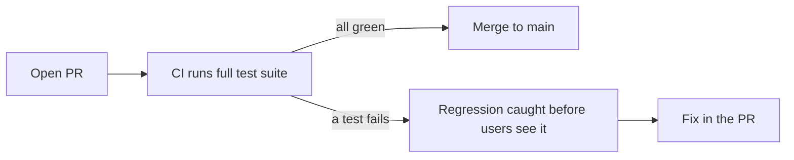
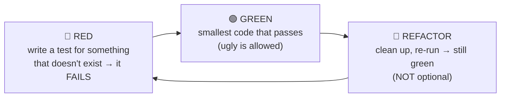

# My Notes: Testing for Backend Engineers (mocks, TDD and coverage)

> **Source:** "26. Testing for Backend Engineers: mocks, TDD and coverage" by Sriniously, *Backend from first principles* playlist (YouTube, 1:24:32)
> **Link:** https://www.youtube.com/watch?v=HgVrfHX92y4
>
> I wrote these from the video's full caption track, summarised in my own words. The diagrams and code are my own illustrations (Go, like the video). Anything marked *(my note)* is my addition, not from the video.

---

## 1. Why no tests until now

- In 20–25 videos we never wrote a test, **on purpose.**
- **A bad, rushed or incomplete test is more harmful than no test**: it gives a **false sense of confidence** in the code.
- So rather than squeezing a small testing section into every video (where the concepts mattered more), testing gets **one full video**.

---

## 2. What a test is, and why I write them

> **A test is a second program that runs my program and makes claims about what happened.**

**Motivations:** guidance and design (**TDD**: write the test first so the goal is clear), documentation… but **the most important reason is to catch regressions.**

- **Regression:** I wrote logic months ago. As features pile up, I want the **old features to keep working exactly as they did** when I first checked them.
- **Every type of test, metric and tool in this video is a variation of this definition.**

---

## 3. Scope of this video

- Testing is a huge field, with whole job titles dedicated to it.
- **Covered:** what a **backend engineer writes and runs themselves**, ~**80%** of testing in a normal team.
- **Not covered:** corporate manual QA processes, test-management tools, mobile testing, browser automation for frontends.

---

## 4. The codebase under test

The **task board** from the real-time video, ~**11 Go files**, **no tests yet**:

```
cmd/board/          the executable; main is the ONLY place that wires everything together
internal/board/     domain: tasks, columns…
internal/hub/       rooms; every subscriber in a room has its own counter
internal/bus/       interface with 2 methods, 2 implementations:
                      • in-process  ← used in tests
                      • Redis       ← used in the real app
internal/store/     interface with 3 methods, Postgres behind it
internal/httpapi/   the route table: one file shows every endpoint
```

- **Same interface, two implementations** = one of the **core use cases of interfaces**.
- Don't know Go? Fine. The playlist claims **any language works**. Code is shown so the concepts are concrete and map to my language. **Testing in theory isn't complex; thinking about tests in code is the core part.**

---

## 5. Test runners: a test is just a program

**At its most basic,** with no frameworks at all:
```go
func testMove() error {
    out := Add(10, 10)
    if out != 20 {
        return fmt.Errorf("want 20, got %d", out)
    }
    return nil
}
```
That **is** a test: call part of the backend, check the output with an `if`, complain if it's wrong.

**Why tooling exists:** with complex backends, hand-writing conditions, runners and mocks every time doesn't scale. Libraries **solve a problem once for everyone** instead of everyone reinventing the wheel. Every language ships some **built-in testing**, and frameworks sit on top for a friendlier experience.

**What the language/framework gives me: a test runner.** It **finds all test files**, **runs** them, and prints a **report** (passed/failed).

### Demo
```go
func TestMoveTask(t *testing.T) {
    b := board.New()
    b.Move("t1", "todo", "doing")
    if got := b.Column("t1"); got != "done" {          // deliberate mistake
        t.Errorf("task column = %q, want %q", got, "done")
    }
}
```
```
--- FAIL: TestMoveTask
    board_test.go:12: task column = "doing", want "done"
```
- It prints **file, line, want vs got**. Fix the expectation → **passes instantly**.

### What's behind `go test`
```bash
go test -work ./internal/board   # keep the build folder → contains _testmain.go (generated, not by me)
go test -x    ./internal/board   # print every command → links board.test, then runs board.test
```
- `_testmain.go` is `package main`, has a **list of every test function found**, and a **`func main`** calling `testing.MainStart(...)` then `os.Exit`.
- **So: `go test` writes a `main` function, compiles it into a program, and executes it.**
- **A runner, in any language, writes the entry point for me and collects the results.**

---

## 6. Assertions and regressions

### Assertion
- **The part of a test that complains:** a check that **stops or fails** the test when a condition isn't true.
- Most languages use a library: `assertEquals`, `assertNotEquals`…
- **Go's stdlib has no assert function.** You write an `if` and call `t.Errorf` with your own message.
- **Always write meaningful failure messages**, so whoever sees the failure knows **what failed and what to check**, with enough to debug.

### Regression
- **A bug I already fixed that comes back**: a teammate changes a function, an interface or a behaviour. Normal in teams.
- **Tests catch it instantly.** In **CI** (e.g. GitHub Actions), the suite runs on **every PR before merge to main/develop**. A failure means **this change brings back a known bug**, so I fix it now instead of hearing it from **users**.
- **Biggest benefit:** I can **move fast and add features without fear**, because a **deterministic suite** encodes every past bug and keeps them fixed.



---

## 7. Unit, integration, end-to-end

### Unit test
- Tests **one unit of code in isolation**, ignoring its surroundings.
- **What's a unit?** A function? A struct? A package? A service? **No universal definition.** You learn to recognise it over time.
- If a function calls 2–3 others, I can **let it call the real ones** or **hand in mocks**. **Both count as unit tests.**

**Demo: the same behaviour tested 4 ways:**
| # | Setup | Time |
|---|---|---|
| 1 | Board + **mock bus** (just records what it was asked to publish) | **0.00 s** |
| 2 | **Real bus + real hub**: the move actually reaches a subscriber | **0.00 s** |
| 3 | **Real HTTP server on a real port**, real POST, real response read | **0.00 s** |
| 4 | Same check against a **real Postgres** | **~10.5 s** (mostly container boot) |

> **The expensive part of a test isn't how much logic it covers** (the full HTTP stack was free). **It's whether it leaves the process** and enters external territory.

### Integration test
- Checks **two or more parts working together**. Usually one part is **my app** and the other is **external** (something I didn't write), e.g. a **database**.

### End-to-end (E2E) test
- Goes through the **whole system the way a real user would.**
- Must follow **every path**: start with **authentication** (a real login), take that token/session, then dashboard → API calls → create a task… **following a user's journey.**
- **Integration tests can use internal shortcuts**, e.g. **bypass the auth middleware** and create a task directly. They don't need to respect every path a user takes.

---

## 8. The test pyramid, and a better mental model

```
            ▲   E2E           slow, expensive (few)
           ▲▲▲  Integration
        ▲▲▲▲▲▲▲ Unit          fast, cheap (many)
```
- The pyramid is about **cost**: higher means **slower and more expensive** (not just money: **CPU, memory, time**).
- It's been a good resource for years, and a source of endless arguments.

### His practical model: what is the test *allowed to touch*?
Instead of "how much of the system does it cover?", ask **"how much is it allowed to touch?"**

| Size | Allowed |
|---|---|
| **Small** | **One process.** No network, no DB, no file system, **no artificial sleeping** |
| **Medium** | Things **on the same machine**: a DB or Redis in a **local container**. **No internet** |
| **Large** | **Anything** |

*(My note: this matches Google's small/medium/large test sizes.)*

**Why it's better:**
- **Nobody can verify whether a test is "really" a unit test.** There's no universal definition, and everyone has opinions.
- **The machine can check whether a test opened a socket.** So it's an **enforceable rule**, not a vague argument.
- **Flakiness:** keep tests inside the process or machine and you push **determinism** to its peak. **Most flakiness lives in talking to the internet** (external services, their clocks…).

---

## 9. Other "kinds" of tests are just variations

**Unit / integration / E2E answer "how much does it touch?" (scope).** The rest answer other questions:

| Kind | Question it answers |
|---|---|
| **Regression** | Do specific past bugs stay fixed? |
| **Functional** | Does it meet the spec? Write the spec (as tests) first, then build; when done, the verification layer is already there |
| **Performance** | How fast, and **how much memory and CPU**? |
| **Security** | Does it bypass security layers (containers, file system, cookies), or breach privacy? |

- These **aren't different kinds**, just **variations** of the three. A regression test can be a **unit** test; a security test can be **E2E**; functional testing is a variation of integration testing.
- The industry uses these words, so I need to know them. **His own model is just: what does the test touch?** (in-process / in-machine / internet). That's the rest of the video's lens.

---

## 10. Why code is hard to test: external dependencies

Task-board flow: move task → handler asks the board to apply it → **publishes an event on the bus** → other browsers find out (previous video).

A real handler might also:
- write to **Postgres**
- call a **payment provider** (check credits)
- **send an email**

**How do I test that without a real DB, real charges, real emails?** → Give the function **something that looks and acts like the external service.** That stand-in is a **test double**.

- Named after **stunt doubles** in film: the double does the risky stunt, and on screen it looks like the actor.
- **"Test double" is the category name.** There are **five types**, and most people call all of them "mocks."

---

## 11. Test doubles: the five types

| Type | What it does | Example |
|---|---|---|
| **Dummy** | Passed only because the **signature requires it. Never actually used** | Service constructor needs a logger; in tests I don't care about logging, so pass a no-op logger |
| **Stub** | **Returns a pre-written answer every time**, whatever I ask | `GetUser(7)` → a fixed user object shaped like the DB's, so the dependency doesn't block |
| **Spy** | A stub that **also records what was done to it** | Returns user 7, **and records** "you changed the name from X to Y" |
| **Mock** | Has **expectations set beforehand** and **fails if they're not met** | "`Save` must be called **exactly once** with these args", else the test fails |
| **Fake** | A **working implementation, not fit for production**, matching the real one's inputs and outputs | `CreateUser` stores in an **in-memory map** instead of Postgres; callers can still save and read back |

```go
type Logger interface{ Info(msg string) }
type nopLogger struct{}                       // DUMMY
func (nopLogger) Info(string) {}

type stubUsers struct{}                        // STUB
func (stubUsers) Get(id int) User { return User{ID: id, Name: "Asha"} }

type spyBus struct{ published []Event }        // SPY: records calls
func (s *spyBus) Publish(e Event) error { s.published = append(s.published, e); return nil }

type fakeStore struct{ m map[string]Task }     // FAKE: real behaviour, in memory
func (f *fakeStore) Save(t Task) error { f.m[t.ID] = t; return nil }
func (f *fakeStore) Get(id string) (Task, error) { t, ok := f.m[id]; if !ok { return Task{}, ErrNotFound }; return t, nil }
// MOCK: usually from a library with expectations, e.g. mock.EXPECT().Save(task).Times(1)
```

---

## 12. State vs interaction verification

Two ways to write the final check in a test of the move handler:

| | Asks | Example |
|---|---|---|
| **State verification** | **The system:** what state is it in now? | Is the task in **done**? Did the **sequence number go up by 1**? |
| **Interaction (behaviour) verification** | **The double:** what did it see? | Was `Publish` called **once** with an event of type `task.moved`? |

**The refactor that exposes the difference:** someone changes the handler to publish **one combined event instead of two**. From outside **nothing changed**: every browser sees the same board.
- **State test:** passes (end state identical). ✅
- **Interaction test:** **fails**, because the call count changed. ❌
- That's a **change-detector test**: it tests the step-by-step implementation, not the result. **Google has a write-up on this.**

> **Rule: assert what the system *is* now, not how it got there.** Use interaction checks only when **absolutely necessary**, e.g. **an email must be sent exactly once**.

```go
// state verification (preferred)
if got := b.Column("t1"); got != "doing" { t.Errorf("column = %q, want doing", got) }

// interaction verification (only when the interaction IS the requirement)
if len(mailer.sent) != 1 { t.Fatalf("emails sent = %d, want exactly 1", len(mailer.sent)) }
```

---

## 13. Don't mock what you don't own

**The mistake:** my service calls a payment provider. I don't want to charge real cards, so I **mock their client**: "when `Charge` is called with these args, return `{data, success, newBalance}`." Tests pass → deploy → **fails in production.**

**Why:** everything that came out of the test **was what I wrote**: the success object's structure, the field names, what happens on a **duplicate charge**, which errors come back **in what format**. I tested my **assumptions**, not their API.

> **Rule: don't mock what you don't own.**

**Instead:**
1. **Wrap the third party in a small interface of my own**, with my own success/failure objects and errors. Use the wrapper in **production and tests**. **I own it now, so I can mock it.**
2. **Use the provider's sandbox API** for a **few small contract tests**: do my request/response/success/failure shapes match the real platform? Fast, with no real payment data.

```go
// my own interface — tests mock THIS
type Payments interface {
    Charge(ctx context.Context, userID string, cents int64) (ChargeResult, error)
}
var ErrDuplicateCharge = errors.New("duplicate charge")

// production adapter translates the provider's SDK ↔ my types
type stripeAdapter struct{ client *stripe.Client }
// + a handful of sandbox tests that verify the adapter against the real API shapes
```

---

## 14. Dependency injection, and functional core / imperative shell

**Why the handler was hard to test:** it **created its own dependencies out of thin air**, building the DB client and Redis client and connecting itself. A function that **constructs what it depends on** can't have those things replaced from outside.

**Fix: dependency injection.** Pass dependencies **in** (parameters, constructor args). DI frameworks exist and all do the same thing; they help once the backend gets big.

```go
// ❌ hard to test
func MoveHandler(w http.ResponseWriter, r *http.Request) {
    db := sql.Open("postgres", os.Getenv("DB_URL"))
    rdb := redis.NewClient(...)
    ...
}

// ✅ injected
type Handler struct {
    Store store.Store
    Bus   bus.Bus
}
func NewHandler(s store.Store, b bus.Bus) *Handler { return &Handler{Store: s, Bus: b} }
```

### Functional core, imperative shell
```
┌──────────────── imperative shell (thin) ─────────────────┐
│  HTTP, DB, Redis, payment API, email, clock              │
│   ┌───────────── functional core ───────────────┐        │
│   │  pure functions: values in → values out      │        │
│   │  decisions, calculations, business rules     │        │
│   └──────────────────────────────────────────────┘        │
└──────────────────────────────────────────────────────────┘
```
- Push **decisions, calculations and business logic** into **pure functions** (values in → values out).
- Keep everything that talks to the outside world in a **thin layer** around them.
- **Core: easy to test, nothing to mock**, since I own everything. **Shell: hard to test, but so thin there's little to test.**
- Structured like this, I'm **far more likely to actually write tests**.

---

## 15. What to replace: database

**The instinct:** the DB is slow, so wrap the repository with an **in-memory fake** (maps/structs). No external deps, the suite runs in seconds.
- Node.js: in-memory replacements. Go: fake repositories. Java: **H2**.

**The trade-off:** gain **speed and maintainability**, give up **fidelity.** Where do data-layer bugs actually live?
- Wrong **column name**
- **Missing index** making a query slow
- A **unique constraint** I forgot
- A **transaction** that doesn't do what I expect
- A **JSON operator** that exists in Postgres but not in my fake (or vice versa)

**Every one of those lives in exactly the layer I replaced.**

> **Use a real database in tests, and make it cheap.**

### Technique 1: transaction per test
```go
func withTx(t *testing.T, db *sql.DB) *sql.Tx {
    tx, err := db.Begin()
    if err != nil { t.Fatal(err) }
    t.Cleanup(func() { tx.Rollback() })   // never commit → DB untouched, next test starts clean
    return tx
}
```
- Fast, and **no data corruption** between tests.
- **Requirement:** my code must accept a **transaction handle**, not just a DB handle. That's what DI already gives me. *(My note: define the repo against an interface both `*sql.DB` and `*sql.Tx` satisfy.)*

### Technique 2: template database (Postgres)
- Postgres can **create a database as a copy of another**.
- Run **all migrations once on a template**, then each test does `CREATE DATABASE test_x TEMPLATE app_template`, which takes **milliseconds**.
- Every test has **its own DB**, so tests can **run in parallel**.

### Testcontainers
- A famous library with SDKs for **almost every language** and many databases. It **starts a real container from my test code** and gives me its **address**.

**Demo output:**
- Testcontainers starts **Postgres 18**, waits until it accepts connections. Container started at **:58**, ready at **:05** past the next minute = **~7 s**, **once per package**, not per test.
- **9 tests**, each copying the template DB, run in **milliseconds**.
- **Whole package ≈ 10.5 s**: ~7 s setup + ~3 s for the actual tests.

```go
func TestMain(m *testing.M) {
    ctx := context.Background()
    pg, _ := postgres.Run(ctx, "postgres:18")        // testcontainers-go module
    dsn, _ := pg.ConnectionString(ctx, "sslmode=disable")
    runMigrations(dsn, "app_template")              // once
    code := m.Run()
    pg.Terminate(ctx)
    os.Exit(code)
}
```

---

## 16. What to replace: network

When my code calls **someone else's API**:
1. As above, **wrap it in my own interface** and fake that in tests.
2. **When I want to test the HTTP call itself** (my client code, setting or removing headers, being the caller over real HTTP): **start a real HTTP server on a real port in the test** and point my client at it. Requests go over **real TCP**, like production.
   - Go: **`net/http/httptest`**. Node/Python have well-maintained equivalents.
   - Node: **MSW** **intercepts at the network layer**, so I don't replace my client.
   - Works the other way too: test **my own handlers** from the client side.

```go
srv := httptest.NewServer(http.HandlerFunc(func(w http.ResponseWriter, r *http.Request) {
    if r.Header.Get("Authorization") == "" { w.WriteHeader(401); return }
    w.Write([]byte(`{"status":"ok"}`))
}))
defer srv.Close()
client := NewProviderClient(srv.URL, "test-key")   // my client, real HTTP over TCP
```

---

## 17. What to replace: time

**The classic flake:** I call something, work happens in the background (async), and the test does `sleep(100ms)` before checking.
- Passes on my laptop and in review, **fails in CI**. The CI machine was busy and the work took **110 ms**.
- **My logic wasn't wrong. The clock was the problem.**
- The naive fix (sleep longer) isn't permanent. A busier day needs more, and the suite gets **slower**.

**Two real fixes:**
1. **Wait for a condition, not a duration.** Wait for a **signal**: in Go, a **value from a channel**; in Node, a **callback**/promise. No guessing.
2. **Inject the clock.** Pass a clock instance, and the code reads time from it. In tests I **fully control time and timeouts.**

```go
// 1) wait for a signal
done := make(chan struct{})
hub.OnDeliver(func() { close(done) })
b.Move("t1", "todo", "doing")
select {
case <-done:
case <-time.After(2 * time.Second):            // safety net only, not the synchronisation
    t.Fatal("event never delivered")
}

// 2) injected clock
type Clock interface{ Now() time.Time }
type fakeClock struct{ t time.Time }
func (f *fakeClock) Now() time.Time         { return f.t }
func (f *fakeClock) Advance(d time.Duration) { f.t = f.t.Add(d) }
```

---

## 18. Hermetic tests

- **Hermetic = sealed.** A test **brings its own environment**: no DB someone set up by hand, no service that "has to be running."
- **Everything it needs, it starts. When done, it stops everything it started.**
- Needed if I want tests to run **anywhere**: laptop, SSH server, GitHub Actions.
- **Testcontainers = hermetic about the database. Injected clock = hermetic about time.**

---

## 19. Test-driven development (TDD)

- **Write the test (the spec) before the code.**
- **A workflow, not a kind of test.** Still unit/integration/E2E. Only **when** I write them changes.



**Why each step matters:**
| Step | Purpose |
|---|---|
| **Red** | **Design.** I must **use** the function before it exists, imagining its **API from the caller's side**, not its implementation. If the test is **hard or awkward to write**, the interface is wrong, and I find out **in minutes**, not after building it |
| **Green** | **Proof.** If I write code first and then a test, it'll **pass first try** because I know the logic. I learn nothing, and can't tell if it passed because the code is right or because **the test checks nothing**. Seeing it go **red then green** proves the test works. (One of **Kent Beck's** listed test properties) |
| **Refactor** | **The step people skip.** Green was allowed to be ugly **precisely so I come back here. Mandatory.** |

### Demo
**Requirement:** a task **can't jump from To-do straight to Done**. It must go through **Doing** first.

```go
// 🔴 RED
func TestCannotSkipDoing(t *testing.T) {
    b := board.New()
    b.Add("t1", "todo")
    if err := b.Move("t1", "todo", "done"); err == nil {
        t.Fatal("expected error moving todo → done, got nil")
    }
}
// fails: got nil — the move succeeded, rule not implemented yet
```
```go
// 🟢 GREEN — smallest change: one if inside Move
if from == "todo" && to == "done" { return ErrInvalidTransition }
```
```go
// 🔵 REFACTOR — the rule was buried in a method that also locks a mutex,
// bumps a sequence number and trims a history buffer → extract a pure function
func canMove(from, to string) bool {
    return !(from == "todo" && to == "done")
}
// Move(): if !canMove(from, to) { return ErrInvalidTransition }
// re-run the whole package → still green
```

---

## 20. The TDD debate, and when to use it

| Who | Point |
|---|---|
| **Kent Beck** (author of TDD), **2023** | A short article on what the loop actually means, prompted by all the arguments |
| **Ian Cooper**, talk *"TDD, Where Did It All Go Wrong"* | People read **"unit" as "class"** → **one test class per production class**, **mocked everything else** → every refactor **broke hundreds of tests** → people gave up on TDD. **His claim: the unit is the behaviour.** Test the module's **public interface**, and I can rearrange its internals freely with tests still passing. (Same as "test state, not implementation") |
| **DHH** (Ruby on Rails), **2014**, *"TDD is dead. Long live testing."* | Against **test-first culture** and **designing systems for mockability**; go for real testing. Sparked public discussions with **Kent Beck and Martin Fowler** |

### His opinion
- **TDD is great when I know what the answer should look like but not how to build it**, because the **expectation is the easy part**:
  - a **parser** (string in → JSON object out)
  - a **pricing rule**
  - a **state machine**
- **TDD is the wrong tool when I don't know what the answer looks like yet**: exploring the space, trying approaches, deciding by what *feels* right. In his view that's **a lot of backend feature work** (trade-offs, approaches, system design). So: **useful, but not for most situations.**

---

## 21. Flaky tests

**A flaky test passes and fails on the same code**, a different answer each run without any change.

**Worse than no test:**
- A **missing** test is a **known hole**.
- A **flaky** test **changes team behaviour**: CI fails → "that one's flaky, just re-run" → passes → everyone moves on. Then one day a **real failure** happens and the reflex is **re-run instead of fix**.

**Where flakiness comes from: Luo et al., 2014.** They took **201 real flaky-test fixes** from open-source projects and sorted them by cause. **Top three:**
| Cause | Meaning | Fix |
|---|---|---|
| **Async wait** | Test starts something, then **waits the wrong way** | Wait for a **signal/condition**, not a sleep (section 17) |
| **Concurrency** | Two things in the test **race** | Concurrency test primitives (Go's **`synctest`**; other languages have their own) |
| **Test order dependency** | **B passes only if A ran first** | (below) |

### Test order dependency
- A **left state behind** that B depends on: a **DB row**, a **global variable**, a **file**…
- Same order every time → always passes. Then **someone adds a test in the middle**, or **turns on parallelism** → failures.
- *(My note: `go test -shuffle=on` randomises order and flushes these out.)*

**What to do with a flaky test:**
1. **Delete it.** Often fine: it wasn't helping, and it causes future problems. **Deleting tests pays off more often than you'd think.**
2. **Quarantine it** ⭐ (his pick): move it **out of the blocking suite** into a separate one that still runs, tagged with **owner name, date and reason**. When it acts up, I know **who wrote it and why**, and can work out the right fix with them.
3. **Add a retry.** **Not a good practice.**

---

## 22. Code coverage

**Coverage = % of code executed while the tests ran.**

**How it works (Go):** the tool **rewrites my code before building**, splits each function into **basic blocks** (no branches inside), **inserts a counter at the top of each block**, runs the tests, then reads the counters. **Count 0 = never ran.**

```bash
go test -coverprofile=cover.out ./...
go tool cover -html=cover.out        # red = never executed  ← the useful part
```

**The problem:** coverage records **that code ran**, not that **anything was checked**. A test that calls every function and **asserts nothing** gets **100%**.

### Line vs branch coverage
```go
func f(x int) int {
    y := 1
    if x > 0 {        // no else
        y = 2
    }
    return y
}
// one test with x = 5 (condition true):
//   line coverage   = 100%  (every line ran)
//   branch coverage =  50%  (the "false" direction was never taken)
```

### What does the % mean? (Inozemtseva & Holmes, **ICSE 2014**)
- Took **large real-world Java programs**, generated **thousands of test suites** of various sizes, measured each one's coverage and **how many real faults it caught**.
- **"Controlling for suite size":** naively, coverage correlates strongly with bugs found, **but mostly because bigger suites cover more and find more.** Holding size fixed and comparing coverage gives **low to moderate correlation** between coverage and effectiveness, varying by system.
- → **A fixed coverage target doesn't produce an effective test suite.**

**Three takeaways:**
1. **Guideline numbers: 60% acceptable · 75% commendable · 90% exemplary.** **No ideal number fits every product.**
2. **What's *not* covered matters more than what is.** The report's value is in the **red lines**, not the percentage.
3. ⚠️ **Make 100% mandatory and engineers write low-value tests to hit the number**, then **stop improving**.

---

## 23. Mutation testing

**Testing my tests.** The tool **damages my code on purpose** and checks whether the tests **notice**.

```
source code ──▶ make small changes (MUTANTS):
                  >   → >=
                  +   → -
                  return x → return 0
           ──▶ run the suite against EACH mutant
                  test fails   → mutant KILLED   ✅ (tests noticed)
                  tests pass   → mutant SURVIVED ❌ (tests don't really check this)
SCORE = % of mutants killed
```

### Demo (JS/TS, **Stryker**)
A pagination module: takes a list, returns one page. The test's assertions: *returns something*, *returns an array*, *doesn't throw*, *length > 0*.
- **Line coverage: 100%.** By coverage alone we're done.
- **Stryker:** **19 mutants** → score **52.63%**, so **9 survived**.
- Example survivor: the loop `i <= offset + limit` mutated to `i < offset + limit`. It **changes how many items come back**, and **every test still passed.**

```js
// a test that would kill that mutant
expect(paginate([1,2,3,4,5,6], { offset: 0, limit: 3 })).toEqual([1,2,3]);
expect(paginate([1,2,3,4,5,6], { offset: 3, limit: 3 })).toEqual([4,5,6]);
```

---

## 24. Code quality: cyclomatic vs cognitive complexity

### Cyclomatic complexity (Thomas McCabe, **1976**)
- **Number of independent paths through a piece of code.** Computable **by hand**:
  - Draw the function as a graph: each straight run of statements is a **node**, each jump an **edge**.
  - **M = E − N + 2**
- **Shortcut: 1 + number of decision points.** +1 for each `if`, loop, `case`, and each `&&` / `||` in a condition.
  - No branches → **1**. One `if` → **2**.
- Common advice: **keep it ≤ 10**. McCabe himself called that **reasonable but not magical**, and noted an exception: **one big switch over many independent cases**. A **20-case switch scores 21**, fails the advice, yet is **easy to read**.

### Cognitive complexity (**SonarSource**)
- **Not a mechanical path count.** It measures **how hard the code is to understand.**
- A **flat switch adds ~nothing** (easy to read). **Nesting is what grows it**: an `if` inside a loop inside an `if` is hard to hold in my head, far harder than **three `if`s in a row**.

| Code shape | Cyclomatic | Cognitive |
|---|---|---|
| Long flat `switch` | **High** | **Low** |
| 3 levels of nesting | Moderate | **High** |

```go
// cyclomatic = 4, cognitive LOW (flat)
switch op { case "a": … case "b": … case "c": … }

// cyclomatic = 4, cognitive HIGH (nested)
if a { for _, x := range xs { if x.ok { if x.n > 0 { … } } } }
```

### Demo on the hub package
- **Cyclomatic:** the hub's `Run` method scores **8**, **3rd**, behind the two stream handlers.
- **Cognitive:** the same method scores **19**, moving **to the top**, level with the WebSocket handler.
- Reading the code: **8 ways into the function**, and **deeply nested**, so genuinely hard to read.

> **Don't trust either tool blindly.** Use them as **flags** pointing at code worth a look, then **decide as a team**.

*(My note: Go tools: `gocyclo`, `gocognit`.)*

---

## 25. Linters, formatters, type checkers, static analysis

Tools that find problems **without running anything**:

| Tool | Does | Doesn't |
|---|---|---|
| **Linter** | Flags **suspicious patterns**: a condition that's **always true** (assigned upstream), an **unchecked error** from a function call | Check **syntax** (the compiler's job) or **logic correctness** (impossible without knowing what output is expected) |
| **Formatter** | Rewrites code into a **standard layout** (team-decided) | Change the program at all. Just readability |
| **Type checker** | Go / TypeScript / Rust, usually in the editor (VS Code): warns about wrong types, e.g. **arithmetic on a variable declared as string** | — |
| **Static analysis** | A **more advanced linter**: starts at a point and **follows a value through the program**, checking conditions along the way | Run the code |

- **Code quality is subjective.** He found **no objective metrics or tools** for it. Ecosystem linters help to an extent (**ESLint** for TypeScript, Go's lint tools), but there's **no deterministic way** to say code is high quality.

*(My note: Go equivalents: `gofmt`, `go vet`, `staticcheck`, `golangci-lint`.)*

---

## 26. My cheat sheet

```
WHY TESTS      main value = catching REGRESSIONS (old bugs coming back) · run in CI on every PR
               a bad/rushed test is worse than none (false confidence)
TEST           a second program that runs mine and makes claims · runner writes main(), runs, reports
               (go test -work → _testmain.go · -x → builds board.test, runs it)
ASSERTION      the complaining part · write MEANINGFUL failure messages (want vs got)

SCOPE          unit (isolated; no universal "unit") · integration (me + external, e.g. DB; can skip auth)
               e2e (real user journey, login first)
               cost isn't coverage — it's LEAVING THE PROCESS (full HTTP stack 0 s, Postgres 10.5 s)
MY MODEL       small = 1 process, no net/DB/FS/sleep · medium = same machine, no internet · large = anything
               (enforceable — the machine can see if a socket opened) · flakiness lives in the internet
VARIATIONS     regression · functional · performance · security = variations of unit/integration/e2e

DOUBLES        dummy (unused filler) · stub (canned answer) · spy (stub + records) · mock (expectations)
               · fake (working in-memory impl)
VERIFY         STATE ("what is it now") ≫ INTERACTION ("was Publish called twice") = change-detector test
               interaction only when it IS the requirement (email exactly once)
DON'T MOCK WHAT YOU DON'T OWN   wrap 3rd party in my interface → mock mine + sandbox contract tests
DI             pass deps in, never construct them inside · functional core (pure) + imperative shell (thin)

DATABASE       in-memory fakes lose fidelity (columns, indexes, constraints, txns, JSON ops)
               → real Postgres: transaction-per-test (rollback) or TEMPLATE DB per test (parallel)
               → Testcontainers: ~7 s once per package, tests in ms (demo 10.5 s total)
NETWORK        own interface, or real local server (Go httptest · Node MSW)
TIME           never sleep-and-hope → wait for a SIGNAL (channel/callback) · INJECT THE CLOCK
HERMETIC       test starts everything it needs and stops it after (Testcontainers = DB, clock = time)

TDD            🔴 red (design the API from the caller; awkward test = bad API)
               🟢 green (smallest code; proves the test can fail)
               🔵 refactor (mandatory) · demo: todo→done must error → if → extract canMove(from,to)
               Ian Cooper: unit = BEHAVIOUR not class · DHH 2014 "TDD is dead" · Beck 2023
               use when the answer is known (parser, pricing rule, state machine); skip when exploring

FLAKY          same code, different result → teaches "just re-run" · Luo 2014 (201 fixes):
               async wait · concurrency · test ORDER dependency
               fix: delete · QUARANTINE with owner + date + reason ⭐ · retry ✗

COVERAGE       counters per basic block · ran ≠ checked (no asserts → 100%)
               line vs branch (if w/o else, true only → 100% line, 50% branch)
               Inozemtseva & Holmes 2014: low–moderate correlation once suite size is controlled
               60 acceptable · 75 commendable · 90 exemplary · value is in the RED lines · don't mandate 100%
MUTATION       mutate (> → >=, + → -, return 0) · killed ✅ / survived ❌ · score = % killed
               Stryker demo: 100% coverage, 52.63% mutation score (9/19 survived; <= → <)

COMPLEXITY     cyclomatic (McCabe 1976) = E − N + 2 = 1 + decisions · ≤10 "reasonable, not magical"
               (20-case switch = 21 but readable)
               cognitive (SonarSource) = nesting hurts, flat switch ≈ free
               hub.Run: cyclomatic 8 (3rd) vs cognitive 19 (top) → tools FLAG, team decides
STATIC         linter (patterns) · formatter (layout) · type checker · static analysis (follows values)
               code quality has no objective metric
```
