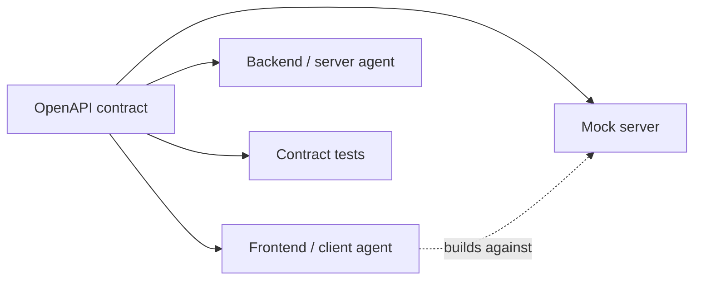
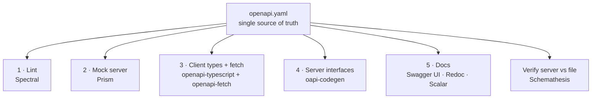

# My Notes: OpenAPI, the Universal Contract Between Clients and Servers

> **Source:** "28. OpenAPI: The universal contract between clients and servers" by Sriniously, *Backend from first principles* playlist (YouTube, 43:55)
> **Link:** https://www.youtube.com/watch?v=CwKsU84jIWs
>
> I wrote these from the video's full caption track, summarised in my own words. The YAML, commands and code are my own illustrations of what he describes. Anything marked *(my note)* is my addition, not from the video.

---

## 1. The problem: three copies of the same knowledge

The task board from the real-time video has ~**6 routes**. One handler, **`POST /api/move`**:
- takes a JSON body with **3 fields**: `task_id`, `to`, `actor`
- responds with a status code depending on what happened downstream (service, repository…): **200** success, **400 / 404** client errors, **500 / 502** server-side problems

The **React frontend knows all this**: the endpoint, the 3 body fields, that **404 means the task doesn't exist**…

**Where does that knowledge live? Three places:**
```
1. backend handler      ← the code that reads the body (the handling point)
2. frontend fetch/axios ← the calling point
3. a hand-written doc   ← if whoever wrote/integrated the API kept one
```
**Three copies of the same truth that must stay in sync.**

### How it goes wrong
```
1. a colleague renames body field  "to" → "column"  (more intuitive)
2. updates the backend handler ✅
3. updates the frontend ✅ (otherwise backend validation rejects it)
4. forgets the doc ❌ (nothing enforces it — it's just for knowledge)
   … a few sprints later …
5. a new engineer integrates the same API on another page
6. reads the DOC (which claims to be the source of truth), not the handler
7. sends "to" → 400 validation error from the backend
```

---

## 2. Why it only happens across the network

**Inside one codebase, this can't happen silently:**
- A Go function's **signature** declares its arguments and return value.
- Someone changes it (renames a struct field, `string` → `int`) and **every call site fails at compile time**. I find out **during development** and fix it.

**Across a network hop (HTTP), there's no signature.** A renamed field or changed type can **only be discovered at runtime**, unless I do what this video is about.

```
local call:   caller ──[compiler checks signature]──▶ function        ✅ compile-time safety
remote call:  client ──────── HTTP (no signature) ───────▶ server    ❌ runtime surprises
```

---

## 3. The idea: give remote calls a signature

Give the network boundary **the same protection** the compiler gives inside a codebase. **Freeze the signature** in one central, **machine-readable** document (not a text or Markdown doc):
- which **routes** exist
- each endpoint's **query params**, **path params**, **request body fields**, down to **each field's data type**
- every kind of **response** each endpoint can return

That specification is **OpenAPI**.
- **An OpenAPI description is just a file**, **JSON or YAML** (both fully supported).
- It **lists every endpoint** and describes its **inputs, outputs and behaviour**.

---

## 4. Origin story: Wordnik and Tony Tam

- **2010**, startup **Wordnik**: an API, ~**6 engineers**.
- Customers wanted **client SDKs in many languages** (**Python, PHP, JavaScript**…) **plus docs for each.**
- **Tony Tam** started the spec. His motivation in one line: **"we often code faster than we can document."**

**The core idea:** the **server describes itself in a JSON file**, and **many programs read that file** for different purposes:
- one **renders documentation** in a friendly, useful UI
- one **generates client libraries** in PHP, Python, JS, Go, Rust…

The description **doesn't impose a language**. Each generator uses that language's primitives. **The only promise needed: this file is true about the backend.**

**Why a structured format, not plain text?** So **any software can parse it** and search, format and transform it programmatically. Plain text makes that hard.

---

## 5. What one file gives me

| # | Benefit | Detail |
|---|---|---|
| 1 | **Documentation** | Read-only, or (most tools) **interactive**: **Swagger UI, Scalar**… send a sample body, add a token, make a **real call**, see the response |
| 2 | **Client libraries** | Generated **ready-to-use functions**. No hand-coding every condition |
| 3 | **Server code** | Generated **interfaces / boilerplate** that I'd otherwise type, maintain and keep in sync |
| 4 | **Request validation** | Libraries validate **query params, path params, body** against the spec, with **no validation code from me** |

> **His take:** this is **the most useful, most productive thing I can add to a codebase**, for backend, frontend and infra, and every engineer benefits.

---

## 6. The official definition, in three parts

The spec defines OpenAPI as a standard, **language-agnostic** interface to HTTP APIs that lets **humans and computers** understand a service's capabilities **without source code, documentation or traffic inspection**. Three parts:

| Phrase | Meaning |
|---|---|
| **Language-agnostic** | Doesn't care whether the server is **Go, Node, Python, Java, PHP**. It documents **behaviour, requirements, outputs** |
| **Humans and computers** | The same file renders **interactive docs for people**, and lets **programs** parse it to generate **code and validation** with no human involved |
| **Without source code, docs or traffic inspection** | No reading the implementation, no stale text doc, no **network tab**. **Just this one file** |

---

## 7. Four names people confuse

| Name | What it is |
|---|---|
| **OpenAPI Specification (OAS)** | The **rules**: which fields exist and what they mean |
| **OpenAPI Description (OAD)** | **My file**, obeying every OAS rule. Usually **`openapi.json` / `openapi.yaml`**. The physical thing |
| **OpenAPI Initiative (OAI)** | The **organization** that publishes and evolves the spec. Part of the **Linux Foundation** |
| **Swagger** | The **original name** of the spec. Now it's **the name of a tool** (the interactive UI) |

- **"The Swagger file"** = the OpenAPI description (`openapi.json`/`.yaml`).
- **"Swagger UI"** = the tool that **renders** that file so I can explore and test the API.

---

## 8. JSON or YAML

- The file is **just a JSON object**, written in **JSON or YAML**: **interchangeable, same features**. Tools usually support both.
- **YAML is a superset of JSON**, and most people write YAML because **JSON doesn't allow comments.**

```json
{ "openapi": "3.1.1", "info": { "title": "Task Board", "version": "1.0.0" }, "paths": {} }
```
```yaml
openapi: 3.1.1          # comments allowed in YAML
info:
  title: Task Board
  version: 1.0.0
paths: {}
```

---

## 9. History timeline

```
2010  Wordnik builds a JSON description of its API + a page that renders a UI from it
      → a designer on the team names it "Swagger"
2011  Swagger 1.0 open-sourced
2014  Swagger 2.0 — adoption takes off
2015  SmartBear (tools company) buys Swagger → donates the SPEC to the Linux Foundation
      founding members include Google, Microsoft, IBM, PayPal…
2016  (Jan) spec renamed OpenAPI — content unchanged: OpenAPI 2.0 ≡ Swagger 2.0
now   latest spec = 3.2.0, but people still write 3.1 —
      most tools (doc UIs, client generators, frontend type generators) only support 3.1
```

---

## 10. The smallest valid file

```yaml
openapi: 3.1.1        # version of the SPECIFICATION this file follows
info:
  title: Task Board
  version: 1.0.0      # version of MY API (internal, cf. route versioning video)
paths: {}             # no endpoints yet
```
- **`openapi`** matters because many tools still run on specific spec versions, and not everything has moved to 3.1.
- ⚠️ **Two different versions:** `openapi` = **spec version** (3.1.1). `info.version` = **my backend's API version**.

---

## 11. Root fields

| Field | Required? | Purpose |
|---|---|---|
| `openapi` | ✅ | Spec version |
| `info` | ✅ | Title, API version (+ contact etc.) |
| `paths` / `components` / `webhooks` | **At least one** | Endpoints / reusable pieces / webhooks |
| `servers` | — | **Where the API lives** |
| `security` | — | Authentication requirements for the endpoints |
| `tags` | — | **Group** endpoints together |

---

## 12. servers

```yaml
servers:
  - url: http://localhost:8080
    description: Local
  - url: https://staging-api.example.com
    description: Staging
  - url: https://api.example.com
    description: Production
```
- **A list**, because the backend can live in **several places**: local, staging, production.
- Write the **base URL once** here, and from then on just write **endpoint paths**.

---

## 13. paths and operations

```yaml
paths:
  /api/board:              # key = path, MUST start with "/"
    get: { ... }           # one entry per HTTP method
  /api/move:
    post: { ... }
  /api/tasks/{taskId}:     # {curly braces} = dynamic portion (path parameter)
    get: { ... }
```
- **`paths` is a map.** Each **key** is an endpoint path starting with `/`. Each **value** is a **path item**: **everything I can do at that address**, with **one entry per HTTP method** (`get, post, put, patch, delete`, sometimes `head, options`…).
- **Dynamic portions** (e.g. `/api/tasks/1` or a UUID, the HTTP convention for fetching an entity by ID) can't be known upfront, so they're written in **curly braces**.

### An operation (each method)
| Field | Purpose |
|---|---|
| `summary` | One-liner |
| `description` | Longer, **supports Markdown** (tables etc.) |
| `tags` | Grouping in rendered docs (e.g. all task endpoints together) |
| **`operationId`** | **Unique name for the operation, written like a function name** (`getBoard`). Generators turn it into **an actual function** I call from the client. **Must be unique across the whole file** |
| `parameters`, `requestBody`, `responses` | Inputs and outputs |

```ts
// what operationId becomes after code generation (illustrative)
const board = await api.getBoard();
await api.moveTask({ task_id: "t-9", to: "doing" });
```

---

## 14. Parameters

**Two kinds of input:** **parameters**, and the **request body**.

A parameter can live in four places, set by the **`in`** field:
| `in` | Example |
|---|---|
| `path` | `/api/tasks/{taskId}` |
| `query` | `?since=41` |
| `header` | `Last-Event-ID: 41` |
| `cookie` | `session=…` |

Each parameter has a **`name`**, **`in`**, a **`required`** flag, and a **`schema`** for its value.
- **Path parameters must be `required: true`.** An optional path param would make two different URLs, which makes no sense.

```yaml
/api/changes:
  get:
    operationId: pollChanges
    parameters:
      - name: since
        in: query
        required: false
        description: Last sequence number the client has received
        schema: { type: integer, minimum: 0 }
/api/events:
  get:
    operationId: streamEvents
    parameters:
      - name: Last-Event-ID       # same value, sent by the BROWSER on SSE reconnect
        in: header
        required: false
        schema: { type: integer }
```

---

## 15. Request body

- For **POST / PUT / PATCH**: the **`requestBody`**, described by **`content`**, a **map of media type → body shape**.
- **Media type** = the **`Content-Type`** label:
  - **`application/json`**: the usual for sending/receiving data
  - **`multipart/form-data`**: **file uploads**
  - **`application/x-www-form-urlencoded`**: classic **HTML forms** (less common with SPAs, still valid)
- Each media type has a **`schema`**.

```yaml
/api/move:
  post:
    operationId: moveTask
    summary: Move a task to another column
    tags: [tasks]
    requestBody:
      required: true
      content:
        application/json:
          schema:
            type: object
            required: [task_id, to]          # backend errors without these
            properties:
              task_id: { type: string }
              to:
                type: string
                enum: [todo, doing, done]
              actor:
                type: string
                default: guest               # optional; backend sets "guest" if omitted
```
**The file states the backend's behaviour** (required fields, defaults) **without anyone reading backend code.** That's the whole point.

---

## 16. Responses

- Each response is keyed by a **status code, written in quotes** (`"200"`).
- **2xx** success · **3xx** redirect · **4xx** client error · **5xx** server error (HTTP video).
- Each has a **`description`** (required) and usually **`content`** (media type + schema), shaped like the request body.

```yaml
    responses:
      "200":
        description: Task moved; the resulting event
        content:
          application/json:
            schema: { $ref: "#/components/schemas/Event" }
      "400":
        description: Validation error (e.g. invalid transition)
        content:
          application/json:
            schema: { $ref: "#/components/schemas/Error" }
      "404":
        description: No task with that ID
        content:
          application/json:
            schema: { $ref: "#/components/schemas/Error" }
      "502":
        description: Move succeeded, but publishing to the message bus failed
        content:
          application/json:
            schema: { $ref: "#/components/schemas/Error" }
```
The move endpoint documents **4 possible outcomes**. Note **502**: the operation itself **succeeded**, but the **event couldn't be published to the bus**.

---

## 17. The schema object

**The part clients use most**: it describes the **structure of every field**.

| `type` | Extra keywords |
|---|---|
| `string` | `minLength`, `maxLength`, **`pattern`**, **`enum`** (allowed values, e.g. `active / inactive / deleted`), `format` |
| `number` / `integer` | `minimum`, `maximum` |
| `boolean` | — |
| `array` | **`items`** (a schema for each item, which can itself be any type) |
| `object` | `properties` (keys are strings, values are any schema, **including nested objects**), `required` |
| `null` | — |

**Compose these and I can describe pretty much any data structure.**

There's also a section for **authentication** (security schemes): what kind of token the client sends, etc.

```yaml
components:
  schemas:
    Task:
      type: object
      required: [id, title, column]
      properties:
        id:     { type: string, format: uuid }
        title:  { type: string, minLength: 1, maxLength: 200 }
        column: { type: string, enum: [todo, doing, done] }
        tags:
          type: array
          items: { type: string }
    Error:
      type: object
      required: [code, message]
      properties:
        code:    { type: string }
        message: { type: string }
  securitySchemes:
    bearerAuth: { type: http, scheme: bearer, bearerFormat: JWT }
security:
  - bearerAuth: []
```

He deliberately **doesn't walk through every property**. In practice libraries generate most of it (section 20).

---

## 18. The full task-board description

*(My assembled version of what's shown in the video.)*

```yaml
openapi: 3.1.1
info:
  title: Task Board API
  version: 1.0.0
  contact: { name: Board team, email: board@example.com }   # the linter demands this
servers:
  - url: http://localhost:8080
tags:
  - name: board
  - name: tasks
paths:
  /api/board:
    get:
      operationId: getBoard
      summary: Get the current board
      description: Returns all columns and tasks with the current sequence number.
      tags: [board]
      responses:
        "200":
          description: The board
          content:
            application/json:
              schema: { $ref: "#/components/schemas/Board" }
              example:
                seq: 41
                columns:
                  todo:  [{ id: t-1, title: Write notes, column: todo }]
                  doing: []
                  done:  []
  /api/move:
    post:
      operationId: moveTask
      summary: Move a task
      description: Moves a task between columns and publishes a task.moved event.
      tags: [tasks]
      requestBody:
        required: true
        content:
          application/json:
            schema: { $ref: "#/components/schemas/MoveRequest" }
      responses:
        "200": { description: Moved,              content: { application/json: { schema: { $ref: "#/components/schemas/Event" } } } }
        "400": { description: Invalid request,    content: { application/json: { schema: { $ref: "#/components/schemas/Error" } } } }
        "404": { description: Task not found,     content: { application/json: { schema: { $ref: "#/components/schemas/Error" } } } }
        "502": { description: Bus publish failed, content: { application/json: { schema: { $ref: "#/components/schemas/Error" } } } }
components:
  schemas:
    MoveRequest:
      type: object
      required: [task_id, to]
      properties:
        task_id: { type: string }
        to:      { type: string, enum: [todo, doing, done] }
        actor:   { type: string, default: guest }
    Board:
      type: object
      properties:
        seq:     { type: integer }
        columns: { type: object, additionalProperties: { type: array, items: { $ref: "#/components/schemas/Task" } } }
    Task:
      type: object
      properties:
        id:     { type: string }
        title:  { type: string }
        column: { type: string }
    Event:
      type: object
      properties:
        seq:  { type: integer }
        type: { type: string, example: task.moved }
        data: { type: object }
    Error:
      type: object
      properties:
        code:    { type: string }
        message: { type: string }
```

---

## 19. Code-first vs design-first

If the file is **the contract between server and client**, **what comes first, the file or the code?**

| | **Code-first** | **Design-first (contract-first)** |
|---|---|---|
| Order | Write handlers/services/behaviour **first** → **derive** the file (annotations, comments on handlers, or the types themselves) | Write the **OpenAPI description first** → then backend, client, mocks and tests **from it** |
| Source of truth | **The code** (file is a by-product) | **The contract** |
| Good for | **Existing servers** you want docs/clients for | **New projects** |

- **The Swagger inventors started code-first** (their server already existed) and **later concluded contract-first makes more sense**. A **2013 talk** covers this.
- **His experience:**
  - started code-first too (adding OpenAPI to existing servers for interactive testing or client generation)
  - **for every new project since: contract-first**
- **Why contract-first:**
  - **frontend and backend start in parallel**, with nobody waiting for the backend to finish, because the behaviour is already agreed
  - **in the agentic era:** agree the contract **with your agents** first, then run **two parallel agents**, one on the server and one on the client, **without blocking each other**



---

## 20. Code-first in practice

**The Tasker app** (from his *Production-grade Go from scratch* playlist):
```
Zod schemas            → define data shapes as code (structured objects)
ts-rest contract       → attaches schemas to paths + methods + status codes
generator function     → contract → openapi.json
Go server              → serves that openapi.json (interactive docs etc.)
→ openapi.json is NEVER written by hand
```

```ts
// ts-rest + Zod (illustrative)
const MoveBody = z.object({
  task_id: z.string(),
  to: z.enum(["todo", "doing", "done"]),
  actor: z.string().default("guest"),
});
export const contract = c.router({
  moveTask: {
    method: "POST",
    path: "/api/move",
    body: MoveBody,
    responses: { 200: EventSchema, 400: ErrorSchema, 404: ErrorSchema, 502: ErrorSchema },
  },
});
const doc = generateOpenApi(contract, { info: { title: "Tasker", version: "1.0.0" } });
fs.writeFileSync("openapi.json", JSON.stringify(doc, null, 2));
```

- **Why he didn't cover every spec feature:** libraries like **ts-rest** make it so streamlined that all I need to understand is:
  1. the **endpoint** (path + method)
  2. the **inputs** (query, path params, body, headers)
  3. the **response** (schema + status code)

  **Just JavaScript objects**, as JSON Schema or **Zod** (even shorter).
- **This is a different flavour of code-first** from "comments on handlers parsed into a file". He prefers it: **it's code, not comments**, so it's **easier to maintain and harder to bypass**.
- **Python's FastAPI:** native integration. It parses the **handler code itself** (type annotations), **generates `openapi.json` behind the scenes and serves it**, with no separate comments.

```python
class MoveRequest(BaseModel):
    task_id: str
    to: Literal["todo", "doing", "done"]
    actor: str = "guest"

@app.post("/api/move", operation_id="moveTask", responses={404: {"model": Error}})
def move(req: MoveRequest) -> Event: ...
# → /openapi.json and /docs generated automatically
```

---

## 21. The design-first pipeline

The **task board from the real-time video** has **no OpenAPI description yet** and is **small and new**, the perfect case to go design-first and **establish it as a practice early**.



### Stage 1: Lint (Spectral)
- Like ESLint or the Go linter, but for OpenAPI. Errors on **missing descriptions**, operations **without an `operationId`**, responses **without a schema**…
- **Spectral** has the **OpenAPI rules built in**.
- **Demo:** 3 errors (**no `contact` in `info`**, **two operations with no description**). Fix → passes.
```bash
npx @stoplight/spectral-cli lint openapi.yaml
```

### Stage 2: Mock server (Prism)
- Reads the spec **before any backend exists** and runs a **fake server** answering every documented request **with the examples written in the file**.
- **The frontend team builds against the mock** while the **backend team implements the handlers**.
- **Demo:** only the file exists. `GET` board returns **the example from the file**. `POST` move **accepts the documented schema**.
```bash
npx @stoplight/prism-cli mock openapi.yaml      # → http://127.0.0.1:4010
curl http://127.0.0.1:4010/api/board
```

### Stage 3: Client (openapi-typescript + openapi-fetch)
- **openapi-typescript** converts the spec into **TypeScript types** that know **every path, every field, each type and constraint**.
- **openapi-fetch** makes the actual calls using those types.
- **Misspell a field or pass the wrong type → the compiler catches it.**
```bash
npx openapi-typescript openapi.yaml -o src/api/schema.d.ts
```
```ts
import createClient from "openapi-fetch";
import type { paths } from "./api/schema";
const api = createClient<paths>({ baseUrl: "http://localhost:8080" });

await api.POST("/api/move", { body: { task_id: "t-9", to: "doing" } });   // ✅
await api.POST("/api/move", { body: { task_id: "t-9", column: "doing" } }); // ❌ compile error
```

### Stage 4: Server (oapi-codegen, Go)
- Converts the file into **Go interfaces**. **My handlers must satisfy them.** The contract now **enforces handler behaviour** (other languages get their own equivalent).
- **Demo:** generate the interface → **add a field in the file and regenerate → the build fails at the handler**, because it no longer matches the contract.
```bash
go run github.com/oapi-codegen/oapi-codegen/v2/cmd/oapi-codegen \
  -generate types,std-http-server -package api openapi.yaml > internal/api/gen.go
```
```go
// generated (shape)
type ServerInterface interface {
    GetBoard(w http.ResponseWriter, r *http.Request)
    MoveTask(w http.ResponseWriter, r *http.Request)
}
// mine — compile fails if the contract changes and this doesn't
var _ api.ServerInterface = (*Handler)(nil)
```

### Stage 5: Docs
Same file, three renderers:
| Tool | Note |
|---|---|
| **Swagger UI** | The traditional interactive docs, with a **"Try it out"** button |
| **Redoc** | Another clean docs UI |
| **Scalar** | Interactive testing environment. **The one he uses**: modern, clean UI |

> **One file, one truth. Client, mock, server interface and docs are all derived from it.**

---

## 22. Does the server actually match the file?

1. **Test the server against the file: Schemathesis.** It reads the spec, **generates requests from the schemas (valid and invalid)**, sends them to the **real server**, and **checks every response against the contract**. Mismatches are flagged.
   ```bash
   schemathesis run openapi.yaml --url http://localhost:8080
   ```
2. **Compare two versions of the file** (he mentions it briefly). *(My note: e.g. `oasdiff breaking old.yaml new.yaml` in CI to catch breaking API changes before merge.)*

### The whole design-first loop
```
write the spec (by hand, or via ts-rest-style code → openapi.json/yaml)
  → lint (Spectral)
  → mock server (Prism) for early client work and testing
  → generate client types/code (openapi-typescript + openapi-fetch)
  → generate server interfaces (oapi-codegen)
  → verify the real server against the contract (Schemathesis)
  → render docs (Swagger UI / Redoc / Scalar)
also: validate requests at the API gateway with the same file
```

---

## 23. OpenAPI in the industry

- **Big platforms publish their OpenAPI files** so anyone integrating can build on them:
  | Platform | Size of its OpenAPI file |
  |---|---|
  | **GitHub** | ~**344,000 lines** |
  | **Stripe** | ~**171,000 lines** |
- That's what "**OpenAPI is the standard**" means: the industry agreed this is **how we describe backends**.
- **Recent use case: AI agents.** When you give an agent a **tool to call**, an OpenAPI description can describe it. *(The caption cuts this point short.)*

---

## 24. Summary

- **Inside one codebase**, the compiler enforces signatures at **compile time**.
- **Across the network boundary** that protection disappears, so issues surface at **runtime**.
- **OpenAPI** puts the **complete API description in one file**:
  - which **paths** exist
  - each endpoint's **inputs and outputs**
  - the **shape of the data**, down to **every field's and subfield's type**
  - **authentication** mechanisms
- **From that one file I generate client code, server interfaces, mocks, tests, docs**, and more.

---

## 25. My cheat sheet

```
PROBLEM     API knowledge in 3 places (handler · frontend call · hand-written doc) → drift
            ("to" renamed "column"; doc forgotten; new dev sends "to" → 400)
            in-process: compiler checks signatures · across HTTP: no signature → runtime bugs
IDEA        give remote calls a SIGNATURE: one machine-readable file = OpenAPI (JSON or YAML)
ORIGIN      Wordnik 2010, Tony Tam — "we code faster than we document"
            server describes itself → tools render docs + generate SDKs in any language
GIVES       interactive docs · client SDKs · server interfaces/boilerplate · automatic request validation
DEFINITION  language-agnostic · for humans AND computers · no source/docs/traffic inspection needed
NAMES       OAS = the rules · OAD = my file (openapi.yaml) · OAI = Linux Foundation org
            Swagger = old name → now the UI tool ("Swagger file" = OAD, "Swagger UI" = renderer)
HISTORY     2010 Swagger @ Wordnik → 2011 1.0 OSS → 2014 2.0 → 2015 SmartBear → Linux Foundation
            (Google, Microsoft, IBM, PayPal) → Jan 2016 renamed OpenAPI (2.0 ≡ Swagger 2.0)
            latest 3.2.0, but write 3.1 (tool support)

FILE        required: openapi (SPEC version) + info{title, version = MY API version}
            + ≥1 of paths / components / webhooks
            optional: servers (list: local/staging/prod base URLs) · security · tags
PATHS       map, keys start "/" · {param} for dynamic parts · one entry per HTTP method
OPERATION   summary · description (markdown) · tags · operationId (function-style, UNIQUE → generated fn)
            parameters · requestBody · responses
PARAMS      in: path | query | header | cookie · name · required · schema · path params ALWAYS required
            e.g. ?since=<seq> (query) · Last-Event-ID (header, browser on SSE reconnect)
BODY        requestBody.content: { media-type: { schema } }
            application/json · multipart/form-data (uploads) · application/x-www-form-urlencoded (forms)
            /api/move: task_id + to required · actor optional, default "guest"
RESPONSES   keyed by "status" in quotes · description + content
            move: 200 Event · 400 validation · 404 no task · 502 moved but bus publish failed
SCHEMA      string(min/maxLength, pattern, enum) · number/integer(min/max) · boolean
            array(items) · object(properties, required) · null · securitySchemes for auth

CODE-FIRST  code → file (annotations/comments/types) · Zod + ts-rest → generate openapi.json (code > comments)
            FastAPI: generates + serves openapi.json from handler annotations
DESIGN-1ST  contract first → FE + BE (or 2 agents) work in parallel · his default for every new project
PIPELINE    1 lint: Spectral (missing contact/description/operationId/schema)
            2 mock: Prism (answers with the file's examples)
            3 client: openapi-typescript + openapi-fetch (typos → compile errors)
            4 server: oapi-codegen → Go interfaces (spec change w/o handler change → build fails)
            5 docs: Swagger UI · Redoc · Scalar (his pick)
VERIFY      Schemathesis: generated valid + invalid requests vs the real server · diff spec versions
INDUSTRY    GitHub ~344k lines · Stripe ~171k lines · gateways validate with it · AI agent tools
```
