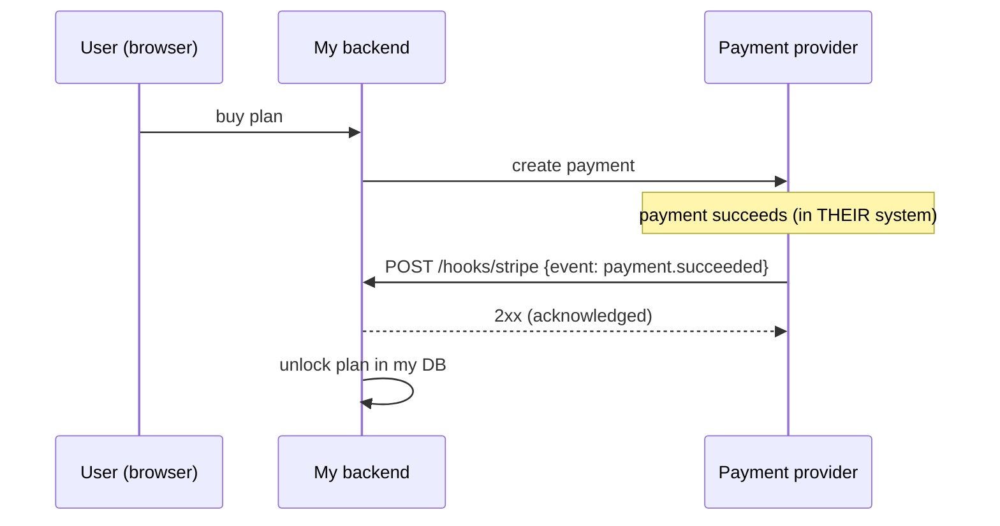
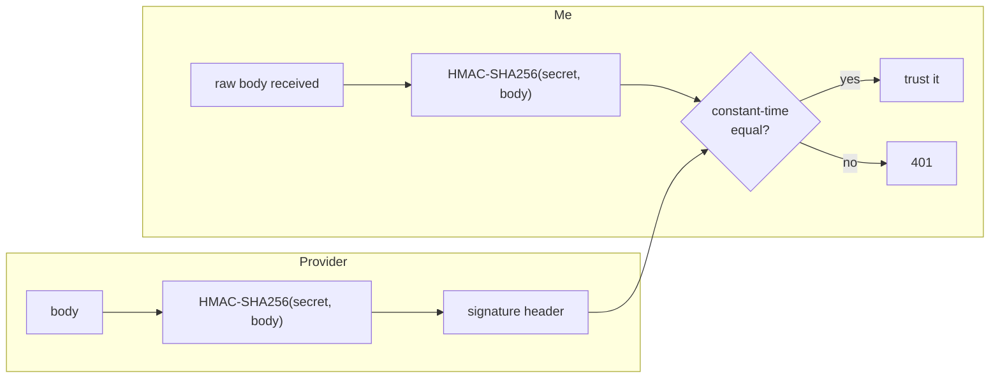
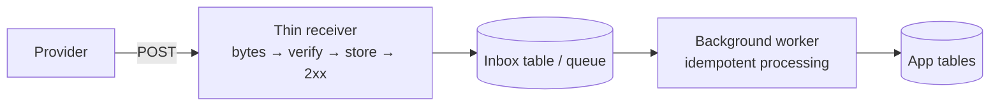
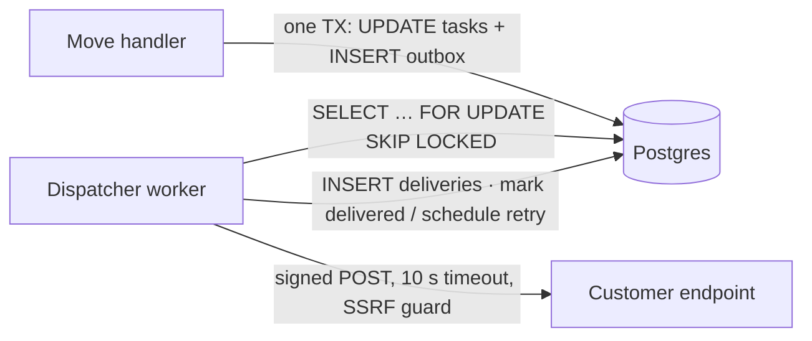

# My Notes: Webhooks, How the Server Calls You

> **Source:** "29. Webhooks: how the server calls you" by Sriniously, *Backend from first principles* playlist (YouTube, 56:07)
> **Link:** https://www.youtube.com/watch?v=eWM0CVReP04
>
> I wrote these from the video's full caption track, summarised in my own words. The diagrams, SQL and code are my own illustrations of what he describes. Anything marked *(my note)* is my addition, not from the video.

---

## 1. A new kind of communication: service to service

- The playlist's premise: **the client always starts the conversation.** Even real-time systems kept that: **the client had to open a connection first** before the server could push.
- This video: **service-to-service communication between two backends**, used when **my backend needs to learn something from another backend**.
- **No browser in between, no browser-opened stream, no human.** Purely two services.

---

## 2. The example: knowing a payment succeeded

- The task board gets a **pricing page** and a **paid plan**. Payments go through a **payment provider** like **Stripe**.
- **The success happens in *their* system, not mine.** I need a **signal from Stripe**, and only then **unlock the plan**.

**The receiver of that signal must not be the browser:**
1. **Reliability:** the user's network can fail, they can **close the tab**, their machine can crash, and the **signal is lost**.
2. **Security:** a **client-side operation can be tampered with**. Never trust the client with something this critical.

> **My server must receive the signal. My system is the source of truth.**

---

## 3. Attempt 1: polling the provider

```
my server → Stripe: create payment
loop every 1 s:  GET /payments/{id}  → "pending" … "pending" … "succeeded"
                 → update DB, notify frontend, activate plan
```

**Problems:**
| Problem | Detail |
|---|---|
| **Delay** | Average = half the interval (real-time video formula) → **~0.5 s** at 1 s polling |
| **Waste** | Every "still pending" response is a **wasted request** |
| **Provider load** | **10,000 merchants polling every second = 10,000 req/s** hitting the provider. To protect its infra, it **rate-limits merchants aggressively** |
| **→ Worse delay** | Rate-limited to, say, a **60 s** interval → **~30 s** average delay |

---

## 4. The fix: flip the direction, i.e. webhooks

- **Stop asking. Trust the provider to tell me when the event happens.**
- **A webhook is nothing fancy: a plain HTTP POST** from the provider **to a URL I give them**, where I'm listening.
- A **reverse API call**: normally I call their API, now **they call mine** to tell me about an event.



---

## 5. History

- **2007: Jeff Lindsay** proposed that the web needs something like the **Unix pipe**: a primitive for one service to **push its output to another when an event happens**. He called them **webhooks**: **user-defined callbacks over HTTP POST**. *(Like redirecting stdout in a terminal.)*
- **~2 years later:** engineers at **Google** built a protocol on the same idea for **blog feeds**: **PubSubHubbub**.

---

## 6. Vocabulary

Every provider's docs use these a bit differently:

| Term | Meaning |
|---|---|
| **Provider / sender** | The system **where the event happens** |
| **Consumer / receiver** | **Me** |
| **Endpoint** | **The URL on my side** that the provider POSTs to |
| **Event** | Anything predefined: *payment succeeded*, *task moved*… |
| **Delivery** | **One attempt** to send an event to the endpoint. ⚠️ **One event can have many deliveries.** Always assume an event **may arrive more than once** |
| **Subscription** | My **registration** with the provider: "this is my URL, these are the event types I want" |

---

## 7. Demo: receiving a GitHub webhook

**Receiver code: 3 packages:**
```
main     → one route: POST /hooks/github
inbox    → the handler: read FULL body → check signature (via verify) → store delivery ID → respond
verify   → signature checking
```
That's the **typical shape of a webhook handler**.

```go
func (h *Inbox) GitHub(w http.ResponseWriter, r *http.Request) {
    body, err := io.ReadAll(http.MaxBytesReader(w, r.Body, 1<<20))   // raw bytes first
    if err != nil { http.Error(w, "bad body", 400); return }
    if !verify.GitHub(h.secret, body, r.Header.Get("X-Hub-Signature-256")) {
        http.Error(w, "bad signature", http.StatusUnauthorized); return
    }
    if err := h.store.SaveDelivery(r.Context(), r.Header.Get("X-GitHub-Delivery"),
        r.Header.Get("X-GitHub-Event"), body); err != nil {
        http.Error(w, "store failed", 500); return
    }
    w.WriteHeader(http.StatusAccepted) // 202
}
```

**Running it:**
1. The receiver runs on a Linux box with **no public address**, so open a **tunnel** (**ngrok**, **Cloudflare Tunnel**…). A tunnel gives a non-exposed port a **public HTTPS address**. Here a random hostname forwards to **port 8081**.
2. On the GitHub repo: **add a webhook** with that URL, **content type JSON**, a **secret**, and **only the `push` event**.
3. GitHub immediately sends a **ping** to the new webhook.
4. **Push a commit** → the receiver logs **one POST** with the **event name header**, a **delivery ID**, a **signature**, and my response: **202**.
5. GitHub keeps **its own record**: **Recent Deliveries** shows the same headers, payload and response.

---

## 8. Anatomy of a delivery

```
POST /hooks/github HTTP/1.1
Content-Type: application/json
X-GitHub-Event: push                                  ← event type
X-GitHub-Delivery: 72d3162e-cc78-11e3-81ab-4c9367dc0958   ← unique delivery ID
X-Hub-Signature-256: sha256=7d38cdd689735b008b3c702edd92eea23791c5f6...   ← HMAC signature

{ "ref": "refs/heads/main", "commits": [ ... ], "repository": { ... } }   ← event data
```

---

## 9. How the provider decides success

1. **Status code:** **any 2xx = success** (200 or 202, doesn't matter much). **Anything else (3xx, 4xx, 5xx) = failure.**
2. **Time limit:**

| Provider | Must respond within |
|---|---|
| **GitHub** | **10 s** |
| **Shopify** | **5 s** |
| **Slack** | **3 s** |
| **Microsoft Graph** (Outlook APIs etc.) | **3 s** |

→ **Check each provider's docs** for its deadline. Miss it and **it counts as a failure** (then their retry policy kicks in, section 20).

---

## 10. Registration, one URL per provider, handshakes

**The registration form** usually asks for: **URL**, **secret**, **event types**.

### One endpoint per provider
```
✅ /hooks/github      ✅ /hooks/stripe
❌ /hooks/callback    (one generic endpoint for everything)
```
- Each provider has **its own headers, signature style and retry behaviour**, which all live in **that provider's handler**. Keep endpoints and handlers **separated per provider**.

### Handshakes (some providers)
Before sending real events, the provider **calls the new URL and waits for a specific answer**:
| Provider | Handshake |
|---|---|
| **Microsoft Graph** | Sends a **validation token** I must **return as plain text** |
| **Discord** | Sends a **ping**, expects a **pong** |
| **Amazon SNS** | Sends a **subscription confirmation** with a **URL I must visit** to confirm |

**Why:** without a handshake, **anyone could register a victim's address** and subscribe to every event type, turning the provider (AWS, Stripe, GitHub…) into a **DDoS cannon** against the victim. The handshake proves **the URL's owner opted in.**

```go
// Microsoft Graph-style validation (illustrative)
if tok := r.URL.Query().Get("validationToken"); tok != "" {
    w.Header().Set("Content-Type", "text/plain")
    w.Write([]byte(tok))
    return
}
```

---

## 11. Local development: tunnels

- A webhook is **inbound** (from the internet into my system).
- My laptop sits behind a **home router** that **doesn't forward unsolicited inbound requests**, and **`localhost` means nothing** to a server on the internet (it works with domains and IPs).
- So during development **events can't reach my laptop.**
- **Fix: a tunnel** (**ngrok**, **Cloudflare Tunnel**…). A **temporary public HTTPS URL** that securely forwards to my **local port**. Register that URL with the provider.

```bash
ngrok http 8081
# or
cloudflared tunnel --url http://localhost:8081
```

---

## 12. Security 1: who sent this? (five methods)

**The threat:**
- My endpoint is a **public URL** that receives a POST and then **does something important** (unlocks a paid plan).
- Webhook URLs follow **guessable patterns** (`/webhooks`, `/hooks`, `/callback`).
- So **anyone can POST `{"payment": "succeeded", "user_id": 42}`** and get a free plan.

**HTTPS doesn't solve this.** HTTPS stops people **reading bytes in transit**. It says **nothing about who wrote them**. I need a guarantee that **the provider sent it**.

| # | Method | Notes |
|---|---|---|
| 1 | **Secret token in the URL** (basic-auth-like) | **Weakest.** URLs are **logged everywhere** (local logs, CloudWatch, Elasticsearch…), so the token leaks into logs |
| 2 | **IP allowlist** | GitHub, Stripe, **Polar** etc. publish the **IPs they send from**. Allow only those in the **firewall / cloud infra**. **Better, but not complete on its own** |
| 3 | **Mutual TLS** | The provider presents a **client certificate** |
| 4 | **HMAC signature over the body with a shared secret** ⭐ | **Most common**: ~**65–80%** of providers. Only **me and the provider** know the secret. **Used for the rest of the video** |
| 5 | **Asymmetric signature** | Provider signs with its **private key**, I verify with its **public key** (e.g. **Discord**) |

---

## 13. HMAC signatures

**HMAC = Hash-based Message Authentication Code.**
- Recall hashing (HTTP and security videos): any input → **fixed-length fingerprint**, and **change one byte and the whole fingerprint changes.**
- **Provider:** computes **HMAC-SHA256(body, shared secret)** and puts it in a **header**.
- **Me:** compute the same thing over the **same received body** with the **same secret**, and **compare**. Match → it really came from the provider.



### What exactly gets signed differs per provider. Read the docs.
| Scheme | Signed string | Why |
|---|---|---|
| **GitHub** | `body` | — |
| **Stripe** | `timestamp + "." + body` (header `t=…,v1=…`, can hold **several `v1`s**) | **Replay protection** (section 15) |
| **Standard Webhooks** | `webhook_id + "." + timestamp + "." + body` | Also protects the **ID** |
| **Twilio** | **full endpoint URL + form fields sorted**, **SHA-1** | Enforces the **exact URL** too |

**Stripe's Go SDK** verification file: parses the header (`t` = Unix timestamp, `v1` = signature, possibly several), then compares with **`hmac.Equal`**.

```go
// GitHub: X-Hub-Signature-256: sha256=<hex>
func GitHub(secret, body []byte, header string) bool {
    const prefix = "sha256="
    if !strings.HasPrefix(header, prefix) { return false }
    got, err := hex.DecodeString(header[len(prefix):])
    if err != nil { return false }
    mac := hmac.New(sha256.New, secret)
    mac.Write(body)
    return hmac.Equal(got, mac.Sum(nil))          // constant-time
}
```

---

## 14. Verify raw bytes before parsing

**The trap:** the HMAC covers **exact bytes**.
- In Node/Express, `express.json()` **parses the body** before my handler runs. If I then **re-encode** the object to compute the HMAC, the bytes may differ: the provider wrote JSON **with no spaces**, my encoder adds a **space after every colon** → **different bytes → different HMAC → every delivery fails verification.**

> **Rule: read the body as bytes → verify those bytes → only then parse.**

```js
// Express: keep the raw body for the webhook route
app.post("/hooks/stripe", express.raw({ type: "application/json" }), (req, res) => {
  const event = stripe.webhooks.constructEvent(req.body /* Buffer */, req.headers["stripe-signature"], secret);
  // parse/handle only AFTER verification
  res.sendStatus(200);
});
```

### Demo: the failure modes
| Run | What changed | Result |
|---|---|---|
| 1 | Verify raw bytes | **202** ✅ |
| 2 | **Changed the secret on GitHub**, redelivered | Header no longer matches → **401 Unauthorized** (GitHub records the 401) |
| 3 | Secret fixed, but receiver **parses JSON then re-encodes** before verifying | **Verification fails again**: bytes differ |

---

## 15. Security 2: replay attacks

- Say an attacker **captures one real delivery** (man-in-the-middle): **all headers and the body**.
- An hour later they **resend it**, maybe **1,000 times**. **The signature is genuine**, so verification **passes** every time.
- **Fix: timestamps inside the signed string.**
  - **Stripe** puts the **attempt's timestamp in what it signs**, so it **can't be altered without breaking the signature**.
  - Its library **rejects anything older than 5 minutes.**

```go
// Stripe-style: header "t=1730479200,v1=<hex>[,v1=<hex>]"
func verifyStripe(secret, body []byte, header string, tolerance time.Duration) error {
    var ts int64; var sigs [][]byte
    for _, part := range strings.Split(header, ",") {
        k, v, _ := strings.Cut(part, "=")
        switch k {
        case "t":  ts, _ = strconv.ParseInt(v, 10, 64)
        case "v1": if b, err := hex.DecodeString(v); err == nil { sigs = append(sigs, b) }
        }
    }
    if time.Since(time.Unix(ts, 0)) > tolerance { return errors.New("timestamp too old") } // replay guard
    mac := hmac.New(sha256.New, secret)
    fmt.Fprintf(mac, "%d.", ts); mac.Write(body)
    want := mac.Sum(nil)
    for _, s := range sigs { if hmac.Equal(s, want) { return nil } }
    return errors.New("no matching signature")
}
```
*(My note: the timestamp limits the replay window. Storing processed delivery IDs, section 18, blocks replays inside the window too.)*

---

## 16. Security 3: constant-time comparison

- **Don't compare signatures with the language's ordinary `==`.** A normal string compare **stops at the first mismatching byte**, so comparison time **leaks how many leading bytes were right**.
- An attacker measuring that over **thousands or millions of requests** can **derive the signature byte by byte** (a timing attack).
- **Use constant-time comparison.** It takes the **same time no matter where the strings differ**:

| Language | Function |
|---|---|
| Go | **`hmac.Equal`** |
| Node.js | **`crypto.timingSafeEqual`** |
| Python | **`hmac.compare_digest`** |

---

## 17. Security 4 (provider side): SSRF

**When I'm the provider:** my dispatcher **calls whatever URL the customer typed**, **from inside my network**.
- The attacker registers e.g. `http://169.254.169.254/...`, which on most clouds is the **instance metadata service** (it hands out **credentials**), or the hostname of an **internal admin service**.
- My dispatcher dutifully POSTs to it. That's **Server-Side Request Forgery (SSRF).**

**Checking the URL at registration isn't enough:**
- DNS can resolve to a **public** IP while I check, then be switched to a **private** one later.
- Or the public URL **redirects** to a private address.

**Defences:**
1. **Resolve the hostname myself** and check the IP against a **fixed list of private/reserved ranges**, **every time I send**, not just at registration.
2. **Never follow redirects.** Normally a 301/302 means "follow". For webhooks it's a threat. (Likewise, as a receiver, **anything not 2xx is a failure**.)
3. **Only 2xx counts as success.**
4. Ideally **send from a separate network through an egress proxy.** Stripe open-sourced one: **Smokescreen**.

```go
var blocked = []netip.Prefix{
    netip.MustParsePrefix("10.0.0.0/8"), netip.MustParsePrefix("172.16.0.0/12"),
    netip.MustParsePrefix("192.168.0.0/16"), netip.MustParsePrefix("127.0.0.0/8"),
    netip.MustParsePrefix("169.254.0.0/16"), netip.MustParsePrefix("::1/128"),
    netip.MustParsePrefix("fc00::/7"), netip.MustParsePrefix("fe80::/10"),
}
func safeDialer() *net.Dialer {
    return &net.Dialer{Timeout: 5 * time.Second, Control: func(_, address string, _ syscall.RawConn) error {
        host, _, _ := net.SplitHostPort(address)
        ip, err := netip.ParseAddr(host)
        if err != nil { return err }
        for _, p := range blocked { if p.Contains(ip.Unmap()) { return fmt.Errorf("blocked address %s", ip) } }
        return nil   // checked at CONNECT time → defeats DNS rebinding
    }}
}
client := &http.Client{
    Timeout:       10 * time.Second,
    Transport:     &http.Transport{DialContext: safeDialer().DialContext},
    CheckRedirect: func(*http.Request, []*http.Request) error { return http.ErrUseLastResponse }, // never follow
}
```

---

## 18. At-least-once delivery, and idempotency

**The scenario:**
```
provider → POST event      me: did the work (DB row written) → respond 200
                           ✂ the 200 is LOST (connection drop, LB restart…)
provider: "delivery failed" → RETRIES the same payload
me: receives the SAME event again (seconds/minutes later, any order)
```
- Hence every provider's docs say **"at least once"**: it **will** arrive and **never be lost**, but it **may arrive more than once**. **Never exactly once**, because the ack itself can be lost.

**Fix: the receiver must be safe to call repeatedly with the same event.** Side effects happen **once**, however many deliveries.

**Use the delivery/event ID**, which stays **the same across all retries of one event**:
| Provider | Where the ID is |
|---|---|
| GitHub | Header **`X-GitHub-Delivery`** |
| Stripe | **`id`** in the event body |
| Standard Webhooks | **`webhook-id`** |

**Store processed IDs with a UNIQUE constraint, in the SAME transaction as the work:**
```sql
CREATE TABLE processed_webhooks (
  delivery_id  text PRIMARY KEY,          -- UNIQUE: never two rows with the same ID
  provider     text NOT NULL,
  received_at  timestamptz NOT NULL DEFAULT now()
);
```
```go
err := db.InTx(ctx, func(tx Tx) error {
    res, err := tx.Exec(ctx, `INSERT INTO processed_webhooks (delivery_id, provider)
                              VALUES ($1, $2) ON CONFLICT DO NOTHING`, id, "stripe")
    if err != nil { return err }
    if res.RowsAffected() == 0 { return nil }          // already processed → skip
    return activatePlan(ctx, tx, evt.UserID)           // the real work, SAME tx
})
```

**Why the same transaction:**
| Order (separate steps) | Crash between steps → |
|---|---|
| **Work first, then store ID** | Work done, ID **not** stored → retry → no ID found → **work done twice** ❌ |
| **Store ID first, then work** | ID stored, work **failed** → retry → "already processed" → **work never happens** ❌ |
| **Both in one transaction** | **Both or neither** ✅ |

This property is **idempotency**: **however many times the request is made, the effect is the same.**

---

## 19. Ordering

**The 2017 case** (written up by someone working on **Stripe's API** then):
```
provider generates: created(obj) → deleted(obj)
created delivery fails once (I was deploying) → retried 5 min later
deleted delivery succeeds within a second
I receive:  deleted … then created
handler takes events at face value → a row for an object that NO LONGER EXISTS
```
- **Stripe's docs say it outright: events are not delivered in order.**
- Event **timestamps have 1-second resolution**, so two events within a second **share a timestamp** and can't be ordered by it.

**Solutions:**
| # | Approach | Trade-off |
|---|---|---|
| 1 | **Treat the event as a signal only.** **Fetch the current state** from the provider's API and decide from that | Order no longer matters. **Costs one API call** |
| 2 | **Version / `updated_at` on the object.** Apply only if **newer than what I have**, in one transaction | Needs a reliable version field |
| 3 | **Buffer** events per object until all earlier ones arrive | **Unpredictable**, can stall |
| — | Some providers **sell strict ordering** as a feature | **Costs extra** |

```sql
-- approach 2: only apply if newer
UPDATE subscriptions SET status = $2, provider_updated_at = $3
WHERE id = $1 AND (provider_updated_at IS NULL OR provider_updated_at < $3);
```

---

## 20. Retry schedules differ per provider

**Check each provider's docs before integrating.**
| Provider | Retry behaviour |
|---|---|
| **Stripe** | **Exponential backoff for up to 3 days**. Still failing → **disables the endpoint** and **emails me** |
| **Svix** (webhooks-as-a-service) | Immediately → **5 s → 5 min → 30 min → 2 h → 5 h → 10 h** → … |
| **Shopify, Slack, Polar** | Each has its own schedule |
| **GitHub** | **Zero retries.** If I was down, **that delivery is gone**. I must click **Redeliver** manually, or write a script that **lists failed deliveries via the API and redelivers** them |

**About Svix:** building a webhook *sending* system is **a lot of engineering** (all the edge cases and security in this video), so many companies **delegate it to Svix**: embeddable UI or APIs, retries, signing, etc.

---

## 21. Load: keep the receiver thin

Putting it together:
- I have **3–10 s** to ack. **Every miss becomes a retry**, adding to normal user traffic.
- **Bursts are normal:**
  - a billing provider **renews every subscription on the 1st of the month**
  - a marketing tool emails **500,000 people** and sends a **delivery receipt per recipient**
- If the handler does **everything inline** (verify, update 2–3 tables, call other APIs, then ack), it **misses deadlines** → **retries** → **more load** → a spiral.

**The ideal receiver does exactly four things:**
```
1. read body (bytes)
2. verify signature
3. store the delivery (DB table / enqueue)
4. respond 2xx IMMEDIATELY — and stop
         ↓
background WORKER (task queue, from the queues video) does the real work asynchronously
```



---

## 22. Becoming the provider: sending webhooks

**Now I offer webhooks.** On the task board, every move emits **`task.moved`** with a **sequence number, the task, who moved it, and when**.
- A customer wants a **programmatic signal whenever a task reaches *Done*** (to post into a chat channel, or build their own logic).
- They give me a **URL**. I give them a **secret** (as Stripe/GitHub did for me).

**Naive version:** in the move handler, after saving the move, call **`http.Post(customerURL, …)`**. Three problems:
| # | Problem |
|---|---|
| 1 | **Their slowness becomes my latency.** Slow or down endpoint → my move handler waits before responding to my frontend |
| 2 | **Saved, then crashed before POSTing** (container down, redeploy) → move succeeded, **webhook never sent** |
| 3 | **POST first, then DB write fails or crashes** → I told the customer **a move happened that never happened** |

---

## 23. The outbox pattern

- **Outbox = an ordinary table in the same database** as everything else (tasks included).
- The move handler opens **one transaction**: **update the task** + **insert an outbox row with the full event** → **commit**. **Both or neither.**
- A **separate background process** reads outbox rows and **delivers them asynchronously**.
- Like the **write-ahead log** from the databases video: **write the intention somewhere durable** (safe from crashes), let **another process** do the delivery.
- The move handler **responds as fast as before**, unaffected by customers' endpoints.

```sql
CREATE TABLE webhook_endpoints (
  id        bigserial PRIMARY KEY,
  url       text NOT NULL,
  secret    text NOT NULL,
  disabled  boolean NOT NULL DEFAULT false,
  consecutive_failures int NOT NULL DEFAULT 0
);
CREATE TABLE outbox (
  id          bigserial PRIMARY KEY,
  endpoint_id bigint REFERENCES webhook_endpoints(id),
  event_type  text NOT NULL,
  payload     jsonb NOT NULL,
  status      text NOT NULL DEFAULT 'pending',   -- pending | delivered | exhausted
  next_attempt_at timestamptz NOT NULL DEFAULT now(),
  attempts    int NOT NULL DEFAULT 0
);
CREATE TABLE deliveries (                          -- one row PER ATTEMPT
  id          bigserial PRIMARY KEY,
  outbox_id   bigint REFERENCES outbox(id),
  status_code int,
  response_snippet text,                           -- first 2 KB
  attempted_at timestamptz NOT NULL DEFAULT now()
);
```
```go
// move handler — one transaction
err := db.InTx(ctx, func(tx Tx) error {
    if err := tx.MoveTask(ctx, taskID, to, actor); err != nil { return err }
    return tx.InsertOutbox(ctx, endpointsFor(boardID), "task.moved", eventJSON)
})
```



---

## 24. The dispatcher

Takes **one outbox row at a time** and, per delivery:

1. **SSRF guard:** resolve the URL and refuse private/loopback addresses **before anything else** (section 17).
2. **Sign** `id.timestamp.body` in the **Standard Webhooks** format with **that endpoint's secret**.
3. **POST with a 10 s timeout.** No hard rule; **10 s is what most use.**
4. **Record the attempt** in `deliveries`: **status code, first 2 KB of the response, time**.
5. **2xx → mark delivered**, no more retries.
6. **Anything else → schedule the next retry** with **exponential backoff + jitter**.
   - **Respect the customer's `Retry-After`** header (e.g. "I'm having issues, retry in 1 h / 6 h").
7. **After the last attempt → mark exhausted.**
8. **10 consecutive failures → disable the endpoint and email the owner.**
9. **One queue per endpoint**, so **one dead customer endpoint doesn't stall everyone else's deliveries.**

### Exponential backoff + jitter
- **Backoff:** grow the wait each time (**5 s → 5 min → 15 min → 1 h…**) instead of a fixed interval.
- **Jitter:** add **randomness** (5 min → **5 min 42 s**), so **1,000 retries don't all fire at the same instant**: they spread out (5:01, 5:35…).

```go
var schedule = []time.Duration{5 * time.Second, 5 * time.Minute, 15 * time.Minute, time.Hour, 6 * time.Hour}

func nextAttempt(attempt int, retryAfter string) (time.Time, bool) {
    if attempt >= len(schedule) { return time.Time{}, false }          // exhausted
    d := schedule[attempt]
    d += time.Duration(rand.Int63n(int64(d / 5)))                      // jitter: up to +20%
    if s, err := strconv.Atoi(retryAfter); err == nil && time.Duration(s)*time.Second > d {
        d = time.Duration(s) * time.Second                              // honour Retry-After
    }
    return time.Now().Add(d), true
}

func sign(secret []byte, id string, ts int64, body []byte) string {   // Standard Webhooks
    mac := hmac.New(sha256.New, secret)
    fmt.Fprintf(mac, "%s.%d.", id, ts); mac.Write(body)
    return "v1," + base64.StdEncoding.EncodeToString(mac.Sum(nil))
}
// headers sent: webhook-id, webhook-timestamp, webhook-signature
```

---

## 25. Demo: sender side

1. **Move a task** → the **outbox already has the row** before anything is sent.
2. The customer's endpoint **returns 500** → first attempt fails → **`deliveries` already shows the next attempt time**.
3. Delays **grow after each attempt** (backoff + jitter).
4. **Fix the customer endpoint** → next attempt gets **200** → **delivered**, no more retries.
5. **SSRF guard test:** register the **task board's own admin route on the loopback address** as a webhook URL → **refused, with the reason**. A hostname **resolving to a private address** → **refused** too.
6. **The check runs on every send, not just at registration**, so a URL that's public at registration and **later re-pointed** is still caught.

---

## 26. When webhooks are the right tool, and when they aren't

**Webhooks are notifications:** "**this exact thing happened**, here's its data."

### ✅ Right tool: notifications that trigger actions
- Event happens → **post to a chat channel**
- Event happens → **start a CI/CD pipeline / GitHub Actions build**
- Payment succeeded → **unlock the user's plan**

### ❌ Wrong use: as a sync mechanism
**His notorious personal case: Clerk.**
- **Clerk** = hosted **authentication & authorization**: email/password, Google/GitHub OAuth, sign-up/login/reset emails, session lists, "forget this device"… everything you'd otherwise rebuild. **SDKs on frontend and backend**, auth becomes a few lines of code.
- All **users, orgs, roles, permissions live in Clerk's database.**
- To avoid **500–600 ms** of Clerk API calls (vs **50–60 ms** from my own DB in the same region), people **keep a copy** (users / organizations / roles tables) **synced via webhooks**: `user.created/updated/deleted`, `organization.*`, `role.*`, one endpoint per entity, writing into the local DB.
- Now that copy depends on **every webhook edge case**: **timeouts, retries/duplicates, replays, ordering**. Events arrive in any order and the copy must still be correct.

> **Keeping a local copy is fine. Syncing it by trusting each webhook's payload is the problem.**

### ✅ The robust way: the provider's ordered event log
- Providers (Clerk included) expose an **event log** (via API like **`/events`**, or the dashboard), **guaranteed ordered**, because it's written inside **their own infrastructure**. Ordering problems only come from **distributed network delivery**.

**Strategy 1: periodic pull (if slightly stale data is OK)**
```
every 5 min: worker → GET /events?after=<last_event_id> → apply in order → save last_event_id
(no redundant work: resume where it left off)
```

**Strategy 2: webhook as a nudge + pull** ⭐
```
user changes their name in the frontend (straight to the provider via its SDK — my backend doesn't know)
→ provider updates the user AND appends to its event log (same transaction)
→ provider sends a webhook: "a new event was added to the log"
→ I immediately start a background job: GET /events?after=<last_event_id>
→ find "user.name_updated" → update my copy
→ in sync within milliseconds/seconds, WITHOUT trusting webhook payloads/order
```

```go
func (s *Syncer) OnNudge(ctx context.Context) error {
    last, _ := s.store.LastEventID(ctx)
    for {
        page, err := s.provider.ListEvents(ctx, last, 100)     // ordered by the provider
        if err != nil { return err }
        for _, e := range page {
            if err := s.store.InTx(ctx, func(tx Tx) error {
                if err := apply(tx, e); err != nil { return err }
                return tx.SetLastEventID(e.ID)                  // cursor moves with the change
            }); err != nil { return err }
            last = e.ID
        }
        if len(page) < 100 { return nil }
    }
}
```

---

## 27. My cheat sheet

```
WHAT        service → service, no browser, no human · a plain HTTP POST from the provider to MY URL
            ("reverse API call") · Jeff Lindsay 2007 (Unix pipe for the web) · Google PubSubHubbub ~2009
WHY         polling the provider: delay = interval/2 · wasted requests · 10k merchants = 10k req/s
            → rate-limited → 60 s polls ≈ 30 s delay · browser can't be the receiver (unreliable + untrusted)
TERMS       provider/sender · consumer/receiver · endpoint · event · DELIVERY (1 attempt; 1 event → N deliveries)
            · subscription (URL + event types)
ANATOMY     POST · Content-Type: json · X-GitHub-Event · X-GitHub-Delivery · X-Hub-Signature-256 · JSON body
SUCCESS     any 2xx (200/202) · everything else = failure · deadlines: GitHub 10 s, Shopify 5 s, Slack 3 s, MS Graph 3 s
REGISTER    URL + secret + event types · ONE endpoint per provider (/hooks/github, /hooks/stripe)
HANDSHAKE   MS Graph: echo validationToken as text · Discord: ping/pong · SNS: visit confirm URL
            (stops registering a victim's URL → DDoS)
LOCAL DEV   inbound + home router + localhost means nothing → tunnel (ngrok, Cloudflare Tunnel)

AUTH        HTTPS ≠ "who sent it" · ① token in URL (logged everywhere ✗) ② IP allowlist (incomplete)
            ③ mTLS ④ HMAC shared secret ⭐ (65–80%) ⑤ public-key signature (Discord)
HMAC        HMAC-SHA256(secret, signed string) in a header · recompute + compare
            signed string: GitHub body · Stripe t.body (t=…,v1=…) · Standard Webhooks id.t.body
            · Twilio URL + sorted params (SHA-1)
RAW BYTES   read bytes → VERIFY → then parse (express.json + re-encode breaks it)
            demo: 202 ✓ · wrong secret 401 · parse-then-verify fails
REPLAY      captured delivery resent → signed timestamp + reject > 5 min (Stripe)
TIMING      never ==  → hmac.Equal (Go) · crypto.timingSafeEqual (Node) · hmac.compare_digest (Py)
SSRF        (as provider) customer URL → metadata IP / internal admin → resolve + block private ranges
            ON EVERY SEND · never follow redirects · only 2xx = success · egress proxy (Stripe Smokescreen)

AT-LEAST-1  lost ack → retry → duplicates; never exactly-once
IDEMPOTENT  delivery/event ID (X-GitHub-Delivery · Stripe event id · webhook-id) UNIQUE
            INSERT ID + do the work in the SAME TRANSACTION (either order separately breaks)
ORDERING    not guaranteed (created retried after deleted) · 1 s timestamps collide
            → treat as signal + fetch current state (1 API call) · or version/updated_at guard
            · or buffer (unpredictable) · or pay for strict ordering
RETRIES     Stripe: backoff ≤ 3 days → disable + email · Svix: 0, 5s, 5m, 30m, 2h, 5h, 10h…
            GitHub: NONE → manual Redeliver / script via API · Svix = webhooks-as-a-service
THIN RECV   bytes → verify → store → 2xx NOW → background worker does the work
            (bursts: 1st-of-month renewals, 500k email receipts; missed deadlines → retry storms)

SENDING     naive http.Post in the handler: their latency is mine · crash after save = never sent
            · send then fail = lie
OUTBOX      one TX: UPDATE task + INSERT outbox (same DB; WAL-like) → dispatcher delivers async
            tables: endpoints(url, secret) · outbox(event) · deliveries(one row per attempt)
DISPATCH    SSRF guard → sign id.ts.body (Standard Webhooks, endpoint secret) → POST, 10 s timeout
            → log status + first 2 KB + time → 2xx delivered · else backoff + JITTER, honour Retry-After
            → last attempt = exhausted · 10 consecutive failures = disable + email owner
            · one queue PER ENDPOINT (no head-of-line blocking)

USE FOR     notifications → post to chat · trigger CI/CD · unlock a plan
NOT FOR     syncing a copy from payloads (Clerk users/orgs/roles: 500–600 ms API vs 50–60 ms local)
            → pull the provider's ORDERED event log with a last_event_id cursor
            → every 5 min, or on a webhook "nudge" (best of both)
```
