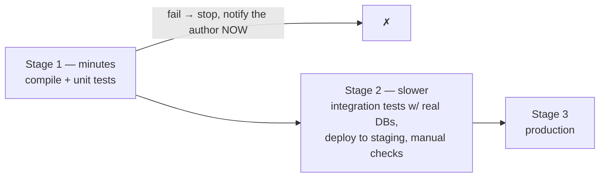
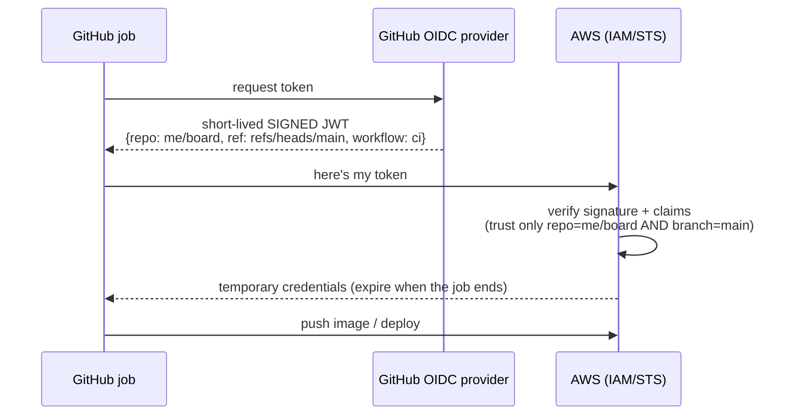
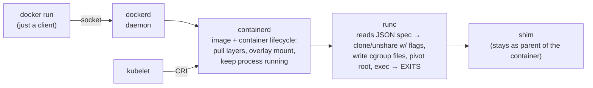
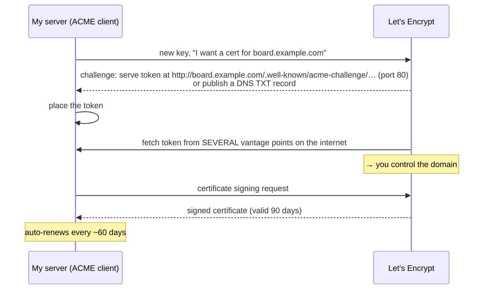
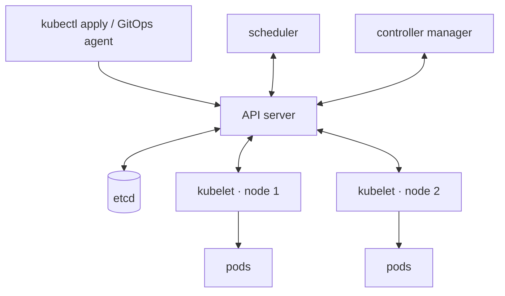
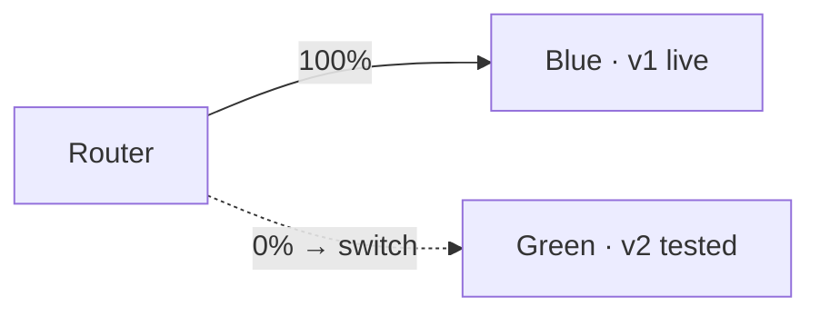
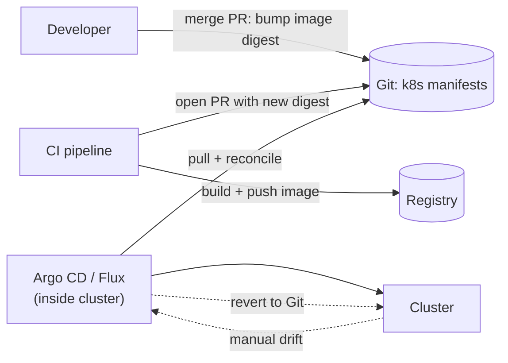

# My Notes: DevOps for Backend Engineers

> **Source:** "30. DevOps for backend engineers" by Sriniously, *Backend from first principles* playlist (YouTube, 1:48:26)
> **Link:** https://www.youtube.com/watch?v=_E8X5RIJfQ4
>
> I wrote these from the video's full caption track, summarised in my own words. The diagrams, YAML, Dockerfiles and code are my own illustrations of what he describes. Anything marked *(my note)* is my addition, not from the video.

---

## 1. The goal: from localhost to the internet

- Everything in the playlist so far ran on **one machine, on localhost**, unreachable by users.
- This video: how my backend becomes **reachable over the internet**, and **stays alive while I push changes every day**.
- **The whole journey from commit to running service is what people call DevOps.** Literally **Dev**elopment + **Op**erations merged.
- **Covered:** what a build is, how containers work at the **system-call** level, running **fleets of machines**, every change reaching production **with no human involved and no downtime**, and **infrastructure defined as code**.

---

## 2. Why DevOps exists: dev vs ops

In mid-size and big companies (not 2–3-person startups) there were traditionally **two teams**:

| Team | Does | Measured by |
|---|---|---|
| **Development** (backend, frontend, testing…) | Writes the code | **How fast features ship** |
| **Infrastructure / operations** | Sets up servers, monitors downtime and alerts | **How rarely production goes down** |

- **Conflict of interest:** ops wants **as few deploys as possible** (every deploy adds **entropy**), dev wants **as many as possible**.
- When prod breaks: dev says "**it's the infrastructure**", ops says "**it's your code**."
- Result: releases slow to **once a week or every two weeks**, because everyone has to be on the same page.
- People kept finding and documenting fixes at scale, and that became the **DevOps movement**: **a collection of ideas to streamline development and deployment.**

---

## 3. What the movement changed

- **Infrastructure automated as code** instead of hand-built servers.
- **All code in shared version control** (Git/GitHub), **with infrastructure config alongside it**.
- **One command to build, one command to deploy**, not a multi-step procedure.
- **Feature flags:** enable/disable features from a central place (DB, edge cache) **without deploying**.
- **Shared observability:** logs, alerts, CPU/memory metrics visible to **developers too**, so they see how their code behaves in production.

> **The common thread: make deployment small, cheap and boring.** One button, one merge, seconds to start. Then nobody hesitates to deploy **many times a day**.

---

## 4. DORA metrics: speed and stability aren't a trade-off

**DORA** surveyed **tens of thousands of teams over many years** and publishes **four metrics**:

| Kind | Metric | Meaning | Example |
|---|---|---|---|
| Speed | **Change lead time** | Commit → live in production | Merged 9:00, users see it 11:00 → **2 h** |
| Speed | **Deployment frequency** | How often I deploy to prod | — |
| Stability | **Change failure rate** | % of deploys causing a production failure | 4 bad out of 100 → **4%** |
| Stability | **Failed deployment recovery time** | How long to recover when one fails | — |

**DORA 2024:**
| Group | Deploys | Lead time | Failure rate | Recovery | Share |
|---|---|---|---|---|---|
| **Top** | **On demand** | **< 1 day** | **~5%** | **< 1 hour** | ~**20%** of teams |
| **Bottom** | **Every 1–6 months** | — | **~40%** | **~1 week** | — |

> **The teams that deploy the most are also the most stable. Speed and stability are not a trade-off.**

### Why it's not counterintuitive
| Monthly deploy | Per-commit deploy |
|---|---|
| A month of changes from **10–20 people**, ~**200 commits** | **One change, one person**, written an hour or a day ago |
| Prod breaks → which commit? **Could take a day** to pinpoint | Easy to pinpoint |
| The fix is another **big deploy** | Small fix |
| Authors have **forgotten** what they did | **Fresh in the author's mind** → faster fix |

> **Rule: deploy as frequently as possible, in changes as small as possible.**

---

## 5. Continuous integration

> **CI = every developer merges into one shared branch at least once a day, and every merge is verified by an automated build that runs all the tests.**

- People say "CI" for **the server that runs tests on push**, but **CI is a practice.** The server only **enforces** it: it can check merges pass tests, but **can't make people merge**.
- **Why daily?**
  - Two engineers on feature branches for **3 weeks** → branches drift so far that merging takes **hours** of conflict resolution.
  - Merge daily → you only reconcile with **one day** of others' changes, everyone remembers their work, and conflicts take **minutes**.

---

## 6. Branching: Git Flow vs trunk-based

### Git Flow (still dominant)
```
main/master   ← finished releases only
develop
release/*
hotfix/*
feature/*
```
- **Its own author**, ~10 years after publishing it, wrote that **for web apps that ship continuously, use something simpler.**
- It was built for **versioned software installed by customers** (desktop, mobile) where you **support v2 while building v3**.
- A **backend has one version in production: the latest.** *(My note: the author is Vincent Driessen.)*

### Trunk-based development ⭐
```
main ──●──●──●──●──●──●──●──▶  (every deploy comes from main)
        \_/   \_/     \__/
      short-lived feature branches (a day or two) → merged → deleted
```
- **Long features (2–3 weeks)?** Merge **within a day or two anyway**, deploy it **behind a feature flag** so users can't reach it yet, while it's already in production.

```go
if flags.Enabled(ctx, "new-billing", user.ID) {
    return newBilling(ctx, req)
}
return legacyBilling(ctx, req)
```

---

## 7. Builds

- **A build turns source code into something that can run:** compile, download dependencies, package into an **artifact** (binary / executable).
- **Key property (12-factor recap):** a build must **not depend on what happens to be installed** on the machine. Declare the **compiler version** and **exact dependency versions**.
- **Same source + same build config → byte-identical output, every time.** The **lock file** is the input list that makes this possible.

| Ecosystem | Reproducible build |
|---|---|
| **Go** | `go build` with a **pinned Go version** + **`go.sum` committed** (not gitignored) |
| **Node** | **`npm ci`** with the committed **`package-lock.json`** |

- **Stamp the commit hash** into the artifact, so a running process can tell me **which commit it is**.

```bash
go build -ldflags "-X main.commit=$(git rev-parse --short HEAD)" -o bin/server ./cmd/server
```

---

## 8. The deployment pipeline

**Build + tests = a deployment pipeline:** stages the code passes through, **ending live in production**. **Cheap and fast stages first, expensive and slow later.**



---

## 9. GitHub Actions

| Term | Meaning |
|---|---|
| **Workflow** | A **YAML file committed in the repo** under **`.github/workflows/`**: **when** to run and **what** to run |
| **Event** | The trigger: **push**, **pull request**, **schedule**, **manual click** |
| **Job** | **A set of steps on one machine.** Jobs can run **in parallel** or **wait for each other** |
| **Runner** | That machine: a **fresh VM from GitHub** per run, gone after. Can be **self-hosted** |
| **Step** | A command or action inside a job |

- **Assume the runner is fresh every time.** Everything is installed from scratch (or restored from cache). That's why **every workflow starts with checkout.**

**The demo workflow (3 jobs):**
```yaml
name: ci
on:
  push:
    branches: [main]
permissions:
  contents: read
  id-token: write          # for OIDC (section 10)
jobs:
  test:
    runs-on: ubuntu-latest
    steps:
      - uses: actions/checkout@v4
      - uses: actions/setup-go@v5
        with: { go-version-file: go.mod }
      - run: go test ./...
  build:
    needs: test                       # waits for test
    runs-on: ubuntu-latest
    steps:
      - uses: actions/checkout@v4
      - uses: actions/setup-go@v5
        with: { go-version-file: go.mod }
      - run: go build -ldflags "-X main.commit=${{ github.sha }}" -o server ./cmd/server
      - uses: actions/upload-artifact@v4
        with: { name: server, path: server }   # artifact shown at the bottom w/ size + digest
  image:
    needs: [test, build]              # waits for both
    runs-on: ubuntu-latest
    steps:
      - uses: actions/checkout@v4
      - run: docker build -t ghcr.io/me/board:${{ github.sha }} .
```

---

## 10. Pipeline → cloud credentials: OIDC

The pipeline runs on **GitHub's infrastructure**, but must **touch my cloud** (push the image, deploy). It needs **credentials**.

**Old way: repository secrets.**
- Stored per repo, referenced in workflows, **never printed**.
- **Problem:** **every job/action can read them**, and if leaked, **anyone can access my infra from anywhere until rotated.**

**Better: OIDC (OpenID Connect):**

- **No long-lived cloud secret stored anywhere.** Credentials are valid **only for that job**.

```yaml
- uses: aws-actions/configure-aws-credentials@v4
  with:
    role-to-assume: arn:aws:iam::123456789012:role/gha-deploy
    aws-region: ap-south-1
```

---

## 11. Versioning deployments

- **Libraries use semantic versioning (`MAJOR.MINOR.PATCH`)** because the version is **for users**:
  - **patch** = bug fix, no behaviour change
  - **minor** = new feature, nothing broken
  - **major** = breaking change
- **A deployed service's version is for us, not users.** HTTP clients don't care about the deploy version (that's separate from **route versioning**).
- **So: version deployments with the commit hash** (sometimes + build ID):
  - stamped in the **artifact**
  - used as the **container image tag**
  - **exposed by the running service** (info/health endpoint) so after a deploy I can **check prod runs the latest commit**

```go
var commit = "dev"   // set via -ldflags at build time
mux.HandleFunc("GET /version", func(w http.ResponseWriter, _ *http.Request) {
    json.NewEncoder(w).Encode(map[string]string{"commit": commit})
})
```

---

## 12. What to ship: the environment problem

- **Go binary** works on my laptop, **fails on the server**: older **system library**, different **certificate store**, **no time-zone database**.
- **Node service** written against **Node 22**, server has **Node 18**: a Node 22 feature breaks in prod.

> **Fix: ship the environment, not just the code.** Not the whole OS, but **everything the process needs**: runtime, libraries, files, exact versions, in **one unit that behaves the same** on my laptop, a data-centre server, or a rented VPS.
> **That unit is a container:** a process with **its own file system** that **sees only the small part of the machine it needs**.

---

## 13. Containers vs virtual machines

**Misconception: "a container is a small VM."** It isn't.

| | **Virtual machine** | **Container** |
|---|---|---|
| What | Software **partitions the hardware**: virtual disks, **its own OS kernel** | **An ordinary process** on the host, started by **the host's kernel** |
| Kernel | **Own kernel per VM** | **Shares the host kernel** |
| Isolation | **Very strong** (host + hypervisor keep VMs apart) | Kernel features give it an **isolated view** |
| Cost | **Heavy**: GBs of RAM, slow boot, own disk | **Light**: just a process |
| Visible on host `ps`? | No | **Yes**, it shows up in the host's process list |

**What makes a process a container?** **Special treatment from the host kernel**, an **illusion** of its own machine:
- its own **PIDs**
- its own **hostname**
- its own **file-system root**
- its own **network interfaces**
- **limits** on memory and CPU

Three Linux kernel features make this possible:

```
NAMESPACES   → what the process can SEE
CGROUPS      → how much it can USE
LAYERED FS   → what its FILE SYSTEM is (OverlayFS)
```

---

## 14. Namespaces

- A kernel feature that **wraps a global resource** so a **group of processes sees its own copy** of it.

| Namespace | Isolates |
|---|---|
| **PID** | Process IDs: inside, the first process is **PID 1**. Can't see processes outside |
| **Mount** | Its own **table of mount points** |
| **Network** | Its own **interfaces, ports, routing table** (two containers can both bind **:80**) |
| **UTS** | Its own **hostname** |
| **IPC** | Inter-process communication |
| **User** | User/group IDs |
| **Cgroup** | Its view of cgroups |
| **Time** | Clocks |

**~8 namespace types** in current Linux. Only the kernel creates them, so I **ask via system calls**:
| Syscall | Does |
|---|---|
| **`clone`** | Creates a **new process**, inside new namespaces if given the flags |
| **`unshare`** | Moves the **calling process** into new namespaces |
| **`setns`** | **Joins an existing** namespace |

**Docker, Kubernetes, every container tool** uses these three syscalls.

---

## 15. Containers from scratch (demo)

From **Liz Rice**'s famous talk **"Containers from Scratch"**: ~**76 lines of Go**.

```go
// the six lines that matter (reconstructed)
func run() {   // parent
    cmd := exec.Command("/proc/self/exe", append([]string{"child"}, os.Args[2:]...)...)
    cmd.SysProcAttr = &syscall.SysProcAttr{
        Cloneflags: syscall.CLONE_NEWUTS | syscall.CLONE_NEWPID | syscall.CLONE_NEWNS,
    }
    cmd.Stdin, cmd.Stdout, cmd.Stderr = os.Stdin, os.Stdout, os.Stderr
    must(cmd.Run())
}
func child() { // runs as PID 1 inside the new namespaces
    must(syscall.Sethostname([]byte("container")))   // only visible in the new UTS ns
    must(syscall.Chroot("/home/me/ubuntu-fs"))       // folder holding an Ubuntu file system
    must(os.Chdir("/"))
    must(syscall.Mount("proc", "proc", "proc", 0, "")) // fresh /proc → ps reads the new PID ns
    cmd := exec.Command(os.Args[2], os.Args[3:]...)    // e.g. /bin/bash
    cmd.Stdin, cmd.Stdout, cmd.Stderr = os.Stdin, os.Stdout, os.Stderr
    must(cmd.Run())
}
```
**What happens:**
1. The program **runs itself twice**. The **parent** calls `clone` with **NEWUTS + NEWPID + NEWNS** and asks the kernel to run the same binary as a **child** inside them.
2. The child is **PID 1**, sets hostname **`container`**, **chroots** into an **Ubuntu file system** folder, **mounts a fresh `/proc`**, and runs a **shell**.

**Inside:** `hostname` → **container**. `ps` → only a few processes, **PID 1 is the program itself**. Files are **Ubuntu's**.
**On the host:** the same shell is just **another process with an ordinary PID** under the program.

---

## 16. cgroups

- **Namespaces control what a process sees, not how much it uses.** A container that only sees its own processes can still **eat all host memory**.
- **Control groups (cgroups)** enforce limits. **A cgroup is a folder** in a file system the kernel exposes at **`/sys/fs/cgroup`**: **create a folder = create a group.**
- Inside are **plain files**:

| File | Effect |
|---|---|
| `memory.max` | Memory limit **shared by every process in the group** |
| `cpu.max` | CPU quota |
| `pids.max` | Max number of processes |
| `cgroup.procs` | **Write a PID here → that process joins the group** |

```bash
sudo mkdir /sys/fs/cgroup/demo
echo $((100*1024*1024)) | sudo tee /sys/fs/cgroup/demo/memory.max   # 100 MB
echo $$ | sudo tee /sys/fs/cgroup/demo/cgroup.procs                  # move this shell in
```

- **When Kubernetes says "memory limit 512 MB"**, the **kubelet writes that number into `memory.max`**. Exceed it → the kernel's **OOM killer** kills the process → the famous **`OOMKilled`** status.
- **Demo:** a program that keeps allocating. The memory column **climbs to the limit, then stops**: **the kernel killed it**, and the **kernel log says why**.

---

## 17. Layered file systems (OverlayFS)

- The demo chrooted into a folder with ~**100 MB** of Ubuntu files. **Copy 100 MB per container start? No.**
- **Container file systems are built from layers.** A **layer** is a **tarball of changes** (files added, modified, deleted).
- **An image is a stack of layers**, combined at runtime by the kernel with **OverlayFS** (on Linux):

```
          ┌───────────────────────────┐
 merged → │  single combined view     │   what the container sees
          └───────────────────────────┘
 upper  →   writable dir (per container)   ← writes land here (copy-up on first write)
 lower  →   layer 3 (my binary)       ┐
            layer 2 (certificates)    ├─ READ-ONLY, shared by all containers of this image
            layer 1 (base OS)         ┘
```
- **Read:** found in the **topmost layer that has the file**.
- **Write:** the file is **copied up** to the upper layer and modified there. **Lower layers never change.**
- **10 containers from one image share every layer** and each gets only a **thin writable layer**.
- **Write a file, stop the container → it's gone** (it lived in the upper dir). **Container file systems are disposable.** Persist data elsewhere (12-factor).

---

## 18. Container images: blobs, config, manifest

**Blob:** unstructured **binary** data (PDF, video…). Unlike a text file you can read and edit character by character, a blob only makes sense **as a whole**.

**A container image = a set of blobs + a few JSON documents:**

| Piece | What |
|---|---|
| **Layer blobs** | Each layer, **identified by the SHA-256 hash of its bytes** |
| **Config** (JSON) | **Layers in order** + start settings: **command, env, working dir, ports** (what I write in a Dockerfile) |
| **Manifest** (JSON) | Points to the **config and each layer**, with **size and hash** |
| **Image identity** | **The hash (digest) of the manifest** |

**Why hashes everywhere:**
- Two images **sharing a base layer** share it **by hash**. The registry **stores it once**, and pulls reuse it.
- **Change one Dockerfile line → only layers after it change.** Earlier layers keep the **same SHA-256**.
- **Tags** (`ubuntu:24.04`, `myapp:v2.3.1`) are **names pointing at a digest**.

> **A container image is like a Git commit for a file system.**

**Demo (layer explorer):** base layer → certificates layer → **binary layer (11 MB)**. Selecting a layer shows **exactly which files it changed**. *(My note: `dive` is a popular tool for this.)*

---

## 19. Dockerfiles, caching, multi-stage builds

- **A Dockerfile is the recipe for the layers.** Each file-system-changing instruction = **one layer**.
  - `FROM` picks the base image
  - `COPY` adds files
  - `RUN` executes commands
- **The builder caches each layer by its instruction + inputs.** The cache is used **top-down until the first instruction whose inputs changed**, and **everything below is rebuilt.** **Order matters.**

### Order for the cache
```dockerfile
# ❌ any code change invalidates COPY → dependencies reinstall on EVERY build
COPY . .
RUN npm ci

# ✅ deps change rarely, code changes 100×/day → only the last layers rebuild
COPY package.json package-lock.json ./
RUN npm ci
COPY . .
```

### Multi-stage builds (compiled languages: Go, Rust)
- **Stage 1** has the compiler and builds the binary.
- **Stage 2** starts from a **tiny base image** and **copies only the binary**. The compiler and build-only deps are left behind, so the **image shrinks dramatically**.

```dockerfile
# ---- build stage ----
FROM golang:1.23 AS build
WORKDIR /src
COPY go.mod go.sum ./
RUN go mod download
COPY . .
ARG COMMIT=dev
RUN CGO_ENABLED=0 go build -ldflags "-X main.commit=${COMMIT}" -o /out/server ./cmd/server

# ---- run stage ----
FROM gcr.io/distroless/static-debian12:nonroot     # tiny, pinned, non-root
COPY --from=build /out/server /server
USER nonroot:nonroot
EXPOSE 8080
ENTRYPOINT ["/server"]
```

---

## 20. Registries

- **Where images live.** I **push after build**, and **pull before run**.
- **Why needed:** **build and run can happen on different machines.** A locally built artifact isn't visible to the run machine.
- **A registry is an HTTP server with two kinds of objects:**
  - **blobs**, fetched **by digest**
  - **manifests**, fetched **by tag or digest**

```
PUSH: upload each layer blob the registry DOESN'T already have (checked by hash) → config → manifest
PULL: fetch manifest → read layer digests → download ONLY layers missing locally
      → after a small code change, pulling a new version takes SECONDS (just the last layer)
```
- Examples: **Docker Hub**, **GitHub's registry**, **AWS / GCP / Azure** registries, or **run your own registry in a container**.

---

## 21. What actually runs a container: docker → containerd → runc



- **`docker` is just the client.** It talks over a **socket** to **`dockerd`**, which hands work to **`containerd`**, which hands the actual start to **`runc`**.
- `runc` reads a **JSON description**, makes the **syscalls** (`clone`, `unshare`…), writes **cgroup files**, **changes root**, **execs** the process, then **exits**, leaving a tiny **shim** as the parent.

**Why so many pieces? The Open Container Initiative (OCI)** standardises three things:
1. **How an image is laid out**
2. **How a runtime is told to run it**
3. **How a registry serves it**

→ **An image built with Docker runs on a Kubernetes cluster with no Docker at all.** The **kubelet talks to containerd via the CRI**, and containerd uses runc.
- **runc's source:** a **C file creates the namespaces in three stages** (parent clones a child → child reads flags → **unshares** into new namespaces). **The same syscalls as the toy program.**

---

## 22. A good container image

| Property | Why |
|---|---|
| **Small** | Fewer files → **less to patch**, **less to download** per deploy |
| **One process** | Starts **only my service**. **No init system, no cron** inside |
| **Non-root** | Runs as an **unprivileged user**, so a code exploit **can't reach host root** |
| **Pinned** | Base image at a **specific version, never `latest`**, so builds stay **reproducible** |
| **Scanned** | Base images and packages have **known vulnerabilities published every week**. A **scanner** reads the image's **package list** and matches it against them. Especially important lately |

```bash
trivy image ghcr.io/me/board:3f9a1c2      # (my note: one popular scanner)
```

---

## 23. Buildpacks / Nixpacks

- PaaS platforms (**Render, Railway**…) take a **GitHub commit** and make it internet-reachable using **buildpacks** (modern variant: **Nixpacks**).
- They **detect the app type** from `package.json` / `go.mod` / `requirements.txt` / `Cargo.toml` and **build the image without a Dockerfile**, using **optimised per-language recipes**.
- I focus on code, and they handle the image.

---

## 24. Running on one machine

**Start simple: one machine.** The foundation matters. Running a service on Linux means **three things**:

```
1. a PROCESS the OS starts at boot and RESTARTS when it dies       → systemd
2. a REVERSE PROXY on :80/:443 terminating TLS → service's port   → Nginx / Caddy
3. LOGS going somewhere I can read them                            → journald (journalctl)
```

**systemd** is the **init system on every mainstream Linux**. A **unit file** says **what to run, as which user, restart on failure**:
```ini
# /etc/systemd/system/board.service
[Unit]
Description=Task board API
After=network-online.target docker.service

[Service]
User=board
ExecStart=/usr/bin/docker run --rm --name board -p 127.0.0.1:8080:8080 \
          --env-file /etc/board/env ghcr.io/me/board:3f9a1c2
Restart=on-failure
RestartSec=3

[Install]
WantedBy=multi-user.target
```
```bash
sudo systemctl enable --now board
journalctl -u board -f        # stdout lands in the journal
```
- The process exits → systemd **starts it again after a delay**.
- With containers, **the "process" is the `docker run` inside the unit file**.

**Request path:**
```
user → DNS (my domain → this machine's IP) → firewall (allow 80/443)
     → reverse proxy (Nginx/Caddy, TLS) → 127.0.0.1:8080 (my process)
```

---

## 25. HTTPS: ACME and Let's Encrypt

- Getting a TLS certificate used to be **a hectic, manual process**. Now it's a **protocol (ACME)** with **no human involved**.
- **Let's Encrypt** = the **free certificate authority** running ACME at scale.


- **Short validity (90 days) is deliberate:** the client renews automatically anyway, so a **stolen key is only useful for weeks**.
- **Caddy** has this **built in**: give it a domain, and it obtains and renews certificates itself.

```caddy
# Caddyfile
board.example.com {
    reverse_proxy 127.0.0.1:8080
}
```
**Demo:** a DNS record points at the machine's IP. Start Caddy → the logs show it **requesting a cert**, **answering the challenge on :80**, and the **cert issued**. External requests show the **issuer and expiry**.

---

## 26. A few machines: Kamal

- More users → **horizontal scaling** (more machines, per the scaling video).
- With ~3 machines, deploys get painful: **build, run on each, start new, stop old, zero downtime, no 500s.**
- **Kamal** does it over **SSH from my machine**:

```
for each host (SSH):
  install Docker if missing → log in to the registry
build + push the image
for each host:
  pull new image → START the new container ALONGSIDE the old one
  → wait until /health (unauthenticated) returns success
  → tell the reverse proxy to send traffic to the NEW container
  → STOP the old container
```

```yaml
# config/deploy.yml (illustrative)
service: board
image: me/board
servers:
  web: [10.0.0.11, 10.0.0.12, 10.0.0.13]
proxy:
  host: board.example.com
  healthcheck: { path: /health }
registry:
  server: ghcr.io
  username: me
  password: [KAMAL_REGISTRY_PASSWORD]
```

---

## 27. Immutable infrastructure

- Everything above assumed **the machine is precious**: maintained, updated, protected, owned by **one or two people**.
- That's a **snowflake** (12-factor video). It grows more unique, and **when those people leave, the knowledge leaves**.
- **Rules:**
  - **Never maintain machines by hand.** Code first, automated, minimal human involvement.
  - **Never SSH into one of 3–4 instances to change something.** Change the code and **redeploy everything**, or that server **drifts** from the others.
- **Immutable infrastructure: a server is never modified after it starts. It's only ever replaced.**
- **Containers made this cheap:** the replaceable unit is **an image**, not a physical server with an OS to babysit.
- **Everything from here on (clusters) assumes servers are cheap and replaced, never modified.**

---

## 28. Orchestration: Kubernetes

**40 containers on 10 machines** raises new questions:
- **Which container runs on which machine?**
- **A machine dies.** Who notices and **starts replacements elsewhere**?
- **Traffic doubles.** Who **starts more copies**?
- **New image.** Who **replaces 40 containers in the right order** with **no downtime**?

→ An **orchestrator**. The most famous is **Kubernetes**, the **open-source version of a system Google ran internally for years**, so its real-world problems were **found and fixed over many years**.

### Declarative, not imperative
- **I don't say what to do. I say what end state I want**, and it works out the steps.
- "**I want 3 copies of this image, on this port, with this much memory**" → send to the **API server** → stored.
- **Controllers** watch the store. **A controller compares what I asked for with what exists**: want 3, see 2 → start one. A machine dies → back to 2 → start one again.

### Control plane and nodes
```
CONTROL PLANE
  API server          ← the front door; the ONLY thing that talks to the store
  etcd                ← the store (distributed key-value)
  scheduler           ← controller that picks a machine for each new container
  controller manager  ← runs the built-in control loops
NODES (every machine)
  kubelet             ← asks the API server "what should run here?" and makes it so
  kube-proxy          ← service networking
```



---

## 29. Pods, ReplicaSets, Deployments, Services, Ingress

### Pod
- **Not another name for a container.** **One or more containers on one machine** that **share a network namespace and volumes**.
- Usually **one container (mine)**. The extra layer exists for **helpers**: a **log shipper** reading the same files, a **proxy** sharing localhost (sidecars).
- **The pod is the unit that gets scheduled, gets an IP, and gets killed.** Each pod has **its own IP**, so two pods can both listen on **:80**.
- **Never created by hand** (everything is declarative config). **Its machine dies → the pod is gone for good.**
- **Labels** (key-value, e.g. `app=api`, `version=v2`) group and select pods.

### ReplicaSet → Deployment → Service
| Object | Job |
|---|---|
| **ReplicaSet** | Controller keeping **N pods** of a template running |
| **Deployment** | **Owns ReplicaSets.** Change the template (new image) → creates a **new ReplicaSet** and **moves the count** from old to new. **I write Deployments, never ReplicaSets directly** |
| **Service** | A **fixed name + virtual IP + DNS name** for a **set of pods** matched by a **selector**. Pods are mortal and their IPs change; the Service doesn't. Other services in the cluster **call it by name** |

### Ingress / Gateway API
- Brings **internet traffic into the cluster**: maps **host + path → Service**. A **controller programs a real load balancer**.
- **Gateway API** is the **newer replacement** for Ingress.

```
domain → load balancer → Service → pods
         └─────── stable ───────┘   └ change every deploy
```

```yaml
apiVersion: apps/v1
kind: Deployment
metadata: { name: board }
spec:
  replicas: 3
  selector: { matchLabels: { app: board } }
  template:
    metadata: { labels: { app: board } }
    spec:
      containers:
        - name: board
          image: ghcr.io/me/board:3f9a1c2
          ports: [{ containerPort: 8080 }]
---
apiVersion: v1
kind: Service
metadata: { name: board }
spec:
  selector: { app: board }
  ports: [{ port: 80, targetPort: 8080 }]
---
apiVersion: networking.k8s.io/v1
kind: Ingress
metadata: { name: board }
spec:
  rules:
    - host: board.example.com
      http:
        paths:
          - path: /
            pathType: Prefix
            backend: { service: { name: board, port: { number: 80 } } }
```

---

## 30. ConfigMaps, Secrets, resources

| Object | Holds | Given to pods as |
|---|---|---|
| **ConfigMap** | **Non-sensitive** key-value config (fine if exposed) | Env vars or files |
| **Secret** | **Credentials, API keys** (same structure as ConfigMap) | **Only to pods that explicitly ask** |

### Resources (per container)
| | Meaning |
|---|---|
| **requests** | Amount **reserved for me on a machine** (the scheduler uses it) |
| **limits** | **Hard ceiling** |

- **This is cgroups:** a memory limit of **512 Mi** is written into **`memory.max`**, and a CPU limit becomes the **quota in `cpu.max`**.
- Exceed memory → the kernel **kills it** → pod shows **`OOMKilled`** → the **kubelet restarts it**.

```yaml
          envFrom:
            - configMapRef: { name: board-config }
            - secretRef:    { name: board-secrets }
          resources:
            requests: { cpu: "250m", memory: "256Mi" }
            limits:   { cpu: "1",    memory: "512Mi" }   # → cpu.max / memory.max
```

---

## 31. Rolling updates

New image → the **Deployment controller creates a new ReplicaSet** and shifts the count in steps, bounded by:
| Setting | Meaning | Default |
|---|---|---|
| **`maxSurge`** | Pods allowed **above** the desired count during the change | **25%** |
| **`maxUnavailable`** | Pods allowed **below** the desired count during the change | **25%** |

**3 replicas with defaults:**
```
new RS +1 → wait until READY → old RS −1 → wait … repeat
until new = 3, old = 0
```
**Two safety nets:**
1. **Readiness gating:** a new pod **gets no traffic until it reports ready**. A **broken image can only stall the rollout, not take the service down.**
2. **The old ReplicaSet is kept at 0 replicas, not deleted**, so **rollback is easy**.

```bash
kubectl set image deployment/board board=ghcr.io/me/board:9b7e4d1
kubectl rollout status deployment/board
kubectl rollout undo deployment/board
```
**Demo:** 3 old pods → set new image → one new pod created, waiting for ready → one old pod terminating → repeat. **No errors. Both versions served traffic for ~30 s.** That's the **zero-downtime** mechanism.

---

## 32. Probes: readiness, liveness, startup

- **"Ready" is something my own code exposes**, usually a **`/health` or `/status`** endpoint returning **200**.
- A **probe** is a check the **kubelet runs against my container on a schedule**: **run a command**, **GET a path**, or **open a TCP port**.

| Probe | Decides | On failure |
|---|---|---|
| **Readiness** | **Should this pod receive traffic?** | Removed from the **Service endpoints**. **Nothing restarts.** Added back when it passes |
| **Liveness** | **Is the container alive?** | After enough failures, the **kubelet kills and restarts** it |
| **Startup** | **Has the process finished starting?** | **Blocks the other two** until it passes (for **slow starters**) |

### ⚠️ The liveness trap
```
liveness probe checks the DATABASE
→ DB gets slow → probe times out → kubelet restarts a perfectly HEALTHY process
→ every pod restarts in a WAVE → reconnect load makes the DB EVEN SLOWER → spiral
```
> **Liveness: only "is the process stuck?" Readiness: only "can this pod serve right now?"**

```yaml
          startupProbe:   { httpGet: { path: /livez,  port: 8080 }, failureThreshold: 30, periodSeconds: 2 }
          livenessProbe:  { httpGet: { path: /livez,  port: 8080 }, periodSeconds: 10 }   # process only
          readinessProbe: { httpGet: { path: /readyz, port: 8080 }, periodSeconds: 5 }    # can I serve?
```

---

## 33. Scaling and autoscaling

- **Scaling out = change a number.** `replicas: 10` → the ReplicaSet controller **starts 7 more pods**. That's it.
- **Horizontal Pod Autoscaler (HPA):** watches **average CPU across pods**, **adds pods above a target, removes them below**, within **min/max** I set.

```bash
kubectl scale deployment/board --replicas=10
```
```yaml
apiVersion: autoscaling/v2
kind: HorizontalPodAutoscaler
metadata: { name: board }
spec:
  scaleTargetRef: { apiVersion: apps/v1, kind: Deployment, name: board }
  minReplicas: 3
  maxReplicas: 20
  metrics:
    - type: Resource
      resource: { name: cpu, target: { type: Utilization, averageUtilization: 70 } }
```

---

## 34. Do I need Kubernetes?

> **Start small, and add complexity like Kubernetes as you earn it**, when growth makes it the natural option. **Don't default to it.**

```
start      one machine: systemd / Docker Compose / a hosting platform (PaaS)
more load  several machines with Kamal
earned it  Kubernetes (+ GitOps)
```

---

## 35. Continuous delivery vs continuous deployment

| | **Continuous delivery** | **Continuous deployment** |
|---|---|---|
| Means | Software is **always deployable**. Every merge passes the full pipeline, and **anyone can press a button** to ship | **The button is pressed by the pipeline.** Every change that passes **goes to production automatically**, many times a day |
| Nature | **Technical property** | **Product / business decision** |

- A team can have **continuous delivery but release weekly**: customers want a **weekly changelog**, **compliance reviews**…
- **Not the other way round:** **continuous deployment requires continuous delivery.**

---

## 36. Deployment strategies

| Strategy | How | Downtime | Mixed versions? | Cost / note |
|---|---|---|---|---|
| **Recreate** | Stop all old, start all new | ❌ **Yes**: the gap means errors, blank pages | No | Simplest |
| **Rolling update** (k8s default) | Replace one at a time, gated by readiness | ✅ None | ⚠️ **Yes**: a request may hit **old or new** | Only if **running both versions at once is OK** |
| **Blue-green** | Two full prod environments. **Blue** = live, deploy to **green** (no traffic), test, **switch the router**. Problems → **switch back instantly** | ✅ None | ✅ **One version at a time** | 💰 **Double infrastructure** while both run |
| **Canary** | New version on **1 of 10 pods**, route **~10%** of traffic. Compare **error rate, latency** with the old. Widen **10 → 20 → 50 → 75 → 100%**. Worse → reroute back | ✅ None | Yes (controlled) | Needs good metrics |
| **Progressive delivery** | **Automated canary:** a controller widens on a schedule, **compares metrics at each step like a human would**, **rolls back** on failure | ✅ None | Yes | Most automated |



---

## 37. GitOps

**A practice defined by its properties:**
1. **Desired state of the whole system is written declaratively in files**: Deployments, Services, ConfigMaps. **End state only, no steps.**
2. **Those files live in Git**, so every change is **versioned, reviewable, reversible**.
3. **An agent inside the cluster pulls from Git** and keeps the cluster matching it.
4. **Change the cluster directly** (not via Git) → the agent **detects and reverts it**. **Git is the single source of truth.**


- **His view: the perfect middle ground** between simple setups (systemd, Kamal) and a **hand-managed Kubernetes cluster**.
- **Every deploy is a pull request** changing the **image digest**. **Merge = deploy.**
- **The pipeline never holds cluster credentials.** It only **pushes the image and opens the PR**; it never touches the cluster.
- Tools: **Argo CD**, **Flux**. They're the controllers here.

---

## 38. Environments: preview and promotion

- **Environments** (dev, staging, prod…) are where pipeline stages live. Per 12-factor: **same code, same image, different config.**
- **Preview environment:** a **temporary environment per pull request**, so reviewers can **try the change live** instead of just reading code. **Destroyed automatically** on merge or close.
- **Promotion:** moving **the same artifact** from one environment to the next, usually with a **human approval gate** (e.g. before production).

---

## 39. Infrastructure as code

**The test:**
> **Could I rebuild my whole infrastructure in a brand-new cloud account in one hour, identical to what exists?**
- With hand-built infra (console clicks, CLI commands): only maybe, if someone **documented every screen**, and even then **unlikely in an hour without mistakes**. No document, or **the person's gone** → **practically impossible** to get *exactly* the same configs and edge-case handling.

**Infrastructure as code:** machines, networks, permissions and configuration **written in files, version-controlled, stored securely**. Every change is **recorded in Git**, and a **tool applies the files to a cloud account**. Run it any number of times → **the same infrastructure**.

| Category | Does | Tool |
|---|---|---|
| **Provisioning** ⭐ | **Creates** machines, networks, cloud services | **Terraform** (open-source fork after licensing changes: **OpenTofu**) |
| **Configuration management** | Given a machine, **installs and configures** everything via a file/script | **Ansible** |
| **Image baking** | Builds a **machine image with everything pre-installed**, ready at boot | **Packer** (+ **cloud-init** for first-boot scripts) |

**Terraform workflow:** write resources in **blocks** → **`plan`** (review what it will do) → approve → **`apply`**. It calls the **AWS/GCP/Azure APIs** for me, so **I only need Terraform's syntax.**

```hcl
resource "aws_security_group" "web" {
  name = "board-web"
  ingress {
    from_port   = 443
    to_port     = 443
    protocol    = "tcp"
    cidr_blocks = ["0.0.0.0/0"]
  }
}

resource "aws_instance" "web" {
  count                  = 2
  ami                    = "ami-0abcdef1234567890"
  instance_type          = "t3.small"
  vpc_security_group_ids = [aws_security_group.web.id]
  tags                   = { Name = "board-web-${count.index}" }
}
```
```bash
terraform plan     # review
terraform apply    # make it so
```

---

## 40. Terraform state and drift

### State
- When Terraform creates a resource from a block, it must **remember "this block = that cloud resource"** via the **provider's resource ID**, saved in a **state file**.
- Next run: read state → **ask the cloud for current reality** → compare → the **difference becomes the plan**.

**Three warnings:**
| ⚠️ | Consequence | Fix |
|---|---|---|
| **State lost** | Terraform forgets everything → **thinks nothing exists** → **plans to create it all again** | **Remote state** |
| **Two people, two copies of state** | **Overwrite each other** | **Remote state with locking** |
| **State contains every attribute, including secrets** | Leak risk | **Never commit it to Git**. Store it **protected and encrypted** |

```hcl
terraform {
  backend "s3" {
    bucket       = "board-tf-state"
    key          = "prod/terraform.tfstate"
    region       = "ap-south-1"
    encrypt      = true
    use_lockfile = true      # (my note: S3-native locking; older setups used a DynamoDB table)
  }
}
```

### Drift
- An urgent fix gets made **directly in the AWS console or CLI** (e.g. a security-group change) instead of in Terraform.
- Terraform's files still describe the old state. **To Terraform, code + state is the truth, so anything not in code should be removed.**
- Next `plan` → it **proposes undoing the manual change**. `apply` → **reverted.**

**Demo:**
```
terraform plan          → 2 instances + 1 security group: "No changes" (files ≡ AWS, no drift)
(CLI) open port 22 to 0.0.0.0/0 directly — Terraform doesn't know
terraform plan          → 1 change: Terraform wants to CLOSE port 22
terraform apply         → port 22 closed again
```

---

## 41. SLI, SLO, SLA and error budgets

**Everything so far is internal practice.** Users don't care if servers were hand-built or automated. **They care about results.**

| Term | Is | Example |
|---|---|---|
| **SLI**: service level **indicator** | A **measurement of something users care about** | % of requests **succeeding**. % answered **within 300 ms** |
| **SLO**: service level **objective** | **A target for an SLI over a window** (always has a window) | **99% of requests succeed over the last 30 days** |
| **SLA**: service level **agreement** | **A contract with customers** betting on the SLO, with **penalties** | Below 99.9% over 30 days → **refund / plan extension / credits** |

### What the nines mean
| Availability | Allowed downtime |
|---|---|
| **99.9%** (30 days) | ~**43 min / month** |
| **99.99%** | ~**52 min / year** (~**4.3 min / month**) |
- **Each extra nine promises 10× more.**

```python
for slo in (0.999, 0.9999):
    print(slo, round((1 - slo) * 30 * 24 * 60, 1), "min/month",
               round((1 - slo) * 365 * 24 * 60, 1), "min/year")
# 0.999  → 43.2 min/month · 525.6 min/year
# 0.9999 →  4.3 min/month ·  52.6 min/year
```

### Error budget
- SLO **99.9%** → **0.1% failure allowed** = the **error budget**. A number, so it can be **tracked**.
- **Spend it deliberately**, like any budget: **deployments, maintenance windows, experiments, risky migrations.**
- **It's not permission to be careless.** It's a few short windows where **genuine failures are tolerable**.
- **Budget left → ship as fast as you like**, many times a day.
- **Budget gone** (say it's the **23rd** and yesterday's incident ate all **43 minutes**) → **freeze deploys until the window resets** (end of month), and **all effort goes to reliability**.

---

## 42. On-call and paging

- SLIs are numbers, so when one drops, **someone must respond**: the **on-call** engineer.
- **On-call rotation:** e.g. 3 engineers, **one on call each week**, plus a **second engineer as backup** (personal emergency, no network).
- **Paging:** from old **pagers** (pre-smartphone emergency devices). Today it's **paid incident-management/paging services** with apps on phone or laptop that send **urgent notifications**.
- Pages come from **observability alerts** (observability video): e.g. **CPU > 90% → Slack**, and likewise **paging alerts** for real user impact.

---

## 43. Incident response and postmortems

**Outage:** too many errors, users can't reach the service, **blank pages**.

### Roles
| Role | Does |
|---|---|
| **Incident commander** | Holds the **big picture**: effects, symptoms, likely causes. **Does not fix it** |
| **Responder(s)** | **Actually fix it** |
| **Communicator** | Updates the **public status page** and **internal managers** |
- So the people fixing **spend zero time on communication.**
- An **incident document** records the **timeline**: what happened when, symptoms, what was tried, results.

### First goal: stop the damage, not find the root cause
- **Mitigate first:** **roll back** the last deploy, **turn off a feature flag**, **disable a feature**, back to how things were an hour ago.
- **Then** find the root cause, fix it, ship a proper deploy.

### Postmortem (after stability is restored and the root cause found)
- **Minute-by-minute timeline** of symptoms, attempts and their effects
- **User impact** (% affected or not)
- **Root cause**
- **Next steps** so it **never happens again**

**Example: Cloudflare's outage postmortem (November, the year before recording):**
```
a database PERMISSION CHANGE
→ a query started returning DUPLICATE ROWS
→ a generated configuration file DOUBLED in size
→ the software reading it had a SIZE LIMIT → it failed
```
It includes the **timeline**, an **impact table**, causes and actions.

### Blameless culture
- **No person is named or blamed.** That's **not because they're nice.** It's **so more failures get prevented.**
- Blame the person ("they typed the wrong command") and **you never learn why they thought it was right.**
- **Every software failure is a human failure.** If you don't understand it **from that human's perspective**, you can't prevent it.
> **Blame systems, never humans.**

---

## 44. Operating principles and chaos engineering

**Principles that recur in postmortems:**
1. **Design for failure.** Assume **every machine and every dependency will fail at some point**, and make the service survive it.
2. **Keep deployment simple.** Files and config, not manual setup.
3. **One change at a time.** When something breaks, you know what changed, and the fix is near-instant.

### Chaos engineering: cause failure on purpose
| Experiment | Checks that… |
|---|---|
| **Kill a pod in production during business hours** | The **ReplicaSet replaces it** |
| **Take a machine out** | **Pods reschedule** elsewhere |
| **Add latency to a dependency** | **Timeouts fire** |
- **Why:** to verify the safety mechanisms **actually work**, before a real outage reveals that one doesn't.

**Demo:** 3 pods → delete one → **Terminating** → a replacement is already **Pending** → **ContainerCreating** → **Running**.
```bash
kubectl delete pod board-7c9f8d6b5-x2kqp
kubectl get pods -w
```

---

## 45. Software supply chain

- An image contains **my code**, but also the **base image, the language runtime, and hundreds of packages** from `npm install` / `go mod download`. **Other people's mistakes can hurt my service.** That's the **software supply chain**.

**Two common failure types:**
| Type | Example |
|---|---|
| **A dependency disappears or changes** | A package pulled from the registry **breaks thousands of builds** |
| **A dependency is poisoned** | **2024:** a **compression library most Linux systems depend on shipped a backdoor**. It was inserted into the **release tarball**, **not the source repo**, so **code reviewers never saw it**. Builds from the tarball got the backdoor. *(My note: the xz-utils incident.)* |

**Defences:**
- **Pin every dependency and every base image**: Dockerfile, `package.json`, `go.mod`, `requirements.txt`… **Never `latest`.**
- **Run a vulnerability scanner** against public databases (section 22).

```dockerfile
FROM golang:1.23.4@sha256:<digest>      # (my note: pin by digest, not just tag)
```

---

## 46. Why this video exists

- **Not** to teach DevOps, AWS, or how to configure CI/CD pipelines. That's **impossible in one video, or even 50–60**, given the ecosystem's size.
- **The goal: a mental model** of everything I should know **before** learning these things, so when an article, doc or colleague mentions one, **I'm not clueless** and can go deeper myself.
- As a backend engineer, my understanding now extends **past the backend, into infrastructure.**

---

## 47. My cheat sheet

```
DEVOPS       dev (ship fast) vs ops (never break) → friction, slow releases
             → automate infra as code, all in Git, 1-cmd build + deploy, feature flags, shared observability
             → make deploys SMALL, CHEAP, BORING
DORA         lead time · deploy frequency · change failure rate · recovery time
             2024 top ~20%: on demand, <1 day, ~5%, <1 h · bottom: every 1–6 mo, ~40%, ~1 week
             speed and stability are NOT a trade-off (small deploys → easy to pinpoint, fresh minds)
CI           merge to the shared branch ≥ daily + automated tests (CI = practice; the server enforces it)
BRANCHING    Git Flow = for installed, multi-version software (its author says: simpler for web)
             → trunk-based: short-lived branches (1–2 days) + feature flags for long work
BUILD        source → artifact; pinned compiler + lock file (go.sum / npm ci) → byte-identical
             stamp the commit hash
PIPELINE     fast cheap stages first (compile + unit) → integration/staging → prod
GH ACTIONS   workflow (.github/workflows/*.yml) · event · job (parallel / needs) · runner (fresh VM)
             · step · checkout first
OIDC         short-lived signed GitHub JWT (repo, branch, workflow) → cloud trusts the claims
             → temp creds for that job only (vs leakable repo secrets)
VERSION      libs: semver · deployments: commit hash (artifact, image tag, /version endpoint)

CONTAINER    ship the ENVIRONMENT · a PROCESS on the host kernel with an isolated view (not a VM)
             VM = own kernel, strong isolation, heavy · container = shared kernel, light, visible in host ps
NAMESPACES   what it SEES: PID · mount · network · UTS · IPC · user · cgroup · time
             syscalls: clone · unshare · setns
             Liz Rice "Containers from Scratch" (~76 lines Go): CLONE_NEWUTS|NEWPID|NEWNS
             → PID 1, hostname, chroot, mount /proc, exec shell
CGROUPS      how much it USES: /sys/fs/cgroup/<group>/{memory.max, cpu.max, pids.max, cgroup.procs}
             k8s 512Mi limit → memory.max → OOM killer → OOMKilled
OVERLAYFS    read-only lower layers + writable upper → merged · copy-up on write
             containers share layers · writes vanish on stop
IMAGE        layer blobs (sha256) + config JSON + manifest JSON · identity = manifest digest
             tags → digests · "Git commit for a file system"
DOCKERFILE   1 FS instruction = 1 layer · cache top-down until the first changed input
             → copy manifests, install deps, THEN copy code · multi-stage: compiler stage → tiny runtime
REGISTRY     HTTP server: blobs by digest, manifests by tag/digest · push/pull only missing layers
             (Docker Hub, GHCR, ECR/GAR/ACR, self-hosted)
RUNTIME      docker CLI → dockerd → containerd → runc (syscalls, cgroups, pivot root, exec, exit) + shim
             OCI = image format + runtime spec + distribution → kubelet → CRI → containerd (no Docker)
GOOD IMAGE   small · one process · non-root · pinned (never latest) · scanned
BUILDPACKS   Render/Railway detect the language → build an image with no Dockerfile (Nixpacks)

ONE BOX      systemd unit (Restart=on-failure, journalctl) + reverse proxy (Nginx/Caddy) + logs
             DNS → firewall 80/443 → proxy (TLS) → 127.0.0.1:8080
ACME         Let's Encrypt: challenge (HTTP-01 on :80 or DNS TXT) → verified from many vantage points
             → 90-day cert, auto-renew ~60 days · Caddy does it automatically
KAMAL        SSH to hosts → install Docker → push image → start new beside old → /health OK
             → switch proxy → stop old
IMMUTABLE    never modify servers, only replace them (no SSH fixes → drift) · containers made it cheap

K8S          declarative desired state · controllers reconcile want vs have
             control plane: API server · etcd · scheduler · controller manager · nodes: kubelet · kube-proxy
OBJECTS      Pod (1+ containers, shared net ns + volumes, own IP, mortal) · labels
             ReplicaSet (keep N) ← Deployment (new RS per template change; what I write)
             Service (stable VIP + DNS → selector) · Ingress / Gateway API (host + path → Service)
             ConfigMap (non-secret) · Secret (only to pods that ask)
             requests (reserved) / limits (cgroup ceiling)
ROLLING      maxSurge 25% / maxUnavailable 25% · +1 new → ready → −1 old · readiness-gated
             old RS kept at 0 → rollback · both versions live briefly (~30 s in the demo)
PROBES       readiness → traffic on/off (no restart) · liveness → restart if stuck · startup → gates both
             ⚠ never check the DB in liveness (restart waves make a slow DB slower)
SCALE        replicas: N · HPA on average CPU with min/max
START SMALL  1 box (systemd/Compose/PaaS) → Kamal → Kubernetes when earned

CD vs CD     delivery = always deployable, a button (technical) · deployment = auto to prod (business)
STRATEGIES   recreate (downtime) · rolling (mixed versions) · blue-green (instant switch/rollback, 2× cost)
             · canary (10% → 20 → 50 → 75 → 100, compare errors + latency)
             · progressive delivery (automated canary + auto rollback)
GITOPS       declarative files in Git → in-cluster agent (Argo CD / Flux) pulls + reconciles
             + reverts drift · deploy = PR bumping the image digest · pipeline holds NO cluster creds
ENVS         same image, different config · preview env per PR (auto-destroyed)
             · promotion with an approval gate
IaC          test: rebuild everything in a new account in 1 hour?
             provisioning Terraform/OpenTofu (plan → apply) · config mgmt Ansible · image baking Packer + cloud-init
TF STATE     block ↔ resource ID · lost state → recreate everything · concurrent runs clobber
             → remote + locked · contains secrets → never in Git, encrypted
DRIFT        console change not in code → plan reverts it (demo: port 22 opened via CLI → TF closes it)

SLI/SLO/SLA  indicator (what users feel) · objective (target over a window) · agreement (contract + penalties)
NINES        99.9% ≈ 43 min/month · 99.99% ≈ 52 min/year (~4.3 min/month) · each 9 = 10× promise
ERROR BUDGET 0.1% to spend on deploys/migrations/experiments · exhausted → freeze deploys, fix reliability
ON-CALL      weekly rotation + backup · paging apps · alerts from observability
INCIDENT     commander (big picture, doesn't fix) · responders (fix) · communicator (status page, mgmt)
             → MITIGATE FIRST (rollback, flag off) → then root cause
POSTMORTEM   timeline · impact · root cause · next steps · BLAMELESS (blame systems, not humans)
             Cloudflare: permission change → duplicate rows → config doubled → size limit hit
PRINCIPLES   design for failure · simple deploys · one change at a time
CHAOS        kill pods in business hours, drop machines, inject latency → prove the safety nets work
SUPPLY CHAIN deps vanish/change or get POISONED (2024 compression-lib backdoor in the release tarball)
             → pin everything (no latest) + scan for known vulnerabilities
```
