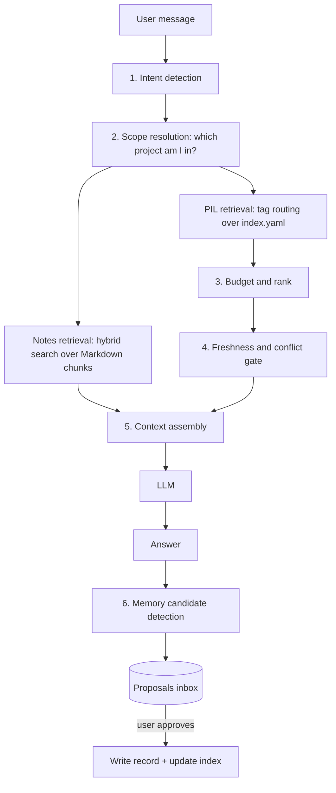
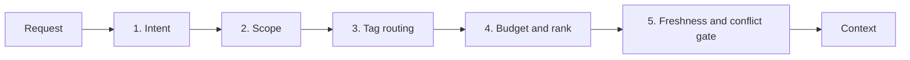
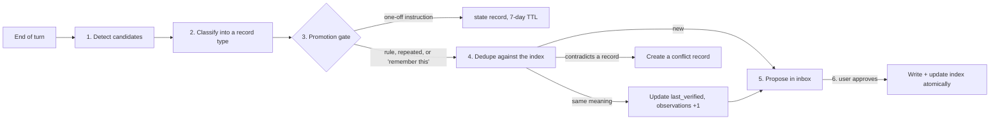
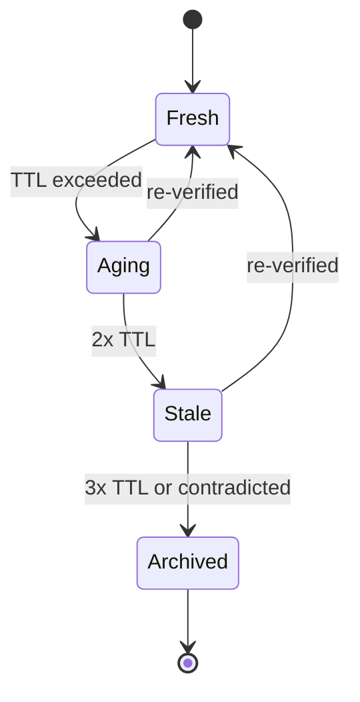

# Chat Bot Architecture: A Notes Assistant with a Personal Information Layer

This notebook is a technical note keeper: everything lives in Markdown files so I can come back to it later without difficulty. The chatbot sits on top of it. It lets me **talk to my notes**, and it **remembers how I work** across conversations without turning into an unreliable pile of guesses.

This note covers that architecture. Most of it is the **Personal Information Layer (PIL)**: the bot's long-term memory about its user. It decides what to remember, how to find the right memories for a request, when a memory is out of date, and what must never be stored.

> **Design status:** designed, not yet implemented. The examples below use made-up projects and preferences. A real memory store holds personal data and stays local (see section 9).

---

## 1. The big picture

Two sources of context feed every answer:

- **Knowledge:** the Markdown notes themselves (chunked, embedded, searched).
- **Memory (the PIL):** small records about the user: preferences, decisions, projects, goals and current state.



**Two rules shape everything:**
1. **Load little.** A good answer needs 3–6 relevant memories, not 40. Everything is designed so the bot can skip most of the store.
2. **Write nothing without approval.** The bot proposes memories, and the user decides.

---

## 2. Why not one big `memory.md`?

The obvious design is one memory file that gets loaded into every prompt. It breaks down quickly:

| Problem with one file | What the PIL does instead |
|---|---|
| Cost grows with file size, and everything is loaded every time | Many small files plus an index; load 3 of 40 |
| A rule from project A leaks into project B | Every record has a **scope**: `global` or `project:<slug>` |
| Old facts look as confident as new ones | Every record has **confidence**, **last verified** and a **TTL** |
| Two contradicting notes, and the bot silently picks one | Contradictions become explicit **conflict** records |
| A one-off instruction becomes a permanent rule | A **promotion gate** separates temporary state from durable preferences |
| Memory stored inside a repo forks when the folder is copied | The store lives in one global place outside any repo |

---

## 3. Information model

### 3.1 Eight record types

The type decides a record's **lifecycle**, not just its folder.

| Type | Holds | Changes | Default TTL |
|---|---|---|---|
| `identity` | Durable facts about the person and their accounts | Rarely | none (yearly review) |
| `preference` | How work should be done: style, code, architecture | Slowly, by correction | 180 days |
| `skill` | Demonstrated capability, with evidence | Accumulates | 180 days |
| `project` | A codebase, its shape, its live constraints | Often | 30 days |
| `decision` | A choice + its reason + what it replaced | Never edited, only superseded | none |
| `goal` | Near- or long-term intent | Medium | 90 days |
| `state` | Temporary: current branch, in-flight work, blockers | Constantly | 7 days, auto-expires |
| `conflict` | Two sources disagree and nobody has decided | Until a human decides | none |

### 3.2 Two axes on every record

- **Scope:** `global`, or `project:<slug>`. A rule written for one project can never fire in another.
- **Confidence:**

| Level | Requires |
|---|---|
| `high` | Stated explicitly by the user, or directly observable in a file |
| `medium` | Consistent across 2+ sources, but never stated as a rule |
| `low` | A single observation that may be situational |

A record can only be `high` if one of its sources **quotes the user or names a file**.

### 3.3 Provenance

Every record lists where it came from: a user statement in a session, a repo file, git history, the environment. "Why do you think that?" always has an answer with a quote and a date.

---

## 4. Directory layout

The store lives **globally, outside any repository**, so copying a project folder doesn't silently fork its memory.

```text
~/.assistant/pil/
├── index.yaml              # manifest: id, type, scope, tags, ttl, confidence, path, tier
├── POLICY.md               # the harness's own rules, human-editable
├── identity/               # accounts, environment, org and ownership boundaries
├── preferences/            # communication, code-style, testing, architecture, permissions
├── skills/                 # one file per area, each with evidence
├── projects/
│   ├── active/<project>/   # profile.md, constraints.md, glossary.md
│   └── archived/<project>/
├── decisions/
│   ├── global/
│   └── <project>/          # mirrors (never duplicates) the repo's own decision log
├── goals/                  # near-term.md, long-term.md
├── temporal/<project>.yaml # branch, in-flight work, blockers; 7-day TTL
├── conflicts/<id>.md       # open and resolved disagreements
└── proposals/inbox/        # pending memory writes awaiting approval
```

**`index.yaml` is the only file that's always read.** Everything else is loaded on demand, which keeps the per-request cost small and predictable.

---

## 5. Schemas

### 5.1 A record: Markdown with YAML frontmatter

```yaml
---
id: pref-answer-first
type: preference
scope: global
title: Answer first, then the reason
tags: [communication, style]
confidence: high
status: active
sensitivity: normal
created: 2026-09-01
last_verified: 2026-10-15
ttl_days: 180
observations: 2
sources:
  - kind: user-statement
    ref: "session 1a2b @2026-09-01"
    quote: "give me the answer first, keep it short"
  - kind: user-statement
    ref: "session 7c8d @2026-10-15"
    quote: "skip the long intro"
supersedes: []
conflicts_with: []
links: [pref-tables-over-prose]
---

**Rule.** Lead with the answer, then a short reason. No restating the question.
**Why.** Long replies bury the useful part.
**How to apply.** Every reply; use tables when comparing options.
```

The body always has three parts: **Rule**, **Why** and **How to apply**. The *why* is what lets the bot handle edge cases instead of applying the rule blindly.

### 5.2 The index

```yaml
version: 1
records:
  - id: pref-answer-first
    type: preference
    scope: global
    tags: [communication, style]
    confidence: high
    status: active
    last_verified: 2026-10-15
    ttl_days: 180
    path: preferences/communication.md
    tier: core
```

`tier: core` marks the small always-loaded set, with a hard budget of about **1,200 tokens**.

### 5.3 Temporary state and conflicts

```yaml
# temporal/notes-app.yaml: expires on its own
project: notes-app
updated: 2026-11-01
ttl_days: 7
branch: feature/search
in_flight: ["search index rebuild", "mobile layout pass"]
blockers: ["waiting on API key approval"]
```

```yaml
# conflicts/X-02-commit-trailer-scope.md
id: X-02-commit-trailer-scope
type: conflict
status: disputed
side_a: "Project A's rule: never add an AI co-author line to commits"
side_b: "Default behaviour: add a co-author line"
question: "Is side A a project-only rule or a global preference?"
while_disputed: "Ask before the first commit in any repo. Never assume."
```

---

## 6. Retrieval: the five stages

The goal of retrieval is to inject **3 to 6 records, not 40**.



### 6.1 Stage 1: intent detection

Each request is classified into one or more fixed intents:

| Intent | Trigger signals |
|---|---|
| `code-write` | "add", "implement", "build", file paths, diffs |
| `code-explain` | "why", "how does", "what is" |
| `design` | "plan", "approach", "should we", "architecture" |
| `debug` | stack traces, "error", "failing" |
| `test` | "test", "coverage" |
| `schema` | "migration", "column", "table" |
| `docs` | "readme", "document", "notes" |
| `ops` | "deploy", "pipeline", "docker" |
| `comms` | "write a message to", "email" |
| `meta` | questions about the assistant or its memory |

### 6.2 Stage 2: scope resolution

Work out the active project from the working directory and git remote, then make **only `global` + `project:<that project>`** records eligible. A rule scoped to another project is never loaded. This one step removes a whole class of "the bot applied the wrong project's rule" bugs.

### 6.3 Stage 3: tag routing

Each intent maps to a set of tags, which are matched against `index.yaml`:

```text
code-write -> [code-style, architecture, testing, permission]
schema     -> [schema-ownership, database, permission, decisions:database]
design     -> [architecture, decisions, goals, communication]
ops        -> [ownership-boundary, cloud, deployment]
comms      -> [communication, org]
```

`ops` deliberately pulls the **ownership boundary**: if pipelines or infrastructure belong to someone else, the bot should check rather than assume the user wrote them.

### 6.4 Stage 4: budget and rank

Rank by `confidence desc`, then `last_verified desc`, then tier:

| Tier | Token cap |
|---|---|
| core (always loaded) | 1,200 |
| routed (from tags) | 2,500 |
| on-demand (explicit lookup) | 4,000 |

Over the cap, drop `low` confidence first, then the oldest `last_verified`.

### 6.5 Stage 5: freshness and conflict gate

Nothing stale or disputed is injected **silently**. Stale records come with a caveat, and disputed records are injected **as a labelled conflict**, never as fact.

### 6.6 The always-core set

A handful of rules where a past violation caused real problems are loaded on every request. For example: "answer first", "ask before acting beyond the request", "plan before executing", "never change the database schema without sign-off". Keep this set tiny: if everything is core, nothing is.

---

## 7. Updating memory: propose, never assume



**1. Candidate detection.** At the end of a turn, look for:

| Signal | Example |
|---|---|
| Imperative about future behaviour | "always X", "never Y", "from now on" |
| Correction of the assistant | "no, do it this way" |
| Decision with a reason | "we'll use Postgres because…" |
| Stable fact | tool versions, paths, account names |
| Explicit request | "remember this" |

**2. Classify** into one of the eight types.

**3. Promotion gate (the anti-assumption rule).** A candidate becomes durable only if it's:
- stated as a rule ("always", "never", "from now on"), **or**
- observed **twice** in separate sessions, **or**
- explicitly marked to remember.

Anything else, like "use the local model for now", becomes a `state` record that expires in 7 days. It never becomes a permanent preference.

**4. Dedupe** against the index by tag overlap and title similarity:

| Outcome | Action |
|---|---|
| Same meaning, same scope | Bump `observations`, update `last_verified`, add the source. No new file |
| Same topic, different scope | Widen or split the scope, and ask which |
| Contradicts an existing record | Don't write. Create a `conflict` and surface it |

**5. Propose** into `proposals/inbox/` as a compact diff:

```text
+ NEW  preference / global / "Write tests through the public API"
       confidence: high (stated 2026-11-01)
~ UPD  preference / global / "Answer first"   observations 1 -> 2
! CONF decision / "latency checks in tests"   user asked for it, a recorded decision rejects it
        [a]pply  [e]dit  [s]kip
```

**6. Apply on approval only.** Every write updates `index.yaml` in the same step.

**Never inferred, ever:** personality, mood, skill level, seniority, time zone, working hours. If the evidence is a pattern and not a statement, store it at `low` confidence with the pattern named, or don't store it.

---

## 8. Conflicts and staleness

### 8.1 Conflict resolution: classify, don't pick a side

| Class | Example | Resolution |
|---|---|---|
| **Temporal** | Same scope, newer statement | Auto-supersede. The old record becomes `superseded`; both are kept |
| **Scope** | Project A's rule vs project B's rule | Not a conflict: tag each with its scope. Ask only if one was written as `global` |
| **Authority** | Memory record vs repo rule vs actual code | Follow the repo's precedence: accepted decisions → code → feature docs → general docs. Personal preferences rank **below** an accepted project decision |
| **Genuine** | Same scope, same time, incompatible | Write a `conflict` record. Both sides become `disputed`; neither is injected as fact |

Disputed records stay **visible**, labelled as disputed. Hiding them recreates the silent-resolution problem they exist to prevent.

### 8.2 Lifecycle



| State | Behaviour |
|---|---|
| **Fresh** | Injected normally |
| **Aging** | Injected, tagged with its last-verified date |
| **Stale** | Injected only with an explicit caveat, after checking the file or flag it names still exists |
| **Archived** | Never injected; kept for history |

**Auto-verification:** before injecting a record that names a file, function, branch or flag, check that it still exists. If it doesn't, demote the record to `stale` automatically. One `grep` catches a memory that confidently says "this module has 4 endpoints" when the code now has 8.

**Review sweep:** a `pil-review` command lists everything aging or worse and asks for each: still true, update, or archive?

---

## 9. Security and privacy

A memory store is a privacy liability if it's careless, because it gets pasted into prompts.

1. **Never store secrets.** No passwords, tokens, keys, connection strings or webhook paths. A pre-write gate rejects anything that looks like a secret and asks before storing an IP address, cloud resource identifier or `user@host` pair.
2. **Sensitivity labels.** `normal` / `internal` (infrastructure identifiers, colleague names) / `secret-adjacent` (rejected outright). `internal` records are never exported.
3. **Reference, don't copy.** Store "the database config lives in the workspace config file", not the host and port.
4. **Local only.** Plain files in the home directory, never committed, never sent to an external service.
5. **Minimise person data.** Colleague names only where needed to route work. No personal attributes about anyone, including the user.
6. **Full auditability.** Every record carries its sources.
7. **Right to delete.** `pil-forget <id>` hard-deletes a record and removes it from the index, with no tombstone holding the content.

---

## 10. One request, end to end

Request: *"add an endpoint to list search runs for a workspace"* in a project called `notes-app`.

```text
1  INTENT     code-write (primary), test (secondary)
2  SCOPE      cwd + git remote -> global + project:notes-app
              records scoped to other projects are now ineligible
3  ROUTE      tags [code-style, architecture, testing, permission] + project tag "search"
              index returns 9 candidates
4  BUDGET     core: 5 records (~940 tokens) + routed top 4 (~1,780 tokens)
              dropped: an archived project's skill (wrong scope), a low-confidence old goal
5  FRESHNESS  pref-tests-via-api           fresh
              constraint-response-envelope  fresh
              project-endpoint-list         AGING -> auto-check finds 8 endpoints, record says 4
                                           -> demoted to STALE, marked disputed
6  CONFLICT   inject the disagreement as a labelled conflict, not as fact
7  CONTEXT    Always: answer first; plan before executing; ask before acting beyond scope
              This task: response envelope; router does HTTP only; integration test per endpoint
              !! Disputed: endpoint list (docs 4, code 8). Flag before adding a 9th
              State: branch feature/search (expires in 7 days)
8  RESPONSE   plans the endpoint, raises the conflict first, writes the test alongside
9  NEW INFO   user: "yes, and from now on every new endpoint needs a cross-workspace isolation test"
              -> contains "from now on" -> passes the gate on first statement
              -> overlaps pref-tests-via-api -> UPDATE proposed, not a new record
              -> nothing written until approved
10 NOT KEPT   "the suite fails on a timezone error" -> state, 7-day TTL
              "run 42 returned low confidence"     -> discarded as noise
```

---

## 11. My cheat sheet

| Idea | One-liner |
|---|---|
| Two context sources | Notes (knowledge) + PIL (memory about the user) |
| Load little | Index always; 3–6 records per request, within token budgets |
| Record types | identity, preference, skill, project, decision, goal, state, conflict |
| Scope | `global` or `project:<slug>`; other projects' rules never load |
| Confidence | high needs a quote or a file; low is a single observation |
| Promotion gate | Rule, seen twice, or "remember this". Otherwise 7-day state |
| Writes | Proposed as a diff, applied only on approval |
| Conflicts | Classified and surfaced, never silently resolved |
| Lifecycle | fresh → aging → stale → archived; auto-verify named files |
| Privacy | No secrets, reference don't copy, local only, right to delete |
