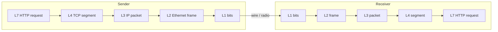
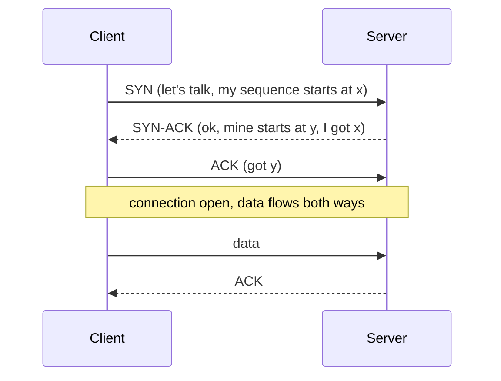
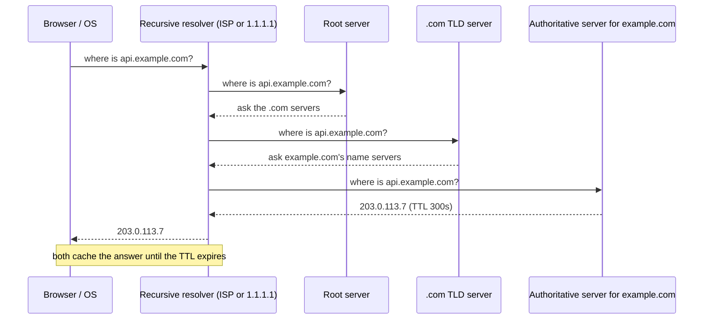

# My Notes: Networking Fundamentals for System Design (IP, OSI, TCP/UDP, DNS)

> **Source:** "Getting Started" and Chapter I of *System Design* by Karan Pratap Singh ([github.com/karanpratapsingh/system-design](https://github.com/karanpratapsingh/system-design)): the IP, OSI Model, TCP and UDP, and DNS sections.
>
> These notes are written fresh from that part of the book. The wording, examples and diagrams are my own, so go to the book for the original explanations.

---

## 1. What system design actually is

- **System design** is deciding the *architecture, components, interfaces and data* of a system so it meets its requirements, both what it must do and how well it must do it.
- It sits between "I have a product idea" and "I'm writing code": which services exist, how they talk, where data lives, and what happens when things fail or traffic grows 100×.
- The point isn't to memorise diagrams. It's to build a toolbox of **building blocks** (load balancers, caches, queues, databases…) and know the **trade-offs** each one brings.

**Why it matters:** most real outages and slowdowns aren't caused by a bad `for` loop. They come from architectural choices: one database doing everything, no cache, synchronous calls chained across five services. Good design up front is far cheaper than re-architecting under load.

This chapter covers the networking layer everything else sits on. Every request in later chapters travels over IP, through TCP or UDP, after a DNS lookup.

---

## 2. IP addresses

An **IP address** is the number that identifies a device on a network, so packets know where to go and where to come back to.

### 2.1 IPv4 vs IPv6

| | IPv4 | IPv6 |
|---|---|---|
| Size | 32 bits | 128 bits |
| Written as | `192.168.1.10` (four 0–255 numbers) | `2001:db8::8a2e:370:7334` (hex groups) |
| How many | ~4.3 billion, effectively exhausted | ~3.4 × 10³⁸, effectively unlimited |
| Reality today | Still dominant, stretched with NAT | Growing; mobile networks lead adoption |

- IPv4 ran out because every phone, laptop, TV and sensor wants an address.
- **NAT** (network address translation) is the workaround: a whole home or office shares one public IPv4 address, and the router maps internal addresses to it.

### 2.2 Kinds of addresses

- **Public**: reachable from the internet, assigned by your ISP or cloud provider. Your load balancer has one.
- **Private**: only meaningful inside a network (`10.x.x.x`, `172.16–31.x.x`, `192.168.x.x`). Your app servers and databases should live here.
- **Dynamic**: handed out automatically (DHCP) and can change. Fine for laptops.
- **Static**: fixed. Needed for things others must reliably find, though in practice we point a DNS name at it instead of hard-coding the IP.

**Design takeaway:** put only the entry points (load balancer, API gateway) on public IPs and keep everything else in a private network. That's a free layer of security.

---

## 3. The OSI model

The **OSI model** splits networking into 7 layers, each with one job and each relying on the layer below. Real networks follow the simpler TCP/IP model, but OSI is the shared vocabulary: "it's a layer 4 load balancer" or "that's a layer 7 problem".

| # | Layer | Job | Examples |
|---|---|---|---|
| 7 | Application | What the app speaks | HTTP, DNS, SMTP, gRPC |
| 6 | Presentation | Encoding, encryption, compression | TLS, JSON/UTF-8, gzip |
| 5 | Session | Opening/keeping/closing conversations | session setup, checkpoints |
| 4 | Transport | End-to-end delivery between processes (ports) | TCP, UDP |
| 3 | Network | Routing packets between networks | IP, ICMP |
| 2 | Data link | Moving frames on one local link | Ethernet, Wi-Fi (MAC addresses) |
| 1 | Physical | Bits as signals | cables, radio, fibre |

**Why it matters for design:**
- **Debugging:** "can't resolve the name" (L7 DNS) vs "connection refused" (L4) vs "no route to host" (L3) point to very different fixes.
- **Picking components:** an L4 load balancer only sees IPs and ports; an L7 one can read URLs, headers and cookies. More on this in the load balancing chapter.

---

## 4. TCP and UDP

Both live at layer 4 and both use **ports** to reach the right process. They make opposite trade-offs.

### 4.1 TCP: reliable and ordered

- **Connection-oriented:** a **three-way handshake** (SYN → SYN-ACK → ACK) sets up the connection before any data flows.
- **Reliable:** every segment is acknowledged, and lost ones are retransmitted.
- **Ordered:** the receiver reassembles bytes in order, even if packets arrive shuffled.
- **Flow and congestion control:** slows down when the receiver or the network can't keep up.

The cost is **latency and overhead**: the handshake adds a round trip, and one lost packet stalls everything behind it (head-of-line blocking).

### 4.2 UDP: fast and fire-and-forget

- **Connectionless:** just send datagrams, no handshake.
- **No guarantees:** packets may be lost, duplicated or reordered, and the app deals with it (or doesn't care).
- **Tiny overhead,** so lowest latency.

### 4.3 Choosing

| | TCP | UDP |
|---|---|---|
| Delivery | Guaranteed, ordered | Best effort |
| Setup | Handshake | None |
| Speed | Slower | Faster |
| Use when | Correctness matters | Freshness matters more than completeness |
| Examples | Web/HTTP 1.1–2, databases, email, file transfer | Video calls, live streaming, gaming, DNS lookups, QUIC/HTTP 3 |

**Rule of thumb:** a dropped frame in a video call is fine (the next frame replaces it), so use UDP. A dropped byte in a bank transfer is not, so use TCP. HTTP/3 shows you can also build reliability *on top of* UDP (QUIC) to avoid TCP's head-of-line blocking.

---

## 5. DNS: the internet's phone book

**DNS (Domain Name System)** turns names like `api.example.com` into IP addresses. Humans remember names, machines route on numbers, and DNS bridges the two. It's also one of the first things every request depends on, so it's a key reliability component.

### 5.1 How a lookup works

1. The browser and OS check their own caches first.
2. On a miss, the **recursive resolver** does the legwork for you.
3. A **root server** points to the right **TLD** (top-level domain) servers.
4. The TLD server points to the domain's **authoritative** name servers.
5. The authoritative server gives the final answer, and everyone caches it.

### 5.2 Server types

- **Recursive resolver:** chases the answer for the client and caches results.
- **Root name servers:** the top of the tree. There are 13 logical root identities, served by many anycast machines worldwide.
- **TLD servers:** one set per `.com`, `.org`, `.in`, `.dev`…
- **Authoritative servers:** hold the actual records for a domain (often run by Route 53, Cloudflare and similar).

### 5.3 Query types

- **Recursive:** "give me the final answer". The client asks the resolver this way.
- **Iterative:** "give me the answer or the next server to ask". Resolvers ask root/TLD/authoritative servers this way.
- **Non-recursive:** the server already knows the answer (it's authoritative, or cached) and replies straight away.

### 5.4 Record types worth knowing

| Record | Maps | Typical use |
|---|---|---|
| `A` | name → IPv4 | `api.example.com → 203.0.113.7` |
| `AAAA` | name → IPv6 | same, for IPv6 |
| `CNAME` | name → another name | `www → example.com`, or pointing at a CDN hostname |
| `MX` | domain → mail servers | email routing, with priorities |
| `TXT` | domain → free text | domain verification, SPF/DKIM email anti-spoofing |
| `NS` | domain → its name servers | delegation |
| `SOA` | zone → admin info | serial number, refresh timings |
| `SRV` | service → host + port | service discovery for some protocols |
| `PTR` | IP → name | reverse DNS |

### 5.5 Subdomains, zones, caching and reverse DNS

- **Subdomains** (`blog.example.com`, `api.example.com`) let one domain host separate services, each pointing anywhere.
- A **zone** is the slice of the namespace one organisation manages. You can delegate a subdomain to a different provider as its own zone.
- **Caching and TTL:** every answer carries a TTL. Long TTLs cut lookup latency and load, short TTLs let you move traffic quickly. **Before a migration, lower the TTL days in advance** so clients pick up the new IP fast.
- **Reverse DNS** (`PTR`) goes from IP back to name. Mail servers use it to sanity-check senders, and logs use it to make IPs readable.

### 5.6 DNS as a design tool

- **Simple load spreading:** return several `A` records (round-robin DNS). It's crude because clients cache and there's no health awareness.
- **Geo and latency routing:** managed DNS can answer with the nearest region's IP.
- **Failover:** health-checked DNS stops returning a dead region's IP, though only as fast as the TTL allows.
- Managed options: Route 53, Cloudflare DNS, Google Cloud DNS, Azure DNS.

---

## 6. My cheat sheet

| Concept | One-liner |
|---|---|
| System design | Choosing components + trade-offs so a system meets functional and non-functional goals |
| IPv4 vs IPv6 | 32-bit and exhausted (NAT keeps it alive) vs 128-bit and plentiful |
| Public vs private IP | Only entry points are public; everything else stays in a private network |
| OSI L4 vs L7 | L4 = IP + port (TCP/UDP), L7 = application data (HTTP headers, URLs) |
| TCP | Handshake, ordered, reliable, slower: use for correctness |
| UDP | No handshake, best effort, fast: use for real-time media and games |
| DNS resolution | Cache → resolver → root → TLD → authoritative → cache with TTL |
| A / CNAME / MX / TXT | IPv4 / alias / mail / verification and anti-spoofing |
| TTL trick | Lower it before migrations so changes spread quickly |
