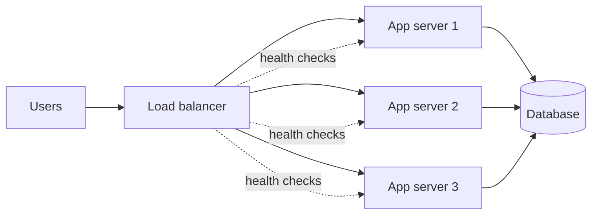
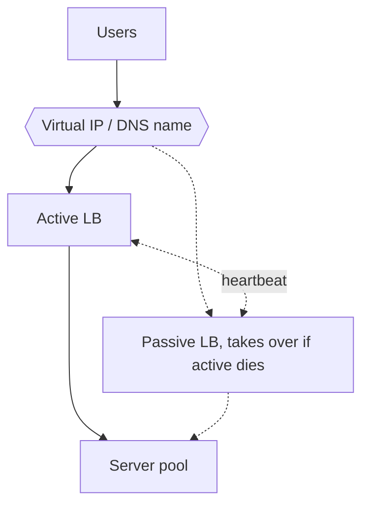
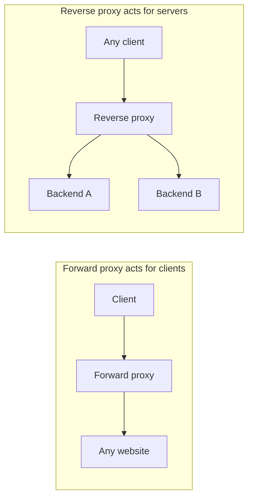

# My Notes: Load Balancing, Clustering and Proxies

> **Source:** Chapter I of *System Design* by Karan Pratap Singh ([github.com/karanpratapsingh/system-design](https://github.com/karanpratapsingh/system-design)): the Load Balancing, Clustering and Proxy sections.
>
> These notes are written fresh from that part of the book. The wording, examples and diagrams are my own, so go to the book for the original explanations.

---

## 1. Why load balancing exists

- One server has a ceiling: CPU, memory, connections. Past it, latency climbs and requests fail.
- One server is also a **single point of failure**: it goes down, the product goes down.
- A **load balancer (LB)** sits in front of a pool of identical servers and spreads incoming requests across them, so we can add capacity by adding servers and survive any one of them dying.

Load balancers show up at several tiers: between users and web servers, between web servers and internal services, and in front of database read replicas.

---

## 2. How work gets split

Beyond "spread evenly", an L7 load balancer can route by *what the request is*:

- **Host-based:** `api.example.com` → API pool, `admin.example.com` → admin pool.
- **Path-based:** `/images/*` → image service, `/checkout/*` → checkout service.
- **Content-based:** inspect headers or cookies, e.g. send `Accept-Language: hi` users to a localised pool, or beta-flagged users to canary servers.

---

## 3. Layer 4 vs layer 7

| | Layer 4 (transport) | Layer 7 (application) |
|---|---|---|
| Sees | Source/destination IP and port | Full HTTP: URL, headers, cookies, body |
| Decides by | Connection info only | Anything in the request |
| Speed | Very fast, little CPU | Slower: must parse (and often decrypt) traffic |
| Can do | Forward TCP/UDP streams | Path routing, header rewrites, TLS termination, caching, auth checks |
| Good for | Raw throughput, non-HTTP protocols | Web apps and microservice routing |

Many setups use both: an L4 balancer at the edge for raw scale, feeding L7 proxies that make the smart routing decisions.

---

## 4. Types of load balancers

- **Software:** HAProxy, NGINX, Envoy, Traefik on ordinary machines. Cheap, flexible, scriptable.
- **Hardware:** dedicated appliances (F5, Citrix). Very high throughput, expensive, less common now outside big data centres.
- **DNS-based:** spreads traffic by returning different IPs. Coarse, and limited by client caching (see the networking chapter).
- **Managed cloud:** AWS ALB/NLB, Google Cloud Load Balancing, Azure Load Balancer. No servers to run, scales automatically, and is what most teams use.

---

## 5. Routing algorithms

| Algorithm | How it picks | Works well when |
|---|---|---|
| **Round robin** | Next server in turn | Servers and requests are roughly equal |
| **Weighted round robin** | Bigger servers get proportionally more turns | Mixed instance sizes |
| **Least connections** | Server with fewest open connections | Long-lived or uneven requests (uploads, websockets) |
| **Least response time** | Fastest-responding, least-loaded server | Latency-sensitive traffic |
| **IP hash** | Hash of client IP picks the server | You want the same client on the same server |
| **Consistent hashing** | Hash ring of servers (see the sharding chapter) | Cache servers, where adding a node shouldn't reshuffle everything |
| **Random / power of two choices** | Pick two at random, send to the less loaded | Huge fleets where global state is costly |

**Sticky sessions** pin a user to one server, usually with a cookie. They help if the server holds session state in memory, but they hurt balancing and failover. The better fix is to make servers **stateless** and keep sessions in Redis or a signed token.

---

## 6. What load balancers give you

- **Scalability:** add or remove servers behind one stable address.
- **Availability:** health checks pull dead servers out of rotation automatically.
- **Zero-downtime deploys:** drain a server, update it, put it back (rolling or blue-green).
- **Security edge:** a single place for TLS termination, DDoS protection, WAF rules and rate limits.
- **Performance features:** compression, connection pooling and keep-alive to backends, HTTP/2 to clients.
- **Observability:** one choke point to log every request and measure latency and error rates.

---

## 7. Don't let the load balancer become the single point of failure

If everything goes through one LB, it's the new weak spot. The standard fix is **redundant load balancers**:

- **Active-passive:** a standby watches the active LB's heartbeat and takes over its virtual IP if it fails.
- **Active-active:** both handle traffic. More capacity, but each must be able to absorb the other's load alone.
- Managed cloud LBs do this for you across availability zones.

---

## 8. Clustering

A **cluster** is a group of machines (nodes) that work together and look like **one system** to the outside. Load balancing spreads independent requests. Clustering makes nodes *coordinate*: they share state, elect leaders and take over each other's work.

### 8.1 Kinds of clusters

- **High-availability (failover) clusters:** standby nodes take over when a primary dies. Example: a database primary with replicas ready to be promoted.
- **Load-balancing clusters:** all nodes serve traffic, and requests are spread among them.
- **High-performance clusters:** many nodes split one big computation (scientific computing, ML training, Spark jobs).

### 8.2 Configurations

- **Active-active:** every node serves traffic. Best utilisation, but nodes must stay in sync.
- **Active-passive:** standbys sit idle (or serve reads) until failover. Simpler consistency, but wasted capacity.

### 8.3 Load balancing vs clustering

| | Load balancing | Clustering |
|---|---|---|
| Nodes know about each other? | No, they're independent | Yes, they coordinate |
| Shared state | None (ideally) | Often: membership, leader, data |
| Typical use | Stateless app servers | Databases, caches, message brokers, Kubernetes control plane |

They often appear together: a load balancer in front of the nodes of a cluster.

### 8.4 Why it's hard

- **Membership and failure detection:** is a node dead or just slow? Heartbeats and timeouts guess.
- **Split brain:** a network partition leaves two halves each thinking they're in charge. Quorums (majority votes) and fencing prevent it.
- **Consensus:** agreeing on a leader or a value needs algorithms like Raft or Paxos (used inside etcd, ZooKeeper, Consul).
- **Operational cost:** upgrades, rebalancing and monitoring many nodes.

Examples: Kubernetes, Redis Cluster, Cassandra, Kafka, Elasticsearch, MongoDB replica sets.

---

## 9. Proxies

A **proxy** is an intermediary that receives a request and forwards it on someone's behalf. Which side it represents decides its type.

### 9.1 Forward proxy (client side)

- Sits in front of **clients**. Websites see the proxy's IP, not the user's.
- Uses: corporate filtering and auditing, caching shared downloads, getting around geo-restrictions, anonymity (VPN-like).

### 9.2 Reverse proxy (server side)

- Sits in front of **servers**. Clients only ever talk to the proxy and never see the backends.
- Uses: hiding and protecting backends, TLS termination, caching static responses, compression, routing to different services, rate limiting, and load balancing.

### 9.3 Load balancer vs reverse proxy

- A load balancer is really a *reverse proxy whose main job is spreading load across many backends*.
- A reverse proxy is still useful with **one** backend, for TLS, caching, security headers and buffering slow clients.
- In practice the same software (NGINX, HAProxy, Envoy) does both. The name describes the role.

Examples: NGINX, HAProxy, Envoy, Traefik, Caddy (reverse); Squid (forward).

---

## 10. My cheat sheet

| Concept | One-liner |
|---|---|
| Load balancer | Spreads requests over identical servers, removes dead ones via health checks |
| L4 vs L7 LB | IP/port only and fast, vs full HTTP aware and smart |
| Round robin / least conn | Equal turns / fewest open connections |
| Sticky sessions | Pin a user to one server; avoid by making servers stateless |
| Redundant LBs | Active-passive with a shared virtual IP, or managed multi-AZ LB |
| Cluster | Nodes that coordinate (membership, leader, shared state) and look like one system |
| Split brain | Partition creates two leaders; prevented with quorum |
| Forward proxy | Acts for clients (filtering, anonymity) |
| Reverse proxy | Acts for servers (TLS, caching, routing, protection); an LB is a kind of reverse proxy |
