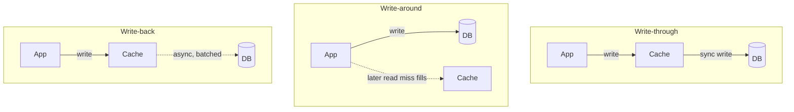
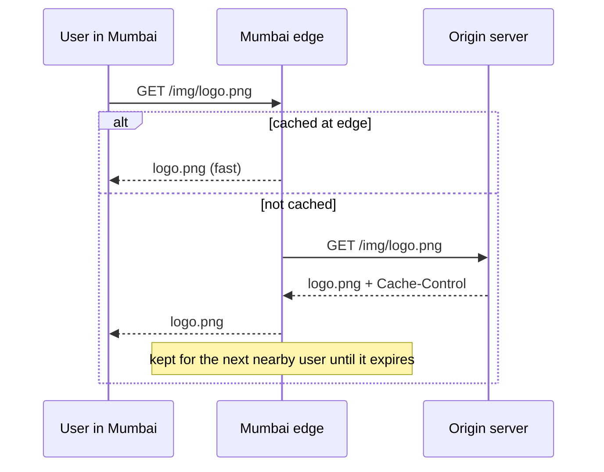

# My Notes: Caching and Content Delivery Networks

> **Source:** Chapter I of *System Design* by Karan Pratap Singh ([github.com/karanpratapsingh/system-design](https://github.com/karanpratapsingh/system-design)): the Caching and Content Delivery Network (CDN) sections.
>
> These notes are written fresh from that part of the book. The wording, examples and diagrams are my own, so go to the book for the original explanations.

---

## 1. The idea behind caching

- A **cache** is a small, fast store that keeps copies of data that's expensive to fetch or compute, so the next request for it is cheap.
- It works because access is **uneven**: a small slice of data (popular products, logged-in users' profiles, the home feed) gets most of the reads.
- Caching trades **freshness and memory** for **speed and less load** on the system behind it.

### 1.1 Caches are everywhere

| Where | What it caches |
|---|---|
| CPU (L1/L2/L3) | Recently used memory |
| Browser | Static files, API responses (by HTTP cache headers) |
| DNS resolvers | Name → IP answers |
| CDN edge | Images, video, JS/CSS, even whole pages |
| Reverse proxy | Rendered responses |
| Application | Objects in Redis or Memcached |
| Database | Buffer pool of hot pages, query plans |

### 1.2 Why memory is the usual home

Reading RAM takes roughly **100 nanoseconds**, an SSD read about **100 microseconds** (1,000× slower), and a network round trip to another region **tens of milliseconds**. In-memory caches like Redis sit at the fast end, which is why they make such a difference, but memory is expensive and limited, so we can only keep the hottest data there.

---

## 2. Hits, misses and hit ratio

- **Cache hit:** the data is in the cache, so it's served fast.
- **Cache miss:** it isn't, so we fetch from the source (slow) and usually store it for next time.
- **Hit ratio** = hits ÷ (hits + misses). A cache with a 30% hit ratio mostly adds a hop. A 95% one transforms performance.

There are two flavours of hit worth naming: **cold** (first request after a restart, cache empty), and **warm or hot** (populated with frequently accessed data). After a deploy or restart, expect a burst of misses; this is why caches are often **pre-warmed**.

---

## 3. Keeping the cache and the source in step (write strategies)

The hard part of caching is **invalidation**: when the real data changes, stale copies must be updated or removed.

| Strategy | How | Good | Bad |
|---|---|---|---|
| **Write-through** | Write to cache and DB together | Cache always fresh, nothing lost | Every write pays double latency; may cache data nobody reads |
| **Write-around** | Write only to DB; cache fills on the next read miss | Doesn't pollute cache with write-once data | First read after a write is a miss (slower) |
| **Write-back (write-behind)** | Write to cache, flush to DB later | Fastest writes, absorbs bursts | Data loss if the cache dies before flushing; harder consistency |

### 3.1 Reading patterns

- **Cache-aside (lazy loading):** the app checks the cache, and on a miss reads the DB and writes the result into the cache. This is the most common pattern. The cache only holds what's actually requested, and a cache outage just means slower reads.
- **Read-through:** the cache library itself loads from the DB on a miss, so app code only talks to the cache.

### 3.2 Expiry (TTL)

Every entry gets a **time-to-live**. Even with careful invalidation, a TTL is a safety net that bounds how stale data can get. Choose it per data type: seconds for stock prices, hours for product descriptions, days for static config.

---

## 4. Eviction: what to throw out when the cache is full

| Policy | Evicts | Note |
|---|---|---|
| **LRU** (least recently used) | Item untouched for the longest | The default choice almost everywhere |
| **LFU** (least frequently used) | Item with the fewest accesses | Protects long-term favourites; slow to adapt to new trends |
| **FIFO** | Oldest inserted | Simple, ignores usage |
| **MRU** (most recently used) | Newest-used item | Niche: scans where the latest item won't be needed again |
| **Random** | Any item | Cheap, surprisingly decent |
| **TTL-based** | Expired items first | Usually combined with one of the above |

---

## 5. Distributed and global caches

- **Local (in-process) cache:** each app server keeps its own map. Fastest, but servers disagree and memory is duplicated.
- **Distributed cache:** a cluster (Redis Cluster, Memcached) whose memory is pooled and **partitioned** across nodes, usually with consistent hashing. All app servers share one view and capacity grows by adding nodes.
- **Global cache:** a single shared cache in front of the data store. Either the cache fetches misses itself, or the app does. It's simple, but the global cache must be made highly available.

Two classic failure modes to design against:
- **Thundering herd / cache stampede:** a hot key expires and thousands of requests miss at once and pile onto the DB. Fixes: one request rebuilds while others wait (a lock or "single flight"), early background refresh, and jittered TTLs.
- **Cache penetration:** repeated requests for keys that don't exist always miss. Fixes: cache "not found" briefly, or put a Bloom filter in front.

---

## 6. Where caching pays off

- **Database query results** and computed objects (profile with counts, product with price).
- **Session data** and auth tokens.
- **Rendered pages or fragments** for anonymous traffic.
- **Rate-limit counters, leaderboards, feature flags,** where Redis data structures shine.
- **Expensive API calls** to third parties.

**When not to cache:** data that must be strictly current (account balances during a transfer), data read once, or when the source is already fast enough. A cache adds a moving part and a whole class of staleness bugs.

---

## 7. Advantages and examples

- Lower latency, much less load on databases and services, cheaper scaling (memory is cheaper than more DB capacity), and resilience: you can serve stale data during brief backend outages.
- Examples: **Redis**, **Memcached**, Amazon ElastiCache, Varnish (HTTP cache), Caffeine (in-process, Java).

---

## 8. Content Delivery Networks (CDNs)

A **CDN** is a geographically distributed network of cache servers (**edge locations** or **points of presence**) that serve content from close to the user, instead of every request travelling to your origin.

### 8.1 Why use one

- **Speed:** a user in Mumbai fetches from a Mumbai edge, not a server in Virginia. The physics of distance sets a latency floor nothing else can beat.
- **Offload:** the origin serves each file once per edge, not once per user.
- **Availability:** edges can keep serving cached content if the origin blips.
- **Security:** CDNs absorb DDoS traffic and offer WAF and TLS at the edge.

### 8.2 How it works

DNS (often with anycast) sends each user to a nearby edge. The edge serves from its cache or fetches from the origin, obeying the `Cache-Control` headers you set.

### 8.3 Push vs pull CDNs

| | Push | Pull |
|---|---|---|
| How content arrives | You upload it to the CDN ahead of time | Edge fetches from origin on first request |
| Best for | Smaller sites, rarely changing content, big files you want pre-placed | Busy sites with lots of content |
| Trade-off | You manage uploads and expiry | First user per edge gets a slow miss; may re-fetch content that hasn't changed |

### 8.4 Downsides

- **Cost** for bandwidth and requests (usually still cheaper than serving it all yourself).
- **Staleness:** updates need purges or versioned file names (`app.3f9a.js`), which is the reliable trick.
- **Restrictions:** some regions block certain CDN providers. Plan a fallback for critical assets.

Examples: Cloudflare, Amazon CloudFront, Akamai, Fastly, Google Cloud CDN.

---

## 9. My cheat sheet

| Concept | One-liner |
|---|---|
| Cache | Fast copy of expensive data; trades freshness for speed |
| Hit ratio | The number that tells you if a cache earns its keep |
| Cache-aside | App reads cache, on miss loads DB and fills cache (the default) |
| Write-through / around / back | Sync both / skip cache on write / write cache, flush later |
| TTL | Upper bound on staleness, always set one |
| LRU | Default eviction: drop the least recently used |
| Stampede | Hot key expires and the herd hits the DB; fix with single-flight, early refresh, jittered TTL |
| CDN | Edge caches near users for static and media content |
| Push vs pull CDN | Upload ahead vs fetch on first request |
| Cache busting | Version file names instead of waiting for TTLs |
