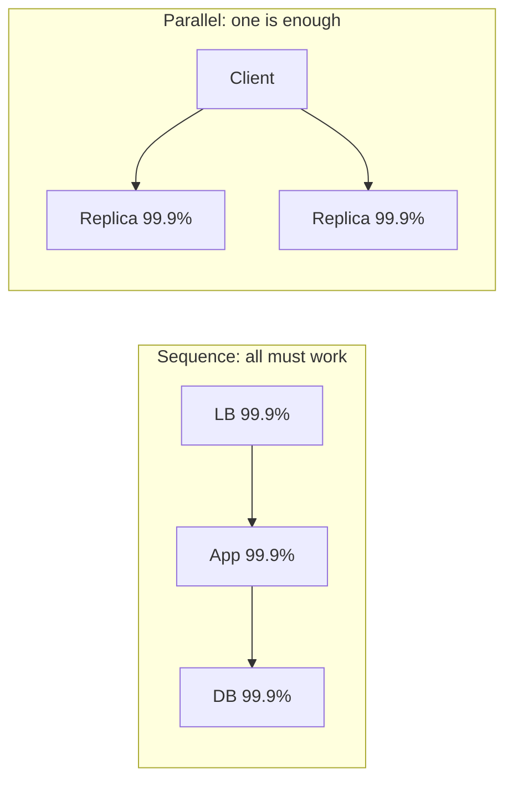
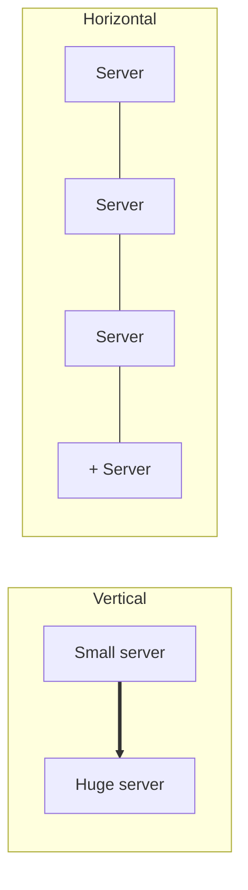

# My Notes: Availability, Scalability and Storage

> **Source:** Chapter I of *System Design* by Karan Pratap Singh ([github.com/karanpratapsingh/system-design](https://github.com/karanpratapsingh/system-design)): the Availability, Scalability and Storage sections.
>
> These notes are written fresh from that part of the book. The wording, examples and diagrams are my own, so go to the book for the original explanations.

---

## 1. Availability

**Availability** is the fraction of time a system is working and able to serve requests:

```text
availability = uptime / (uptime + downtime)
```

It's usually written as a percentage of "nines", and every extra nine cuts the allowed downtime by 10×.

### 1.1 The nines

| Availability | Downtime per year | per month | per day |
|---|---|---|---|
| 99% ("two nines") | ~3.65 days | ~7.3 hours | ~14.4 min |
| 99.9% | ~8.8 hours | ~43.8 min | ~1.4 min |
| 99.99% | ~52.6 min | ~4.4 min | ~8.6 s |
| 99.999% ("five nines") | ~5.3 min | ~26 s | ~0.9 s |
| 99.9999% | ~31.5 s | ~2.6 s | ~0.09 s |

At four nines and beyond, humans can't react in time, so recovery has to be **automatic** (health checks, failover, self-healing). Each extra nine costs a lot more money and complexity, so pick the target the business actually needs.

### 1.2 Components in sequence vs in parallel

How you wire components changes total availability.



- **In sequence**, multiply: `A = A1 × A2 × A3`. Three 99.9% parts in a chain give about **99.7%**. Every dependency you add lowers the ceiling.
- **In parallel** (redundant copies, either can serve): `A = 1 − (1 − A1) × (1 − A2)`. Two 99.9% replicas give **99.9999%**.

**Takeaway:** long synchronous call chains are availability killers, and redundancy is how you buy nines back.

### 1.3 Availability vs reliability

- **Availability:** is it up *right now*? (a time ratio)
- **Reliability:** does it work *correctly* over time? (how often it fails, measured as MTBF, mean time between failures)
- A system can be available but unreliable: always up, but returning wrong results sometimes. A reliable system is usually available, but not the other way round.

### 1.4 High availability vs fault tolerance

| | High availability | Fault tolerance |
|---|---|---|
| Goal | Minimise downtime | Zero interruption |
| On failure | Brief blip while failover happens | No visible effect, because a mirror is already serving |
| Cost | Moderate | High (full duplicate hardware and state) |
| Example | Promote a DB replica in ~30 s | Aircraft control systems, mirrored storage |

---

## 2. Scalability

**Scalability** is how well a system handles more load (users, data, requests) by adding resources, ideally with performance staying flat and cost growing roughly in proportion.

### 2.1 Vertical scaling (scale up)

Give the same machine more CPU, RAM or faster disks.

- **Pros:** dead simple, no code changes, no distributed-systems problems.
- **Cons:** hard ceiling (the biggest box money can buy), cost rises steeply at the top end, often needs downtime to resize, and it's still a single point of failure.

### 2.2 Horizontal scaling (scale out)

Add more machines and spread the load (load balancers, sharding).

- **Pros:** nearly unlimited, built-in redundancy, can scale up and down with demand (autoscaling), uses cheap commodity machines.
- **Cons:** distributed-systems complexity (consistency, coordination, network failures), and the app must be designed for it, especially kept **stateless**.



**In practice:** scale vertically first (it's cheap in engineering time), and design so you *can* scale out when you need to. Stateless app tiers scale out easily, and databases are where it gets hard (see the sharding and replication chapters).

---

## 3. Storage fundamentals

Where and how bytes are stored drives durability, performance and cost.

### 3.1 RAID

**RAID** (redundant array of independent disks) combines several disks for speed, redundancy or both.

| Level | How | Survives | Good for |
|---|---|---|---|
| **RAID 0** | Striping: data split across disks | No disk failure (one dies, all lost) | Pure speed, scratch data |
| **RAID 1** | Mirroring: each disk duplicated | One disk per mirror | Simple redundancy, boot disks |
| **RAID 5** | Striping + one disk's worth of parity | Any one disk | Read-heavy storage on a budget |
| **RAID 6** | Striping + two parity blocks | Any two disks | Large arrays where rebuilds are slow |
| **RAID 10** | Mirrors, then striped | One disk per mirror pair | Databases: fast and redundant |

RAID protects against **disk** failure, not against deleting the wrong table, so it's never a substitute for backups.

### 3.2 Volumes

A **volume** is a usable unit of storage presented to an operating system, like a drive letter or mount point. It may be one disk, a slice of one, or a RAID array or network disk spanning many.

### 3.3 File, block and object storage

| | File storage | Block storage | Object storage |
|---|---|---|---|
| Unit | Files in folders | Fixed-size blocks | Objects (data + metadata + ID) in flat buckets |
| Access | File paths (NFS, SMB) | Raw disk, OS puts a filesystem on it | HTTP API (`PUT`/`GET` by key) |
| Strengths | Familiar, shareable | Lowest latency, high IOPS | Practically infinite, cheap, very durable |
| Weaknesses | Scaling limits, metadata overhead | Attached to one machine at a time, pricier | Higher latency, no in-place edits (rewrite whole object) |
| Use for | Shared home dirs, CMS uploads | Databases, VM disks | Images, video, backups, logs, data lakes |
| Examples | Amazon EFS, Azure Files | Amazon EBS, Persistent Disk | Amazon S3, Google Cloud Storage, Azure Blob |

### 3.4 NAS

**Network attached storage** is a storage box on the network that serves *files* to many machines over NFS or SMB. It's convenient shared storage, but it's limited by the network and the box itself.

### 3.5 HDFS

The **Hadoop Distributed File System** stores huge files split into large blocks (128 MB by default), each **replicated** across several commodity machines (3 copies by default). A NameNode tracks where blocks live, and DataNodes store them. It's built for high-throughput batch reads of big datasets rather than low-latency access, and it's the storage under classic Hadoop and Spark pipelines.

---

## 4. My cheat sheet

| Concept | One-liner |
|---|---|
| Nines | Each extra nine = 10× less downtime; 99.99% ≈ 52 min/year |
| Sequence | Multiply availabilities: chains get worse |
| Parallel | `1 − Π(1 − A)`: redundancy adds nines |
| Availability vs reliability | Up right now vs works correctly over time |
| HA vs fault tolerance | Short blip on failover vs no interruption at all |
| Vertical scaling | Bigger box: simple, but has a ceiling and is a SPOF |
| Horizontal scaling | More boxes: near-limitless, needs stateless design |
| RAID 10 | Mirrored + striped; usual DB choice. RAID ≠ backup |
| Block / file / object | DB disks / shared folders / blobs via HTTP (S3) |
| HDFS | Big files in replicated 128 MB blocks for batch processing |
