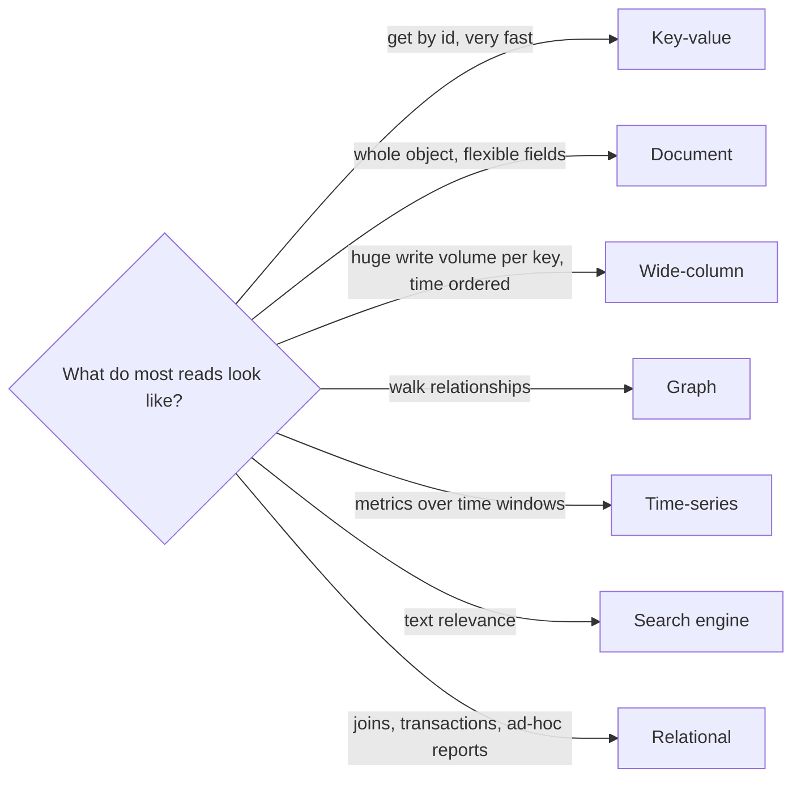

# My Notes: Databases, SQL and NoSQL, and How to Choose

> **Source:** Chapter II of *System Design* by Karan Pratap Singh ([github.com/karanpratapsingh/system-design](https://github.com/karanpratapsingh/system-design)): the Databases and DBMS, SQL databases, NoSQL databases and SQL vs NoSQL sections.
>
> These notes are written fresh from that part of the book. The wording, examples and diagrams are my own, so go to the book for the original explanations.

---

## 1. Database vs DBMS

- A **database** is an organised collection of data, stored so it can be found, updated and kept safe.
- A **DBMS** (database management system) is the software that does that work: PostgreSQL, MySQL, MongoDB, Cassandra. It handles storage, querying, concurrency, access control, durability and recovery so every app doesn't reinvent them.

### 1.1 Vocabulary

| Term | Meaning |
|---|---|
| **Schema** | The shape of the data: tables/collections, fields, types, relationships. Strict in SQL, flexible in most NoSQL |
| **Table / collection** | A group of records of the same kind (`users`, `orders`) |
| **Row / document** | One record |
| **Column / field** | One attribute of a record |
| **Primary key** | Uniquely identifies a record |
| **Foreign key** | Points to a record in another table, which is how relationships are expressed |
| **Index** | Extra structure to find records fast (see the indexes chapter) |

### 1.2 Problems every database must handle at scale

- **Growth:** more data than one machine holds, and more queries than one machine serves.
- **Consistency under concurrency:** many writers touching the same rows at once.
- **Availability:** surviving machine, disk and network failures.
- **Performance:** keeping queries fast as data grows (indexes, caching, partitioning).
- **Security and compliance:** access control, encryption, backups, retention.

The rest of this part of the notebook is about tools for those problems: replication, indexes, transactions, sharding and federation.

---

## 2. SQL (relational) databases

Data lives in **tables** with a fixed schema, related through keys, and queried with **SQL**. Relational databases give strong guarantees through **ACID transactions** (next chapters).

```sql
SELECT u.name, COUNT(o.id) AS orders
FROM users u
JOIN orders o ON o.user_id = u.id
WHERE o.created_at > now() - interval '30 days'
GROUP BY u.name;
```

### 2.1 Two concepts worth knowing

- **Materialized view:** a query whose *result is stored* like a table and refreshed periodically or on change. Great for expensive reports and dashboards: read the precomputed answer instead of re-running a heavy join every time.
- **The N+1 query problem:** fetch a list (1 query), then loop and fetch related data per item (N queries). 100 posts become 101 round trips. Fix it with a `JOIN`, a batched `WHERE id IN (...)`, or your ORM's eager loading. It's one of the most common hidden performance bugs.

```text
❌ SELECT * FROM posts LIMIT 100;      -- then, for each post:
   SELECT * FROM users WHERE id = ?;  -- ×100

✅ SELECT p.*, u.name FROM posts p JOIN users u ON u.id = p.author_id LIMIT 100;
```

### 2.2 Strengths and weaknesses

| Strengths | Weaknesses |
|---|---|
| Strong consistency and ACID transactions | Rigid schema: migrations needed for changes |
| Powerful ad-hoc queries, joins and aggregations | Harder to scale writes horizontally (sharding is manual work) |
| Mature tooling, decades of operational knowledge | Joins across huge tables can get expensive |
| Data integrity via constraints and foreign keys | Object–relational mismatch with app code (ORMs help, partly) |

Examples: **PostgreSQL**, MySQL, MariaDB, SQL Server, Oracle; distributed SQL like CockroachDB, Google Spanner, YugabyteDB.

---

## 3. NoSQL databases

"NoSQL" is an umbrella for non-relational databases, each built around a **different data model** and usually designed to scale out across many machines, often trading some consistency or query flexibility for it.

### 3.1 The main families

| Type | Data model | Great at | Weak at | Examples |
|---|---|---|---|---|
| **Document** | JSON-like documents, nested fields, flexible schema | Objects that are read and written as a whole: profiles, catalogs, CMS content | Many-to-many relations, cross-document transactions (improving) | MongoDB, Couchbase, Firestore |
| **Key-value** | `key → value` blob | Ultra-fast lookups by key: sessions, caches, carts, counters | Querying by anything other than the key | Redis, DynamoDB, Memcached, etcd |
| **Wide-column** | Rows with flexible column families, partitioned by key | Massive write throughput, time-ordered data per key | Ad-hoc queries; you design tables per query | Cassandra, HBase, ScyllaDB, Bigtable |
| **Graph** | Nodes + edges with properties | Relationship-heavy questions: friends-of-friends, fraud rings, recommendations | Bulk analytics over everything | Neo4j, Amazon Neptune, JanusGraph |
| **Time-series** | Timestamped measurements | Metrics, IoT, monitoring: fast ingest, downsampling, time-window queries | General-purpose data | InfluxDB, TimescaleDB, Prometheus |
| **Search** | Inverted indexes over text | Full-text search, relevance ranking, faceting | Being the source of truth | Elasticsearch, OpenSearch |
| **Multi-model** | Several models in one engine | Fewer systems to run | Jack of all trades | ArangoDB, Azure Cosmos DB |



---

## 4. SQL vs NoSQL, side by side

| Aspect | SQL | NoSQL |
|---|---|---|
| Schema | Fixed, enforced | Flexible / schema-on-read |
| Query language | SQL, standard and expressive | Per database (APIs, query DSLs, CQL…) |
| Scaling | Mostly vertical; horizontal needs sharding effort | Designed to scale horizontally |
| Consistency | Strong (ACID) by default | Often eventual (BASE), many offer tunable or strong options now |
| Relationships | Joins are first-class | Usually denormalised or embedded; joins limited |
| Transactions | Multi-row, multi-table | Often single-record; multi-record support varies |
| Best for | Complex queries, integrity-critical data | Huge scale, simple access patterns, evolving shapes |

---

## 5. How I'd actually choose

**Lean SQL when:**
- Data is **structured and relational** (users, orders, payments, inventory).
- You need **transactions and integrity** (money, stock levels, bookings).
- Query patterns aren't fully known yet: SQL lets you ask new questions later.
- Scale is "big" but not "planet-sized". A well-tuned Postgres handles far more than most products ever reach.

**Lean NoSQL when:**
- Access patterns are **simple and known** (get item by key, get the latest events for a device).
- You need **very high write throughput** or **horizontal scale** beyond one machine.
- Data is **semi-structured** or varies a lot between records.
- You need low-latency key lookups at huge scale (sessions, carts, leaderboards).

**Polyglot persistence** is normal: Postgres as the source of truth, Redis for caching and sessions, Elasticsearch for search, a time-series DB for metrics, each fed from the main store. Start with one solid relational database and add specialised stores only when a clear need appears.

---

## 6. My cheat sheet

| Concept | One-liner |
|---|---|
| DBMS | Software that stores, queries, protects and recovers data |
| SQL | Tables + fixed schema + joins + ACID; default for business data |
| Materialized view | Stored result of an expensive query, refreshed periodically |
| N+1 | 1 list query + N per-item queries; fix with joins or batching |
| Document | Flexible JSON-like objects (MongoDB) |
| Key-value | Fastest lookup by key (Redis, DynamoDB) |
| Wide-column | Massive writes, query-driven tables (Cassandra) |
| Graph | Relationship traversal (Neo4j) |
| Time-series | Metrics over time (InfluxDB, Prometheus) |
| Choosing | Start relational; add specialised stores when access patterns demand it |
