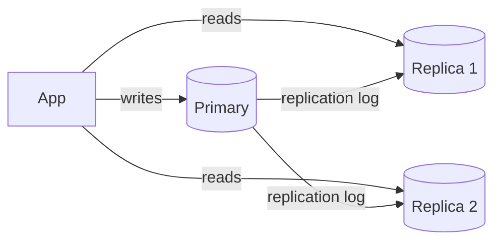

# My Notes: Replication, Indexes, Normalization and Denormalization

> **Source:** Chapter II of *System Design* by Karan Pratap Singh ([github.com/karanpratapsingh/system-design](https://github.com/karanpratapsingh/system-design)): the Database Replication, Indexes and Normalization and Denormalization sections.
>
> These notes are written fresh from that part of the book. The wording, examples and diagrams are my own, so go to the book for the original explanations.

---

## 1. Replication: keeping copies of the data

**Replication** means keeping the same data on several machines. It gives us:
- **Availability:** if one copy dies, another serves.
- **Read scale:** spread reads across copies.
- **Latency:** put a copy near users in each region.
- **Durability:** data survives losing a machine.

The hard part is keeping copies in step while writes keep coming.

### 1.1 Primary–replica (leader–follower, "master–slave")

- **All writes go to one primary**, which streams its change log to replicas. Replicas serve reads.
- **Pros:** simple mental model, no write conflicts, easy read scaling, replicas double as failover candidates and backup sources.
- **Cons:**
  - Write throughput is capped by one machine.
  - **Replication lag:** a replica may be behind, so a user can save a profile and then read the old version from a replica. Fix with "read your own writes": send that user's reads to the primary for a short while.
  - **Failover** needs care: promote a replica, repoint clients, and handle writes the old primary never shipped.

### 1.2 Multi-primary ("master–master")

- **Several nodes accept writes** and replicate to each other, often one per region.
- **Pros:** writes keep working if one primary dies, and local writes are fast in each region.
- **Cons:** **write conflicts.** Two regions edit the same row at once. They must be resolved somehow: last-writer-wins (loses data), merge rules, CRDTs, or app-level resolution. It's much harder to reason about, so use it only when you truly need multi-region writes.

### 1.3 Synchronous vs asynchronous replication

| | Synchronous | Asynchronous |
|---|---|---|
| Write confirmed when | Replica(s) also have it | Primary has it |
| Durability | No loss if primary dies | Recent writes can be lost |
| Latency | Higher (waits on the network) | Low |
| Availability | A slow or dead replica can block writes | Primary keeps going alone |

The common compromise is **semi-synchronous**: wait for *one* replica to acknowledge and let the rest catch up asynchronously.

---

## 2. Indexes: finding rows without reading everything

Without an index, finding `WHERE email = 'a@b.com'` means a **full table scan**, reading every row. An **index** is an extra sorted structure that maps column values to row locations, like the index at the back of a book.

- Most relational DBs use **B-tree** indexes: balanced, sorted, good for equality and range queries (`>`, `BETWEEN`, `ORDER BY`).
- **Hash** indexes are only for exact matches. Inverted indexes power full-text search, and GiST/R-tree types handle geo and ranges.

### 2.1 Dense vs sparse indexes

- **Dense index:** an entry for **every** record. Lookups go straight to the row. Bigger, and slower to maintain on writes.
- **Sparse index:** an entry for **some** records (say, the first row of each data block), which requires the data to be **sorted** by that key. Find the nearest entry, then scan a little. Smaller, slightly slower lookups.

### 2.2 The trade-off

| Indexes help | Indexes cost |
|---|---|
| Reads with filters, joins, sorting | **Every write** must update every index on the table |
| Uniqueness constraints | Disk and memory space |
| Covering queries straight from the index | Too many indexes confuse the planner and bloat the DB |

**Practical rules:**
- Index columns you **filter, join or sort** on often.
- Put the most selective column first in **composite indexes**, and remember `(a, b)` helps queries on `a` or `a, b`, but not `b` alone.
- Check with `EXPLAIN` instead of guessing.
- Don't index low-cardinality columns (like a boolean) on their own.

---

## 3. Normalization: one fact, one place

**Normalization** organises tables so each fact is stored **once**, which avoids anomalies when data changes.

### 3.1 Terms

- **Key types:**
  - **Candidate key:** any minimal set of columns that uniquely identifies a row.
  - **Primary key:** the candidate key we pick.
  - **Composite key:** a key made of several columns.
  - **Foreign key:** a column referencing another table's key.
- **Functional dependency:** `A → B` means knowing A determines B (a `user_id` determines `email`).
- **Anomalies normalization prevents:**
  - *Update:* change a value in one place and forget the copies.
  - *Insert:* can't record something without unrelated data.
  - *Delete:* removing one thing loses another.

### 3.2 The normal forms (the practical ones)

| Form | Rule | Fix for a violation |
|---|---|---|
| **1NF** | Atomic values, no repeating groups or lists in a cell | One row per value, or a child table |
| **2NF** | 1NF + every non-key column depends on the **whole** key | Split out columns that depend on part of a composite key |
| **3NF** | 2NF + no non-key column depends on **another non-key** column | Move transitive facts (zip → city) to their own table |
| **BCNF** | Every determinant is a candidate key | Stricter 3NF for edge cases |

**Example:** an `orders` table storing `customer_name` and `customer_city` on every order breaks 3NF. Move customers to their own table and keep `customer_id` in `orders`. Now a customer's move is one update, not thousands.

Most business schemas aim for **3NF** as the starting point.

---

## 4. Denormalization: copying on purpose for speed

**Denormalization** deliberately duplicates data to avoid expensive joins at read time.

- Store `author_name` on each post so the feed doesn't join `users`.
- Keep a `comment_count` on the post instead of counting every time.
- Precompute daily totals in a summary table (or materialized view).

| Gains | Costs |
|---|---|
| Faster, simpler reads | Writes must update every copy (or accept temporary staleness) |
| Fewer joins, which is easier to scale and shard | Risk of inconsistent copies, update anomalies come back |
| Natural fit for NoSQL and read-heavy systems | More storage, more code to keep things in sync |

**Rule of thumb:** normalise your **source of truth**, denormalise **read models** where profiling shows joins hurt, and keep the copies in sync through transactions, triggers or events (see the CQRS chapter).

---

## 5. My cheat sheet

| Concept | One-liner |
|---|---|
| Primary–replica | One writer, many readers; watch replication lag |
| Multi-primary | Many writers; must resolve conflicts |
| Sync vs async replication | No data loss + slower vs fast + possible loss |
| Read-your-writes | Route a user's reads to the primary right after they write |
| Index | Sorted lookup structure; faster reads, slower writes |
| Dense vs sparse | Entry per row vs entry per block (needs sorted data) |
| Composite index order | `(a, b)` serves `a` and `a+b`, not `b` alone |
| 1NF / 2NF / 3NF | Atomic values / whole-key dependency / no transitive dependency |
| Denormalize | Duplicate for read speed; pay with write complexity |
