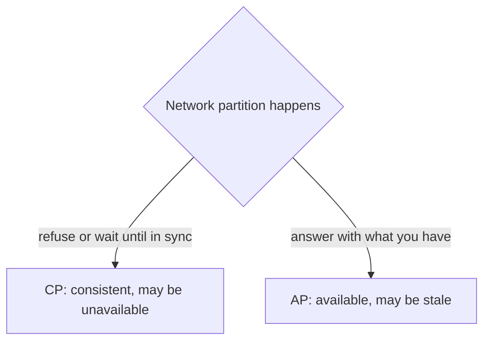

# My Notes: ACID, BASE, the CAP Theorem and PACELC

> **Source:** Chapter II of *System Design* by Karan Pratap Singh ([github.com/karanpratapsingh/system-design](https://github.com/karanpratapsingh/system-design)): the ACID and BASE consistency models, CAP Theorem and PACELC Theorem sections.
>
> These notes are written fresh from that part of the book. The wording, examples and diagrams are my own, so go to the book for the original explanations.

---

## 1. Why consistency models exist

When many users read and write the same data, and that data lives on several machines, we need a **contract**: what can a reader expect to see after a write? Different systems promise different things, and the promise shapes both correctness and performance.

Two families of promises:
- **ACID:** strict, transaction-centric guarantees, typical of relational databases.
- **BASE:** relaxed, availability-first guarantees, typical of large distributed NoSQL stores.

---

## 2. ACID

A **transaction** is a group of operations that should behave as one unit, like "move ₹500 from A to B" (debit A, credit B). ACID describes how a database protects it.

| Letter | Property | Meaning | Without it… |
|---|---|---|---|
| **A** | Atomicity | All operations happen, or none do | A debited, B never credited |
| **C** | Consistency | Every transaction moves the DB from one valid state to another (constraints, rules hold) | Negative balances, orphan rows |
| **I** | Isolation | Concurrent transactions don't see each other's half-done work | Two withdrawals both read the same old balance |
| **D** | Durability | Once committed, it survives crashes and power loss | "Payment successful" vanishes after a restart |

**How databases deliver it:**
- *Atomicity and durability:* a **write-ahead log** records changes before applying them, so after a crash the DB replays or rolls back.
- *Isolation:* locks or **MVCC** (multi-version concurrency control, where readers see a snapshot).

### 2.1 Isolation levels (the practical knob)

Full isolation is expensive, so databases offer levels:

| Level | Prevents | Still allows |
|---|---|---|
| Read uncommitted | (almost nothing) | Dirty reads |
| Read committed (Postgres default) | Dirty reads | Non-repeatable reads, phantoms |
| Repeatable read (MySQL InnoDB default) | + non-repeatable reads | Some phantoms / write skew (depends on engine) |
| Serializable | Everything: as if transactions ran one by one | Nothing, but slowest, and may abort and require retries |

- **Dirty read:** seeing uncommitted data.
- **Non-repeatable read:** the same row read twice gives different values.
- **Phantom:** the same query returns new rows the second time.

---

## 3. BASE

**BASE** is the looser contract many distributed stores choose so they stay fast and available at huge scale:

- **Basically Available:** the system always responds, even during failures, though possibly with stale or partial data.
- **Soft state:** data may change over time even without new input, as replicas sync up.
- **Eventual consistency:** if writes stop, all replicas *eventually* converge to the same value.

**Example:** you like a post. Your friend in another region sees the like count update a second later. Nobody is harmed, and the system never had to block your write waiting for every region to agree.

---

## 4. ACID vs BASE

| | ACID | BASE |
|---|---|---|
| Priority | Correctness | Availability and scale |
| After a write | Everyone sees it immediately | Everyone sees it eventually |
| Scaling | Harder to distribute | Built to distribute |
| Fits | Payments, inventory, bookings, ledgers | Feeds, likes, view counts, analytics, carts |

It's not all-or-nothing: many systems use ACID for the money path and BASE for everything around it. Modern databases also blur the line (MongoDB multi-document transactions, DynamoDB transactions, distributed SQL like Spanner and CockroachDB).

---

## 5. The CAP theorem

For a **distributed** data store, when a **network partition** happens (some nodes can't talk to others), you must choose between:

- **C, Consistency:** every read sees the latest write (or gets an error).
- **A, Availability:** every request gets a non-error response (possibly stale).
- **P, Partition tolerance:** the system keeps working despite lost or delayed messages between nodes.

**The real reading:** partitions *will* happen in any distributed system, so P isn't optional. The actual choice is **during a partition, C or A?**

- **CP systems:** prefer correctness. Some requests fail or wait until the partition heals. Examples: ZooKeeper, etcd, HBase, MongoDB (default config), traditional RDBMS clusters with synchronous failover.
- **AP systems:** prefer answering. Nodes accept reads and writes and reconcile later. Examples: Cassandra, DynamoDB (default), CouchDB, DNS.

CA (consistent and available, no partition tolerance) only really describes a single-node database. Once you have a network between nodes, you're choosing CP or AP.

### 5.1 Picking by use case

- Bank balance, seat booking, unique username claim → **CP**: better to say "try again" than double-book.
- Social feed, product reviews, shopping cart, metrics → **AP**: better to show slightly old data than an error page.

---

## 6. PACELC: what CAP leaves out

CAP only talks about behaviour **during a partition**, which is rare. PACELC adds the everyday trade-off:

> **If** there's a **P**artition, choose **A**vailability or **C**onsistency, **E**lse (normal operation) choose **L**atency or **C**onsistency.

Even with a healthy network, strong consistency means waiting for replicas to confirm (more **latency**), while answering from the nearest replica is fast but may be stale.

| System | During partition | Normally | Class |
|---|---|---|---|
| Cassandra, DynamoDB (default) | Availability | Latency | **PA/EL** |
| Spanner, CockroachDB, HBase | Consistency | Consistency | **PC/EC** |
| MongoDB, Cosmos DB | Depends on configuration (read/write concerns, consistency level) | | tunable |

Many stores make this **tunable per request**. Cassandra's consistency levels (`ONE`, `QUORUM`, `ALL`) let you choose: read and write at `QUORUM` (majority) and you get strong consistency because the read and write sets overlap (`R + W > N`).

---

## 7. My cheat sheet

| Concept | One-liner |
|---|---|
| ACID | Atomic, consistent, isolated, durable transactions; correctness first |
| WAL / MVCC | How DBs get durability and atomicity / isolation without blocking readers |
| Isolation levels | Read committed → repeatable read → serializable: safer but slower |
| BASE | Basically available, soft state, eventually consistent; scale first |
| CAP | During a partition, choose consistency (CP) or availability (AP) |
| P is mandatory | Networks fail; the real choice is C vs A when they do |
| PACELC | Also, without partitions: latency vs consistency |
| Quorum | `R + W > N` gives strong reads in a replicated store |
