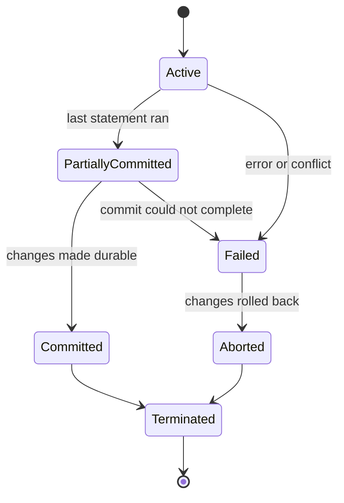
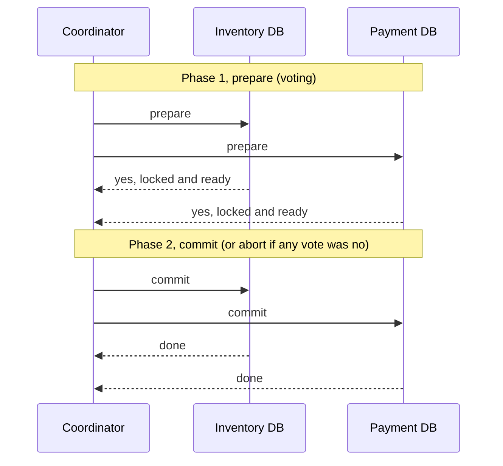
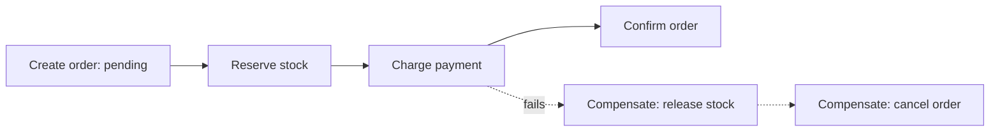

# My Notes: Transactions and Distributed Transactions (2PC, 3PC, Sagas)

> **Source:** Chapter II of *System Design* by Karan Pratap Singh ([github.com/karanpratapsingh/system-design](https://github.com/karanpratapsingh/system-design)): the Transactions and Distributed Transactions sections.
>
> These notes are written fresh from that part of the book. The wording, examples and diagrams are my own, so go to the book for the original explanations.

---

## 1. A transaction is one logical unit of work

A **transaction** groups several reads and writes so they succeed or fail **together** (with the ACID guarantees from the previous chapter).

```sql
BEGIN;
  UPDATE accounts SET balance = balance - 500 WHERE id = 'A';
  UPDATE accounts SET balance = balance + 500 WHERE id = 'B';
COMMIT;   -- or ROLLBACK if anything failed
```

### 1.1 The life of a transaction



| State | What's happening |
|---|---|
| **Active** | Statements are executing |
| **Partially committed** | The last operation ran, but changes aren't durable yet |
| **Committed** | Changes are permanent (logged to disk) |
| **Failed** | Something went wrong: an error, constraint violation, deadlock or crash |
| **Aborted** | All changes rolled back. The app may **retry** (safe for serialization conflicts) or give up |
| **Terminated** | Done, resources released |

Inside **one database**, all of this is handled for us. The trouble starts when one business operation spans **several** databases or services.

---

## 2. Why distributed transactions are hard

An order in a microservice system might need to:
1. Reserve stock in the **Inventory** service (its own DB).
2. Charge the card via the **Payment** service (its own DB, plus an external provider).
3. Create the order in the **Order** service (its own DB).

There's no single `BEGIN … COMMIT` across three databases. If payment succeeds and order creation fails, we've charged a customer for nothing. A **distributed transaction** is any technique for keeping several independent participants consistent: either all apply the change, or none does (or it's compensated).

---

## 3. Two-phase commit (2PC)

A **coordinator** asks every participant to get ready, and only commits if *everyone* says yes.



- **Phase 1, prepare:** each participant does the work, writes it to its log, **holds locks**, and votes yes or no.
- **Phase 2, commit/abort:** all yes means commit everywhere. Any no (or a timeout) means abort everywhere.

| Pros | Cons |
|---|---|
| Real atomicity across participants | **Blocking:** if the coordinator dies after prepare, participants sit holding locks, unsure whether to commit |
| Well understood, supported by XA and many databases | Slow: extra round trips, and locks held across the network |
| | Coordinator is a single point of failure |
| | Every participant must support the protocol (most external APIs don't) |

---

## 4. Three-phase commit (3PC)

3PC adds a middle step so participants never get stuck waiting forever:

1. **Can-commit:** "could you commit?" (vote)
2. **Pre-commit:** "everyone said yes, prepare to commit." Participants acknowledge.
3. **Do-commit:** actually commit.

Because everyone knows the decision is "commit" before the final step, a participant that loses the coordinator after pre-commit can **time out and commit safely** instead of blocking.

| Pros | Cons |
|---|---|
| Non-blocking under coordinator crashes | Even more round trips and latency |
| | Still breaks under network partitions (nodes can decide differently) |
| | Rarely used in practice |

---

## 5. Sagas: the microservices answer

A **saga** splits one big transaction into a **sequence of local transactions**, one per service. Each step commits in its own database and triggers the next. If a step fails, the saga runs **compensating transactions** to undo the earlier steps.



- There's **no global lock**, so each service stays independent and available.
- The system is **eventually consistent**: for a moment, stock is reserved but the order isn't confirmed.
- Compensations are **business undo actions**, not database rollbacks: "refund the charge", "release the stock", "send a cancellation email".

### 5.1 Two ways to coordinate a saga

| | Choreography | Orchestration |
|---|---|---|
| How | Each service listens for events and emits the next (`OrderCreated` → Inventory → `StockReserved` → Payment…) | A central **orchestrator** tells each service what to do and tracks progress |
| Pros | No central brain, loosely coupled, simple for few steps | Whole flow visible in one place; easier to change, test and monitor |
| Cons | Flow is spread across services, hard to follow; risk of cyclic dependencies | Orchestrator is extra infrastructure and a place logic can pile up |
| Tools | Kafka, RabbitMQ, SNS/SQS events | Temporal, AWS Step Functions, Camunda, Netflix Conductor |

### 5.2 Saga rules I keep in mind

- Every step and every compensation should be **idempotent**: retries happen.
- Some steps **can't be undone** (an email was sent). Put them last, or design a compensating message.
- Expose intermediate states honestly (`PENDING`, `PAYMENT_FAILED`) instead of pretending things are atomic.
- Use the **transactional outbox** pattern: write the business change and the "event to publish" in the same local transaction, then relay it to the broker, so events are never lost or published for rolled-back changes.

---

## 6. Which one to use

| Situation | Choice |
|---|---|
| All data in one database | A normal local transaction. Keep it that way if you can |
| Few participants you control, short-lived, strong consistency required | 2PC (or a distributed SQL database that handles it internally) |
| Microservices, external APIs, long-running business processes | **Saga** with compensations |

---

## 7. My cheat sheet

| Concept | One-liner |
|---|---|
| Transaction | All-or-nothing unit of work |
| States | Active → partially committed → committed, or failed → aborted |
| Distributed transaction | Keeping several independent stores consistent for one operation |
| 2PC | Prepare (vote) then commit; atomic but blocking, coordinator is a SPOF |
| 3PC | Adds pre-commit to avoid blocking; still partition-unsafe, rarely used |
| Saga | Chain of local transactions + compensations; eventual consistency |
| Choreography vs orchestration | Services react to events vs a central coordinator directs them |
| Outbox | Save change + event together, publish after commit |
