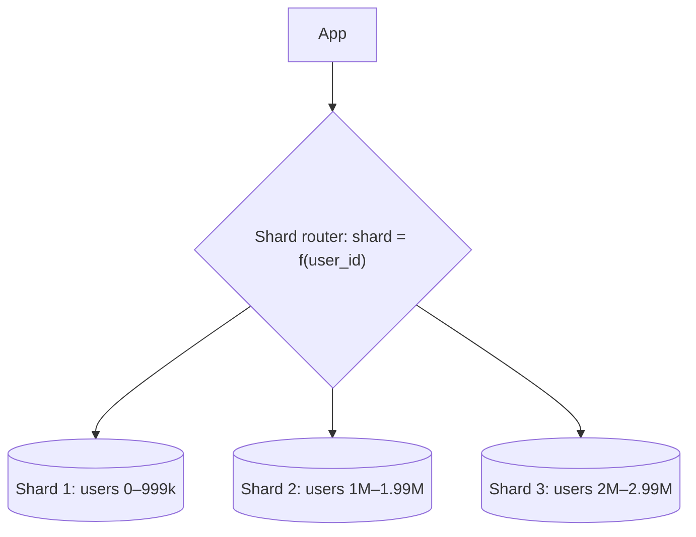
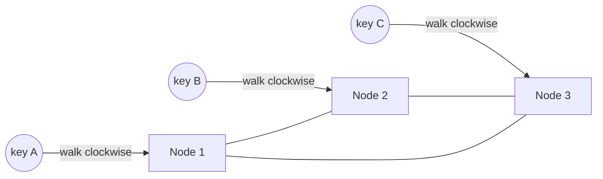
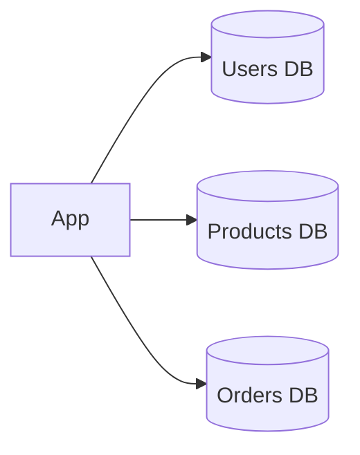

# My Notes: Sharding, Consistent Hashing and Database Federation

> **Source:** Chapter II of *System Design* by Karan Pratap Singh ([github.com/karanpratapsingh/system-design](https://github.com/karanpratapsingh/system-design)): the Sharding, Consistent Hashing and Database Federation sections.
>
> These notes are written fresh from that part of the book. The wording, examples and diagrams are my own, so go to the book for the original explanations.

---

## 1. Partitioning: splitting data up

When one database can't hold the data or keep up with the writes, we **partition**: split the data into pieces that live in different places.

- **Vertical partitioning:** split by **columns or features**. Move rarely used large columns (`bio`, `avatar_blob`) to another table, or move whole feature areas to separate databases (see federation below).
- **Horizontal partitioning:** split by **rows**. Users A–M in one place, N–Z in another. When those pieces live on **different machines**, that's **sharding**.

---

## 2. Sharding

Each **shard** is an independent database holding a subset of the rows, with the same schema. Together they hold everything.

The **shard key** (partition key) decides which shard a row lives on. Choosing it is the most important and least reversible decision in sharding.

### 2.1 Ways to map keys to shards

| Method | How | Good | Bad |
|---|---|---|---|
| **Hash-based** | `shard = hash(key) % N` | Even spread, no hotspots from sequential keys | Range queries hit every shard; changing `N` moves almost all data |
| **Range-based** | Key ranges per shard (dates, IDs, A–M) | Range scans stay on one shard; easy to reason about | Hotspots: today's data or new IDs all land on the last shard |
| **List-based** | Explicit lists (country `IN`, `US` → shard 2) | Natural for regional data and data-residency laws | Uneven sizes; lists need maintenance |
| **Directory-based** | A lookup table says where each key lives | Total flexibility, can move individual keys | The directory is extra latency and a critical dependency |
| **Composite** | Combine methods (list by region, then hash within it) | Fits complex needs | More complex routing |

### 2.2 What a good shard key looks like

- **High cardinality:** many distinct values, so data can spread.
- **Even access:** no single value gets most of the traffic (a celebrity's `user_id` can be a "hot key").
- **Matches the queries:** most queries should include it, so they hit one shard. For a chat app, `conversation_id` keeps a conversation's messages together.

### 2.3 Why shard

- Store more data than one machine can.
- Spread **write** load (replicas only spread reads).
- Smaller indexes per shard, so faster queries.
- **Fault isolation:** one shard down affects only its slice of users.

### 2.4 What it costs

- **Cross-shard queries** (joins, aggregations, global sorting) become scatter-gather across all shards: slow and complex.
- **Cross-shard transactions** need distributed transactions or sagas (previous chapter).
- **Rebalancing** when shards fill up or get hot is operationally painful.
- **Unique IDs** can't come from one auto-increment, so use UUIDs, Snowflake-style IDs, or per-shard ranges.
- App and ops complexity: routing, backups, schema migrations ×N.

### 2.5 When to shard

**Last**, not first. Before sharding, try: better indexes and queries → caching → read replicas → vertical scaling → moving big or rarely used data elsewhere → federation. Shard when write volume or data size truly outgrows one well-tuned primary, or use a database that shards for you (DynamoDB, Cassandra, MongoDB, CockroachDB, Vitess for MySQL, Citus for Postgres).

---

## 3. Consistent hashing

### 3.1 The problem with `hash(key) % N`

With 4 shards, `hash % 4` spreads keys nicely. Add a 5th and `hash % 5` gives a different answer for **~80% of keys**, so almost all the data (or the whole cache) must move at once. That's a disaster for caches and a huge migration for databases.

### 3.2 The ring

Consistent hashing maps **both servers and keys onto the same circular hash space** (say 0 to 2³²−1):

1. Hash each node's ID to a position on the ring.
2. Hash each key to a position on the ring.
3. A key belongs to the **first node clockwise** from it.

**Adding a node** only takes over keys between it and its predecessor, about `1/N` of the data. **Removing a node** hands its keys to the next node only. Everything else stays put.

### 3.3 Virtual nodes

With only a few real nodes, their positions can be lumpy, so one node owns a huge arc. The fix is to place **many virtual nodes** per server around the ring (say 100–200 each):
- Load evens out statistically.
- A bigger machine can get more virtual nodes (weighting).
- When a node dies, its load scatters across *many* neighbours instead of dumping on one.

### 3.4 Replication on the ring

To keep `R` copies, store each key on its owner **and the next `R − 1` distinct nodes clockwise**. This is how Dynamo-style stores (Cassandra, Riak, DynamoDB) place replicas.

| Pros | Cons |
|---|---|
| Adding/removing nodes moves only ~`1/N` of keys | Needs virtual nodes to balance well |
| Smooth scaling for caches and partitioned stores | Hot *keys* still overload one node (needs splitting or caching) |
| Natural replica placement | More complex than modulo |

Used by: Cassandra, DynamoDB, Riak, Memcached client libraries, and load balancers that need key affinity. The idea itself came out of research behind Akamai's CDN.

---

## 4. Database federation (functional partitioning)

**Federation** splits databases **by function**: users, products and orders each get their own database, instead of one database holding everything.

### 4.1 Characteristics

- Each database is independent and can be scaled, tuned and backed up on its own.
- The app (or a data access layer) knows which database serves which domain.
- It often lines up with team and service boundaries, and microservices with their own databases are federation by design.

| Advantages | Disadvantages |
|---|---|
| Less load and contention per database | **Joins across databases** must happen in the app |
| Smaller datasets, so more fits in memory and caches hit more | Transactions spanning domains need sagas or 2PC |
| Scale each domain to its own needs (read-heavy catalog, write-heavy orders) | More databases to run and monitor |
| Fault isolation between domains | Doesn't help if *one* domain alone is too big, which still needs sharding |

---

## 5. My cheat sheet

| Concept | One-liner |
|---|---|
| Vertical vs horizontal partitioning | Split columns/features vs split rows |
| Sharding | Rows spread across independent databases by a shard key |
| Hash / range / list / directory | Even spread / range scans / explicit groups / lookup table |
| Good shard key | High cardinality, even traffic, present in most queries |
| Shard last | Indexes → cache → replicas → bigger box → federation → shard |
| `hash % N` problem | Changing N remaps ~all keys |
| Consistent hashing | Ring; adding a node moves ~1/N of keys |
| Virtual nodes | Many ring positions per server for even load |
| Federation | One database per business function |
