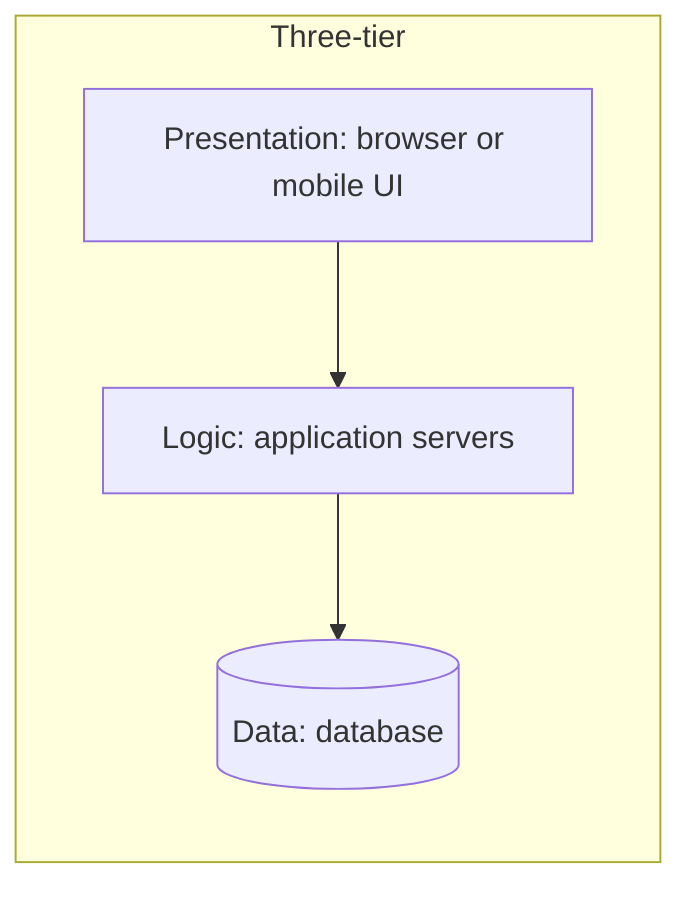
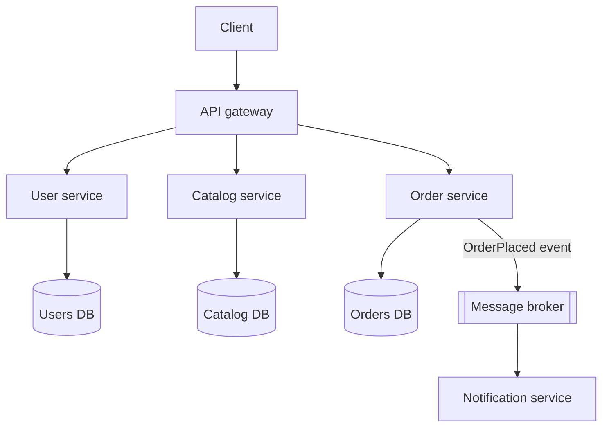

# My Notes: N-Tier Architecture, Monoliths and Microservices

> **Source:** Chapter III of *System Design* by Karan Pratap Singh ([github.com/karanpratapsingh/system-design](https://github.com/karanpratapsingh/system-design)): the N-tier architecture and Monoliths and Microservices sections.
>
> These notes are written fresh from that part of the book. The wording, examples and diagrams are my own, so go to the book for the original explanations.

---

## 1. N-tier architecture

**N-tier** architecture splits an application into **layers (tiers)**, each with one responsibility, usually on separate machines. Each tier only talks to the one next to it.

> Tier vs layer: a *layer* is a logical separation in code, and a *tier* is a physical deployment separation. Three layers can still run on one tier.

### 1.1 The common shapes

| Type | Split | Example |
|---|---|---|
| **1-tier** | UI, logic and data on one machine | A desktop app with a local SQLite file |
| **2-tier** | Client (UI + some logic) ↔ database server | Old-school desktop apps talking straight to a DB |
| **3-tier** | UI ↔ app server ↔ database | Almost every web app: React → API → Postgres |
| **N-tier** | Add tiers like cache, search, queue, API gateway | Large web platforms |

| Advantages | Disadvantages |
|---|---|
| Separation of concerns, so each tier is simpler | More network hops, more latency |
| Scale tiers independently (more app servers, same DB) | More moving parts to deploy and secure |
| Security: the DB is never exposed to clients | Can become "lasagna": layers that just pass calls through |
| Teams can work on tiers in parallel | Changes that touch every tier are slow |

---

## 2. Monoliths

A **monolith** is one application, **one codebase and one deployable**, containing all the business features: users, catalog, cart, payments, notifications.

| Advantages | Disadvantages |
|---|---|
| Simple to build, run, test and debug locally | Gets harder to understand as it grows |
| One deploy, one place to look at logs | Any change means redeploying the whole thing |
| Function calls instead of network calls: fast, no partial failures | Scale everything together, even if only one feature is hot |
| Easy transactions across features (one database) | One bad module (memory leak) can take down everything |
| Easy refactoring across the codebase | Hard to adopt new tech for one part; big teams step on each other |

### 2.1 The modular monolith

A middle ground I like: **one deployable, but strict internal modules**, each with its own clear API, its own tables, and no reaching into another module's internals.

- Keeps the operational simplicity of a monolith.
- Gives most of the code-organisation benefits of microservices.
- Makes it easy to **extract** a module into a service later if it truly needs independent scaling or deployment.

---

## 3. Microservices

**Microservices** split the system into many **small, independently deployable services**, each owning one business capability **and its own data**, talking over the network (HTTP/gRPC or messages).

### 3.1 Characteristics

- **Single business capability** per service ("checkout", not "database helpers").
- **Own data:** no other service touches its database directly.
- **Independently deployable** by the owning team.
- **Communicate via APIs or events**; **decentralised** tech choices where they make sense.
- **Designed for failure:** timeouts, retries, circuit breakers (see the resilience chapter).

### 3.2 The trade

| Advantages | Disadvantages |
|---|---|
| Teams ship independently and quickly | **Distributed systems problems:** latency, partial failures, retries, consistency |
| Scale only the hot services | Data spread out, so no joins or easy transactions (sagas needed) |
| Fault isolation (if done right) | Much harder testing, debugging and tracing across services |
| Freedom to pick tech per service | Operational load: CI/CD, monitoring and on-call ×N services |
| Smaller codebases are easier to understand individually | Network calls cost far more than function calls |

### 3.3 Practices that make them work

- Draw boundaries around **business domains** (domain-driven design, bounded contexts), not technical layers.
- **Database per service**, sharing data through APIs or events.
- **Automate everything:** CI/CD, infrastructure as code, containers and orchestration.
- **Observability from day one:** centralised logs, metrics, distributed tracing with correlation IDs.
- **Resilience:** timeouts, retries with backoff, circuit breakers, bulkheads, idempotent handlers.
- Prefer **asynchronous events** for cross-service side effects, to reduce temporal coupling.
- Version APIs and keep them backward compatible.

### 3.4 Pitfalls

- **Services too small** ("nano-services"): every feature touches five services.
- **Shared database** between services: you get the coupling of a monolith with the complexity of microservices.
- **Chatty synchronous chains:** A → B → C → D, where latency adds up and availability multiplies down.
- Splitting **before** understanding the domain: boundaries end up in the wrong places and are expensive to move.

---

## 4. Beware the distributed monolith

The worst of both worlds: services that are separately deployed but **must be deployed together**, share databases or libraries full of business logic, and call each other synchronously everywhere. Signs to watch for:
- One feature needs coordinated changes in many services.
- One service failing cascades across the system.
- Teams can't release without asking others.

If you see these, either merge the over-split services back, or decouple them properly with clear ownership and async events.

---

## 5. Microservices vs SOA

**Service-oriented architecture (SOA)** came first, with the same instinct of splitting into services, but in a different style:

| | SOA | Microservices |
|---|---|---|
| Service size | Larger, enterprise-wide services | Small, single capability |
| Communication | Often through a central **ESB** with heavy logic | "Smart endpoints, dumb pipes": simple HTTP or brokers |
| Data | Often shared databases | Database per service |
| Governance | Centralised standards | Decentralised, team-owned |
| Goal | Reuse across the enterprise | Independent delivery and scaling |

---

## 6. Do you even need microservices?

Usually not at the start. Microservices solve **organisational scale** problems (many teams blocked on one codebase) more than technical ones. A small team on microservices spends its time on infrastructure instead of the product.

**A sensible path:** start with a well-structured (modular) monolith → find the parts with genuinely different scaling, reliability or team-ownership needs → extract those as services, one at a time.

---

## 7. My cheat sheet

| Concept | One-liner |
|---|---|
| Layer vs tier | Logical split in code vs physical deployment split |
| 3-tier | UI → app servers → database; the default web shape |
| Monolith | One deployable; simple, but grows unwieldy |
| Modular monolith | One deployable, strict internal modules; best starting point |
| Microservices | Independent services owning their own data; organisational scaling |
| Database per service | Never share a DB between services |
| Distributed monolith | Separate deploys that must ship together: avoid |
| SOA vs microservices | Big services + smart ESB vs small services + dumb pipes |
