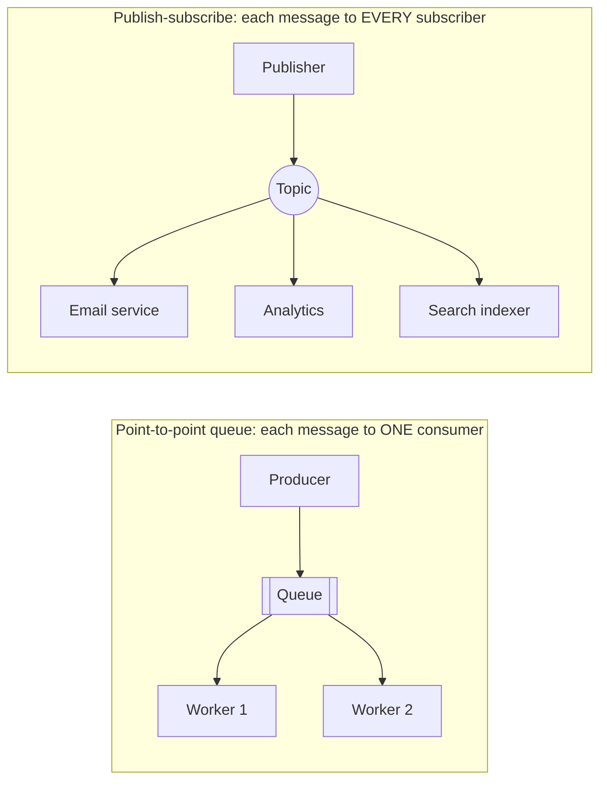
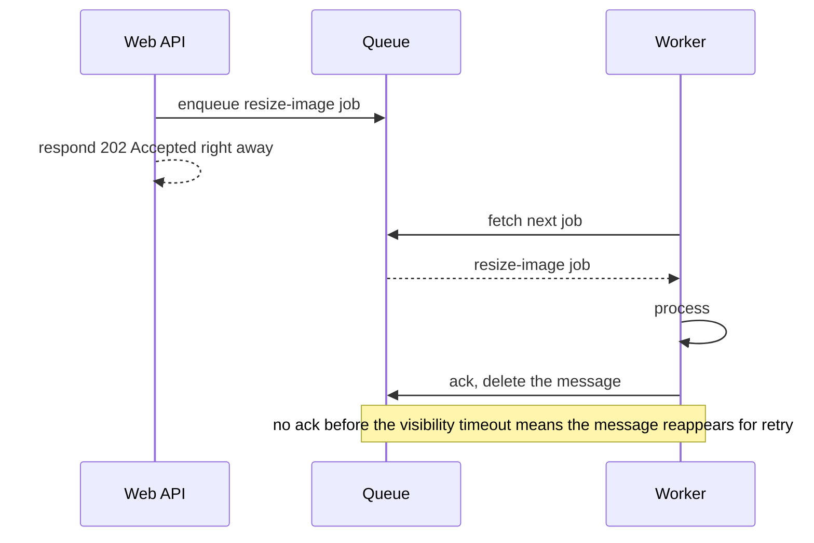
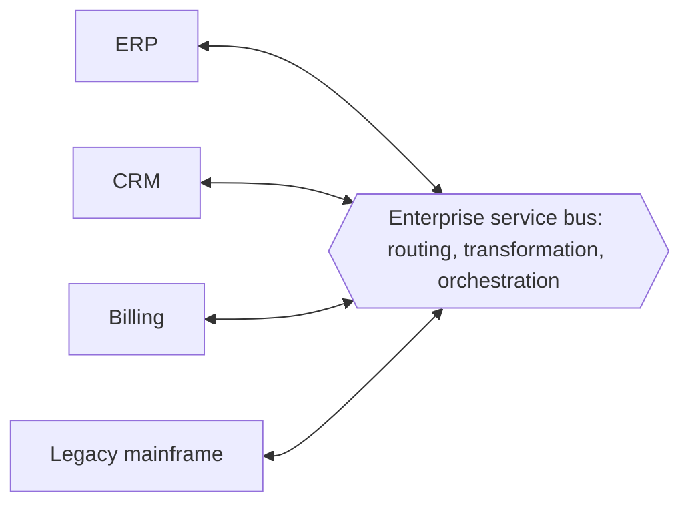

# My Notes: Message Brokers, Message Queues, Pub/Sub and the ESB

> **Source:** Chapter III of *System Design* by Karan Pratap Singh ([github.com/karanpratapsingh/system-design](https://github.com/karanpratapsingh/system-design)): the Message Brokers, Message Queues, Publish-Subscribe and Enterprise Service Bus sections.
>
> These notes are written fresh from that part of the book. The wording, examples and diagrams are my own, so go to the book for the original explanations.

---

## 1. Why messaging at all

When service A calls service B directly over HTTP, A has to wait for B, B has to be up, and B has to keep up with A's rate. **Asynchronous messaging** breaks those ties:

- **Decoupling in time:** B can be down or busy, and the message waits.
- **Decoupling in space:** A doesn't need to know who consumes the message, or how many consumers there are.
- **Load levelling:** bursts queue up and get processed at a steady pace.
- **Resilience:** failed work is retried instead of lost.

---

## 2. Message brokers

A **message broker** is the middleware that receives messages from **producers**, stores them, and delivers them to **consumers**, translating protocols and routing along the way.

### 2.1 Two delivery models

- **Point-to-point (queues):** a message is processed by exactly one of the competing consumers. Use it for distributing *work*.
- **Publish-subscribe (topics):** a message is copied to every subscriber. Use it for broadcasting *facts* ("an order was placed").

### 2.2 Brokers vs event streaming platforms

| | Classic message broker | Event streaming platform |
|---|---|---|
| Examples | RabbitMQ, ActiveMQ, Amazon SQS | Apache Kafka, Kinesis, Pulsar, Redpanda |
| Message after consumption | Removed | **Kept** in an append-only log for a retention period |
| Replay | No | Yes: new consumers can read history from any offset |
| Ordering | Per queue (often best-effort) | Strict **per partition** |
| Typical use | Task distribution, request buffering, routing rules | Event pipelines, analytics, event sourcing, change data capture |

### 2.3 Brokers vs an ESB

A broker mainly moves messages. An **enterprise service bus** (section 5) also transforms, orchestrates and applies business rules in the middle. Modern advice is to keep the pipes **dumb** and the endpoints smart, so brokers fit that better.

---

## 3. Message queues

A **message queue** holds messages until a consumer takes and processes them.

### 3.1 Benefits

- Faster user-facing responses: do the slow work later (emails, video encoding, reports).
- Absorb spikes: the queue grows, workers drain it.
- Scale workers independently of the API.
- Built-in retries and failure isolation.

### 3.2 Features to know

| Feature | What it means |
|---|---|
| **Push vs pull** | Broker pushes to consumers (low latency) vs consumers poll (consumer controls pace; most queues) |
| **FIFO queues** | Strict first-in-first-out ordering (often with lower throughput, e.g. SQS FIFO) |
| **Delayed / scheduled delivery** | Message becomes visible only after a delay: reminders, retry backoff |
| **At-least-once delivery** | Never lost, but **may be delivered twice**, so consumers must be idempotent. The common default |
| **At-most-once** | Never duplicated, but may be lost. Fine for metrics noise |
| **Exactly-once** | Hard. Achieved in practice as at-least-once + deduplication or transactional processing (Kafka transactions, SQS FIFO dedup IDs) |
| **Dead-letter queue (DLQ)** | Messages that fail N times are moved aside for inspection, so they don't block or loop forever |
| **Ordering** | Often only guaranteed within a group or partition key (all messages for `order_42` in order) |
| **Poison-pill messages** | A message that crashes every consumer that touches it; DLQs and max-retry counts contain it |
| **Security** | Authentication, per-queue permissions, encryption in transit and at rest |
| **Task queues** | Queues specialised for background jobs with retries and scheduling (Celery, Sidekiq, BullMQ) |

### 3.3 Backpressure

If producers outpace consumers forever, the queue grows without limit: memory fills, latency explodes, and old messages become useless. **Backpressure** pushes back on producers:
- Cap queue length and **reject or slow** new work (HTTP 429 or 503 to clients).
- Autoscale consumers based on queue depth or age of the oldest message.
- Shed low-priority work first.

Examples: Amazon SQS, RabbitMQ, Azure Service Bus, Google Cloud Tasks, Redis-based queues.

---

## 4. Publish-subscribe

In **pub/sub**, publishers send messages to a **topic** without knowing who's listening. Every subscriber to that topic gets its own copy.

### 4.1 Why it's useful

- Add a new reaction to an event (say, a fraud check on `OrderPlaced`) **without touching the publisher**.
- Fan the same event out to many systems: email, analytics, search index, cache invalidation.
- Services stay independently deployable and scalable.

### 4.2 Features

| Feature | Meaning |
|---|---|
| **Push delivery** | Subscribers get messages as they're published (webhooks, streaming connections) |
| **Multiple protocols** | Deliver to queues, HTTP endpoints, email, SMS, mobile push (e.g. Amazon SNS) |
| **Fan-out** | One message copied to many subscribers. The classic SNS → many SQS queues pattern |
| **Filtering** | Subscribers receive only messages matching attributes (`country = IN`) |
| **Durability** | Messages are persisted until each subscriber acknowledges them |
| **Security** | Control who may publish to and subscribe to each topic |

**Watch out for:** subscribers can't see each other's failures, ordering across subscribers isn't guaranteed, and events can arrive late or twice. Design consumers to be idempotent.

Examples: Amazon SNS, Google Cloud Pub/Sub, Kafka topics with consumer groups, Redis Pub/Sub (in-memory and fire-and-forget), NATS.

---

## 5. Enterprise service bus (ESB)

An **ESB** is a central integration hub that every application plugs into. It routes messages, **transforms formats** (XML ↔ JSON, field mapping), **translates protocols** (SOAP ↔ REST ↔ FTP), and can **orchestrate** multi-step business flows.

| Advantages | Disadvantages |
|---|---|
| Connects many heterogeneous, legacy systems | **Central bottleneck and single point of failure** |
| Integration logic in one place, not N×N connections | Business logic creeps into the bus and becomes hard to change and test |
| Standard monitoring and security for integrations | Slower change: every integration goes through the bus team |
| | Heavyweight, often expensive products |

ESBs were central to SOA (see the previous chapter). Today they mostly survive in large enterprises integrating older systems. New designs prefer lightweight brokers plus smart services.

Examples: MuleSoft, IBM App Connect, Microsoft BizTalk, Apache ServiceMix, WSO2.

---

## 6. My cheat sheet

| Concept | One-liner |
|---|---|
| Broker | Middleware that stores and routes messages between producers and consumers |
| Queue (point-to-point) | Each message to one worker; distributes work |
| Topic (pub/sub) | Each message to every subscriber; broadcasts facts |
| Streaming log (Kafka) | Messages retained and replayable, ordered per partition |
| At-least-once | Default; duplicates possible, so idempotent consumers |
| DLQ | Parking lot for messages that keep failing |
| Backpressure | Push back on producers when consumers can't keep up |
| Fan-out | One event → many subscriber queues (SNS → SQS) |
| ESB | Central smart bus for enterprise integration; avoid for new designs |
