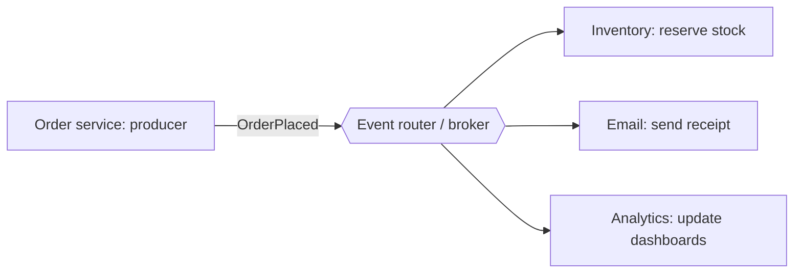
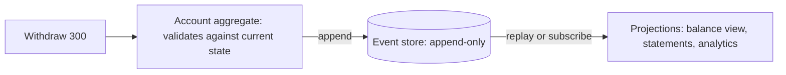
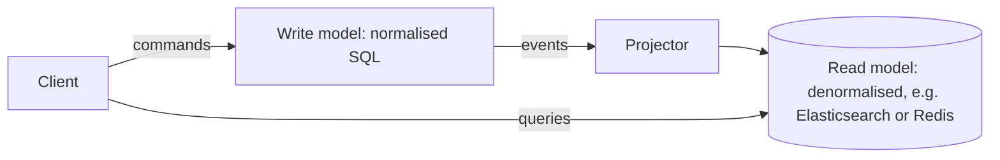

# My Notes: Event-Driven Architecture, Event Sourcing and CQRS

> **Source:** Chapter III of *System Design* by Karan Pratap Singh ([github.com/karanpratapsingh/system-design](https://github.com/karanpratapsingh/system-design)): the Event-Driven Architecture, Event Sourcing and CQRS sections.
>
> These notes are written fresh from that part of the book. The wording, examples and diagrams are my own, so go to the book for the original explanations.

---

## 1. Event-driven architecture (EDA)

In **event-driven architecture**, services communicate by **producing and reacting to events** instead of calling each other directly. The producer announces "this happened" and doesn't know or care who reacts.

### 1.1 What's an event?

An **event** is an immutable record that **something happened** in the past: `OrderPlaced`, `PaymentFailed`, `UserSignedUp`, `TemperatureExceeded`.

- Named in the **past tense**: it's a fact, not a request.
- Carries what consumers need: IDs, timestamp, relevant data.
- Compare with a **command** (`PlaceOrder`), which asks for something to happen and can be rejected.

```json
{
  "type": "OrderPlaced",
  "eventId": "evt_8f2c",
  "occurredAt": "2026-11-03T10:15:00Z",
  "orderId": "ord_42",
  "userId": "usr_7",
  "total": 1499
}
```

### 1.2 Building blocks



- **Producers (publishers):** detect changes and emit events.
- **Event router / broker:** receives, stores and delivers events (Kafka, SNS/SQS, EventBridge, RabbitMQ).
- **Consumers (subscribers):** react to events they care about.

### 1.3 Patterns

- **Event notification:** a thin event says "order 42 changed", and consumers call back for details. Small events, but adds coupling and load.
- **Event-carried state transfer:** the event includes the data consumers need, so they can keep their own local copy and never call back.
- **Pub/sub fan-out:** one event, many independent reactions.
- **Event streaming:** an ordered, replayable log of events (Kafka) for pipelines and analytics.
- **Event sourcing:** events *are* the source of truth (section 2).

| Advantages | Challenges |
|---|---|
| Loose coupling: add consumers without changing producers | **Eventual consistency:** consumers lag behind |
| Each service scales and fails independently | Hard to see the overall flow; needs tracing and good docs |
| Natural audit trail and real-time reactions | Duplicates and out-of-order events: idempotency needed |
| Absorbs spikes via the broker | Event schema evolution and versioning |
| | Debugging "why didn't X happen?" across async hops |

**Good fits:** e-commerce order flows, IoT telemetry, fraud detection, notifications, syncing data between microservices, real-time analytics.

Examples: Kafka, AWS EventBridge, SNS + SQS, Google Pub/Sub, NATS, RabbitMQ.

---

## 2. Event sourcing

Normally a database stores **current state**: `balance = 700`. **Event sourcing** stores **every change as an event** in an append-only log, and current state is derived by replaying them.

```text
AccountOpened      { id: A, owner: "Riya" }
MoneyDeposited     { id: A, amount: 1000 }
MoneyWithdrawn     { id: A, amount: 300 }
--------------------------------------------
replay → balance = 700
```



- Events are **never updated or deleted**. Corrections are new events (`WithdrawalReversed`).
- To avoid replaying millions of events, store periodic **snapshots** and replay only what came after.

### 2.1 Event sourcing vs EDA

They're often confused:
- **EDA** is about *communication*: services talk through events.
- **Event sourcing** is about *storage*: one service persists its state as events.

You can have either without the other. They combine well when a service's stored events are also published for others.

| Advantages | Disadvantages |
|---|---|
| Complete **audit log** for free: who changed what, when | Different way of thinking, with a steep learning curve |
| **Time travel:** rebuild state at any past moment, debug by replaying | Querying current state needs projections (often CQRS) |
| New read models can be built from history at any time | Event schemas live forever, so versioning is hard |
| Natural fit for domains that are already ledgers (banking, inventory, bookings) | Eventual consistency between the log and read views |
| | Event stores grow without bound, so snapshots and archiving are needed |

---

## 3. CQRS: separate the writes from the reads

**Command Query Responsibility Segregation** splits a system into:
- a **command side (writes):** validates and applies changes, optimised for correctness;
- a **query side (reads):** serves data in exactly the shape screens need, optimised for speed.

They can use different models, and even **different databases**, kept in sync asynchronously.



### 3.1 CQRS with event sourcing

The two are natural partners: the **event store is the write model**, and **projections are the read models**. Each event updates one or more read views (an order list, a search index, a dashboard). Need a new view? Replay history into it.

| Advantages | Disadvantages |
|---|---|
| Scale reads and writes independently (reads usually dominate) | More moving parts: two models, sync pipelines |
| Read models tailored per screen: fast, no complex joins | **Stale reads:** the query side lags behind writes |
| Simpler write logic, focused on business rules | Overkill for simple CRUD apps |
| Different storage tech for each side | Harder to debug and operate |

### 3.2 When to use it

- Read and write workloads are **very different** in volume or shape (a catalog read 1000× more than it's edited).
- Complex domains with rich business rules on writes.
- Many different views of the same data (dashboards, search, feeds).
- Already using event sourcing.

Plain CRUD admin screens don't need it.

---

## 4. My cheat sheet

| Concept | One-liner |
|---|---|
| Event | Immutable past-tense fact (`OrderPlaced`) |
| Command | Request that may be rejected (`PlaceOrder`) |
| EDA | Services communicate by emitting and reacting to events |
| Event-carried state transfer | Event includes the data, so consumers needn't call back |
| Event sourcing | Store the change log; state = replay (+ snapshots) |
| EDA vs event sourcing | Communication style vs storage style |
| CQRS | Separate write model and read models, synced asynchronously |
| CQRS + ES | Event store = write side, projections = read side |
| Main cost | Eventual consistency and operational complexity |
