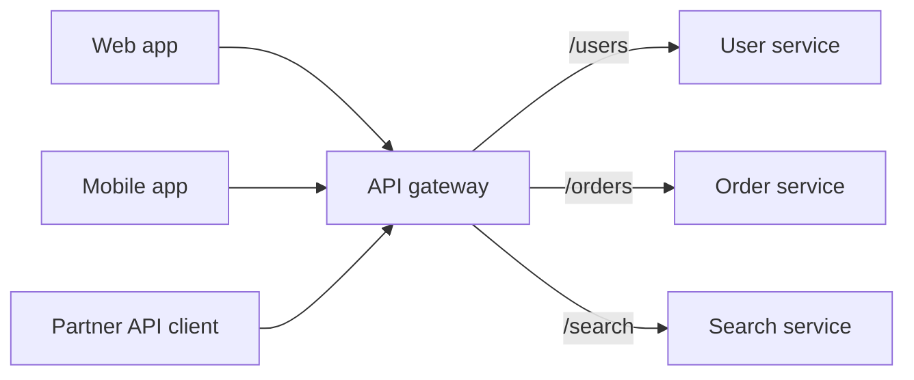
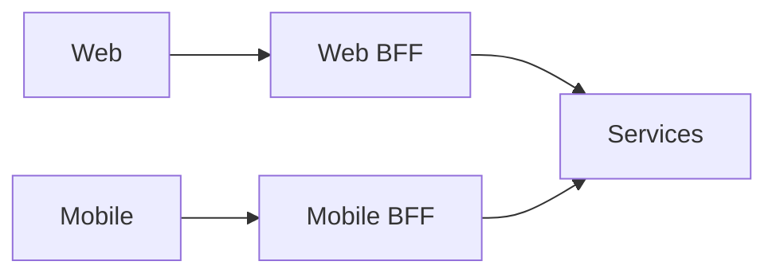

# My Notes: API Gateways, REST, GraphQL and gRPC

> **Source:** Chapter III of *System Design* by Karan Pratap Singh ([github.com/karanpratapsingh/system-design](https://github.com/karanpratapsingh/system-design)): the API Gateway and REST, GraphQL, gRPC sections.
>
> These notes are written fresh from that part of the book. The wording, examples and diagrams are my own, so go to the book for the original explanations.

---

## 1. API gateway

An **API gateway** is a single entry point that sits between clients and a set of backend services. Clients talk to one host, and the gateway routes each request to the right service while handling the cross-cutting chores once.



### 1.1 Why have one

Without a gateway, every client needs to know every service's address, and every service must re-implement auth, rate limits and logging. With microservices, that gets messy quickly.

### 1.2 What gateways typically do

- **Routing** by path, host or header, plus **service discovery** of backend instances.
- **Authentication and authorization** (validate JWTs or API keys once at the edge).
- **Rate limiting and throttling** per client or API key.
- **Request/response transformation:** protocol translation (REST ↔ gRPC), header injection, payload shaping.
- **Aggregation:** one client call fans out to several services and merges the result.
- **Caching** of common responses.
- **TLS termination, CORS, IP allow/deny lists**, and a WAF.
- **Observability:** access logs, metrics and tracing headers on every request.
- **Resilience:** timeouts, retries and circuit breaking toward backends.

| Advantages | Disadvantages |
|---|---|
| Clients see one stable, simple API | Another hop, so a little more latency |
| Cross-cutting concerns implemented once | Can become a **single point of failure** (run it redundantly) |
| Backends can change, split or move freely | Can become a **bottleneck** or a dumping ground for business logic |
| Central security and monitoring | Extra component to configure, deploy and scale |

### 1.3 Backend for frontend (BFF)

One gateway serving every client ends up compromising: mobile wants small payloads, web wants rich pages, TVs want something else. The **BFF pattern** gives **each client type its own gateway/backend**, owned by the team that builds that frontend.



Use BFFs when client experiences differ a lot, when frontend teams need to move independently, or when one generic API keeps growing special cases. Avoid them for a single client type: you'd just duplicate code.

Examples: Kong, AWS API Gateway, Apigee, Azure API Management, NGINX, Envoy-based gateways, Tyk.

---

## 2. What an API is

An **API** (application programming interface) is a contract for how software talks to other software: what you can ask for, in what format, and what you get back. The three dominant styles for service APIs are REST, GraphQL and gRPC.

---

## 3. REST

**REST** (representational state transfer) is an architectural style for HTTP APIs built around **resources**.

### 3.1 Core ideas

- **Resources** identified by URLs: `/users/42`, `/users/42/orders`.
- **HTTP methods** as verbs: `GET` read, `POST` create, `PUT`/`PATCH` update, `DELETE` remove.
- **Representations:** usually JSON, negotiated with headers.
- **Stateless:** every request carries what's needed (auth token and so on).
- **Status codes** carry outcomes: 200, 201, 400, 404, 409, 500…
- **Cacheable:** responses can use HTTP caching (`ETag`, `Cache-Control`).
- **Uniform interface** (ideally with links between resources, HATEOAS, though rarely done fully).

```http
GET /users/42/orders?status=shipped&limit=20
Authorization: Bearer <token>

HTTP/1.1 200 OK
Content-Type: application/json

{ "data": [ { "id": "ord_9", "total": 1499, "status": "shipped" } ], "next": "/users/42/orders?cursor=abc" }
```

| Advantages | Disadvantages |
|---|---|
| Simple, universal, works with every HTTP tool | **Over-fetching** (too much data) and **under-fetching** (needs many calls) |
| HTTP caching, proxies and CDNs just work | Many endpoints to version and maintain |
| Easy to debug with curl and a browser | No built-in schema or typing (OpenAPI adds one) |
| Loose coupling between client and server | Chatty for complex nested screens |

**Use for:** public APIs, CRUD-style services, anything consumed by many unknown clients.

---

## 4. GraphQL

**GraphQL** is a query language for APIs: the server publishes a **typed schema**, and the client asks for **exactly the fields it needs**, nested, in a single request to one endpoint.

### 4.1 Core ideas

- **Schema and types** describe everything the API offers.
- **Queries** (read), **mutations** (write), **subscriptions** (real-time updates).
- **Resolvers** on the server fetch each field, from any mix of databases and services.

```graphql
query {
  user(id: "42") {
    name
    orders(last: 3) { id total status }
  }
}
```

| Advantages | Disadvantages |
|---|---|
| No over- or under-fetching: one round trip per screen | HTTP caching is harder (usually one `POST /graphql` endpoint) |
| Strongly typed schema, great tooling and introspection | **N+1 resolver problems** (fix with batching, e.g. DataLoader) |
| Evolve without versions: add fields, deprecate old ones | Expensive queries are possible, so query cost limits and depth limits are needed |
| Ideal aggregation layer over many services | More server complexity; file uploads and error handling are less standard |

**Use for:** rich frontends with varied data needs, mobile apps on slow networks, and a gateway or BFF layer that aggregates microservices.

---

## 5. gRPC

**gRPC** is a high-performance RPC framework from Google. You define services and messages in **Protocol Buffers**, and gRPC generates client and server code in many languages. It runs over **HTTP/2** with compact **binary** messages.

### 5.1 Core ideas

- **Contract first** with `.proto` files and strong typing.
- **Call remote functions** like local ones (`userService.GetUser(req)`).
- **Streaming:** unary, server-streaming, client-streaming and bidirectional streaming.
- Built-in deadlines, cancellation and metadata.

```protobuf
service UserService {
  rpc GetUser (GetUserRequest) returns (User);
  rpc StreamOrders (StreamOrdersRequest) returns (stream Order);
}

message GetUserRequest { string id = 1; }
message User { string id = 1; string name = 2; }
```

| Advantages | Disadvantages |
|---|---|
| Very fast: binary protobuf + HTTP/2 multiplexing | Not natively callable from browsers (needs gRPC-Web or a proxy) |
| Generated, type-safe clients in many languages | Binary payloads are harder to inspect and debug by hand |
| First-class streaming | Less suited to public, third-party APIs |
| Strict contracts with backward-compatible evolution | Tighter coupling to the shared `.proto` contract |

**Use for:** internal service-to-service communication, low-latency or high-throughput systems, polyglot microservices, streaming between services.

---

## 6. REST vs GraphQL vs gRPC

| | REST | GraphQL | gRPC |
|---|---|---|---|
| Model | Resources + HTTP verbs | Typed graph + queries | Remote procedures |
| Transport / format | HTTP/1.1+, JSON | HTTP, JSON | HTTP/2, protobuf (binary) |
| Who shapes the response | Server | **Client** | Server (contract) |
| Caching | Excellent (HTTP) | Harder | Custom |
| Browser support | Native | Native | Via gRPC-Web |
| Streaming | Add SSE/WebSockets | Subscriptions | Built-in |
| Sweet spot | Public and CRUD APIs | Complex UIs, aggregation | Internal microservice calls |

### 6.1 Which is better?

None of them. They solve different problems, and many systems use all three: **gRPC between services, GraphQL or a BFF for the app's frontends, REST for public and partner APIs and webhooks.** Pick per boundary based on who the clients are and what they need.

---

## 7. My cheat sheet

| Concept | One-liner |
|---|---|
| API gateway | One entry point: routing, auth, rate limits, aggregation |
| BFF | One gateway per client type, owned by that frontend's team |
| REST | Resources + verbs + status codes; cacheable, universal |
| Over/under-fetching | REST's main pain; GraphQL's main fix |
| GraphQL | Client asks for exactly the fields it needs from a typed schema |
| DataLoader | Batching to stop N+1 in GraphQL resolvers |
| gRPC | Protobuf over HTTP/2; fast, typed, streaming; internal calls |
| Rule | gRPC inside, GraphQL/BFF for UIs, REST for the public |
