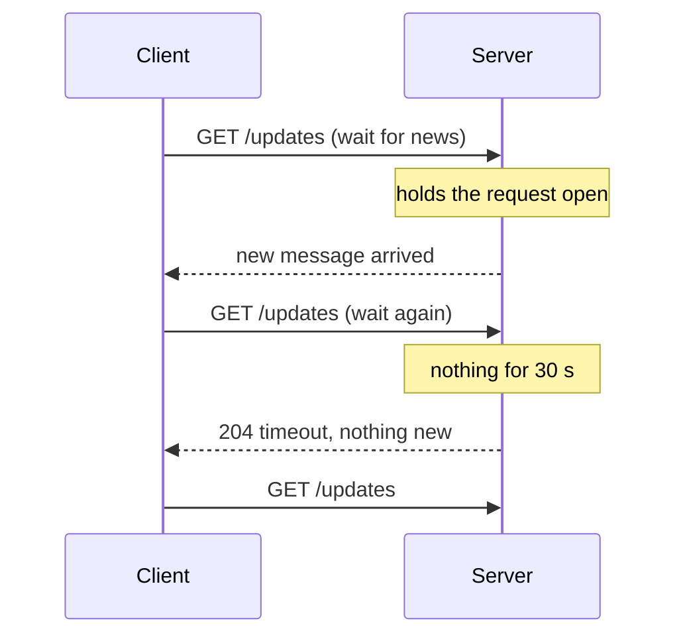
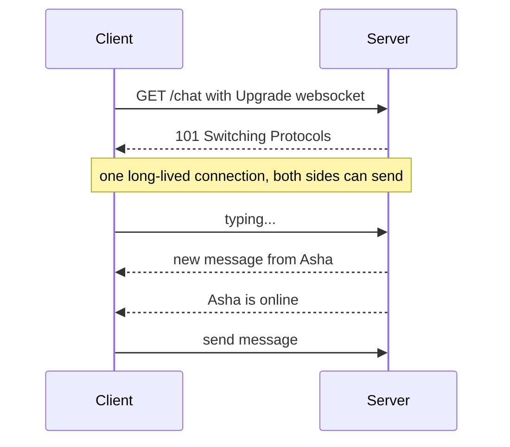
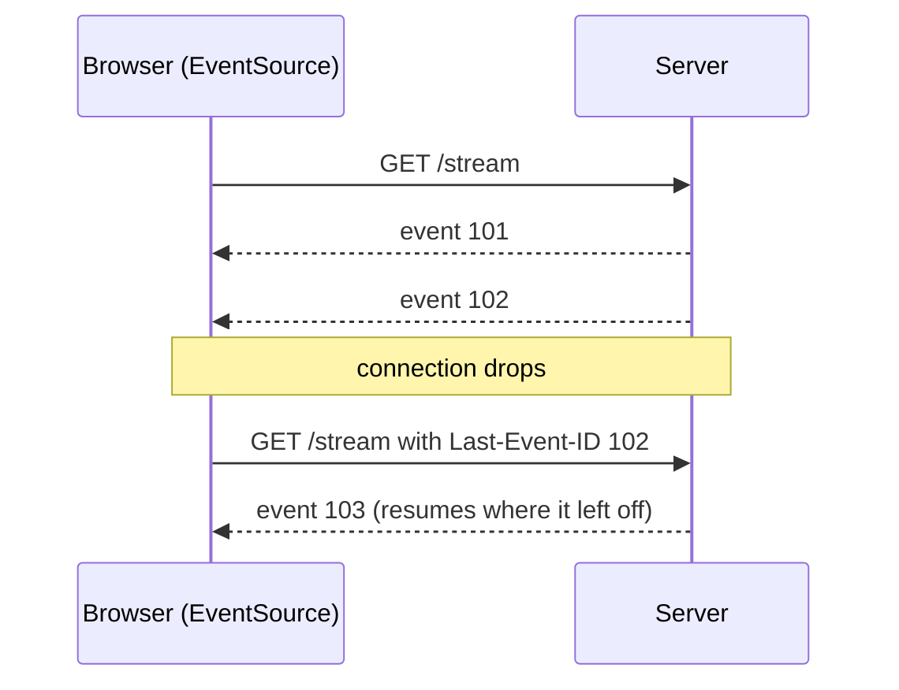

# My Notes: Long Polling, WebSockets and Server-Sent Events

> **Source:** Chapter III of *System Design* by Karan Pratap Singh ([github.com/karanpratapsingh/system-design](https://github.com/karanpratapsingh/system-design)): the Long polling, WebSockets, Server-Sent Events (SSE) section.
>
> These notes are written fresh from that part of the book. The wording, examples and diagrams are my own, so go to the book for the original explanations.

---

## 1. The problem: HTTP only speaks when asked

Plain HTTP is **request → response**: the server can only answer, never start a conversation. But chat messages, live scores, stock tickers, notifications and collaborative editing all need the **server to push** updates as they happen.

The naive approach is **short polling**: the client asks "anything new?" every few seconds. It's simple, but mostly wasted requests ("no", "no", "no") and updates are delayed by up to the polling interval.

Three better techniques:

---

## 2. Long polling

The client sends a request, and the server **holds it open** until there's new data (or a timeout), then responds. The client immediately sends the next request.



| Advantages | Disadvantages |
|---|---|
| Works everywhere plain HTTP works (old browsers, strict proxies) | Each update still costs a full HTTP request and response with headers |
| Near-real-time without new protocols | Server holds many open requests, which ties up resources |
| Easy fallback when better options are blocked | Message ordering and gaps between reconnects need care |
| | Not great for high-frequency updates |

---

## 3. WebSockets

A **WebSocket** is a persistent, **full-duplex** connection: after an HTTP **upgrade** handshake, client and server can both send messages at any time over the same TCP connection, with tiny per-message overhead.



| Advantages | Disadvantages |
|---|---|
| True two-way, low-latency messaging | **Stateful connections:** harder to load balance and scale horizontally |
| Very low overhead per message after the handshake | Need sticky routing or a shared pub/sub layer (e.g. Redis) so a message reaches whichever server holds the user's socket |
| Supports text and binary | Reconnection, heartbeats and message replay are your job |
| Supported by all modern browsers | Some proxies and firewalls interfere; no built-in HTTP caching |

**Use for:** chat, multiplayer games, collaborative editors, live trading screens: anything where **both sides talk often**.

**Scaling tip:** connection servers hold the sockets, and a pub/sub backbone routes each message to the server that owns the recipient's connection (see the WhatsApp case study).

---

## 4. Server-Sent Events (SSE)

**SSE** keeps one long-lived HTTP response open and streams **server → client** events as plain text (`text/event-stream`). The browser's built-in `EventSource` API handles parsing and **automatic reconnection**.

```text
HTTP/1.1 200 OK
Content-Type: text/event-stream

id: 101
event: score
data: {"match": "IND-AUS", "runs": 212}

id: 102
event: score
data: {"match": "IND-AUS", "runs": 216}
```



| Advantages | Disadvantages |
|---|---|
| Simple: plain HTTP, works with existing infrastructure | **One-way** only (client sends via normal HTTP requests) |
| Auto-reconnect and resume (`Last-Event-ID`) built into browsers | Text only (binary needs encoding) |
| Great with HTTP/2 (many streams on one connection) | Under HTTP/1.1, browsers limit open connections per domain (~6) |
| Lighter than WebSockets for push-only use | Still a long-lived connection per client to manage |

**Use for:** notifications, live feeds and scores, dashboards, progress updates, streaming AI responses token by token.

---

## 5. Choosing

| Need | Pick |
|---|---|
| Server pushes, client rarely sends | **SSE** |
| Both sides send frequently, low latency | **WebSockets** |
| Must work through restrictive networks, low update rate | **Long polling** |
| Updates every few minutes, simplicity first | Plain polling is fine |
| Mobile app in the background | Platform push notifications (FCM/APNs), not open sockets |

---

## 6. My cheat sheet

| Concept | One-liner |
|---|---|
| Short polling | Ask repeatedly; simple but wasteful |
| Long polling | Server holds the request until there's news; works everywhere |
| WebSockets | Upgrade to persistent full-duplex connection; chat, games |
| SSE | One-way server push over HTTP with auto-reconnect; feeds, notifications |
| Scaling sockets | Connection servers + pub/sub to route messages to the right server |
| `Last-Event-ID` | How SSE resumes after a reconnect |
