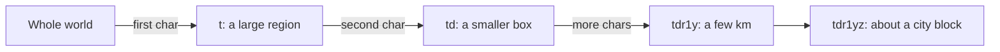
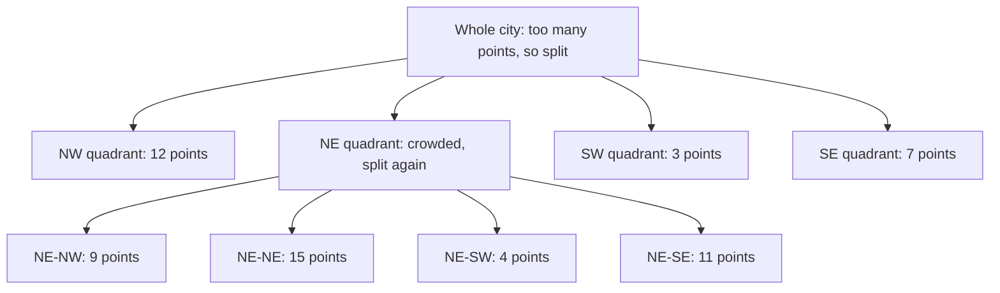

# My Notes: Geohashing and Quadtrees

> **Source:** Chapter IV of *System Design* by Karan Pratap Singh ([github.com/karanpratapsingh/system-design](https://github.com/karanpratapsingh/system-design)): the Geohashing and Quadtrees section.
>
> These notes are written fresh from that part of the book. The wording, examples and diagrams are my own, so go to the book for the original explanations.

---

## 1. The problem: "what's near me?"

Ride-hailing ("nearest drivers"), food delivery ("restaurants within 3 km"), maps and dating apps all ask **proximity queries**. A naive approach compares the user's location with **every** row:

```sql
SELECT * FROM drivers
WHERE lat BETWEEN :lat - 0.03 AND :lat + 0.03
  AND lng BETWEEN :lng - 0.03 AND :lng + 0.03;
```

Even with separate indexes on `lat` and `lng`, the database finds a wide strip for each and intersects them, which is slow with millions of moving points. We need a way to index **two dimensions together**. Geohashes and quadtrees are the two classic answers.

---

## 2. Geohashing

A **geohash** encodes a latitude/longitude pair into a **short string**, like `tdr1y` for a spot in Bengaluru. Each extra character zooms into a smaller cell.

### 2.1 How it works

1. Split the world in half by longitude: left = `0`, right = `1`.
2. Split that half by latitude: bottom = `0`, top = `1`.
3. Keep alternating, adding one bit each time, to shrink the cell.
4. Group the bits five at a time and map each group to a base-32 character.



Approximate cell sizes:

| Length | Cell size (approx.) |
|---|---|
| 4 | ~39 km × 20 km |
| 5 | ~4.9 km × 4.9 km |
| 6 | ~1.2 km × 0.6 km |
| 7 | ~153 m × 153 m |
| 8 | ~38 m × 19 m |

### 2.2 Why it's useful

- **Shared prefix = nearby** (usually). All points in `tdr1y…` sit in the same ~5 km box.
- A proximity search becomes a **string prefix query**, which an ordinary B-tree index or a key-value store handles well: `WHERE geohash LIKE 'tdr1y%'`.
- Easy to **shard** or **cache** by geohash prefix.

### 2.3 The edge problem

Two points can be metres apart but on opposite sides of a cell boundary, with completely different prefixes. The standard fix is to **search the cell and its 8 neighbours**, then filter by exact distance.

**Use cases:** finding nearby drivers or stores, location-based caching, clustering map markers, geo-sharding data.
**Examples:** Redis `GEOADD`/`GEOSEARCH` (geohash-based), Elasticsearch `geo_point`, MongoDB 2dsphere indexes use similar ideas, and Uber's H3 (hexagons instead of squares).

---

## 3. Quadtrees

A **quadtree** is a tree where each node covers a rectangular area and has **exactly four children** (NW, NE, SW, SE). When a node holds too many points, it **splits into four**.



### 3.1 Why quadtrees

- **Adaptive density:** a crowded downtown gets split into many tiny cells, while empty countryside stays one big cell. Geohash cells are a fixed size everywhere, but quadtree cells fit the data.
- **Fast search:** to find nearby points, descend to the leaf containing the user, then check neighbouring leaves until you have enough results. It's roughly `O(log n)` to reach the leaf.
- Leaves can be capped at a max number of points (say 100), which keeps each lookup cheap.

### 3.2 Types

- **Point quadtree:** splits at actual data points.
- **Region (PR) quadtree:** splits space into equal quarters regardless of where points are. This is the common one for location search.
- **Edge / polygon-map quadtrees:** store lines and shapes, used in maps and graphics.
- Related structures: k-d trees, R-trees (used by spatial databases like PostGIS).

### 3.3 Things to plan for

- Usually kept **in memory** for speed and rebuilt from the database on startup.
- **Moving objects** (drivers) need frequent updates. Batch location updates every few seconds, and rebalance or rebuild periodically.
- For huge datasets, partition the tree across servers by region.

**Use cases:** nearest-driver matching, map tile rendering, image compression, collision detection in games.

---

## 4. Geohash vs quadtree

| | Geohash | Quadtree |
|---|---|---|
| Structure | String encoding, fixed-size cells | In-memory tree, adaptive cell sizes |
| Storage | Any DB or KV store with prefix queries | Usually a custom in-memory structure |
| Dense vs sparse areas | Same cell size everywhere | Splits where data is dense |
| Updates | Just rewrite the string | Can trigger node splits or merges |
| Best when | You want something simple and DB-friendly | Density varies a lot, you need fast in-memory k-nearest search |

---

## 5. My cheat sheet

| Concept | One-liner |
|---|---|
| Proximity query | "Find things near X", which 1-D indexes handle badly |
| Geohash | Lat/lng → base-32 string; shared prefix ≈ nearby |
| Geohash length | 5 chars ≈ 5 km, 6 ≈ 1 km, 7 ≈ 150 m |
| Edge problem | Always search the cell plus its 8 neighbours |
| Quadtree | Each node splits into 4 when crowded; adapts to density |
| Use | Geohash for DB-friendly simplicity; quadtree for dense, in-memory nearest search |
