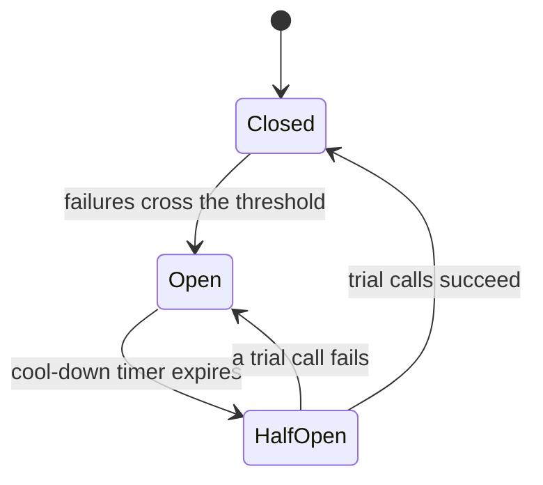
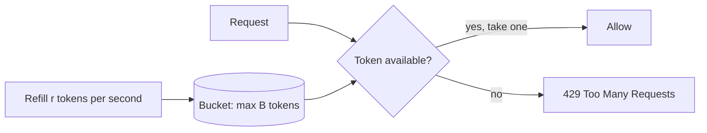
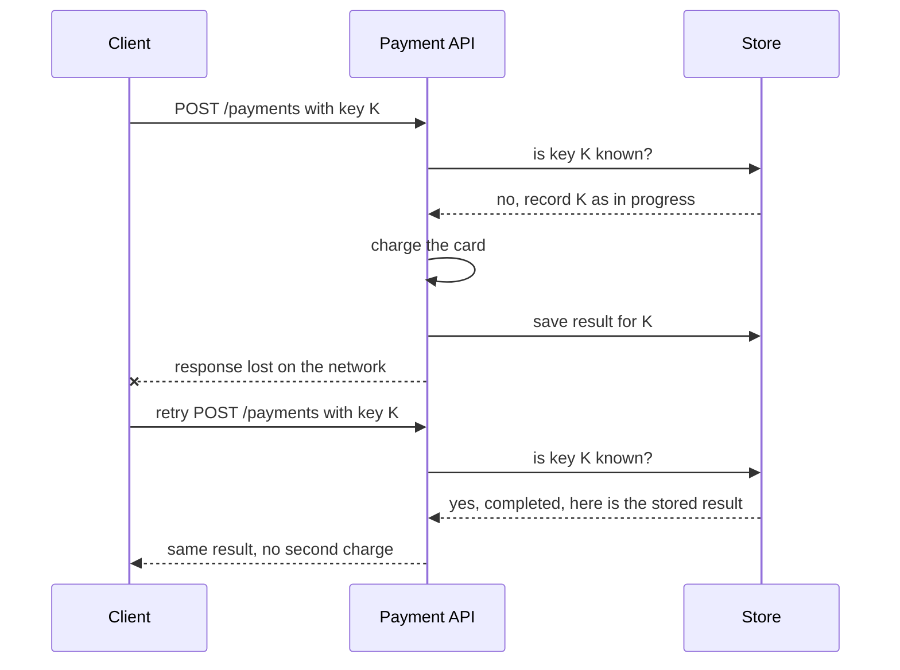

# My Notes: Circuit Breakers, Rate Limiting and Idempotency

> **Source:** Chapter IV of *System Design* by Karan Pratap Singh ([github.com/karanpratapsingh/system-design](https://github.com/karanpratapsingh/system-design)): the Circuit breaker, Rate Limiting and Idempotency sections.
>
> These notes are written fresh from that part of the book. The wording, examples and diagrams are my own, so go to the book for the original explanations.

---

## 1. Circuit breaker

### 1.1 Why

When service A calls a struggling service B, every call waits for a timeout. A's threads and connections pile up waiting, A slows down, A's callers slow down, and one sick service **cascades** into a system-wide outage. Retrying blindly makes it worse by hammering B while it's trying to recover.

A **circuit breaker** wraps calls to a dependency and **stops calling it** once it's clearly failing, failing fast instead, the way an electrical breaker cuts power to protect the rest of the house.

### 1.2 States



- **Closed (normal):** calls pass through, and failures are counted (e.g. 50% errors over the last 20 calls, or 5 timeouts in a row).
- **Open (tripped):** calls fail **immediately** without touching B. Return a fallback: cached data, a default, or a friendly error.
- **Half-open (testing):** after a cool-down, let a few trial calls through. If they succeed, close the circuit. If they fail, open it again and restart the timer.

### 1.3 Good practice

- Always pair with **timeouts**. A breaker can't trip on calls that hang forever.
- Provide **fallbacks** where possible (stale cache, degraded feature).
- Emit metrics and alerts on state changes.
- Combine with **bulkheads** (separate thread or connection pools per dependency) so one slow dependency can't use up everything.
- Libraries: Resilience4j, Polly (.NET), opossum (Node), gobreaker. Service meshes like Istio and Envoy offer it at the network level.

---

## 2. Rate limiting

### 2.1 Why

**Rate limiting** caps how many requests a client can make in a time window (say 100 requests per minute per API key). It protects against:
- **Abuse and attacks:** brute-force logins, scraping, DDoS-style floods.
- **Noisy neighbours:** one heavy client starving everyone else.
- **Cost overruns:** expensive downstream calls (third-party APIs, LLMs).
- **Overload:** keeps the system within capacity during spikes.

Limits can be keyed by user, API key, IP, endpoint, or tenant. Rejected requests get **HTTP 429 Too Many Requests**, ideally with `Retry-After` and `RateLimit-*` headers.

### 2.2 Algorithms

| Algorithm | How it works | Pros | Cons |
|---|---|---|---|
| **Token bucket** | Bucket holds up to `B` tokens, refilled at `r` per second; each request spends one | Allows short **bursts**, smooth average; very common (AWS, Stripe) | Two parameters to tune |
| **Leaky bucket** | Requests queue in a bucket that "leaks" (is processed) at a fixed rate; overflow is dropped | Perfectly **smooth output** rate | Bursts get queued or dropped; adds latency |
| **Fixed window** | Count requests per fixed window (e.g. per calendar minute) | Simplest, tiny memory | **Boundary spike:** 100 at 0:59 + 100 at 1:00 = 200 in 2 seconds |
| **Sliding log** | Store a timestamp per request; count those within the last window | Exact | Memory grows with traffic |
| **Sliding window counter** | Blend current and previous window counts by overlap | Accurate enough, cheap | Approximation |



### 2.3 Rate limiting across many servers

With many API servers, each one counting locally lets a client get N× the limit. The usual fix is a **shared counter store** (Redis), which brings two problems:

- **Inconsistency:** if each node counts locally and syncs occasionally, limits are fuzzy. Sticky routing per client helps, or accept approximate limits.
- **Race conditions:** two servers both read "99", both allow, both write "100": the limit is exceeded. Use **atomic operations** (Redis `INCR` with expiry, or a Lua script that checks and increments in one step) instead of read-then-write.

Also decide what happens when the limiter itself is down: **fail open** (allow, protecting availability) or **fail closed** (block, protecting the backend).

Where it lives: API gateway or edge (Kong, NGINX, Cloudflare, AWS API Gateway), service middleware, or both (coarse limits at the edge, fine-grained per-user limits in the app).

---

## 3. Idempotency

### 3.1 Why

Networks are unreliable: a client sends "pay ₹500", the payment succeeds, but the response is lost. The client **retries**, and without protection the customer is charged twice. Queues with at-least-once delivery cause the same duplication.

An operation is **idempotent** if doing it many times has the same effect as doing it once. That makes retries safe, and safe retries are the foundation of reliable distributed systems.

### 3.2 Idempotency in HTTP

| Method | Idempotent? | Why |
|---|---|---|
| `GET`, `HEAD`, `OPTIONS` | Yes | Read-only |
| `PUT` | Yes | "Set resource to this" gives the same end state each time |
| `DELETE` | Yes | Deleting twice leaves it deleted (second call may return 404) |
| `POST` | **No** | "Create" twice gives two resources |
| `PATCH` | Depends | `set name = "X"` yes; `increment count` no |

### 3.3 Idempotency keys

For non-idempotent operations like payments, the client generates a unique **idempotency key** per logical operation and sends it with every retry:

```http
POST /payments
Idempotency-Key: 6f1c2e9a-8b7d-4c1e-9a2f-3d5b7e8c1a00
```



- Store the key with the **result** and an expiry (e.g. 24 hours).
- If a duplicate arrives **while the first is still processing**, return 409 or make it wait.
- Reject a reused key with a **different request body**, since that's a client bug.

### 3.4 Idempotent consumers

Message consumers must expect duplicates:
- Keep a table of **processed message IDs** and skip repeats, ideally in the same transaction as the side effect.
- Prefer naturally idempotent writes: upserts, "set status = SHIPPED" instead of "advance status", unique constraints that make duplicate inserts fail harmlessly.

### 3.5 Trade-offs

- Extra **storage and a lookup** on every request.
- Choosing key **expiry**: too short allows late duplicates, too long grows storage.
- Concurrency handling (two retries racing) needs locks or unique constraints.
- It's worth it on anything involving money, inventory, messages to users or external side effects.

---

## 4. My cheat sheet

| Concept | One-liner |
|---|---|
| Circuit breaker | Stop calling a failing dependency; fail fast with a fallback |
| Closed / open / half-open | Normal / blocking calls / testing recovery |
| Bulkhead | Isolate resources per dependency so one can't drain all |
| Rate limiting | Cap requests per client per window; reply 429 |
| Token bucket | Allows bursts up to bucket size, average rate `r` |
| Fixed-window flaw | Double traffic across the window boundary |
| Distributed limiter | Shared Redis counter with atomic ops; decide fail-open vs fail-closed |
| Idempotent | Repeating = same effect as once; makes retries safe |
| Idempotency key | Client-generated ID per operation; server returns the stored result on retry |
| Idempotent consumer | Dedupe by message ID; prefer upserts and absolute writes |
