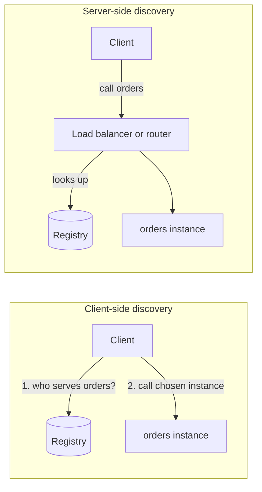
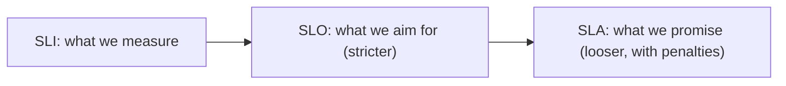
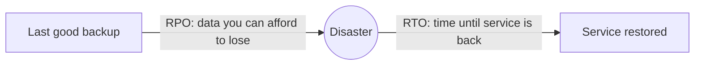
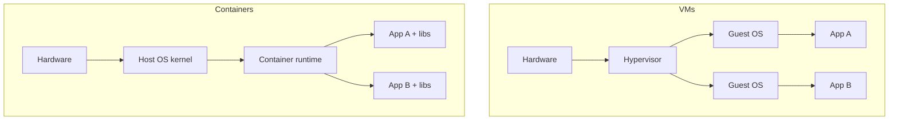

# My Notes: Service Discovery, SLA/SLO/SLI, Disaster Recovery, VMs and Containers

> **Source:** Chapter IV of *System Design* by Karan Pratap Singh ([github.com/karanpratapsingh/system-design](https://github.com/karanpratapsingh/system-design)): the Service Discovery, SLA, SLO, SLI, Disaster recovery and Virtual Machines and Containers sections.
>
> These notes are written fresh from that part of the book. The wording, examples and diagrams are my own, so go to the book for the original explanations.

---

## 1. Service discovery

### 1.1 Why

In a cloud or container world, service instances **come and go constantly**: autoscaling adds them, deploys replace them, failures kill them, and each gets a new IP. Hard-coding `orders-service = 10.0.3.17` breaks immediately. **Service discovery** is how a client finds the current, healthy instances of a service by name.

### 1.2 The service registry

At the centre is a **service registry**: a highly available database of `service name → healthy instances (IP:port, metadata)`. It must be replicated and consistent, because if it's wrong or down, nothing can find anything.

Instances get into the registry in one of two ways:
- **Self-registration:** each instance registers itself on startup, sends heartbeats, and deregisters on shutdown. Simple, but every service needs registry code.
- **Third-party registration:** a separate **registrar** watches the platform (e.g. Kubernetes events) and updates the registry. Services stay unaware.

### 1.3 Client-side vs server-side discovery

| | Client-side | Server-side |
|---|---|---|
| Who queries the registry | The calling service (via a library) | A load balancer or router |
| Pros | Fewer hops, client can balance smartly | Clients stay simple and language-agnostic |
| Cons | Discovery logic in every language you use | Extra hop; the router must be highly available |
| Examples | Netflix Eureka + Ribbon | AWS ALB, Kubernetes Services (DNS + kube-proxy) |

### 1.4 Service mesh

A **service mesh** moves discovery and other networking concerns into a **sidecar proxy** next to every service instance. The app talks to localhost, and the sidecar handles discovery, load balancing, retries, timeouts, circuit breaking, **mTLS** encryption and telemetry, all configured centrally.

Examples: Istio, Linkerd, Consul Connect (sidecars are usually Envoy). It's powerful for large fleets, but heavy for small systems.

Discovery tools: Consul, etcd, ZooKeeper, Eureka, Kubernetes DNS.

---

## 2. SLA, SLO, SLI

Three related terms for "how reliable must this be?":

| Term | What it is | Who it's for | Example |
|---|---|---|---|
| **SLI**, service level *indicator* | A **measurement** of service behaviour | Engineers | % of requests served successfully in < 300 ms |
| **SLO**, service level *objective* | A **target** for an SLI over a period | Internal teams | 99.9% of requests succeed in < 300 ms over 30 days |
| **SLA**, service level *agreement* | A **contract** with customers, with penalties if missed | Customers, legal | 99.5% monthly uptime, or 10% service credit |

**Why they matter:**
- They turn "is the system reliable enough?" into numbers everyone agrees on.
- The SLO is set **stricter than the SLA**, so you notice and react before breaking a contract.
- **Error budget:** a 99.9% SLO allows 0.1% failures (~43 minutes per month). While budget remains, ship features fast. Once it's spent, slow down and prioritise reliability. This settles the "speed vs stability" argument with data.

**Good SLIs** reflect what users experience: availability (successful requests ÷ total), latency (p95/p99 below a threshold), freshness, correctness, durability.

---

## 3. Disaster recovery (DR)

### 3.1 Why

Disasters are events that take out much more than a server: a whole data centre or region failing, ransomware, an accidental `DROP TABLE`, a bad deploy corrupting data, natural disasters. **Disaster recovery** is the plan and infrastructure for restoring service and data afterwards. Losing customer data can end a business, and regulators often require tested DR plans.

### 3.2 The two numbers

- **RPO (recovery point objective):** the maximum acceptable **data loss**, measured in time. An RPO of 1 hour means backups or replication at least hourly.
- **RTO (recovery time objective):** the maximum acceptable **downtime** before service is restored.

Smaller RPO and RTO cost more, so set them per system based on business impact.

### 3.3 Strategies (cheapest to most expensive)

| Strategy | How | RTO / RPO | Cost |
|---|---|---|---|
| **Backup and restore** | Regular backups stored off-site (another region, immutable storage); rebuild on disaster | Hours to days | Low |
| **Cold site** | A standby location with infrastructure ready but not running; restore data and start up | Hours | Low–medium |
| **Warm standby / pilot light** | Scaled-down copy running with replicated data; scale up on disaster | Minutes to an hour | Medium |
| **Hot site / active-active** | Full copy running in another region, receiving live traffic or ready instantly | Seconds to minutes, near-zero RPO | High |

**Non-negotiables:** keep backups **off-site and immutable** (ransomware deletes reachable backups), **test restores regularly** (an untested backup is a hope, not a plan), automate failover runbooks, and practise with game days.

---

## 4. Virtual machines and containers

### 4.1 Virtual machines

A **virtual machine** is a software-emulated computer with its own **full operating system**, running on shared physical hardware. A **hypervisor** creates and isolates VMs:
- **Type 1 (bare metal):** runs directly on hardware (KVM, VMware ESXi, Xen, Hyper-V). This is what clouds use.
- **Type 2 (hosted):** runs on top of a normal OS (VirtualBox, VMware Workstation). Used for desktops and dev.

**Why VMs:** strong isolation between tenants, run different OSes on one machine, better hardware utilisation, snapshots and live migration. This is the foundation of cloud computing (EC2, Compute Engine).

### 4.2 Containers

A **container** packages an app with its libraries and config, and runs as an isolated process that **shares the host's OS kernel** (via Linux namespaces and cgroups). There's no guest OS to boot.

**Why containers:** start in seconds, are small (MBs, not GBs), "works on my machine" becomes "works everywhere" because the image is identical across dev, CI and prod, you can pack many per host, and they suit microservices and CI/CD well. Docker builds and runs them, and **Kubernetes** orchestrates them at scale (scheduling, scaling, self-healing, rollouts).

### 4.3 Side by side

| | Virtual machines | Containers |
|---|---|---|
| Isolation | Strong: separate kernels | Process-level: shared kernel (weaker by default) |
| Size | GBs | MBs |
| Startup | Minutes | Seconds or less |
| Density | Tens per host | Hundreds per host |
| OS flexibility | Any OS per VM | Same kernel family as the host |
| Typical use | Multi-tenant isolation, legacy apps, different OSes | Microservices, CI/CD, scalable stateless apps |

In practice they're **combined**: containers run inside cloud VMs. For stronger isolation with container ergonomics, there are microVMs (Firecracker) and sandboxed runtimes (gVisor, Kata).

---

## 5. My cheat sheet

| Concept | One-liner |
|---|---|
| Service registry | Live map of service name → healthy instances |
| Self vs third-party registration | Instance registers itself vs a registrar watches the platform |
| Client- vs server-side discovery | Caller looks up instances vs a router does it |
| Service mesh | Sidecar proxies handle discovery, retries, mTLS, telemetry |
| SLI / SLO / SLA | Measurement / internal target / customer contract with penalties |
| Error budget | 100% − SLO; spend it on shipping, stop when exhausted |
| RPO / RTO | Max data loss / max downtime |
| DR ladder | Backup → cold → warm/pilot light → hot active-active |
| Test restores | An untested backup isn't a backup |
| VM vs container | Own OS + hypervisor vs shared kernel, light and fast |
