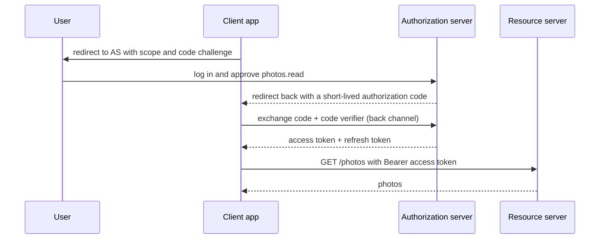
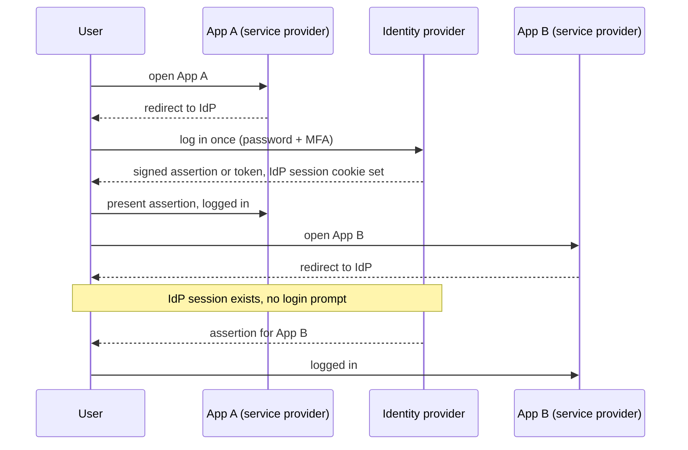
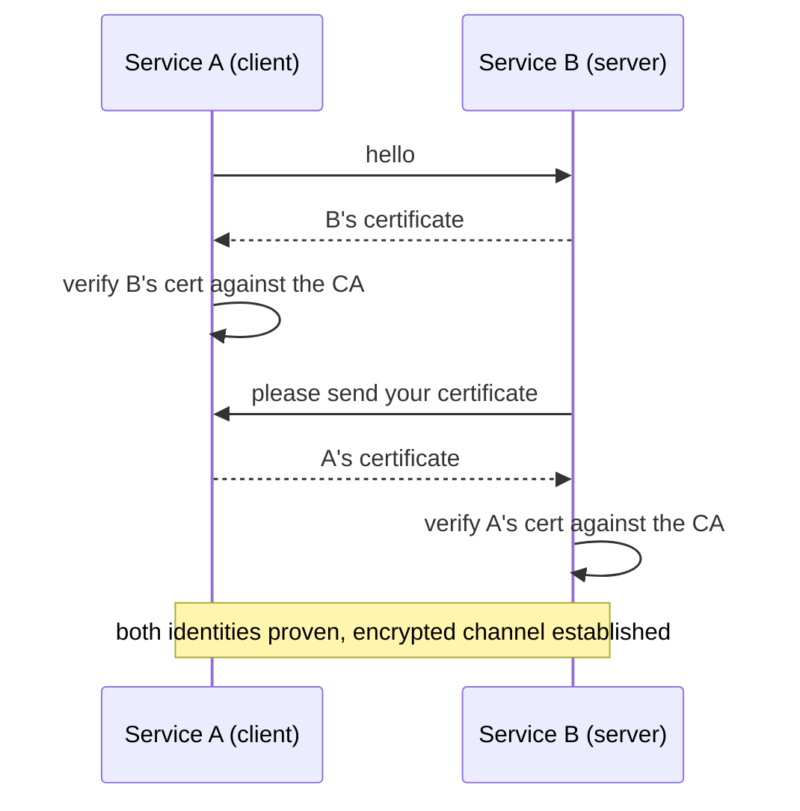

# My Notes: OAuth 2.0, OpenID Connect, Single Sign-On and SSL/TLS/mTLS

> **Source:** Chapter IV of *System Design* by Karan Pratap Singh ([github.com/karanpratapsingh/system-design](https://github.com/karanpratapsingh/system-design)): the OAuth 2.0 and OpenID Connect, Single Sign-On and SSL, TLS, mTLS sections.
>
> These notes are written fresh from that part of the book. The wording, examples and diagrams are my own, so go to the book for the original explanations.

---

## 1. Two questions that get mixed up

- **Authentication (AuthN):** *who are you?* Proving identity.
- **Authorization (AuthZ):** *what are you allowed to do?* Granting permissions.

OAuth 2.0 is about **authorization**. OpenID Connect adds **authentication** on top of it. SSO uses them (or SAML) so you log in once for many apps. TLS protects all of it on the wire.

---

## 2. OAuth 2.0

### 2.1 The problem it solves

A photo-printing app wants to read your Google Photos. The bad old way: give it your Google password, which grants it everything forever and leaves it storing your password. **OAuth 2.0** lets you grant **limited, revocable access** (read photos only) **without sharing your password**. The app gets an **access token** instead.

### 2.2 Roles and terms

| Term | Meaning |
|---|---|
| **Resource owner** | You, the user who owns the data |
| **Client** | The app asking for access (photo printer) |
| **Authorization server** | Issues tokens after you consent (Google's auth server) |
| **Resource server** | The API holding the data (Google Photos API); accepts tokens |
| **Scope** | What access is requested (`photos.read`) |
| **Access token** | Short-lived credential the client sends to the API |
| **Refresh token** | Longer-lived credential to get new access tokens without asking again |
| **Redirect URI** | Where the auth server sends the user back after consent |

### 2.3 Authorization code flow (with PKCE)

The standard flow for web and mobile apps:

- The **code** travels through the browser, but the **tokens** are fetched over a direct back channel.
- **PKCE** (proof key for code exchange) ties the code to the app that started the flow, so a stolen code is useless. It's required for mobile and single-page apps and recommended everywhere.
- Other grants: **client credentials** (machine-to-machine, no user), **device code** (TVs and CLIs). The old implicit and password grants are discouraged.

### 2.4 Downsides and pitfalls

- It's a **framework**, not a strict protocol: lots of options and room for insecure setups.
- **Bearer tokens** are usable by whoever holds them, so keep them short-lived, store them securely, and always use HTTPS.
- Redirect URI validation must be exact, or attackers can steal codes.
- OAuth alone doesn't tell you **who** the user is. Using an access token as proof of login is a classic mistake, and that gap is why OIDC exists.

---

## 3. OpenID Connect (OIDC)

**OIDC** is a thin **identity layer on top of OAuth 2.0**. Same flows, plus:

- **ID token:** a signed **JWT** that states who the user is (`sub` user ID, `email`, `name`, `iss` issuer, `aud` audience, `exp` expiry). The app verifies the signature and claims, and the user is logged in.
- **UserInfo endpoint:** fetch more profile claims with the access token.
- **Standard scopes:** `openid` (required), `profile`, `email`.
- **Discovery:** `/.well-known/openid-configuration` publishes endpoints and signing keys, so apps configure themselves.

**"Sign in with Google / Apple / Microsoft"** is OIDC.

| OAuth 2.0 | OpenID Connect |
|---|---|
| Delegated **authorization** ("app may read photos") | **Authentication** ("this is user 123") |
| Access token (opaque to the client) | ID token (JWT the client reads and verifies) + access token |

---

## 4. Single sign-on (SSO)

**SSO** lets a user **authenticate once** and access many applications without logging in again: one corporate login for email, chat, HR, the wiki and dozens of SaaS tools.

### 4.1 Components

- **Identity provider (IdP):** authenticates users and vouches for them (Okta, Azure AD / Entra ID, Google Workspace, Keycloak, Auth0).
- **Service provider (SP):** the app that trusts the IdP instead of managing passwords itself.
- **Identity broker:** an intermediary connecting SPs to several IdPs (e.g. letting an app accept logins from multiple partner companies' IdPs).

### 4.2 How it works

### 4.3 SAML

**SAML 2.0** is an older XML-based standard for SSO: the IdP sends the SP a signed XML **assertion** about the user. It's still everywhere in enterprise software.

| | SAML 2.0 | OAuth 2.0 | OIDC |
|---|---|---|---|
| Purpose | Authentication + SSO | Authorization (delegated access) | Authentication on top of OAuth |
| Format | XML assertions | Tokens (often JWT) | JWT ID tokens |
| Best for | Enterprise web SSO | API access delegation | Modern web/mobile login and SSO |

| SSO advantages | SSO disadvantages |
|---|---|
| One strong login (with MFA) instead of many weak passwords | The IdP becomes a **single point of failure** and a high-value target |
| Central on/offboarding: disable one account, lose access everywhere | Setup and integration effort |
| Fewer password-reset tickets, better UX | If the IdP account is compromised, every app is |
| Central audit of who accessed what | |

---

## 5. SSL, TLS and mTLS

### 5.1 SSL → TLS

- **SSL** (secure sockets layer) was the original protocol for encrypting traffic between client and server. All SSL versions are **broken and deprecated**.
- **TLS** (transport layer security) replaced it. Modern systems use **TLS 1.2 and 1.3**. TLS 1.3 is faster (one round-trip handshake) and drops weak ciphers.
- People still say "SSL certificate" out of habit, but the certificates are used with TLS. The certificate itself isn't tied to the protocol version.

### 5.2 What TLS gives you

- **Encryption:** eavesdroppers on the network can't read traffic.
- **Integrity:** tampering is detected.
- **Authentication:** the server proves its identity with a **certificate** signed by a trusted certificate authority (CA), so you know you're really talking to `bank.com`.

HTTPS is HTTP over TLS. Certificates can be free and automatic with Let's Encrypt (ACME).

### 5.3 mTLS (mutual TLS)

In normal TLS only the **server** shows a certificate. In **mTLS**, **both sides** present and verify certificates, so the server also knows exactly which client is calling.

**Why mTLS:**
- **Zero-trust** service-to-service security: being "inside the network" isn't enough, and every call proves its identity.
- Strong machine identity without passwords or API keys in code.
- Used for IoT devices, B2B APIs, and inside service meshes (Istio and Linkerd issue and rotate certificates automatically).

The cost is **certificate management**: issuing, rotating and revoking many short-lived certificates, which is why automation (a mesh, cert-manager, SPIFFE/SPIRE) matters.

---

## 6. My cheat sheet

| Concept | One-liner |
|---|---|
| AuthN vs AuthZ | Who you are vs what you may do |
| OAuth 2.0 | Delegated, scoped, revocable access via tokens; no password sharing |
| Auth code + PKCE | Standard flow; code via browser, tokens via back channel |
| Access vs refresh token | Short-lived API key vs long-lived token to get new ones |
| OIDC | OAuth + ID token (JWT) = login; "Sign in with Google" |
| SSO | One login at the IdP, trusted by many service providers |
| SAML | XML-based enterprise SSO |
| SSL vs TLS | SSL is dead; TLS 1.2/1.3 is what we use |
| mTLS | Both sides present certificates; zero-trust service auth |
