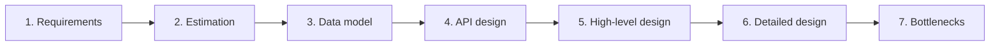
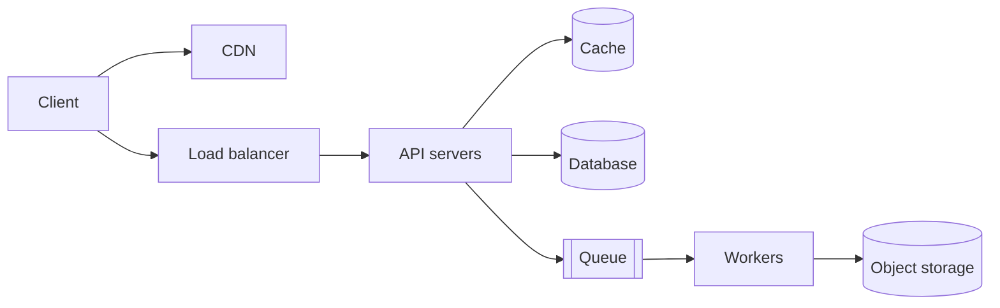

# My Notes: The System Design Interview Playbook

> **Source:** Chapter V of *System Design* by Karan Pratap Singh ([github.com/karanpratapsingh/system-design](https://github.com/karanpratapsingh/system-design)): the System Design Interviews section.
>
> These notes are written fresh from that part of the book. The wording, examples and diagrams are my own, so go to the book for the original explanations.

---

## 1. What the interview is really testing

A system design interview is an **open-ended conversation**, not a quiz with one right answer. The interviewer wants to see how I:
- turn a vague prompt ("design Twitter") into **clear requirements**;
- reason about **scale** with rough numbers;
- choose components and explain **trade-offs**;
- find and fix **bottlenecks and failure points**;
- **communicate**: think out loud, take hints, and collaborate like a teammate.

Saying "it depends" is fine, as long as I then say **on what** and pick a direction.

---

## 2. The steps, in order



A rough time budget for a 45–60 minute round:

| Step | Time |
|---|---|
| Requirements and scope | 5–8 min |
| Estimation | 3–5 min |
| Data model + API | 5–8 min |
| High-level design | 10–15 min |
| Deep dives and bottlenecks | 10–15 min |
| Wrap-up, questions | 2–5 min |

---

## 3. Step 1: clarify requirements

Never start drawing boxes straight away. Ask questions and **write the answers down** where the interviewer can see them.

### 3.1 Functional requirements: what the system does

The core features, ideally 3–5. For a URL shortener: create a short link, redirect to the original, optional expiry.

### 3.2 Non-functional requirements: how well it does it

- **Scale:** users, requests per second, data volume, read/write ratio.
- **Latency:** e.g. redirects under 100 ms at p99.
- **Availability vs consistency:** which matters more here (see the CAP chapter)?
- **Durability:** can we ever lose data?
- **Security, privacy, compliance, cost.**

### 3.3 Extended requirements: nice to have

Analytics, monitoring, rate limiting, admin tools. Mention them, park them, and come back if time allows.

---

## 4. Step 2: back-of-the-envelope estimation

Rough numbers decide the architecture: 100 writes per second fits on one database, 100,000 doesn't. Aim for **order of magnitude**, and round aggressively.

### 4.1 Handy numbers

| Fact | Value |
|---|---|
| Seconds per day | 86,400 ≈ **10⁵** |
| Seconds per month | ≈ 2.5 × 10⁶ |
| 1 million requests/day | ≈ **12 req/s** average |
| Peak traffic | Usually 2–10× average |
| 1 KB × 1 billion | 1 TB |
| Char / int / timestamp | ~1 / 4 / 8 bytes |

| Latency (approx.) | |
|---|---|
| L1 cache / RAM reference | ~1 ns / ~100 ns |
| Read 1 MB from RAM | ~10 µs |
| SSD random read | ~100 µs |
| Round trip within a data centre | ~0.5 ms |
| Disk seek (HDD) | ~10 ms |
| Round trip across continents | ~100–150 ms |

### 4.2 What to estimate

1. **Traffic:** daily active users × actions per user → requests per second (reads and writes separately).
2. **Storage:** objects per day × size × retention (often 5–10 years).
3. **Bandwidth:** requests per second × payload size, in and out.
4. **Memory for cache:** the hot slice (often ~20% of daily reads, the 80/20 rule) × size.

State assumptions out loud: the interviewer cares about the reasoning, not the exact number.

---

## 5. Step 3: data model

- List the **entities** (User, Post, Follow, Message…) and key fields.
- Note **relationships** and **access patterns** ("get latest 20 posts by user", "get messages in a chat ordered by time").
- Choose storage **from the access patterns**: relational for relationships and transactions, wide-column or key-value for huge write volumes and simple lookups, object storage for media, a search index for text (see the databases chapters).

---

## 6. Step 4: API design

Define the main endpoints (or RPCs) with inputs and outputs. It nails down the contract and catches missing requirements.

```text
POST   /v1/posts            { text, mediaIds }        → 201 { postId }
GET    /v1/feed?cursor=…    (auth)                    → 200 { posts[], nextCursor }
POST   /v1/users/{id}/follow                         → 204
```

Mention authentication, **pagination** (cursor-based for feeds), **idempotency keys** for writes that can be retried, and rate limits.

---

## 7. Step 5: high-level design

Draw the main boxes and arrows that satisfy the functional requirements end to end, for example:



Walk through **one request at a time** ("when a user posts…", "when a user opens the feed…"). Keep it simple first, then evolve it.

---

## 8. Step 6: detailed design

Pick the 2–3 most interesting or risky parts (or the ones the interviewer steers toward) and go deep:
- How data is **partitioned** (shard key, consistent hashing).
- **Caching** strategy and invalidation.
- **Consistency** choices and replication.
- **Async processing** with queues, fan-out, retries and idempotency.
- Specific algorithms: ID generation, ranking, geo-indexing, rate limiting.

Always explain **why** this choice and **what it costs**.

---

## 9. Step 7: identify and resolve bottlenecks

Stress-test the design:
- **Single points of failure:** is every component redundant? What happens if a region goes down?
- **Hot spots:** celebrity users, viral posts, hot partitions.
- **Scaling limits:** which component hits its ceiling first at 10× traffic?
- **Failure handling:** timeouts, retries, circuit breakers, graceful degradation.
- **Observability:** metrics, logs, tracing, alerting, SLOs.
- **Security:** auth, rate limiting, encryption, abuse prevention.

---

## 10. Habits that make a difference

- **Drive** the conversation, but check in: "Does it make sense to go deeper on the feed, or on storage?"
- Start **simple**, then scale. Don't open with Kafka, Kubernetes and twelve microservices.
- Use **numbers** to justify decisions.
- Name **trade-offs** explicitly: "SQL here for transactions; the cost is harder horizontal scaling, which we handle by…"
- Don't silently get stuck. Say what you're weighing.

**Common mistakes:** skipping requirements, over-engineering, ignoring the read/write ratio, single points of failure, never mentioning failure modes, and going so deep on one box that the end-to-end flow never gets finished.

---

## 11. My cheat sheet

| Step | Key question |
|---|---|
| Requirements | What must it do, at what scale, how fast, how available? |
| Estimation | How many req/s, how much storage, bandwidth and cache? |
| Data model | Which entities and access patterns, so which stores? |
| API | What's the contract (pagination, idempotency, auth)? |
| High-level | Which boxes satisfy every requirement end to end? |
| Detailed | How do the hard parts work, and why this way? |
| Bottlenecks | What breaks first, and how do we fix it? |
| Golden numbers | 10⁵ s/day; 1M/day ≈ 12/s; RAM 100 ns, SSD 100 µs, cross-continent ~100 ms |
