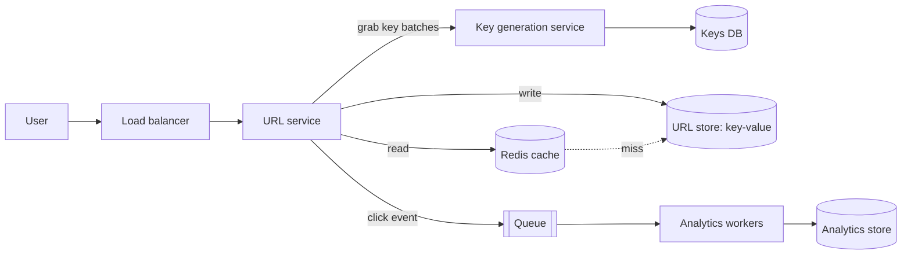

# My Notes: Case Study, Designing a URL Shortener

> **Source:** Chapter V of *System Design* by Karan Pratap Singh ([github.com/karanpratapsingh/system-design](https://github.com/karanpratapsingh/system-design)): the URL Shortener case study.
>
> These notes are written fresh from that part of the book. The wording, numbers, examples and diagrams are my own, so go to the book for the original walkthrough.

---

## 1. What we're building

A **URL shortener** turns a long URL into a short alias (`https://sho.rt/aZ3k9Q`) and redirects anyone visiting the alias to the original. Think bit.ly or TinyURL.

**Why people use them:** links that fit in messages and print, tidy sharing, and **click analytics** (how many, from where, when).

---

## 2. Requirements

### 2.1 Functional

- Given a long URL, create a **unique short URL**.
- Visiting the short URL **redirects** to the original.
- Links can **expire** (default or user-chosen).
- Optional: users can pick a **custom alias**, and delete their links.

### 2.2 Non-functional

- **Highly available:** if redirects fail, every link on the internet that uses us breaks.
- **Low latency** redirects (tens of ms).
- Short links must be **unpredictable** enough that people can't easily enumerate others' links.
- **Read-heavy:** far more redirects than creations.

### 2.3 Extended

- Analytics (clicks, referrers, countries), API keys and rate limits for creation, abuse/malware scanning.

---

## 3. Estimation

My assumptions: **50 million new links per month**, and **100:1** reads to writes.

| Quantity | Calculation | Result |
|---|---|---|
| Writes | 50M / (30 × 86,400 s) | **~20 links/s** |
| Reads | 20 × 100 | **~2,000 redirects/s** (peaks ~10k/s) |
| Link record size | URL ~400 B + key + metadata | **~500 bytes** |
| Storage over 5 years | 50M × 12 × 5 = 3 billion × 500 B | **~1.5 TB** |
| Read bandwidth | 2,000/s × 500 B | ~1 MB/s (tiny) |
| Cache | ~20% of a day's distinct hot links: 2,000 × 86,400 × 0.2 × 500 B | **~17 GB**, fits in RAM easily |

**Key takeaway:** storage and bandwidth are modest. The design is about **fast, highly available reads** and **generating unique short keys** safely.

**Key length:** with base62 (`a–z A–Z 0–9`), 7 characters give 62⁷ ≈ **3.5 trillion** combinations, plenty for 3 billion links with a huge safety margin (and harder to guess).

---

## 4. Data model

Two simple entities:

```text
users  (id, name, email, api_key, created_at)
urls   (short_key PK, long_url, user_id, created_at, expires_at, click_count)
```

The access pattern is almost entirely **get by `short_key`**, there are no joins, and there are billions of rows. A **key-value or wide-column store** (DynamoDB, Cassandra) fits naturally and scales horizontally. Postgres would also work fine for a long time at ~1.5 TB with good indexing and sharding later. Keep analytics in a separate store.

---

## 5. API design

```text
POST   /v1/urls            { longUrl, customAlias?, expiresAt? }   API key   → 201 { shortUrl, expiresAt }
GET    /{shortKey}                                                          → 301/302 Location: longUrl
DELETE /v1/urls/{shortKey}                                       API key   → 204
```

- **301 (permanent)** lets browsers cache the redirect, so there's less load but we **lose click analytics** for repeat visits. **302 (temporary)** sends every visit through us, so analytics are accurate. Pick per product needs (bit.ly-style analytics → 302).
- **API keys** identify who creates links, enable rate limits per account, and let users manage their links.

---

## 6. High-level design

### 6.1 Generating the short key

| Approach | How | Problem |
|---|---|---|
| Hash the URL (MD5/SHA) → base62, take 7 chars | Deterministic | **Collisions** must be detected and retried; the same URL from two users gives the same key |
| Counter → base62 | Global auto-increment ID encoded in base62 | Needs a highly available counter; sequential keys are **guessable** |
| **Key generation service (KGS)** | Pre-generate random unique keys offline, hand them out | Must make sure no key is handed out twice |

I'd go with a **key generation service**:
- It pre-generates random 7-char keys and stores them in a `keys` table, split into unused and used.
- Each app server grabs a **batch** (say 1,000 keys) into memory, so there's no DB hit per creation.
- Moving a batch to used is atomic, so two servers never get the same keys.
- If a server crashes, the unused keys in its batch are simply wasted. With 3.5 trillion keys, that's fine.
- Run KGS replicated to avoid a single point of failure.

### 6.2 The flows



**Create:**
1. Validate the URL (format, blocklist, optional malware scan).
2. Take a key from the server's KGS batch (or check a custom alias is free).
3. Store `(key, longUrl, user, expiry)`.
4. Return `https://sho.rt/{key}`.

**Redirect:**
1. Look up the key in **Redis**. On a miss, read the DB and populate the cache.
2. Not found or expired → 404 or 410.
3. Respond with a 302 to the long URL.
4. Publish a click event to a queue **asynchronously**, so analytics never slows the redirect.

---

## 7. Detailed design

- **Partitioning:** shard the URL store by `hash(short_key)` with consistent hashing. Keys are random, so load spreads evenly.
- **Caching:** cache-aside with **LRU** eviction, ~20 GB of hot links per region, with replicas for availability. Popular links stay hot naturally.
- **Expired-link cleanup:** don't scan constantly. Check `expires_at` lazily on read (and return 410), plus a low-priority **background job** that deletes expired rows and returns their keys to KGS if desired.
- **Analytics:** click events flow through Kafka or a queue into a columnar/time-series store for dashboards. Aggregate counts asynchronously.
- **Security:**
  - Random keys (not sequential) resist enumeration.
  - Rate-limit creation per API key and IP.
  - Scan destinations against malware and phishing lists.
  - Support private links that require auth.

---

## 8. Bottlenecks and fixes

| Risk | Fix |
|---|---|
| DB as a single point of failure | Replicated, multi-AZ key-value store; multi-region for global latency |
| Cache failure causing a DB stampede | Clustered Redis with replicas; single-flight on misses |
| KGS outage stops link creation | Replicated KGS + each server holds a key buffer |
| Viral link (hot key) | It's in cache, and a CDN can cache 301/302 responses at the edge for very hot links |
| Abuse (spam links) | Rate limits, URL reputation checks, takedown tooling |
| Global latency | Deploy redirect servers + cache in several regions with replicated data |

---

## 9. My cheat sheet

| Decision | Choice and why |
|---|---|
| Key format | 7 random base62 chars ≈ 3.5 trillion combinations |
| Key generation | Pre-generated keys from a KGS, handed out in batches |
| Storage | Key-value store sharded by key; ~1.5 TB / 5 years |
| Read path | Redis cache → DB; 302 redirect; async click event |
| 301 vs 302 | Cacheable but invisible vs every click counted |
| Expiry | Lazy check on read + background cleanup job |
| Scale shape | Read-heavy (100:1): caching and replication matter most |
