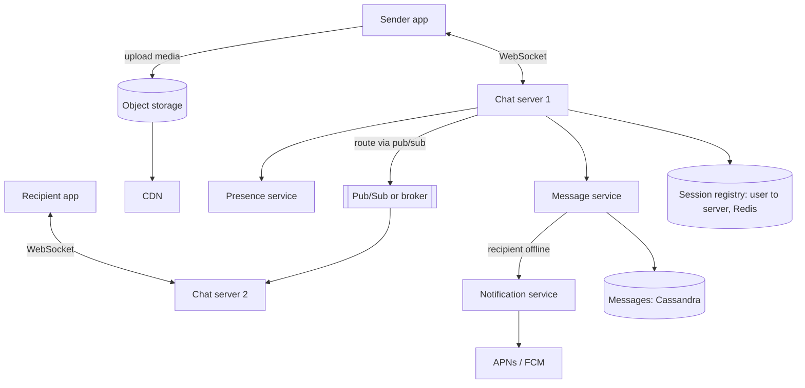

# My Notes: Case Study, Designing a Chat App like WhatsApp

> **Source:** Chapter V of *System Design* by Karan Pratap Singh ([github.com/karanpratapsingh/system-design](https://github.com/karanpratapsingh/system-design)): the WhatsApp case study.
>
> These notes are written fresh from that part of the book. The wording, numbers, examples and diagrams are my own, so go to the book for the original walkthrough.

---

## 1. What we're building

A **real-time messaging app**: one-to-one and group chats, media sharing, delivery and read ticks, online/last-seen status, and push notifications when the app is closed.

---

## 2. Requirements

### 2.1 Functional

- One-to-one chat and **group chat** (say up to 1,000 members).
- Text plus **media** (images, video, documents, voice notes).
- **Sent / delivered / read** receipts.
- **Online / last seen** presence.
- **Push notifications** for offline users.

### 2.2 Non-functional

- **Low latency** delivery: feels instant (< ~200 ms when both are online).
- **Highly available**, and **no message loss**: once the sender sees "sent", it must arrive.
- **Ordering** preserved within a conversation.
- **Privacy:** end-to-end encryption, so the server only relays ciphertext.
- Scales to hundreds of millions of concurrent connections.

### 2.3 Extended

Voice/video calls, message search, multi-device sync, backups, stories.

---

## 3. Estimation

My assumptions: **500M daily active users**, **40 messages per user per day**, average text message **~100 bytes**, and 5% of messages carry media averaging **~100 KB**.

| Quantity | Calculation | Result |
|---|---|---|
| Messages per day | 500M × 40 | **20 billion** |
| Messages per second | 20B / 86,400 | **~230k/s** average, peaks ~1M/s |
| Text storage per day | 20B × 100 B | **~2 TB/day** |
| Media per day | 1B media msgs × 100 KB | **~100 TB/day** |
| Ingress bandwidth | ~102 TB / 86,400 s | **~1.2 GB/s** |
| Concurrent connections | say 40% of DAU online at peak | **~200M open sockets** |

**Key takeaways:** a huge number of **persistent connections**, a very high message rate, and **media dominates** storage and bandwidth.

---

## 4. Data model

```text
users          (user_id, phone, name, avatar_url, last_seen_at)
chats          (chat_id, type: direct|group, created_at)
chat_members   (chat_id, user_id, role, joined_at)
messages       (chat_id, message_id (time-ordered), sender_id, type, body_ciphertext, media_url, created_at)
message_status (message_id, recipient_id, status: sent|delivered|read, updated_at)
```

**Which database?**
- `messages` is a huge append-only, time-ordered write stream read as "latest N in this chat". A **wide-column store** (Cassandra, HBase, ScyllaDB) partitioned by `chat_id` and clustered by `message_id` fits perfectly.
- Users, chats and memberships are relational and much smaller, so **Postgres/MySQL** (sharded by user or chat) works.
- **Message IDs** should be time-sortable and unique without coordination (Snowflake-style 64-bit IDs) so ordering within a chat is cheap.
- Like WhatsApp, the server can **delete messages once delivered** to all devices, which cuts storage to an undelivered queue plus optional encrypted backups.

---

## 5. API design

Messages flow over a **persistent WebSocket**. A small REST API handles everything else.

```text
GET  /v1/chats                           → my chats with last message and unread count
GET  /v1/chats/{chatId}/messages?before=  → paginated history
POST /v1/chats/{chatId}/members          → join / add to group
DEL  /v1/chats/{chatId}/members/{userId} → leave / remove
POST /v1/media/upload-url                → pre-signed URL for direct upload

WebSocket frames:
  → send      { clientMsgId, chatId, type, ciphertext, mediaUrl? }
  ← ack       { clientMsgId, messageId, status: sent }
  ← message   { messageId, chatId, sender, ciphertext, ... }
  → receipt   { messageId, status: delivered|read }
```

`clientMsgId` acts as an **idempotency key**, so a resend after a flaky connection doesn't create duplicates.

---

## 6. High-level design



### 6.1 Real-time messaging

1. Every online client holds a WebSocket to some **chat server**. The **session registry** records `user → chat server`.
2. Sender sends a message → chat server **persists it first** (message service), then **acks "sent"** (one tick).
3. The chat server looks up the recipient's server in the registry and routes the message via **pub/sub**.
4. The recipient's chat server pushes it down the socket. The recipient app replies "delivered" (two ticks), which flows back the same way.
5. If the recipient is **offline**, the message waits in their undelivered queue and the **notification service** sends a push. On reconnect, the client syncs everything since its last seen message ID.

Persisting **before** acking is what guarantees no loss: anything the sender saw as sent is durable.

### 6.2 Groups

- Small groups: the chat server **fans out** to each member's server (write the message once, deliver N times).
- Each member's delivered/read status is tracked separately, and the group shows read when all members have read it.
- Very large groups or channels switch to a pull model, since fanning out to huge audiences per message is expensive.

### 6.3 Presence and last seen

- A connected socket plus periodic **heartbeats** (every ~30 s) means online.
- No heartbeat for a while → offline, and store `last_seen_at`.
- Publish presence changes only to **people who have that chat open** (subscribe on demand). Broadcasting every status change to every contact would be a firehose.
- Respect privacy settings (hide last seen).

### 6.4 Read receipts

Receipts are just small messages flowing in reverse (`delivered`, `read`), batched and coalesced. "Read up to message X" covers everything before it.

### 6.5 Notifications

For offline users, send through Apple (APNs) and Google (FCM) push services. With end-to-end encryption, the payload is minimal or encrypted, and the app decrypts on wake.

---

## 7. Detailed design

- **Partitioning:** messages by `chat_id` (one chat's history on one partition, ordered). Users and sessions by `user_id` with consistent hashing.
- **Caching:** recent messages of active chats, session registry and presence in **Redis**. User profiles cached.
- **Media:**
  - The client gets a **pre-signed URL** and uploads straight to object storage (S3), encrypted on the device.
  - The message carries only the media URL and decryption key.
  - The recipient downloads via a **CDN**.
  - Generate thumbnails and compressed variants asynchronously.
- **API gateway** in front of the REST endpoints: auth, rate limiting, routing. WebSocket traffic goes through L4 load balancers to chat servers.
- **End-to-end encryption:** clients exchange keys (the Signal protocol is the well-known approach). Servers store and forward ciphertext only.

---

## 8. Bottlenecks and fixes

| Risk | Fix |
|---|---|
| Chat server dies, dropping its sockets | Clients reconnect to another server and re-sync from the last message ID; the registry updates |
| Session registry outage | Replicated Redis cluster; entries rebuilt from reconnecting clients |
| Message loss | Persist before ack; at-least-once delivery + client-side dedupe by `messageId` |
| Hot group chats | Fan-out workers, rate limits, switch to pull for huge groups |
| Media bandwidth | Client-side compression, CDN, resumable uploads |
| Regional outage | Multi-region deployment, users routed to the nearest healthy region |
| Thundering reconnect after an outage | Randomised reconnect backoff with jitter |

---

## 9. My cheat sheet

| Decision | Choice and why |
|---|---|
| Transport | WebSockets for live messages; REST for history and management |
| Routing | Session registry (user → server) + pub/sub between chat servers |
| Durability | Persist before "sent" ack; dedupe with client message IDs |
| Message store | Wide-column, partitioned by `chat_id`, time-ordered IDs |
| Offline users | Undelivered queue + APNs/FCM push, sync on reconnect |
| Presence | Heartbeats; publish only to interested viewers |
| Media | Pre-signed direct upload to object storage, served via CDN |
| Scale numbers | ~230k msgs/s, ~200M sockets, ~100 TB media/day |
