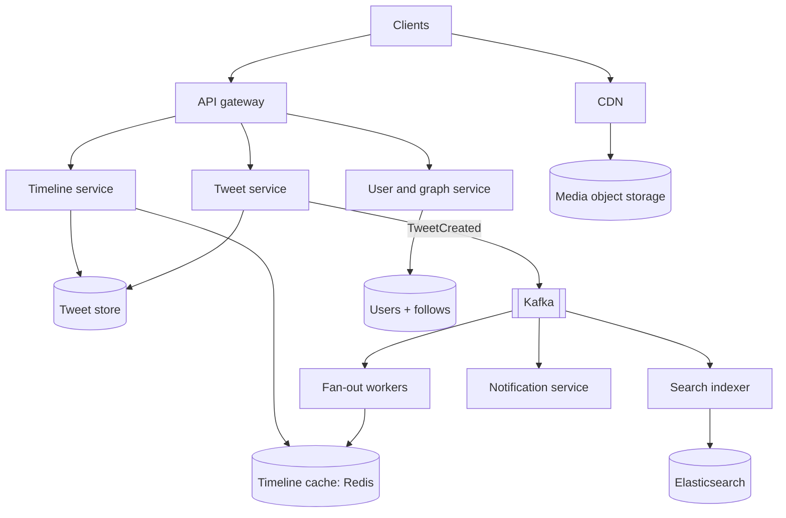
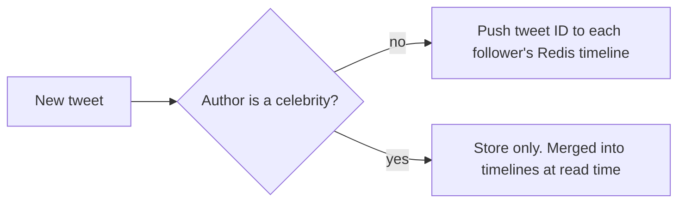

# My Notes: Case Study, Designing a Social Feed like Twitter

> **Source:** Chapter V of *System Design* by Karan Pratap Singh ([github.com/karanpratapsingh/system-design](https://github.com/karanpratapsingh/system-design)): the Twitter case study.
>
> These notes are written fresh from that part of the book. The wording, numbers, examples and diagrams are my own, so go to the book for the original walkthrough.

---

## 1. What we're building

A **microblogging platform**: users post short tweets (with media), follow others, and read a **home timeline** of tweets from people they follow. The heart of the problem is producing that timeline fast for hundreds of millions of people.

---

## 2. Requirements

### 2.1 Functional

- Post tweets (text up to 280 chars, optional images/video).
- Follow and unfollow users.
- **Home timeline:** recent tweets from followed accounts, optionally ranked.
- Like, reply, **retweet**.
- **Search** tweets.
- Notifications (new follower, mentions, likes).

### 2.2 Non-functional

- **Highly available**. A timeline that's a few seconds stale is acceptable (**eventual consistency** is fine).
- **Low-latency timelines** (< ~200 ms).
- **Extremely read-heavy:** people read far more than they post.
- Handle **celebrity accounts** with tens of millions of followers.

### 2.3 Extended

Trends, analytics, recommendations ("who to follow"), ads.

---

## 3. Estimation

My assumptions: **200M daily active users**, each posts **0.5 tweets/day** and loads the timeline **20 times/day**. Tweet text plus metadata is ~**300 bytes**, and 10% of tweets carry media averaging ~**500 KB**.

| Quantity | Calculation | Result |
|---|---|---|
| Tweets per day | 200M × 0.5 | **100M/day ≈ 1,200 writes/s** |
| Timeline reads | 200M × 20 | **4B/day ≈ 46k reads/s** (peaks 2–3× higher) |
| Read:write ratio | 46k : 1.2k | **~40:1** |
| Text storage | 100M × 300 B | **~30 GB/day** → ~55 TB over 5 years |
| Media storage | 10M × 500 KB | **~5 TB/day** |
| Timeline egress | 46k/s × 20 tweets × 300 B | ~280 MB/s (media served separately by the CDN) |

**Key takeaway:** reads dominate, so **precompute timelines** and cache aggressively. Media is the biggest storage cost, so use object storage and a CDN.

---

## 4. Data model

```text
users    (user_id, handle, name, bio, followers_count, following_count, created_at)
tweets   (tweet_id (Snowflake, time-sortable), user_id, text, media_ids, reply_to, retweet_of, created_at)
follows  (follower_id, followee_id, created_at)        -- both directions indexed
likes    (user_id, tweet_id, created_at)
media    (media_id, owner_id, type, url, width, height)
```

**Which databases?**
- Users and follows: relational (sharded by `user_id`), or a graph store for social queries.
- Tweets: huge, append-heavy, fetched by ID or by author and time → a **wide-column store** or sharded SQL keyed by `tweet_id` / `user_id`.
- Timelines: **Redis** lists of tweet IDs per user.
- Search: **Elasticsearch**. Media: **object storage + CDN**.
- **Snowflake IDs** (timestamp + machine + sequence) are unique without coordination and sort by time, which feeds need.

---

## 5. API design

```text
POST   /v1/tweets                 { text, mediaIds?, replyTo? }       → 201 { tweetId }
POST   /v1/tweets/{id}/retweet                                          → 201
POST   /v1/users/{id}/follow                                            → 204
DELETE /v1/users/{id}/follow                                            → 204
GET    /v1/timeline/home?cursor=…&limit=20                              → { tweets[], nextCursor }
GET    /v1/search?q=…&cursor=…                                          → { tweets[], nextCursor }
```

Cursor-based pagination (using the last tweet ID) is stable even while new tweets keep arriving.

---

## 6. High-level design



### 6.1 The newsfeed problem: push vs pull

**Fan-out on read (pull):** when you open the app, fetch recent tweets from everyone you follow and merge them.
- Cheap writes, always fresh.
- **Slow reads:** following 500 accounts means 500 lookups per timeline load, at 46k loads/s.

**Fan-out on write (push):** when someone tweets, insert the tweet ID into **each follower's** precomputed timeline in Redis.
- **Timeline read = one cache read**, which is very fast.
- A celebrity with 50M followers creates **50M writes per tweet**, delayed and expensive, and wasted on inactive followers.

**Hybrid, the practical answer:**
- Normal users → **push** to followers' cached timelines.
- **Celebrities** (above a follower threshold) → **pull**: their tweets are merged in at read time.
- Only push to **active** users. Rebuild inactive users' timelines on demand when they return.



### 6.2 Ranking

A chronological feed just sorts by tweet ID. A **ranked** feed scores candidate tweets with signals such as recency, engagement (likes, replies, retweets), your affinity with the author, media type, and what you've engaged with before. Usually that's a lightweight ML model over a candidate set pulled from the cached timeline.

### 6.3 Retweets

A retweet is a small record pointing to the original (`retweet_of`). It fans out like a tweet, but timelines display the original content, so there's **no duplicated content** and counts stay on the original.

### 6.4 Search

New tweets flow from Kafka to an **indexer** that tokenises the text and writes to **Elasticsearch** (inverted index). Recent tweets matter most, so the index is partitioned by time, with recent shards kept hot. Results are ranked by relevance plus recency and engagement.

### 6.5 Notifications

Events (follow, like, mention, reply) go through Kafka to a **notification service** that batches and deduplicates them ("Riya and 12 others liked your tweet"), stores them in an in-app inbox, and sends push notifications via APNs/FCM.

---

## 7. Detailed design

- **Partitioning:**
  - Tweets sharded by `tweet_id` (even spread). Add an index by `user_id` for profile pages, or shard by `user_id` and accept hotter shards for prolific users.
  - Timelines sharded by `user_id`.
  - Follows indexed both ways (followers of X, followees of X).
- **Mutual friends / who to follow:** graph queries on the follow graph ("followers of people you follow"), precomputed offline in batch jobs, or served from a graph store.
- **Caching:**
  - Timeline cache (last ~800 tweet IDs per active user).
  - Tweet object cache (hydrate IDs → full tweets).
  - User profile cache.
  - Counters (likes, retweets) in Redis, flushed to the DB periodically.
- **Media:** direct upload to object storage via pre-signed URLs, async transcoding and thumbnails, delivered by **CDN**.
- **Metrics and analytics:** stream events (impressions, engagement) to a data warehouse for trends, ads and recommendations.

---

## 8. Bottlenecks and fixes

| Risk | Fix |
|---|---|
| Celebrity fan-out storm | Hybrid push/pull; push only to active followers |
| Viral tweet (hot key) | Replicate the hot tweet in cache across nodes; CDN for media |
| Timeline cache loss | Rebuild from the tweet store + follow graph on demand; Redis replicas |
| Kafka lag delays timelines | Partition by user, autoscale fan-out workers, monitor consumer lag |
| Search index lag | Acceptable seconds of delay; separate real-time and archive indexes |
| Counter contention (likes) | Sharded counters, batched increments |
| Region failure | Multi-region with replicated data; serve slightly stale timelines rather than errors |

---

## 9. My cheat sheet

| Decision | Choice and why |
|---|---|
| Shape | ~40:1 read-heavy; eventual consistency acceptable |
| Feed strategy | Hybrid: push for normal users, pull for celebrities |
| Timeline storage | Redis lists of tweet IDs per active user |
| IDs | Snowflake: unique, time-sortable, no coordination |
| Retweet | Pointer to the original, not a copy |
| Search | Kafka → indexer → Elasticsearch, time-partitioned |
| Media | Object storage + CDN, async transcoding |
| Scale numbers | ~1.2k tweets/s, ~46k timeline reads/s, ~5 TB media/day |
