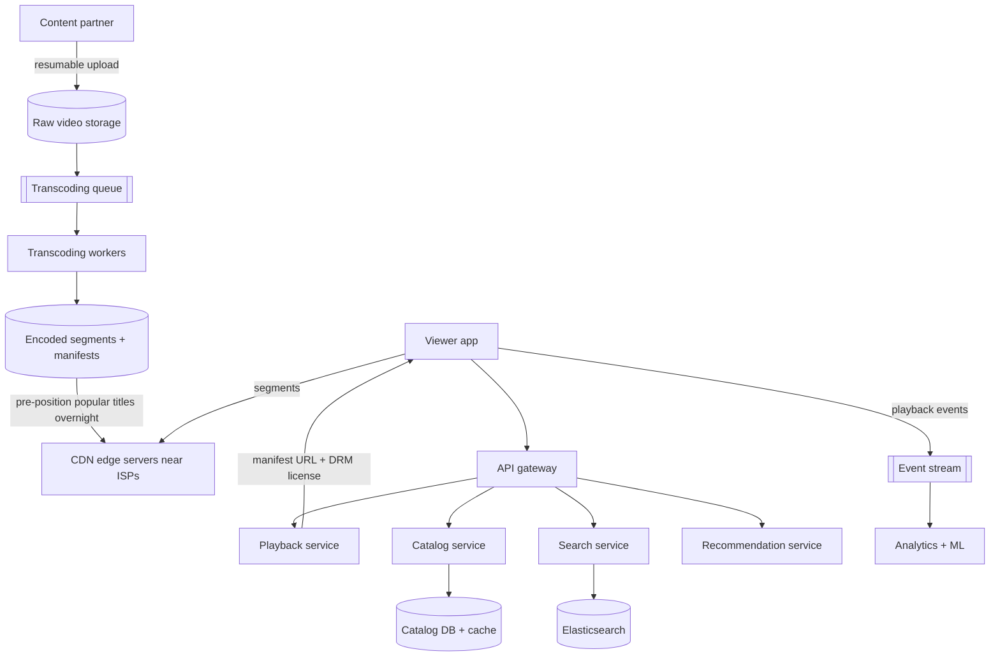
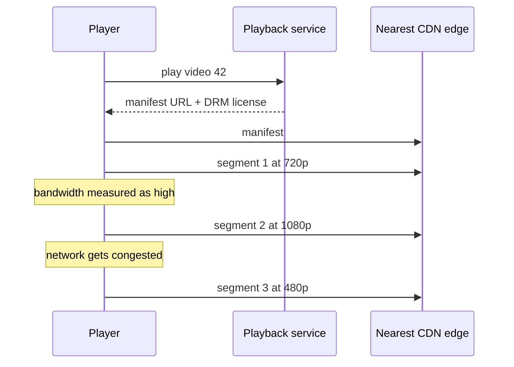

# My Notes: Case Study, Designing a Video Streaming Service like Netflix

> **Source:** Chapter V of *System Design* by Karan Pratap Singh ([github.com/karanpratapsingh/system-design](https://github.com/karanpratapsingh/system-design)): the Netflix case study.
>
> These notes are written fresh from that part of the book. The wording, numbers, examples and diagrams are my own, so go to the book for the original walkthrough.

---

## 1. What we're building

A **video-on-demand streaming service**: content partners upload titles, and viewers browse, search and **stream** them smoothly on any device and network, worldwide. Video delivery is the core problem: it's by far the heaviest part.

---

## 2. Requirements

### 2.1 Functional

- Content partners/admins **upload** videos (films, episodes) with metadata.
- Users **stream** videos on web, mobile and TV, resuming where they left off.
- **Search** the catalog. Users can add **comments/ratings** and **share** titles.
- **Personalised recommendations** on the home screen.

### 2.2 Non-functional

- **Smooth playback:** fast start (< ~2 s), minimal buffering, quality adapted to the network.
- **Highly available** browsing and playback. Catalog metadata can be eventually consistent.
- **Global scale**, with **geo-restrictions** honouring licensing per country.
- Uploaded content is **never lost** (durable storage).

### 2.3 Extended

Downloads for offline viewing, multiple profiles, parental controls, A/B testing artwork, analytics on viewing quality.

---

## 3. Estimation

My assumptions: **200M daily active users**, **~5 plays per user per day**, **10k new videos uploaded per day** at ~**1 GB** raw each, and peak concurrency of **20M streams** at ~**5 Mbps** average.

| Quantity | Calculation | Result |
|---|---|---|
| Plays per day | 200M × 5 | **1B/day ≈ 12k play starts/s** |
| Raw upload storage | 10k × 1 GB | **~10 TB/day** |
| Encoded renditions | ~3× raw across resolutions and codecs | **~30 TB/day** more |
| Peak egress | 20M × 5 Mbps | **~100 Tbps** (!) |
| Catalog metadata | ~a few million titles × ~10 KB | Small (tens of GB) |

**Key takeaway:** egress bandwidth is enormous, so no central data centre can serve it. **Video must be served from CDN servers placed close to users** (Netflix built its own CDN, Open Connect, inside ISPs). Everything else (catalog, search, accounts) is a comparatively ordinary web backend.

---

## 4. Data model

```text
users          (user_id, email, plan, country, created_at)
profiles       (profile_id, user_id, name, maturity_level)
videos         (video_id, title, description, duration, genres[], cast[], release_year, available_regions[])
video_assets   (video_id, rendition: 1080p-h264 | 4k-hevc | ..., manifest_url, drm_key_id)
watch_history  (profile_id, video_id, position_seconds, updated_at)
comments       (comment_id, video_id, profile_id, text, created_at)
```

**Which databases?**
- Account and billing data → **relational** (strong consistency).
- Catalog metadata → relational or document store, **heavily cached**.
- Watch history and "continue watching" → huge write volume keyed by profile → **wide-column** (Netflix famously uses Cassandra).
- Video files → **object storage**. Search → **Elasticsearch**.

---

## 5. API design

```text
POST /v1/videos                      (partner) { metadata } → { videoId, uploadUrl }   -- resumable multipart upload
GET  /v1/videos/{id}/play            → { manifestUrl (CDN), drmLicenseUrl, resumeAt }
PUT  /v1/profiles/{id}/progress      { videoId, positionSeconds }                        -- sent every ~10 s
GET  /v1/search?q=…&cursor=…         → { videos[], nextCursor }
POST /v1/videos/{id}/comments        { text } → 201
```

The `play` endpoint doesn't stream bytes. It returns a **manifest URL on the CDN**, and the player fetches video segments directly from there.

---

## 6. High-level design



### 6.1 Video processing pipeline

1. **Upload:** resumable, chunked uploads into raw object storage. Verify checksums.
2. **Split** the source into chunks (a few seconds or a scene each) so encoding runs **in parallel** across many workers.
3. **Transcode** each chunk into a **bitrate ladder**: multiple resolutions (240p → 4K) and codecs (H.264, HEVC, VP9/AV1) for different devices and networks.
4. **Package** into streaming formats (**HLS / MPEG-DASH**): small segments (2–6 s) plus **manifest** files listing every rendition.
5. **Encrypt (DRM)**, generate thumbnails, subtitles and audio tracks.
6. **Publish** metadata and push popular content to CDN edges.

The pipeline is a set of queue-driven workers with retries, so a failed chunk is re-encoded, not the whole film.

### 6.2 Streaming: adaptive bitrate



The **player** chooses the rendition for each segment based on measured bandwidth and buffer level. That's **adaptive bitrate (ABR)** streaming: it drops quality instead of stopping to buffer.

### 6.3 Search and sharing

- Catalog changes are indexed into **Elasticsearch** (title, cast, genre, description), with typo tolerance and per-user filtering (region, maturity level).
- **Sharing** creates a deep link to the title page. The link resolves through the normal catalog and playback checks, so geo and plan restrictions still apply.

---

## 7. Detailed design

- **Partitioning:** watch history and progress by `profile_id`. The catalog is small enough to replicate everywhere. Comments by `video_id`.
- **Geo-blocking:** each title carries the **regions where it's licensed**. The playback service checks the user's country (account plus IP geolocation) before issuing a manifest, and CDN URLs are **signed and short-lived** so they can't be shared across regions.
- **Recommendations:**
  - Offline ML jobs (collaborative filtering and deep models over viewing history) precompute candidate rows per profile.
  - An online service re-ranks them with fresh context (time of day, device, what was just watched).
  - Even artwork is personalised and A/B tested.
- **Metrics and analytics:** players stream **quality-of-experience** events (start time, rebuffering, bitrate switches, errors) to Kafka → real-time dashboards and alerts, and into the data warehouse.
- **Caching:**
  - Catalog and home-page rows in Redis/memcached at the API layer.
  - Video segments at the CDN, popular titles **pre-positioned** during off-peak hours.
  - Long-tail titles fetched from origin on demand.
- **Media storage:** object storage with cross-region replication for the masters, which are irreplaceable.

---

## 8. Bottlenecks and fixes

| Risk | Fix |
|---|---|
| Egress cost and congestion | Own or partner CDN inside ISPs; pre-position popular titles off-peak |
| New hit release spikes | Pre-warm CDNs before launch; stagger by region |
| Transcoding backlog | Parallel chunked encoding, autoscaled workers, priority queues |
| Playback API outage | Multi-region, active-active; cached manifests; graceful fallbacks |
| Recommendation service slow | Serve precomputed rows or popular-in-your-country as a fallback |
| Lost progress updates | Idempotent periodic writes; the last write per profile and video wins |
| Region failure | Evacuate traffic to other regions (Netflix runs regular failover drills) |

---

## 9. My cheat sheet

| Decision | Choice and why |
|---|---|
| Delivery | CDN edges close to users; the backend never streams bytes |
| Encoding | Chunked parallel transcoding into a bitrate ladder + multiple codecs |
| Format | HLS / DASH: short segments + manifests |
| Playback | Adaptive bitrate chosen by the player per segment |
| Protection | DRM + signed, short-lived CDN URLs |
| Geo-blocking | Licensed regions per title, checked at play time |
| Watch history | Wide-column store keyed by profile |
| Scale numbers | ~12k play starts/s, ~100 Tbps peak egress, ~40 TB/day of new video data |
