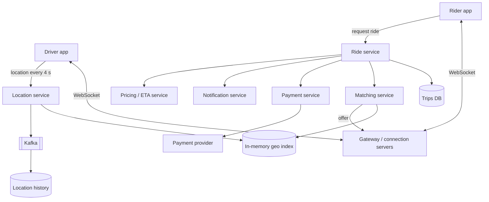
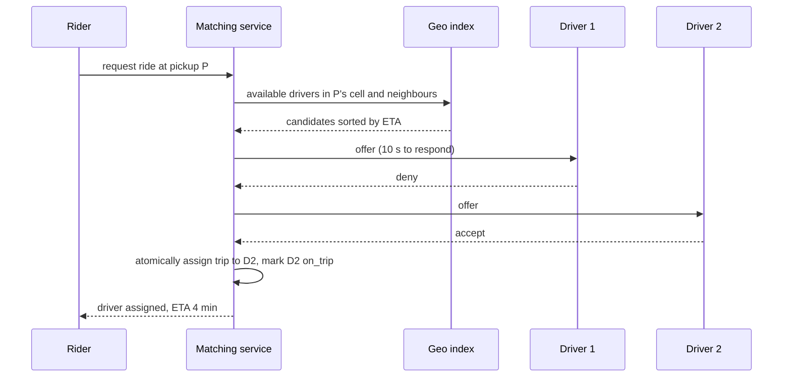

# My Notes: Case Study, Designing a Ride-Hailing Service like Uber

> **Source:** Chapter V of *System Design* by Karan Pratap Singh ([github.com/karanpratapsingh/system-design](https://github.com/karanpratapsingh/system-design)): the Uber case study.
>
> These notes are written fresh from that part of the book. The wording, numbers, examples and diagrams are my own, so go to the book for the original walkthrough.

---

## 1. What we're building

A **ride-hailing platform**: riders request a ride, the system **matches them with a nearby driver**, both see each other's live location, the trip happens, the rider pays, and both rate each other. The hard parts are **real-time location at scale** and **fast, fair matching**.

---

## 2. Requirements

### 2.1 Functional

- **Riders:** see nearby drivers, request a ride with pickup and drop-off, see the price estimate and ETA, track the driver live, cancel, pay, rate.
- **Drivers:** go online/offline, receive ride requests, **accept or deny**, navigate, start and end trips, get paid, rate riders.

### 2.2 Non-functional

- **Low latency** matching (seconds) and live location updates.
- **Highly available:** a down app strands people.
- **Consistent** where it matters: a ride is assigned to **exactly one** driver, and payments are correct.
- Scales across many cities with very different densities.

### 2.3 Extended

Surge pricing, ride sharing (pool), scheduled rides, fraud detection, safety features, driver earnings dashboards.

---

## 3. Estimation

My assumptions: **100M riders** and **1M drivers** in total, **10M rides per day**, and **400k drivers online at peak**, each sending a location update **every 4 seconds**.

| Quantity | Calculation | Result |
|---|---|---|
| Ride requests | 10M / 86,400 | **~120 rides/s** average (peaks several × higher) |
| Location updates | 400k / 4 s | **~100k updates/s** |
| Location update size | driver ID + lat/lng + heading + timestamp | ~50 bytes → ~5 MB/s ingest |
| Trip records | 10M/day × ~1 KB | **~10 GB/day** |
| Location history (optional) | 100k/s × 50 B × 86,400 | ~430 GB/day |

**Key takeaway:** ride creation is modest. The challenge is the **firehose of location updates** and answering "which available drivers are near this point?" thousands of times per second.

---

## 4. Data model

```text
riders     (rider_id, name, phone, rating, payment_method_id)
drivers    (driver_id, name, vehicle, license_plate, rating, status: offline|available|on_trip)
trips      (trip_id, rider_id, driver_id, status, pickup, dropoff, fare, requested_at, started_at, ended_at)
payments   (payment_id, trip_id, amount, currency, status, provider_ref)
ratings    (trip_id, from_user, to_user, stars, comment)
driver_locations (live, in memory): driver_id → (lat, lng, geohash cell, updated_at)
```

**Which databases?**
- Trips and payments → **relational** with transactions (correct state machine, money).
- Live driver locations → **in-memory geo index** (Redis geo or a custom quadtree/H3 index), constantly overwritten.
- Location history and analytics → wide-column or time-series storage, written asynchronously.

---

## 5. API design

```text
POST /v1/rides                       { pickup, dropoff, rideType } → 201 { rideId, estimate, status: searching }
POST /v1/rides/{id}/cancel                                          → 200 { cancellationFee? }
POST /v1/rides/{id}/accept           (driver)                       → 200   -- or 409 if already taken
POST /v1/rides/{id}/deny             (driver)                       → 204
POST /v1/rides/{id}/start            (driver)                       → 200
POST /v1/rides/{id}/end              (driver)                       → 200 { fare }
POST /v1/rides/{id}/rating           { stars, comment }             → 201

WebSocket:  driver → server  { location }       every ~4 s
            server → rider   { driverLocation, eta }
            server → driver  { rideOffer }
```

---

## 6. High-level design



### 6.1 How a ride flows

1. Rider opens the app and sees nearby cars (a geo query on the location index) plus price and ETA from the **pricing service**.
2. Rider requests a ride. The **ride service** creates a trip in `SEARCHING` state.
3. The **matching service** finds candidate drivers near the pickup and sends the best one an offer.
4. Driver accepts within ~10 s, or the offer goes to the next candidate.
5. Trip moves to `DRIVER_ASSIGNED` → `ARRIVED` → `IN_PROGRESS` → `COMPLETED`, with live locations streamed to both apps.
6. On completion, the fare is computed, payment is charged, and both parties are prompted to rate.

### 6.2 Location tracking

- Drivers push GPS updates **every few seconds** over a persistent connection.
- The location service **overwrites** each driver's current position in the in-memory geo index (cells via **geohash**, quadtree or H3 hexagons, see the geospatial chapter), and publishes updates to Kafka for history, ETA models and analytics.
- During a trip, the rider's app subscribes to that one driver's updates.

### 6.3 Ride matching



- Rank candidates by **ETA on roads** (not straight-line distance), driver rating, and how long they've been idle.
- **Exactly-one assignment:** use a conditional update (`UPDATE trips SET driver_id = ? WHERE id = ? AND driver_id IS NULL`) or a lock per driver/trip, so two drivers can't accept the same ride and one driver can't get two rides.
- Expand the search radius if no one accepts.

### 6.4 Payments

- Pre-authorise the rider's card at request time, and **capture** the final fare at trip end.
- Calls to the payment provider use **idempotency keys** (the trip ID), so retries never double-charge.
- Driver payouts are batched asynchronously.
- Payment status follows its own state machine, and failures trigger retries or a "settle later" flow.

### 6.5 Notifications

Push notifications (APNs/FCM) for offers when the app is backgrounded, driver arriving, trip receipts. Real-time updates go over the open socket when the app is in the foreground.

---

## 7. Detailed design

- **Partitioning:**
  - Geo index sharded **by city or region** (most queries are local).
  - Trips sharded by `trip_id` or by city.
  - Riders and drivers by user ID.
- **Caching:** driver profiles, pricing parameters and surge multipliers per cell, and map/ETA tiles in Redis or in memory.
- **Surge pricing:** compare demand (requests) to supply (available drivers) per geo cell every minute, and set a multiplier to rebalance.
- **Metrics and analytics:** trip events and location streams feed the data warehouse for ETA model training, demand forecasting, fraud detection and city operations dashboards.
- **State machines everywhere:** trip and payment status transitions are explicit and validated, which makes retries and recovery safe.

---

## 8. Bottlenecks and fixes

| Risk | Fix |
|---|---|
| Location update firehose | In-memory index, sharded by region; batched writes to history via Kafka |
| Geo index node failure | Replicas per shard; drivers re-send locations every few seconds, so it rebuilds quickly |
| Double assignment | Atomic conditional update or a distributed lock on driver and trip |
| Dense events (concert ends) | Hot cells split finer (quadtree), queue requests, surge pricing |
| Payment provider outage | Retry with idempotency keys; let the trip complete and settle the charge later |
| Connection server failure | Clients reconnect to another server; trip state lives in the DB, not the socket |
| Regional outage | Cities served from multiple zones; fail over per region |

---

## 9. My cheat sheet

| Decision | Choice and why |
|---|---|
| Live locations | Drivers push every ~4 s; in-memory geo index (geohash/quadtree/H3) |
| Matching | Nearby available drivers ranked by road ETA, offered one at a time |
| Exactly-one driver | Conditional update / lock on the trip and driver |
| Trips + payments | Relational with transactions; explicit state machines |
| Payments | Pre-auth then capture; idempotency key = trip ID |
| Sharding | By city or region, since nearly all queries are local |
| Scale numbers | ~120 rides/s, ~100k location updates/s |
